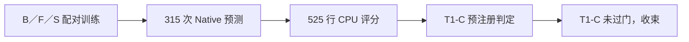

# Cranial-BCSP-FullMamba SCQ-PRIME T1-C 结题记录

2026-11-22 · Fold C · seed `2026112101` · 判定 `T1_C_FAIL_STOP`

## 📋 结题决定

SCQ-PRIME T1-C 的训练、Native 预测、统一评分和预注册判定已完成。本轮在 Fold C 收束。S 相对 B 有实用收益，但真实相对几何通道相对等容量固定投影 F 的增益未达到预算门，且接口与严重病例约束出现回退。按预注册计划，第 8.1 节未通过时停止后续 Fold D 与第二种子验证。[预注册方案](evidence/plan.md) · [逐项判定回执](evidence/BFS_C_T1C_preregistered_gate_v1.json)

## 🔬 实验范围与比较含义

| 臂 | 处理 | 可训练参数 |
|---|---|---:|
| B | 原 LQI FullMamba 基线 | 39,903,169 |
| F | 局部 Memory 读取、SCQ 残差头与七维固定投影 | 40,596,676 |
| S | 与 F 共用局部读取和残差头，七维输入使用真实相对几何 | 40,596,676 |

三臂使用同一 GPU 和驱动、相同母版初态与 3900 步的完整批次顺序。F 与 S 的完整参数及持久状态初始指纹相同。每臂 100 轮、31,200 次样本曝光及 300 个丢弃槽位。开发集为同一批 SkullBreak 105 例、21 个来源。评分在原世界毫米坐标进行，使用 D-only 逆归一化，不做 GT 配准。每来源的五类缺损等权，21 个来源再等权。95% 区间来自 2,000 次来源级配对 bootstrap。[B_C 冻结回执](evidence/B_C_post_training_freeze_receipt_v1.json) · [F_C 冻结回执](evidence/F_C_post_training_freeze_receipt_v1.json) · [S_C 冻结回执](evidence/S_C_post_training_freeze_receipt_v1.json) · [预测冻结回执](evidence/BFS_C_post_prediction_freeze_receipt_v1.json) · [评分冻结回执](evidence/BFS_C_post_scoring_freeze_audit_v1.json)

## 📊 三臂结果与预注册判定

| 臂 | E P95 (mm) | J P95 (mm) | J Cover@2 (%) | Pred→A2 P95 (mm) | Pred→A2 >20 mm (%) | 严重例 |
|---|---:|---:|---:|---:|---:|---:|
| B | 11.349 | 14.446 | 43.085 | 14.248 | 7.831 | 18／105 |
| F | 7.695 | 10.577 | 51.117 | 10.861 | 3.831 | 4／105 |
| S | 8.496 | 11.176 | 45.749 | 11.331 | 4.757 | 6／105 |

| 对比 | Δ E P95 (mm) | 95% 来源 bootstrap 区间 (mm) | E 改善来源 | 严重事件新增／挽回／共同 |
|---|---:|---|---:|---|
| S−B | −2.853 | [−4.435, −1.477] | 17／21 | 1／13／5 |
| S−F | +0.801 | [−0.511, +2.032] | 7／21 | 3／1／3 |
| F−B | −3.654 | [−5.371, −1.969] | 18／21 | 1／15／3 |

S−B 的实用收益门及接口、反向和严重事件约束通过。F 满足等容量核验，F−B 的对照解释门通过。S−F 的反向 P95 为 +0.469 mm，符合 ≤ +0.50 mm 的上限。以下六项 S−F 约束未通过。

| 指标 | 实测 | 预注册要求 |
|---|---:|---:|
| E P95 | +0.801 mm | ≤ −0.25 mm |
| J P95 | +0.599 mm | ≤ +0.25 mm |
| J Cover@2 | −5.368 pp | ≥ −0.50 pp |
| Pred→A2 >20 mm | +0.926 pp | ≤ +0.25 pp |
| 严重总数 | 4 → 6 | 不增加 |
| 新增严重 | 3／105 | ≤ 2／105 |

表中数值仅用于展示。机器判定使用未四舍五入的冻结结果。[完整配对统计](scores/paired_comparisons.json) · [逐项判定](evidence/BFS_C_T1C_preregistered_gate_v1.json)

## ⚠️ 新增严重病例

严重事件定义为 E P95 >20 mm 或 J Cover@2 = 0。下表覆盖三项对比中的全部新增事件。病例 ID 对应固定开发集。

| 对比 | 病例 | E P95 (mm) | J Cover@2 (%) |
|---|---|---:|---:|
| S−B | `train__013__parietotemporal` | 3.97 → 48.12 | 72.32 → 0.61 |
| S−F | `train__013__parietotemporal` | 7.81 → 48.12 | 35.41 → 0.61 |
| S−F | `train__038__random_1` | 18.06 → 23.89 | 33.18 → 26.01 |
| S−F | `train__066__frontoorbital` | 8.14 → 51.67 | 49.21 → 1.48 |
| F−B | `train__107__parietotemporal` | 19.67 → 22.90 | 37.70 → 41.65 |

## 🧭 科研解读与证据边界

Fold C 的证据支持 SCQ 组合相对 B 的开发集增量。与 F 配对后，当前实验未支持真实相对几何通道的额外收益。S−F 主指标区间跨零，作用大小及方向仍有来源抽样不确定性。过门取舍还考虑接口与严重尾部，因此收束决定独立于统计显著性。

F−B 同时改变了局部读取、残差路径和固定投影。当前折与种子下的收益可以作为新假设的依据，各组件贡献仍待单独验证。后续若立项，可先复用已有预测检查 S−F 新增严重病例的 `Qraw → Qused → dense` 轨迹，区分残差放大与密点阶段退化。本轮归档无新增预测、训练或评分。

## 📁 归档内容

- [评分明细](scores/case_metrics.jsonl)、[CSV](scores/case_metrics.csv)、[来源汇总](scores/source_metrics.json)及[配对汇总](scores/paired_comparisons.json)。
- [校验清单](SHA256SUMS)和[逐文件归档记录](archive_manifest_v1.json)保存归档相对路径、字节数与 SHA256。
- [三份最终 checkpoint 校验回执](checkpoints/checkpoint_verification_v1.json)记录服务器源路径及本机摘要。权重按字节校验。
