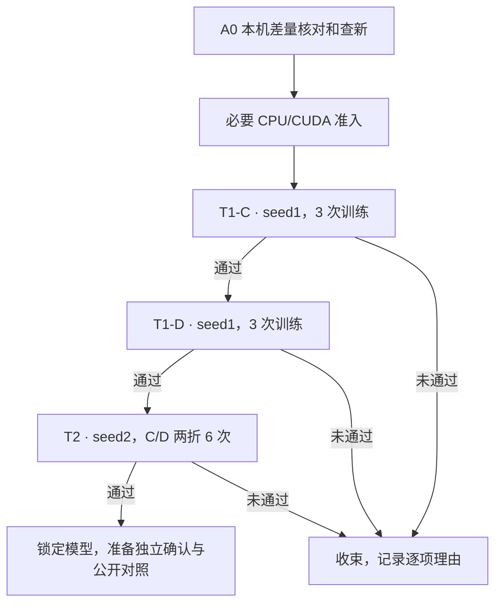

# Cranial-BCSP-FullMamba · SCQ-PRIME 正式实验计划书

**版本**　审阅修订 v2.0，2026-11-21  
**状态**　待确认，尚未执行。现场资产、执行请求及授权另行冻结。  
**对象**　SkullBreak BCSP Geo-V1 中由残骨完整组织边界预测缺失骨块完整边界。  
**决定**　保留原始 SCQ-S 为待验证论文候选，先检验复现、同容量通道贡献及尾部风险。

## 1. 审阅结论

原稿的方向合理。原始 B/S 开发对照中，S 的 E P95 在 C/D 分别下降 **5.055／1.813 mm**，J Cover@2 提高 **11.11／5.62 个百分点**，E 改善来源为 **15／21、18／21**。C 折严重病例 11→3，挽回 10、新增 2。D 折 5→2，挽回 3、新增 0。单 seed、反复使用的开发来源以及未训练 F，限制了论文主张。[SCQ B/S 冻结报告](../cranial_bcsp_scq_BS_20261114/SCQ_BS_阶段正式实验报告_zh_v1.md)

| 草案的执行风险 | 修订决定 |
|---|---|
| 第一批直接投入两折六次 | 两折、两个新 seed 事前固定，先跑 C 折三臂。C 同时有最大历史收益、基线差异及新增严重病例，适合作先行筛查。未过门只终止追加预算，未执行的 D 折效应未知。 |
| 历史 LQI 与重训 B 之间的差值易被误解 | C 折两次 E P95 为 7.338 和 11.743 mm，差 4.405 mm。对两批归档做差量核对，将两者作为非配对背景。新 B 在同一格与 F/S 匹配，方可归因。 |
| F 被称为非几何对照 | F 保留基于坐标的近邻、Qraw 和已编码空间信息。其七维固定投影由已经进入头的局部均值特征计算，通道分布及梯度路径与 S 不同。S−F 估计相对这个特定控制的增量。 |
| 草案给了新 seed，但原训练入口、随机数初始化和回执存在固定 0 | 明确适配完整 seed 链，核验实际传入值与初态差异。保留历史投影字节和原生产 KNN。 |
| 事后跨 seed 平均可能掩盖坏格 | 接口、反向和严重守护逐格分别对 B/F 判定。另设 F 明显劣于 B 的解释状态。 |
| 旧权重回放既是硬门又是可选，查新偏晚，确认方案允许直接“平均预测” | 冻结数学图、来源、损失和评分是硬前提，旧权重复演可选。把关键文献查新的第一轮移到首批训练前。确认预锁单一三臂权重组合。 |

RF/RIVE 检验第二次反馈，SPCG/TRACE/CIUA 检验粗生成和条件读出，PCAT/FCSP 检验密阶段覆盖。它们解释本项目曾遇到的风险，不能替代原始 SCQ 的配对复现。[跨阶段复盘](../../outputs/cross_stage_review_20261121_v1/BCSP_跨阶段证据复盘与最小投稿验证路线_zh_v1.md)

## 2. 研究假设与对照

| 比较 | 对照定义 | 可以支持的主张 |
|---|---|---|
| S−B | B 为原 LQI FullMamba。S 加局部 Memory 读取和真实相对几何残差。 | SCQ 组合在固定主干上的实用增量。 |
| S−F | F 与 S 的残差头、局部读取、参数初态一致，仅替换附加七维通道。 | 真实相对几何通道相对固定投影控制的训练后增量。 |
| F−B | 加入活跃投影和局部条件残差的组合。 | 检查 F 的工作表现及共享设计的价值。局部读取与容量贡献仍未拆开。 |

B 可训练参数 **39,903,169**，F/S 各 **40,596,676**，新增 **693,507**。H-P 为 S−B 的实用收益，H-G 为 S−F 的通道收益，H-R 为二者不伴随不可接受的接口和严重尾部退化。若论文另称 SCQ 的收益是 Mamba 特有的，需要主干×SCQ 的交互对照，超出本轮范围。

## 3. 任务及数据

- **表示。** 以残骨实体 D 的完整组织边界预测缺失骨块 G 的完整边界。E 是 G 继承的自由表面，J 是共享切壁。V1 按暴露体素面的世界物理面积采样，输入、目标各 8,192，粗点 256，密点每父 32。归一化中心和尺度由 D 决定。G 用于原损失和离线评分。推理仅使用 D 及其内部表示，不读 GT 切壁、中心、范围或用于配准的真值。
- **开发来源。** 固定开放 84 来源×5 类缺损。C/D 各 63 个训练来源／315 例、21 个开发来源／105 例，开发来源互斥、训练来源重叠。清单必须核对逐来源五种缺损、折内来源互斥、输入和监督哈希、逆变换及评分参考。C/D 始终是已曝光开发集。
- **封存来源。** A0 只核对台账、来源 ID、训练交集、历史曝光及许可。区分项目所称 confirmation20 和历史 O0 排序曾使用的官方测试，关系未核实则保留并说明。来源身份和权限审核完成前不读封存 GT。
- **SkullFix。** 数据论文注明发布的 SkullFix 与 SkullBreak 两轨不重叠且均由 CQ500 派生。仍需确认本机副本的发布版本、来源映射、历史使用与 E/J 参考。固定模型直接迁移和目标域重训是两个实验。MUG500+ 不纳入本轮主检验。[原始数据论文](https://pmc.ncbi.nlm.nih.gov/articles/PMC8100897/)

## 4. 数学和执行合同

使用原生 KNN 8，从已学习的 Qraw 查询实际编码 Memory。Memory 坐标为 256×3、特征为 256×384，全局 z 为 1,024 维。选择邻居沿用历史无梯度的原生 topk 路径及实际并列行为。逐 token 无仿射 LayerNorm（eps=1e−5）后，计算邻域特征均值 fa 和逐维最大 fm。若邻居相对偏移为 d_j=S_j−Qraw，S 的附加通道由三维均值 μ、三维 sqrt(mean[(d_j−μ)²]+1e−6) 和一维平均欧氏距离构成；F 用 LN(fa) @ Pfix.T，其中 Pfix 是固定 7×384 buffer。头输入 [z, fa, fm, Qraw, channel] 共 1,802 维，MLP 为 **1802→384→3**，精确 GELU，末层权重和偏置为零，得到 Qused=Qraw+δ。

继承历史原生消费者。分别对照 Query 特征、位置、排序、解码近邻、密点生成中心及 coarse loss 的真实输入。区分 Qraw 查询 Memory 和 Qused 的消费者。原训练损失使用 PyTorch cdist Chamfer 的 coarse+dense 重建，关闭去噪，无新增位置、切壁、厚度或尺度监督。权重及归约以历史生产代码核实为准。发现数学图或损失不一致时记录差异，停止按历史候选身份执行。 [残差源码](../../outputs/cranial_bcsp_scq_implementation_20261113_v1/bcsp_scq_residual_v1.py) · [历史初始化清单](../../outputs/cranial_bcsp_scq_implementation_20261113_v1/initialization_manifest_v1.json)

### 4.1 两个新种子

延用原稿 **2026112101、2026112102**，下称 seed1、seed2。B/F/S 同折同 seed 共享从头初始化的母版参数、持久 buffer 和公共训练 RNG 初态。F/S 的 W1 和 bias 使用该 seed 的独立 CPU 随机流，按历史分布生成并冻结 FP32 字节，末层保持全零。历史初始化文件中 Pfix 字段用原字节及该字段哈希复用，跨折、跨 seed 一致。明示 Python、NumPy、CPU/CUDA 及头部种子的映射。验证 seed1、seed2 的母版及 W1 初始指纹均不同。同一格各臂共有初态一致。seed0 历史 B/S 只作参照。

**同折跨 seed 固定完整历史批次顺序。** 本轮检查初始化及实际训练随机流的复现，在固定训练顺序下解释。传递真实 seed 到 CLI、配置、factory、训练 RNG、运行回执和 checkpoint。旧入口硬编码 0，改名称或配置后不算完成适配。接受已披露的 Mamba 有限非位级梯度确定性，完整记录实测条件。

## 5. A0 与最小准入

### A0 本机只读差量核对

1. 比较历史 LQI 与 SCQ-B 的计算图、源清单和点集、归一化、损失、共有初态、逐批顺序、学习率与 BN、最后权重身份、训练及预测硬件。若有逐步日志，检查末段损失和梯度走势。3900 步是受控预算，不能仅凭相同计数判断收敛。历史 C 折差值保留为待解释跨运行差异。
2. 验证历史生产源码、真实 KNN／loss、冻结投影、开放来源与评分身份。列出最小 seed 和 F 接入差量。旧 B/S checkpoint 如果已下线或无法恢复，可用冻结历史预测和指标复核评分，记录不能重放。不用旧权重初始化新实验。
3. 查新记录核对第 10 节的最近邻方法及其结论边界，确认公开基线适配有无可行路径。FusionMamba 若无全文，明确论文原创性待核，仍可做限定的项目内部复现。若已经确认方法等价且暂无独立任务贡献，先重新讨论论文定位。
4. 只读检查确认来源台账和未曝光证据，不读取封存数据内容。输出历史合同差量表、资产清单、查新差异表。A0 **零训练、零新增真实 forward、零封存数据读取**。生产图、核心数据或评分身份缺失会阻断；不另建通用审计框架。

### 最小适配与数值验证

仅隔离适配 arm、fold、seed 和运行绑定，复用原模型、损失与评分。CPU 人工验证真实 seed 传递、不同 seed 初态差、同格共有初态、F/S 身份与投影、训练顺序、真实消费者和推理 GT 禁读。已有测试只针对受影响路径复用。

当前 CUDA 路径未覆盖时，申请 **B/F/S 各一次 batch1 初态 eval forward，另各一次 batch8 人工 train forward＋完整 loss/backward**。固定 **6 forward／3 loss／3 backward／0 optimizer step**，检查真实 Mamba、PointNet2、cdist、有限梯度和资源，恢复参数、buffer、模式与 RNG。W2 零初始化时首步 W1 梯度为零是预期。人工非零残差的消费者检查放在 CPU 或静态环节。数值准入失败记录工程阻断，暂不启动科学对照。

## 6. 分段训练矩阵

| 批次 | 冻结顺序 | 训练 | 更新 | Native 预测 |
|---|---|---:|---:|---:|
| T1-C | seed1，C 折 B→F→S | **3** | 11,700 | 315 |
| T1-D | 仅 T1-C 过门，seed1，D 折 B→F→S | 3 | 11,700 | 315 |
| T2 | 仅 T1-C/D 均过门，seed2，先 C 后 D，各 B→F→S | 6 | 23,400 | 630 |
| 开发上限 | 不含人工准入、独立确认与公开基线 | 12 | 46,800 | 1,260 |

每 run batch8、100 遍历×39 完整批，**3900 步、31,200 次曝光槽、300 次丢弃槽**，使用末步 checkpoint。原 AdamW，学习率初始 1e−4，betas=(0.9,0.999)，eps=1e−8，实际衰减组 5e−4 与一维、bias、SSM 例外组按历史。clip norm=10。学习率 1e−4×max(0.9^(epoch/21),0.02)，BN momentum=max(0.9×0.5^(epoch/21),0.01)，更新时点核验生产源码。FP32、TF32 off、AMP off。数据与增强策略、损失、点数、批次及模型禁止根据结果变化。无 BNCal、训练内开发评价、提前挑权重、resume 或自动重试。

同一格三臂使用同一物理 GPU、驱动、模型读入及算子环境。开发预测至少保证同格一致。优先跨格保持同一设备，若设备与 seed 共变，跨 seed 结果解释为在两个运行条件下复现，无法区分设备效应。格内设备不匹配时暂停判门。历史耗时只能用于粗估，按当前 batch8 准入估计显存、磁盘和运行预算。沿用短入口与新版本化输出。

## 7. Native 评价与统计

1. 每模型在固定开发集完整 105 例做 batch1、FP32、eval Native 预测，使用末步权重及其 BN 状态。保存 Qraw、Qused、delta、P8192、D-only 中心尺度和模型、输入、输出身份。B 的 coarse 标为 Qused，未计算 delta 的字段标明缺项。核对状态、buffer 和 RNG。固定少量历史解释病例及按 ID 哈希预选的普通病例，保存近邻索引与尺度摘要。Qraw/Qused/dense 轨迹用于解释，与 B 的端到端干预含义分开。
2. 原世界毫米坐标、无 GT 配准，复用冻结 A1/A2 评分。主指标为 **A1 面积加权 E P95**。接口为 A1 J P95 与 J Cover@2，反向为 Pred→A2 P95 与 >20 mm 点比例。辅助报告 CD-L1、E/J Cover@0.5/1/2、质心、半径和最坏连续差值。严重事件定义为 **E P95 >20 mm 或 J Cover@2=0**，只对应合成点云的几何事件。逐例报告新增、挽回与共同严重，保留 frontoorbital 完整分布。
3. 评分先用已有历史预测或分数和少量人工样本确认分区、面积、分位数、等于 2 mm 的包含规则及零覆盖。任一格病例缺失、重复、非法分区或非有限，标为不可判定，保存原始失败记录。只读冻结核对输入、输出、完整集合、哈希和汇总，记录独立复算范围。
4. 每来源五类缺损等权，再对 21 来源等权。每格分别算 S−B、S−F 和 F−B，原始精度判改善、退化、持平。距离负值改善，覆盖正值改善并以百分点报告。输出来源差均值、中位数、区间、胜负，保留病例及类型结果。训练 seed 和同来源五类缺损不能当作新增独立来源。
5. 每折做 **2,000 次来源级配对 bootstrap**。NumPy PCG64，C seed 2026112103、D seed 2026112104。按来源 ID 排序冻结索引，同折各比较、指标和训练 seed 共用索引。95% percentile 区间描述固定训练实例下的来源不确定性。四格单列、两 seed 效应的均值和范围另列。试验按事前门裁决，区间不能衡量种子间方差或独立泛化。

## 8. 预算门与停止规则

以下阈值为研究投资规则。A0 核对历史评分误差及度量单位，首个新训练之前锁定。若证据要求改值，更新计划版本后才执行。同一格结果按未四舍五入值判定。

### 8.1 T1 每折共同门

| 检查 | 要求 |
|---|---|
| 实用收益 S−B | ΔE P95 ≤−0.50 mm，至少 12／21 来源 E P95 改善。 |
| 通道收益 S−F | ΔE P95 ≤−0.25 mm。保留来源胜负与区间。 |
| F 对 B 的解释门 | F 路径及等容量验证通过，且均值 ΔE P95(F−B) ≤+0.50 mm。若劣于该值，标 `CONTROL_UNDERPERFORMS`，记录全部差值，停止本几何主张的自动扩展。 |
| 接口风险 | 对 B、F 分别要求 ΔJ P95 ≤+0.25 mm、ΔJ Cover@2 ≥−0.50 pp。 |
| 反向风险 | 对 B、F 分别要求 ΔPred→A2 P95 ≤+0.50 mm、Δfar20 ≤+0.25 pp。 |
| 严重事件 | 对 B、F 分别要求 S 总数不增加，且相对各比较臂新增不超过 2／105。新增病例的类型、连续恶化幅度和阶段证据全部披露。 |
| 完整性 | 三臂各 105／105 例、21／21 来源、配对合同及冻结审计通过。 |

T1-C 过共同门才申请 T1-D；T1-D 过同门才申请 T2。若仅 S−B 有支持，报告原组合的开发增量及几何通道缺证据。工程不完整标 `INCOMPLETE_PAIR`，不能以未完成训练判定效应。若 C 折即停止，新证据只覆盖一个折×seed。无统计显著差异或 S 接近 F，均不能直接声称等效。

### 8.2 T2 开发复现门

- 四格 S−B 和 S−F 的 E P95 差均为负。每个比较至少 3／4 格达到各自 −0.50 和 −0.25 mm 门槛，两个训练 seed 在每折的均值也分别达到对应阈值。
- 四格 S−B 各至少 12／21 来源改善。**接口、反向、严重、F 控制和完整性逐格沿用 T1 门槛**。前序通过不能抵消 seed2 风险失败。两折及干预类型全量披露。
- 通过记 `DEVELOPMENT_METHOD_SIGNAL`，进入独立确认和一项可比公开基线的准备。未通过记 `NO_CONFIRMED_SCQ_GEOMETRY_GAIN`，不追加第三 seed、变投影、筛病例或继续用新模块追求过门。若同容量投影也改善 B，可保留共享设计的发现并另立论文判断。

通过开发门的证据仅覆盖当前两个 seed、两开发折与训练合同。逐格原则尤其用于防止均值改善掩盖少数严重病例。这些严格门用来作算力取舍，未通过不等于统计证实无效。

## 9. 论文确认、基线与效率

**确认模型预先指定为 Fold C／seed2 的 B/F/S 三份 step3900 原生权重。** 不按开发结果更换 seed、折或对无对应点集作逐点平均。只有通过 T2 并核实未曝光范围后，才另行授权一次确认。事先冻结模型、输入、评分、来源名单和门槛。若是 SkullBreak 同协议确认且每源仍有五个缺损，沿用 T1 的效应及连续风险界值，来源改善下限按 ceil(12×来源数/21)，相对每比较臂新增严重上限按 floor(2×病例数/105)，严重总数约束保留。记录来源区间和原始计数，规模小时克制解释。没有合格来源时停留在开发复现。SkullFix 迁移必须有独立的任务等价性和许可说明，不能代用已曝光条目。

**公开基线只先选一个可公平复现的方法。** T0/M0 属内部历史参照，B/F 属匹配对照。优先核查 MICCAI 2023 迭代颅骨点云方法及复现条件。若同任务适配不可行，选原始 AdaPoinTr 的 BCSP 适配作为公开架构基线，核对它与 T0 是否重复。要求相同数据、输出语义、坐标和统一评分，注明预算匹配试验与按原方法合理训练预算的区别。通用 Mamba 论文公开分数、官方测试分数、MedPCFM 生成聚合分数均保留各自口径。 [颅骨点云补全](https://arxiv.org/abs/2308.03813) · [AdaPoinTr](https://pubmed.ncbi.nlm.nih.gov/37924200/)

**效率按主张计量。** 报告可训练参数和相同设备、相同输入输出点数下的 batch1 端到端时延与峰值显存。锁定样本、预热、重复次数、同步、计时及 I/O 边界。只有报告全文所用的原生算子覆盖、测量对象和结果，才谈速度优势。完整模型含 KNN、分组等，不由 Mamba 单元复杂度推出整体复杂度。确认、公开基线及效率独立计预算，不计入以上 12 次开发训练。

## 10. 公开文献与近邻风险

| 文献与核验范围 | 对本轮的直接影响 |
|---|---|
| **FusionMamba，Information Fusion 2026**。出版社预览确认局部－全局融合、输入原始几何对生成 proxy 作残差对齐的 Correction Module。现阶段取得预览，CM 全公式及实现未核到。 [出版社预览](https://www.sciencedirect.com/science/article/pii/S1566253526002575) | 最邻近结构。首批训练前核对从何处取空间条件、纠正哪类坐标、放在何层、如何输入 decoder。当前无法排除近似或同构，暂不声称几何残差首创。 |
| **3DMambaComplete，2026 作者修订版**。§3.2–3.3 给出 Mamba 与 cross-attention 的 HyperPoint 生成、偏移分散，以及后续点变形路径。 [作者全文](https://arxiv.org/html/2404.07106v2) | 粗点偏移已有先例。SCQ 候选的具体差别是从已学习 Qraw 查询编码 Memory，将局部相对几何用于一次残差，回写原 LQI 消费者。 |
| **CompletionMamba，IEEE TIP 2025**。作者论文材料展示 kNN Local Mamba、全局形状代码、seed/refinement 和密点重建。 [期刊 DOI](https://doi.org/10.1109/TIP.2025.3597041) · [作者论文第 6 章](https://api.research-repository.uwa.edu.au/ws/portalfiles/portal/520146047/THESIS_-_DOCTOR_OF_PHILOSOPHY_-_FU_Zhiheng_-_2025.pdf) | 局部与全局条件均有既有方案。用 Q→Memory 的输入、输出和消费者位置区分具体计算图。 |
| **DAPointMamba，AAAI 2026；PPC-MT，2026 预印本**。前者研究域适配补全，后者研究 Mamba–Transformer 并行混合。 [AAAI](https://ojs.aaai.org/index.php/AAAI/article/view/37596) · [PPC-MT](https://arxiv.org/abs/2603.00870) | 作为任务和结构近邻。全 Mamba 可作为本轮母版，无法仅凭本轮对照宣称优于混合网络。 |
| **BuildingComSSSM，2026；DAPointRWKV，2026-11 作者稿**。前者将几何感知 Mamba 与关键点扩散用于建筑补全。后者用 RWKV 做域适配及粗到密局部细化。 [BuildingComSSSM](https://www.sciencedirect.com/science/article/pii/S1569843226001858) · [DAPointRWKV 作者稿](https://arxiv.org/abs/2611.10353) | 新近方法表明几何条件和粗到密递归是更广的研究主题。建筑任务与 RWKV 域适配不能回答同一颅骨模型内 S 对 F 的差值。 |
| **CDRMamba、迭代颅骨点云 Transformer、可学习对称性**分别提供 Mamba 医学影像修复、颅骨点云补全和解剖先验的公开先例。 [CDRMamba](https://doi.org/10.1016/j.bspc.2024.107376) · [颅骨点云工作](https://arxiv.org/abs/2308.03813) · [对称性方法](https://doi.org/10.1016/j.cmpb.2025.108670) | 医学任务定位须落实到完整骨块 E/J 表面与严重尾部证据。不能以首次采用 Mamba 或点云作为贡献。 |
| **MedPCFM 与 MedPCFM-TED，2026 预印本**。MedPCFM 用 SkullFix/SkullBreak 官方划分、联合训练、多点数和 PTv3 流匹配。TED 的 CD 用重复生成的共识点集，体素评价含体素化和后处理。 [MedPCFM 全文](https://arxiv.org/html/2606.24433v1) · [TED 全文](https://arxiv.org/abs/2609.16934) | 直接医学参照。若要数值对照，先核对训练划分、点集目标和切壁语义，统一 Native 单次或生成聚合口径。 |

查新差异表至少记录公开入口和版本、证据章节或代码、空间参照、读出、改变的坐标与下游消费者。FusionMamba 全文／代码权限不足时保留缺项。若结构差异不足，按可验证的完整骨块评价与应用证据重新定位，避免夸大算法原创。合成切壁指标不能替代闭合、厚度、穿插或临床装配研究。投稿资格按当前 CCF 目录、会议 CFP 和学院的 Full／Regular 认定单独核对。 [CCF 2026 目录说明](https://www.ccf.org.cn/Academic_Evaluation/By_category/2026-03-31/870181.shtml)

## 11. 执行前冻结与验收

| 节点 | 最少交付 |
|---|---|
| A0 结束 | 历史 LQI/B 合同对照、当前来源与资产身份表、近邻差异表。每个缺项注明是否阻断。 |
| 进入正式三臂 | 核验代码、投影和各臂初态、数据与批次、seed 传递、设备资源、校验及本格请求。开发范围内预锁阈值与采集例。 |
| 每格结束 | 三份末步权重及逐步计数、315 份 Native 预测、冻结审计、来源效应和风险表。 |
| 晋级判断 | T1-C、T1-D、T2 各逐条记录数值和去留，保留阴性、配对不全与控制劣化证据。 |
| 论文确认 | 预锁权重及未曝光来源依据、和公开基线的协议差异、独立效果与尾部风险、相关工作与主张边界。 |

**确认本版后，下一步只做 A0 本机只读差量核对。** 本文没有执行新训练、推理、恢复权重或打开封存集。后续实现、单次 GPU 准入、每批训练和评价遵循既定分阶段授权。
