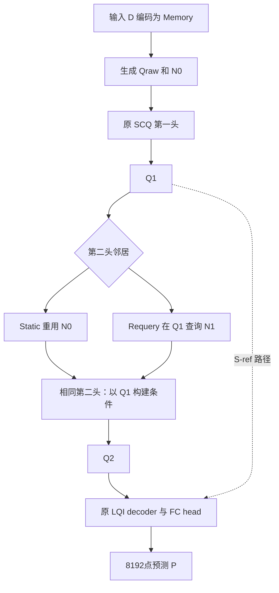

# Cranial-BCSP-FullMamba：SCQ-RF空间重查询反馈与残差可靠性正式实验计划书

_修订版 v2｜2026-11-14｜下一阶段科研参考协议，待用户确认｜未实施、未训练、未生成执行请求_

---

## 1. 决策摘要、依据与修订原则

### 1.1 推荐的研究问题

本阶段只检验一个新结构问题：**保留SCQ第一步残差结构后，第二次坐标校正依据Q1重选实际Memory邻居，是否优于沿用Qraw旧邻居，并在保留完整骨块表面与接口质量的同时减少严重失败？**

实验名称为SCQ-RF（Spatial Re-query Feedback）。这里的“反馈”特指一次额外的前馈重查询与坐标校正，不是收敛迭代、控制系统稳定性保证或校准的不确定性估计。“可靠性”是病例级研究目标，不是已证明的模型属性。

推荐主比较为RF-Requery−RF-Static，实用比较为RF-Requery−同环境S-ref。默认三臂、两折、seed 0，共六次从头训练；先做有界可行性核查，再决定是否投入训练。F同容量归因是单独问题，默认不作为RF实施的强制前置；若要加入，必须在第一轮新训练前登记，增加两次训练，总预算不超过八次。未执行F时，不得声称7维显式几何独立贡献已被证明。

本文件确认研究设计并不自动授权代码实施、真实数据forward、部署或训练。执行仍沿用既定分阶段授权，但不增加通用库存、传输或审计框架。

### 1.2 已知事实与待验证解释

已冻结B／S实验中，每臂两折8k→8k、3900更新、seed 0。S的E P95在C／D由11.743→6.688、7.307→5.494 mm；接口J Cover@2 mm由38.77%→49.88%、48.30%→53.93%。E改善来源为15／21和18／21；严重病例16→5，其中13例恢复、2例新增，两例新增均为C折frontoorbital。以上是开发证据，不是可靠性认证。[^bs]

全210例诊断发现，S有195例Qraw质心>20 mm，145个E改善病例中135例如此，65个E退化病例中60例如此；SCQ在205例中拉近质心。故不能把Qraw偏位直接视为坏query或推理触发条件。反例D069中，质心18.82→12.86→13.03 mm而最终E P95仍23.07 mm，说明位置纠正不能替代完整范围／形状覆盖。[^cohort]

“Qraw与delta共同形成有效表示”与这些事实相容，但尚不是训练因果证明。RF设计保留的是第一步SCQ的**结构与初始合同**；从头端到端训练后，其Q1不保证等于旧S的Qused，也不保证独立预测正确。

### 1.3 对用户草案的实质修订

| 项目 | 正式决定 |
|---|---|
| F归因位置 | 独立可选分支，不强制阻塞RF；结论必须与已执行对照匹配 |
| 新阶段参考 | 当前环境从头训练S-ref，不把历史S分数当严格主对照 |
| 默认训练数 | S-ref／Static／Requery各C、D，共6run；可选F另2run，总上限8 |
| 原S路径的解释 | 保留结构、初始化和原目标，不声称冻结旧S的最终功能 |
| 原LQI的信息来源 | 承认S的decoder已经在Q1处做cross-KNN；RF新增解码前坐标反馈 |
| 可行性判据 | 区分精确可区分、数值证据不足和性能未知；不使用主观“有意义差异”作通行证 |
| 风险结论 | 区分机制支持、严格研发晋级、临床可靠；不将一项失败写成所有科研价值为零 |
| 等效与统计 | 删除未经定义的“≈”等效判断；不显著不等于等效 |
| 资产准备 | 已有归档与四权重仅有限核对，不重复建设准备链 |

完整评审见[草案评审与修订说明](SCQ_RF_草案评审与修订说明_zh_v1.md)。

## 2. 文献依据与拟研究的增量

### 2.1 检索范围与证据层级

检索日期为2026-11-14，结合用户此前提供的颅骨、点云补全与Mamba题目清单，对直接相关公开期刊／会议记录、摘要和可用正文进行定向检索。不是系统综述，不声称已精读全部所列论文，也不保证穷尽所有同类设计。文章是否含attention按可用实际描述判断，不能按模型名称推断。

| 研究 | 本次确认的内容与版本 | 对本计划的约束 |
|---|---|---|
| CompletionMamba，TIP 2025 | 摘要描述欧氏邻域局部SSM与shape-aware条件 | 局部读出＋Mamba已存在；本轮不主张首次提出。[^completion] |
| FusionMamba，Information Fusion 134，2026 | 出版预览包含空间感知聚合及以输入几何先验残差校正proxy | 几何残差存在直接近邻；尚未完整排除相同re-query，不能先承诺原创性。[^fusion] |
| 3DMambaComplete，arXiv v2，2026-05-19修订 | 可用正文的HyperPoint生成包含Cross-Attention Block | 可借鉴分布／形变问题，不能当已核验的纯无attention对照。[^3dm] |
| PointMamba，NeurIPS 2024；Point Cloud Mamba，AAAI 2025 | 空间序列化与位置表征用于点云分析 | 固定当前排序，不把本轮变成排序或主干搜索。[^pointmamba][^pcm] |
| DAPointMamba，AAAI 2026 | 跨域patch及空间／通道对齐 | 任务不同，不将跨域指标等同颅骨E／J。[^dap] |
| DAPointRWKV，2026-11-07预印本 | 局部token引导的渐进解码与结构稳定化 | 补充近期近邻；RWKV不是Mamba，不在本轮换主干。[^rwkv] |
| AnchorFormer，CVPR 2023；CRA-PCN，AAAI 2024 | 动态区域节点、渐进及跨分辨率聚合 | 不将动态节点、局部读取或第二次细化泛称首创。[^anchor][^cra] |
| MedPCFM，2026-06-23预印本 | 医疗点云确定性PTv3与flow matching对照 | 后期同任务强基线候选；不能把不同划分／表示的CD直接排名。[^medpcfm] |
| 颅骨低分辨率迭代点云补全，MICCAI 2023 | 颅骨点云补全与迭代高分辨率生成 | 颅骨点云和迭代本身不是本项目独占创新。[^cranial] |
| CDRMamba，BSPC 2025 | 3D医学影像修复中结合U-Net与Mamba | 不宣称首次Mamba颅颌面修复；表示及目标需分别比较。[^cdr] |
| 临床implant厚度／rim研究，2024 | 临床设计含厚度与rim过渡差异 | 完整实体骨块边界不是最终临床制造形态。[^clinical] |

### 2.2 本轮可争取的贡献

如果实验成功，可以支持一个受限结论：在当前无attention的FullMamba颅骨完整骨块任务中，**解码前、以第一次补偿后的query重选输入Memory并再次校正坐标**，相对于同容量固定旧邻居策略具有额外价值。它不是“首次给Mamba加入几何”“首次使用KNN”或“首次多阶段补全”。

现有LQI源码已在decoder入口按`q_pos`计算self-KNN和cross-KNN；原S传入Q1。因此，RF研究的是在该解码过程之前再改变坐标，不能将S写成全网仅使用Qraw邻域。[^lqi]

若后续准备以此作为论文主要创新，需要进一步取得最邻近论文正文／代码，核对query更新、邻域重算及残差消费位置。该工作应聚焦近邻技术差异，不要求在本轮训练前重做全部领域综述。

## 3. 任务、数据、模型与训练合同

### 3.1 几何任务和来源单位

固定任务为

\[
\partial D\longmapsto\partial G=E_G\cup J_G.
\]

D为实体缺损后的残余骨组织，G为被移除骨块。输入／输出采用骨组织与背景相接的完整边界；内外表面、存在于原分割的孔腔边界和暴露切壁均属于采样对象。有限点集不保证每处薄板与切壁都足够密集。E为缺失骨块继承的原始表面，J为共享切除接口；E不是仅外板面片。

| 内容 | 锁定合同 |
|---|---|
| 数据 | SkullBreak BCSP V1已开放84来源、每来源5种缺损、420病例 |
| 类型 | bilateral、frontoorbital、parietotemporal、random_1、random_2 |
| 每折训练 | 63来源、315病例 |
| 每折开发 | 21来源、105病例；C／D开发来源互斥 |
| 统计依赖 | 来源内五缺损相关，C／D训练来源重叠 |
| 表示 | V1固定实体边界采样，8192输入／8192目标／256 coarse |
| 归一化 | 只由D得到center／scale，G使用同框架；评分逆变换回mm |
| 模型输出 | FC head，每coarse生成32点，共8192 |
| 封存边界 | 不读取既定受保护或未开放来源；确认集身份须核实其历史暴露状态 |
| 其他数据 | SkullFix不纳入本轮主实验；MUG不作为已认证精确GT |

来源、点集和参考使用冻结清单与内容哈希判定，不能凭目录名判断fold。历史缓存中C／D开发点集所在目录的表面折名不等于真实归属；沿用已核清的精确映射。[^contract][^bs]

### 3.2 Attention-free与原损失边界

保留已冻结Mamba encoder、LQI decoder、原局部图和FC重建头。允许FPS、KNN、普通图／PointNet式聚合、MLP和归一化，不引入Transformer self／cross-attention或新的softmax query-key/value attention。旧模块名称含`attn`不单独作为判定，按已核验实际运算与本次新增路径检查；不宣称检查了不可见第三方二进制内部。

去噪关闭，保持原有效目标：

\[
\mathcal L_{S}=\operatorname{CD}(Q^1,G)+\operatorname{CD}(P,G),
\quad
\mathcal L_{RF}=\operatorname{CD}(Q^2,G)+\operatorname{CD}(P,G).
\]

复用冻结`get_loss()`及PyTorch `cdist`路径，不根据数学简写重写损失归约或系数。RF不增加Qraw、Q1、质心、半径、接口、法向、厚度或delta正则损失。`loss_sparse=0`是去噪关闭标志，不能误读为coarse无监督。

### 3.3 每run精确合同

| 项目 | 值 |
|---|---|
| 起点 | 随机初始化从头训练；不warm-start旧S，不复用旧optimizer |
| seed | 0；共有母版与SCQ初始状态匹配；新增RF头独立随机流 |
| 更新 | 100 traversals ×39 full batches=3900 steps |
| batch | 8，drop_last；每遍历曝光312例、丢3例 |
| 总计 | 31,200曝光、300次丢弃；每病例曝光＋丢弃=100 |
| 优化器 | AdamW，lr=1e-4，betas=(0.9,0.999)，eps=1e-8，clip=10 |
| 权重衰减 | 常规矩阵5e-4；1D／bias／明确SSM例外0；新增RF权重／bias同策略 |
| LR | `1e-4 × max(0.9^(epoch/21),0.02)` |
| BN动量 | `max(0.9 × 0.5^(epoch/21),0.01)` |
| 数值 | FP32、TF32=false；保留并披露已接受的有限梯度非位级确定性 |
| checkpoint | 仅固定epoch99／step3900用于主评价，不按开发分数挑epoch |
| 禁止 | resume、自动重试、训练内开发选择、BNCal、TTA、GT-Oracle配准、后验删点 |

同折三臂使用完全相同实际批次／source顺序、输入／GT点集、LR和BN计划。新增模块构造不得消耗母版随机流；不能只保证`manual_seed`相同而忽略构造顺序造成的差异。

六run合计23,400更新、187,200曝光、1,800丢弃；含可选F八run合计31,200更新、249,600曝光、2,400丢弃。开发评分不参与训练设置选择。

## 4. 唯一结构规格与计算图

### 4.1 原SCQ完整复用

用M表示实际Memory坐标，避免与候选臂S混淆：\(M\in\mathbb R^{256\times3}\)、\(F\in\mathbb R^{256\times384}\)、\(z\in\mathbb R^{1024}\)、\(Q^0=Q^{raw}\in\mathbb R^{256\times3}\)。定义

\[
N_i^0=\operatorname{KNN}_8(M,Q_i^0).
\]

记统一特征构建算子为

\[
\Phi(q,N)=\left[z,\operatorname{mean}_{j\in N}\operatorname{LN}(F_j),
\operatorname{max}_{j\in N}\operatorname{LN}(F_j),q,\mu,\sigma,\rho\right]\in\mathbb R^{1802},
\]

\[
d_j=M_j-q,\quad\mu=\operatorname{mean}_j d_j,\quad
\sigma=\sqrt{\operatorname{mean}_j(d_j-\mu)^2+10^{-6}},\quad
\rho=\operatorname{mean}_j\lVert d_j\rVert_2.
\]

Memory逐token先做无affine LayerNorm（epsilon=1e-5），再mean／max；sigma按坐标分量计算。原SCQ为

\[
\delta_i^0=W_2\operatorname{GELU}(W_1\Phi(Q_i^0,N_i^0)+b_1)+b_2,
\quad Q_i^1=Q_i^0+\delta_i^0,
\]

其中1802→384→3，精确GELU，原冻结W2／b2零初始化。原SCQ新增693,507可训练参数；初始化二进制与源码哈希完全沿用，不重生成。[^implementation]

### 4.2 第二次校正：唯一研究差异

\[
N_i^{static}=N_i^0,\qquad N_i^{requery}=\operatorname{KNN}_8(M,Q_i^1).
\]

对\(A\in\{static,requery\}\)，两臂统一使用当前Q1构建特征：

\[
h_i^A=\Phi(Q_i^1,N_i^A),\qquad
\delta_i^{1,A}=V_2\operatorname{GELU}(V_1h_i^A+c_1)+c_2,
\qquad Q_i^{2,A}=Q_i^1+\delta_i^{1,A}.
\]

固定新增头1802→128→3，单独参数，不与第一头共享权重；恰好231,171可训练参数。\(V_2,c_2\)零初始化；\(V_1,c_1\)采用PyTorch Linear等价默认初始化，但使用独立CPU Generator，固定seed=2026111402，生成后冻结精确字节与哈希。实际程序数参必须验证，不能将临时fixture总参数量代替原生模型值。

| 模型 | 预计原生可训练参数 |
|---|---:|
| S-ref | 40,596,676 |
| RF-Static | 40,827,847 |
| RF-Requery | 40,827,847 |

两RF臂的新增头、第一头、encoder、decoder、optimizer、数据和初始化相同；**唯一程序条件分支为第二次邻居索引选择**。Static也按Q1重算相对几何，禁止复用Q0相对几何缓存。共同头不加gate、clamp、幅度系数、置信阈值、stop-gradient或新激活。

### 4.3 所有下游消费者必须一致使用Q2

新增模块位于原SCQ之后、decoder前。RF的query-MLP、位置编码、排序、self／cross KNN、FC重建中心、coarse输出及coarse loss全部使用Q2；不能只改日志或最终坐标相加。Static中“旧邻居”只指第二头读取的N0，不冻结下游decoder的KNN。



### 4.4 初始化、梯度与功能保留的准确解释

在同一共有初始状态，第二头零输出使Q2=Q1，新RF模型初始预测应与S-ref一致。初始第一头也零输出时Q1=Qraw，N1=N0，因此从头模型的第一初态**没有重查询机制差异**；不能据此认定设计无效，也不能据首步输出一致证明后续所有行为一致。

新增头首次反传V1／c1梯度可以为0，V2／c2应在规定非退化人工输入和完整损失下有限且具有有效梯度。使用固定非零V2的人工诊断副本验证梯度可到达V1和上游；诊断副本不作为训练初始化，不执行optimizer step。整数KNN选择不求导，但聚合特征、显式相对几何及Q1身份路径不得被错误detach。

本轮RF最终只监督Q2与P，允许Qraw／第一残差／第二残差共同适应。由此得到的是“反馈架构从头训练效果”，不是“给旧S加一个保证不损坏的修复器”。冻结旧S微调第二头、增加Q1辅助监督、共享两头或循环多次均属于不同假设，不纳入本轮。

## 5. 有界可行性与实施准入

### 5.1 先做一次现有证据与真实邻域核查

已有B／S代码、结果及四关键checkpoint已在本机归档，并发布`cranial-bcsp-scq-bs-20261114-v1`；先有限核对相关文件可读、哈希及实际接口，不重新生成归档、不扩展全环境扫描。原训练设备与后续预测设备身份不同，不能把预测容器当作历史训练GPU。[^archive]

若已保存的实际Memory足够完成核查，复用它；不能把8192输入、另一次FPS或估计proxy冒充同次forward的256 Memory。若仍缺张量，下一项需单独授权：**最多10个固定开发病例、对应两折冻结S模型、每例一次eval forward、0 backward／0 step**。这是有GPU读取与计算的零更新诊断，不称作纯只读审计。

病例选择在执行前固定：五个既知反例C013／C051／C053 frontoorbital、D046 parietotemporal、D069 random_2；另取五个分数盲对照，每种缺损各一例，从固定210开发索引中排除前五例后，以`SHA256("SCQ-RF-control-v2|"+case_id)`最小者选择。选中后冻结ID、fold和文件哈希。它们称“分数盲对照”，不预称正常或改善病例。该规则不读取新RF结果，不因为对照不理想而重选。

只保存实际Memory、z、Qraw、delta0、Q1、N0、按Q1计算的N1与必要摘要。记录邻居集合重合率、排序差异、第二头特征h的差异、Q1到邻居的距离以及计算时间；GT不进入特征构建。原冻结S的Qraw／Q1／dense仅用于检查采集未改模型行为。

预算：一次核查会话总墙钟不超过30分钟，GPU显存沿原门、RSS 8 GiB、输出2 GiB；无checkpoint转换、优化器、真实loss或forward重试。遇到资源／身份／非有限失败立即停止；部分成功不自动补跑缺失病例。

### 5.2 可区分性不能被误作有用性

N1使Q1到所选邻居距离更小，主要是KNN定义的数学结果，不证明邻居更解剖正确。query位于缺失骨块内部时，到残骨表面存在真实间隔；不能加入任意5／10 mm“正确邻居”门。

人工fixture中必须能够制造N0≠N1及h不同，否则实现不具备所声称的机制，停止。实际固定样本中若至少一例有可复核的邻居集合与聚合条件差异，记为`DISTINGUISHABLE_NOT_EFFECTIVE`，仅允许讨论是否进入证伪训练。

若十例均精确相同，记录`NO_OBSERVED_DISTINCTION_IN_FIXED_SAMPLE`，本轮先停止投入，不扩大邻域／半径或自动增加病例；不能推论全训练人群永远相同。若仅有接近计算精度的差异，记为`INCONCLUSIVE`，不得事后人为设置容差把它变成通过。差异的数值容差只能沿用已有同一tensor回读合同或在实施前给出误差依据。

训练后S的局部存在性不代表RF从头训练会使用同样邻域。后续全量轨迹仍必须检验，不能把本步骤当作性能准入证据。

### 5.3 集中实施与人工CPU验证

实现范围限定隔离RF模块、最小factory／训练入口适配、专用测试和必要短入口，不修改母版科研源码或通用传输框架。一次CPU检查至少覆盖：

1. 参数量与初始化流：两RF相同，S共有参数与RNG不变，持久状态严格匹配。
2. `Q1=Q0`、邻居未变、邻居确实变化三类机制fixture，全部按相同Q1构造h。
3. 坐标系和batch独立：Memory与query均为D-only normalized；B=1／8形状和dtype正确。
4. Q2进入完整原调用链及原`get_loss()`，不重复计算loss、不漏coarse监督。
5. 初始与非零诊断头的梯度预期、原Mamba no-decay例外、新参数完整分组。
6. 输入签名无GT、类型、J／E、风险标签；无attention新增或临床先验暗注入。
7. 对同值和等距KNN人工案例保留原provider实际tie行为；禁止仅为过测试增加epsilon扰动或切换排序后端。

CPU检查通过及P3只证明限定接口，不证明实际CUDA、科学收益或部署许可。一次失败保存结果后停止，不自动修复重跑。

### 5.4 人工CUDA零更新准入

固定五个阶段：S-ref eval(batch1)仅一次forward作为同环境初态基准；Static eval(batch1)、Requery eval(batch1)、Static train(batch8)、Requery train(batch8)各一次完整forward／loss／backward。**总计5 forward／4 full loss／4 backward／0 optimizer step**。人工输入共享，保持真实Mamba、PointNet2和原`cdist`loss。需验证Q2全路径消费、梯度有限及预期活跃、状态／RNG／BN模式恢复、资源在预算内。

各阶段使用同一已冻结共有初始状态，eval两RF的coarse／dense均与本会话S-ref输出按冻结容差比较。多出的S-ref一次forward专门用于避免跨设备借用历史结果来证明初始等价；不能在执行时再追加其他基准或warmup。准入完成后正式只读冻结计数和恢复证据，再讨论训练。

首次零输出不能验证实际不同邻居产生的效应，故CPU机制fixture与冻结S可行性检查不可被该CUDA一致性替代。CUDA只验证新增真实路径可运行，不重做旧母版的全部已通过preflight。

## 6. 训练矩阵、资源预算与执行顺序

### 6.1 主矩阵：默认六run

新阶段采用统一设备／驱动／provider／软件身份。S-ref为当前环境重新从头训练的原S结构；历史B／S只作背景，不担当跨设备严格主差值。如果训练中设备变化，停止后续自动执行，先披露并决定匹配范围；不把先后不同GPU默认为同条件。

| Fold | S-ref | RF-Static | RF-Requery | 合计 |
|---|---|---|---|---:|
| C | 3900步 | 3900步 | 3900步 | 3run |
| D | 3900步 | 3900步 | 3900步 | 3run |

固定顺序：S-ref_C→Static_C→Requery_C→S-ref_D→Requery_D→Static_D。RF两臂在不同折交换先后，降低恒定执行顺序偏置；这不能消除时间和硬件随机性。每run仍独立授权。尽量在六run全部训练冻结后再集中预测与解读，禁止看C开发结果后调整D。

若科学结果不理想但训练合同通过，应按预定矩阵完成D以检验证伪，不以“C loss不好”改变结构。若资源、数值、数据泄漏或计数失败，立即停止；科学阴性与执行故障区别记录。

### 6.2 F归因：默认不启用的两run分支

F定义保留旧SCQ同容量头及KNN局部特征，将显式7维相对几何替换为冻结局部特征投影。它仍使用由坐标确定的邻居，故不是没有空间关系的模型。F只能与同环境S-ref比较，不与历史异设备S混算严格效应。

默认`include_F=false`。若用户在第一轮新训练前选择`true`，固定F_C／F_D各3900步、原冻结投影与初始化，额外210预测；不因某一折F先胜出而改RF母版。F回答原几何通道增量，不是RF-Requery主比较的一部分。没有F，不影响对重选邻居的匹配比较，但论文须放弃“7维几何独立贡献”主张。

如未来认为无F不足以支持拟投稿故事，应另行冻结该归因预算，而不是把所有RF工作停在F之前。新的分支不能在看到RF结果后被写成原先必做或原先已完成。

### 6.3 资源与工程完成标准

沿用每run：墙钟24小时、RSS 8 GiB、torch峰值20 GiB、SMI显存22,528 MiB、输出2 GiB、空闲磁盘至少4 GiB。启动前另核对总归档空间：六个最终权重未压缩约3 GB，若可选F则更多；预留压缩包、下载及日志空间，不能只检查单run4 GiB就忽略后续总产物。

资源监测与超限停止足够，不重新开发硬隔离或PID映射框架。保持单GPU、串行训练；不升级／重装依赖，不后台启动未授权任务。原B／S训练约25分钟／run只是历史容量参考，不作为新阶段速度承诺。

准备工作的完成定义是：唯一公式与作用接口明确；必要依赖／provider身份可绑定；限定CPU及一次CUDA通过；数据／初始化／实际顺序合同可用；资源预算明确。达到后直接进入已授权下一科研步骤，不继续扩展通用工具。

## 7. Native预测、评分与机制产物

### 7.1 固定评价范围和次数

默认六模型各105例，合计**630次Native预测**；每例一次batch1，无warmup／TTA／loss／backward／optimizer step。预测状态／RNG不变，保留原始P8192；RF额外保存Qraw、delta0、Q1、delta1、Q2、Memory身份与N0／N1。完整特征大张量可仅保存固定十例，所有病例必须保存几何阶段、整数索引和轻量差异摘要，避免无必要膨胀归档。

每折三个模型共有同一105病例，重复输入不视为新增受试者。主评分为630模型行＋420共享控制行=**1050行**；共享Nop_D／GT8192每病例各一条，严禁随模型重复计入。可选F加入后为840模型行＋420控制=**1260行**。来源均值分别210行和252行。

新增评分行数变化不意味着改指标实现。需要入口适配时保持冻结指标函数和参考哈希，仅适配模型标签及计数，完成针对性人工合同检查。

### 7.2 终点及聚合保持原定义

主终点为A1面积加权E→预测P95（mm）。每病例先计算，再每来源五缺损等权，最后每折21来源等权；不是将所有点拼接后的总体P95。关键协同终点为J Cover@2 mm及J P95。

完整披露E／J Cover@0.5、1、2 mm、CD-L1、预测→A2 P95和>20 mm点比例、E／J距离尾部、质心误差及回转半径比。CD-L1沿用未平方双向欧氏最近邻均值的半和；Ref-B指marching-cubes参考，不能与模型臂B混淆。无GT配准、尺度对齐或后验删点。[^metric]

固定风险：

```text
severe_geometry = E_P95_mm > 20 OR J_Cover2 == 0
placement_tail = dense_centroid_distance_mm > 20
compact_distribution = dense_radius_ratio < 0.9
```

这些是既有研究标签，不是临床标准。每个主比较报告baseline严重、新增、恢复、共同严重及至少一种缺损严重的来源数；共同严重病例进一步恶化也应保留幅度，不能只数新增病例。

### 7.3 阶段诊断是关联测量，不是推理门控

全开发病例保存Qraw→Q1→Q2→P的质心与范围、delta均值／分位、N0／N1集合重合率、归一化及world-mm邻居距离、局部feature差异和最终E／J／逆向尾部。只有离线评分允许计算指向GT的残差方向余弦；该值不得输入forward或作为部署选择器。

同一最终RF权重中的Q1不是原S-ref，也不是关闭第二头后的完整dense反事实。若需要反事实forward或GT-Oracle配准，必须另定范围，本版不自动包含。N1通常距离更小的事实不作机制成功分数。

五个既知反例＋五个分数盲对照固定用于可视化。其余新最差病例可以按事前规则附录展示，但不能替换固定对照，也不能只展示获救病例。位置改善但E／J退化、质心接近却覆盖不足是必须讨论的反例类型。

## 8. 统计、成功定义和停止规则

### 8.1 主比较与不确定性

预先固定两个比较：Requery−Static检验邻居重选；Requery−S-ref检验新增反馈是否值得。Static−S-ref作为容量／额外阶段描述，不冒充主假设。F−S-ref仅在登记启用F时计算归因。

每折报告21个来源配对差值的均值、中位数、IQR、改善／退化数、最差五来源和五类缺损分层。两折不合并冒充42次独立训练复现；病例分组是事后解释，不是训练选择。

若执行不确定性分析，固定来源级配对bootstrap：每折21来源、有放回抽21、同一抽样索引同时应用所有模型及每来源五病例、10,000次、NumPy `Generator(PCG64)`，C种子2026111403、D种子2026111404，双侧95% percentile区间，分位`linear`。对象限定两个主比较的E P95均值差与J Cover2均值差；风险转移同时保留原始病例／来源计数，若做来源级风险均值差也按同一抽样，不把稀少事件bootstrap当零风险证明。

bootstrap不重新训练模型，只描述固定模型在当前来源样本的条件不确定性；不估计Mamba训练轨迹方差，不把多轮开发选择偏差变没。固定100个traversals不能代替多seed。没有预设等效界限，不使用“≈”作正式等效结论，不以区间含0证明两模型一样。不为所有辅助指标批量报告未调整显著性。

### 8.2 分开判断机制、实用增量和严格可靠性晋级

使用完整精度冻结标量判门，表格舍入只用于展示。这里的零界限是明确的严格研发目标，没有临床含义；若未来希望设置实际重要差值，应在新结果产生前以新协议定义，不能结果后放宽。

**M：重查询增量支持。** Requery−Static的来源等权E P95在C和D均≤0，至少一折<0；来源差值中位数两折≤0；J Cover2均值两折不下降。若未满足，记为当前预算下机制未获一致支持或结果混合。即使满足也只是开发性支持，不是显著性或因果唯一性证明。

**U：相对S-ref的实用增量。** Requery−S-ref的来源等权E均值及来源差值中位数两折≤0，至少一折E均值严格改善；J Cover2两折不下降，J P95均值不增加。仅质心／半径改善不算通过。

**R：严格可靠性晋级目标。** 必须同时满足M、U及以下全部条件：

1. 相对同环境S-ref，210例中新增严重=0；若S-ref严重总数>0，至少恢复1例；若S-ref严重=0，则要求Requery也=0，恢复条件不适用，只能声称本样本保持零严重。
2. 相对Static也不新增严重病例；两折严重来源数均不增加。不以净减少遮盖新发。
3. 反向A2 P95及>20 mm比例的来源均值差，两折相对S-ref和Static均≤0；不只用一个总体平均掩盖另一折退化。
4. 每折placement_tail和compact_distribution的总病例数及受影响来源数相对S-ref不增加；新增／恢复仍逐项披露，不把“总数未增”写成没有新事件。

R是本阶段是否投入额外确认预算的保守目标。未通过R并不抹掉所有平均收益，但不得宣告达到本计划的可靠性晋级；零新增在少量单seed开发病例中也不证明总体风险为零。若M通过而R未通过，记录“机制有开发性信号、可靠性目标未达”，停止当前候选的自动晋级。

### 8.3 失败处理与预算终止

| 观察 | 结论与下一步 |
|---|---|
| 人工接口／梯度／资源／泄漏失败 | 保存证据后立即停；不自动补丁、重试或训练 |
| 实际邻域无可区分证据 | 保留固定样本结果，暂停投入；不自动扩样或扫描k |
| Requery与Static均改善S-ref，但主差异不支持 | 额外阶段或容量可能有用，重查询独立贡献未获支持 |
| Requery一折好一折差 | 混合开发结果，不调D、不换seed直到好看 |
| E／J改善但新增严重 | 有收益也有风险；R未通过，不报临床可靠 |
| RF完全未获支持 | 收束为负结果；独立D-only位置提案如需研究另立问题 |
| F未支持S显式几何增量 | 收紧原SCQ机制表述，不顺势改本轮RF参数 |

新旧模型的共同严重病例、类型退化和反向离群均必须呈现。不得删C013／C051等病例、改变2／20 mm阈值、增加loss／gate／k、重建数据或追加seed来挽救本版本结果。

## 9. 阶段交付、后续确认与执行边界

### 9.1 有限阶段与完成标准

| 阶段 | 科研产物 | 本阶段不自动授权的内容 |
|---|---|---|
| A：接口与可行性 | 精确作用点、固定病例规则、真实Memory条件差异与局限 | 不实现RF或训练 |
| B：implementation-only | 隔离模块、两臂同容量／初始化、CPU验证与P3 | 不部署或GPU |
| C：人工CUDA | 冻结次数、真实loss／梯度／资源及正式冻结 | 不进入训练 |
| D：配对训练 | 六run原合同、最终权重与正式训练冻结 | 不按loss推效果，不自动评价 |
| E：Native及统一评分 | 630预测、1050行评分、来源统计与风险转移 | 不自动开确认集 |
| F：机制与决策 | 全量阶段摘要、M／U／R、阴性分支与局限 | 不自动追加候选／多seed |

已有适用测试、provider、传输和冻结工具应复用；只适配新增路径所必需的接口。失败日志应精确到出错阶段，避免把平台启动问题误作科研假设失败，但也不能借工程排查无限扩张范围。

### 9.2 应保存的最小证据

每run保存源码／配置／点集／初始化指纹、3900条有效更新、完整实际顺序及曝光／丢弃、LR／BN／梯度有限性、资源记录、退出码和最终checkpoint哈希。预测保存全部Native结果、阶段坐标、整数索引及摘要，评分保存病例／来源／类型／风险与比较清单；大特征只保留固定样本及其来源身份。

全部新结果写新版本目录，历史B／S与原归档不可覆盖。Windows项目与服务器`/home/jovyan/adapointr_work/PoinTr`不是同一文件系统；长期备份目录仅本机可验证。模型权重与点数组留本机，GitHub只发布允许公开的代码、标量证据和静态图。归档或清理在相应阶段另行授权。

### 9.3 确认阶段与论文路线

若M／U／R获得支持，再先冻结最终候选和比较合同，另行计划同seed配对的两个额外seed及独立来源确认。单seed收益不够支持稳健性；病例bootstrap不能替代训练复现。独立确认来源的历史暴露情况须核清，不能将早期已使用的官方test重新命名为盲集。

SkullFix可作为后续跨数据集适用性验证，但先固定其任务与划分，不将其称为临床外部验证。MedPCFM／确定性PTv3、CompletionMamba及邻近强基线属于论文阶段的同协议比较，需先适配完整骨块目标和E／J参考；本轮不同时扩展强基线、厚度loss和mesh制造研究。

### 9.4 已冻结父资产与建议下一动作

父公开归档：[SCQ B／S annotated tag](https://github.com/ZhangHuijun520/AdaPoinTr_Adapt/tree/cranial-bcsp-scq-bs-20261114-v1/archives/cranial_bcsp_scq_BS_20261114_v1)，commit `1881f1237b5dbbf06c3a8ea7ffa47cfaf15e5928`。

本机四权重目录：`E:/ResearchBackups/AdaPoinTr/BCSP_FULLMAMBA_SCQ/2026-11-14_key_checkpoints_v1`。S_C哈希`00f1ce94d219a42294c6c5a7874710edbd58431deac44c9522a9ab4f120d2f0b`；S_D哈希`bd8fe23f1a276019b776b5d2cadce7aad62bd31eea440975ffd1222331f636fa`。其余模型和归档身份见[归档回执](../../deliverables/scq_BS_20261114_v1/SCQ_BS_归档完成回执_zh_v1.md)。这些是父证据，不代替当前服务器身份核验。

建议下一动作是确认本计划后，**只进行一次有限计算图差量复核，冻结十例以内真实Memory可行性范围**；若确实需要新forward，再单独授权该范围。不要直接开始F或RF训练。当前仅完成本计划文件，不创建runtime config、launcher、execution request或服务器文件。

---

### 证据与参考文献

[^bs]: [SCQ B／S阶段正式报告](../cranial_bcsp_scq_BS_20261114/SCQ_BS_阶段正式实验报告_zh_v1.md)，原始分数及风险来自[正式评分后冻结](../../outputs/scq_score_freeze_20261114_v1/audit_report_v1.json)和[两折配对汇总](../../outputs/scq_score_impl_20261114_v1/unified_scores_v1/paired_comparison.json)。
[^cohort]: [全210例Qraw及补偿诊断](../../outputs/scq_Qraw_cohort_20261114_v1/Qraw偏位专属性与补偿协同_全队列诊断报告_zh_v1.md)。
[^contract]: [B／S四run合同](../../outputs/cranial_bcsp_scq_foldC_training_preparation_20261113_v1/SCQ_BS_CD_pair_contract_v1.json)。
[^implementation]: [SCQ实现](../../outputs/cranial_bcsp_scq_implementation_20261113_v1/bcsp_scq_residual_v1.py)及[factory](../../outputs/cranial_bcsp_scq_implementation_20261113_v1/bcsp_scq_factory_v1.py)。
[^lqi]: [实际LQI decoder源码](../../outputs/cranial_bcsp_fullmamba_20261110/lqi_implementation_v1/bcsp_lqi_decoder_v1.py)，`forward()`按q_pos构造self／cross索引，并传给各层；RF不得虚构原S没有Q1处Memory条件。
[^metric]: [冻结指标实现](../../outputs/cranial_bcsp_geov1_20261024/blue_pair_eval_v1/bcsp_eval_metrics_v1.py)，SHA256 `af938519125b25b6d22d862dd4967dabef3be6d97d38e60eb9995ee7e9ce9766`。
[^archive]: [SCQ B／S归档完成回执](../../deliverables/scq_BS_20261114_v1/SCQ_BS_归档完成回执_zh_v1.md)。
[^completion]: Fu et al. *CompletionMamba: Taming State Space Model for Point Cloud Completion*. IEEE TIP 34:5473–5485, 2025. DOI [10.1109/TIP.2025.3597041](https://doi.org/10.1109/TIP.2025.3597041)；[出版摘要记录](https://pubmed.ncbi.nlm.nih.gov/40853794/)。本次未全面核查其源码。
[^fusion]: Wu et al. *FusionMamba: Efficient 3D point cloud completion via spatially-aware state space models and multi-scale information fusion*. Information Fusion 134:104378, 2026. [出版预览](https://www.sciencedirect.com/science/article/abs/pii/S1566253526002575)，DOI 10.1016/j.inffus.2026.104378。正文直读受限，未完成同公式排除。
[^3dm]: Li, Yang, Fei. *3DMambaComplete*. arXiv:2404.07106，2024首发、2026-05-19 v2修订；[版本记录](https://arxiv.org/abs/2404.07106)、[v2正文](https://arxiv.org/html/2404.07106v2)。正文标题与摘要页表述略有差别，本计划以标识符及版本为准。
[^pointmamba]: Liang et al. *PointMamba: A Simple State Space Model for Point Cloud Analysis*. NeurIPS 2024. [正式会议页面](https://proceedings.neurips.cc/paper_files/paper/2024/hash/395371f778ebd4854b88521100af30ad-Abstract-Conference.html)。
[^pcm]: Zhang et al. *Point Cloud Mamba: Point Cloud Learning via State Space Model*. AAAI 39(10):10121–10130, 2025. [正式页面](https://ojs.aaai.org/index.php/AAAI/article/view/33098)，DOI 10.1609/aaai.v39i10.33098。
[^dap]: Li et al. *DAPointMamba: Domain Adaptive Point Mamba for Point Cloud Completion*. AAAI 40(8):6653–6661, 2026. [正式页面](https://ojs.aaai.org/index.php/AAAI/article/view/37596)，DOI 10.1609/aaai.v40i8.37596。
[^rwkv]: Li et al. *DAPointRWKV: Domain Adaptive Vision RWKV for Point Cloud Completion*. [arXiv:2611.10353](https://arxiv.org/abs/2611.10353)，2026-11-07预印本。页面自述会议接收，不以自述替代会议正式出版核验。
[^anchor]: Chen et al. *AnchorFormer: Point Cloud Completion From Discriminative Nodes*. CVPR 2023:13581–13590. [正式页面](https://openaccess.thecvf.com/content/CVPR2023/html/Chen_AnchorFormer_Point_Cloud_Completion_From_Discriminative_Nodes_CVPR_2023_paper.html)。
[^cra]: Rong et al. *CRA-PCN: Point Cloud Completion with Intra- and Inter-level Cross-Resolution Transformers*. AAAI 38(5):4676–4685, 2024. [正式页面](https://ojs.aaai.org/index.php/AAAI/article/view/28268)，DOI 10.1609/aaai.v38i5.28268。
[^medpcfm]: Kwarciak and Wodzinski. *MedPCFM: Improving Medical Point Cloud Completion by Integrating Point Transformers and Flow Matching*. [arXiv:2606.24433](https://arxiv.org/abs/2606.24433)，2026-06-23；[正文](https://arxiv.org/html/2606.24433v1)。预印本，不跨协议引用其数值作为本轮优劣证据。
[^cranial]: Wodzinski et al. *High-Resolution Cranial Defect Reconstruction by Iterative, Low-Resolution, Point Cloud Completion Transformers*. MICCAI 2023. [作者预印本](https://arxiv.org/abs/2308.03813)，正式DOI 10.1007/978-3-031-43996-4_32。
[^cdr]: Wang et al. *CDRMamba: A framework for automated craniomaxillofacial defect reconstruction using Mamba-based modeling*. BSPC 103:107376, 2025. [出版摘要](https://www.sciencedirect.com/science/article/abs/pii/S1746809424014344)，DOI 10.1016/j.bspc.2024.107376。
[^clinical]: Fishman et al. *Thickness and design features of clinical cranial implants—what should automated methods strive to replicate?* IJCARS 19:747–756, 2024. [出版摘要记录](https://pubmed.ncbi.nlm.nih.gov/38430381/)，DOI 10.1007/s11548-024-03068-4。
