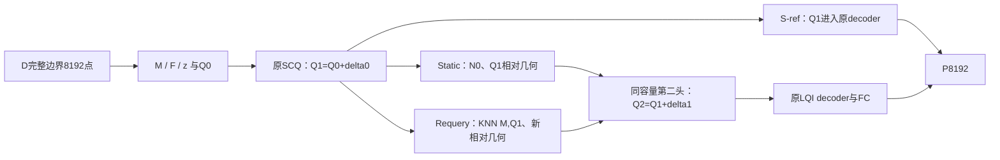

# Cranial-BCSP-FullMamba：SCQ-RF完整实验报告

版本：v1｜报告日期：2026-11-15｜本轮科研执行正式收束

本报告覆盖SCQ-RF有限计算图核对、十例实际Memory可行性观察、隔离实现与人工CPU/CUDA验证、三臂两折六次从头训练、630次Native开发预测、1050行统一CPU评分、正式冻结审计，以及七例既有预测阶段诊断。报告依据本机冻结证据撰写；没有新增训练、模型forward、评分、bootstrap、正式gate或文献检索。

## 1. 摘要与本轮结论

本轮检验的核心问题是：在已冻结的无attention FullMamba颅骨完整骨块补全模型中，保留第一步SCQ后，以校正后的Q1重新查询实际encoder Memory，再做第二次坐标残差，是否优于同容量、沿用Q0旧邻居的第二残差头，并改善接口与严重失败表现。

结果显示，RF-Requery在两折选定平均指标上均优于RF-Static，且C折同设备核心对照提供较明确的开发性支持：E_P95降低0.687mm，J_P95降低0.633mm，J Cover@2mm提高6.05个百分点，CD-L1降低0.666mm；E_P95在21个来源中17个改善、4个回退。相对S-ref，C折收益更大，D折收益较小。RF-Static相对S-ref没有形成稳定、全面收益，因此不能把本轮提升简单归因于增加参数或第二阶段本身。

但可靠性问题没有解决。C折Requery相对Static严重病例6→3，实际新增1、挽回4；D折2→2，实际新增2、挽回2。C折parietotemporal类型的误差尾部回退。七例诊断区分出反馈放大、纠偏不足，以及质心改善而形状/接口覆盖仍差等不同情形。D折Static最后一次训练迁移了GPU UUID及驱动，必须作为设备混杂的补充证据。

因此，本轮可收束为：**重查询具有值得保留的开发性增量，但当前版本未建立可靠性保证，不能自动晋级为已解决严重失败的方案。** 本报告不计算或宣布正式M/U/R gate，不给出显著性或临床认证。后续方向应聚焦空间条件与残差更新方向可靠性，保留有效大幅纠偏，而不是立即统一限幅或扩大模型搜索。

## 2. 研究背景、目的与边界

### 2.1 为什么开展SCQ-RF

此前FullMamba/LQI与SCQ研究已经把任务收敛为骨组织完整边界输入、完整缺失骨块边界输出。SCQ能够借助局部Memory特征与相对几何校正learned coarse，但平均收益和新增严重病例并存。已有证据还表明Qraw的大偏位并非失败病例特有，部分大偏位通过SCQ可以被有效纠正；不能仅因Qraw离GT远就判query无效。

本轮不是重新比较Mamba与Transformer，也不是修改采样、输入点数或实体缺损生成。它只考察“第一次校正改变query位置后，第二头读取哪一组Memory邻居”这一因素。原LQI decoder本已在其输入query位置做cross-KNN，RF新增的是**解码前第二次坐标校正**，不能将S-ref描述成全网一直只用旧邻域。

### 2.2 三层问题

1. 可行性：Q0与Q1处的实际Memory条件是否确实不同，而非仅浮点抖动或日志编号变化？
2. 核心结构比较：同参数规模Static/Requery中，重选邻居是否带来完整骨块与接口改善？
3. 可靠性：平均指标改善是否同时减少新发严重病例、远端离群和分类型回退？

S-ref用于实用增量比较；Static/Requery用于更接近匹配的机制比较。三臂均端到端从头训练，第一头最终功能不被冻结。跨臂Q0、Memory和权重不同，所以保存的Q1不是旧S-ref输出，也不是关掉第二头的完整反事实预测。

### 2.3 本轮不支持的主张

本轮不证明首次Mamba颅骨修复、首次局部KNN、多阶段点云生成或几何残差，也未执行可选同容量F归因分支，不能单独证明SCQ七维显式几何通道的独立贡献。论文创新性需后续与最邻近方法正文/代码核对；本报告不沿用未核验的“最新”或“首创”表述。

## 3. 数据、任务与几何表示

### 3.1 固定任务

设完整骨组织为C、实体移除骨块为G、残余骨组织为D。目标为从残余骨组织完整边界∂D预测缺失骨块完整边界∂G，而非完整颅骨重建或只补原始外表面片。

骨组织边界包括原分割中存在的外表面、朝向颅腔的内表面、孔道/腔体边界及缺损暴露切壁。G边界划分为继承的原始骨表面E和与D共享的切除接口J；E不等于仅颅骨外板。数据的分割质量与有限点数决定可表达的上限，完整边界采样也不保证每块薄板或切壁的局部密度足够。

### 3.2 本轮数据与划分

| 项目 | 固定设置 |
|---|---|
| 数据来源 | SkullBreak BCSP V1，已开放84个来源 |
| 缺损 | 每来源5种：bilateral、frontoorbital、parietotemporal、random_1、random_2 |
| 总病例 | 420个合成缺损病例 |
| 每折训练 | 63来源、315病例 |
| 每折开发 | 21来源、105病例 |
| 两折关系 | C/D开发来源互斥；训练来源重叠，不是两组独立训练人群 |
| 输入/目标点数 | 8192/8192，固定V1采样 |
| coarse | 256点；FC头每中心32个子点，总计8192 |
| 归一化 | center和scale只由D确定，G使用相同变换；评分还原world-mm |
| 本轮未用 | SkullFix外部适用性训练、MUG精确GT、未授权来源 |

同一来源的五类缺损具有相关性，105个开发缺损不是105个独立受试者。每病例先评分，五缺损等权形成来源均值，再每折21来源等权。两折和单种子结果不能作为42次独立训练复现。

### 3.3 路径与fold的实际关系

历史存放目录名与开发折名相反：C开发输入在`data/bcsp_geov1_foldd_8192_seed0_v1/points`，D开发输入在`data/bcsp_geov1_foldc_8192_seed0_v1/points`。病例身份、fold与来源由冻结索引和哈希确定，不能按目录名推断。Native v1因误绑定训练同名根而停止，随后逐一核清210份输入的唯一大小/哈希匹配，v2只改路径，没有改病例、数据或归一化。

## 4. 模型方法与唯一研究差异

### 4.1 共同母版

保留冻结Mamba encoder、无attention LQI decoder、局部图/KNN、FC重建头和原loss。M为256×3实际Memory坐标，F为256×384 Memory特征，z为query生成前1024维全局特征，Q⁰为256×3 learned query。允许FPS、KNN、MLP、普通图聚合和归一化；没有新增Transformer self/cross-attention。

“无attention”是对已检查结构及新增路径的限定描述；历史配置/模块名仍可能带`attn`字符串，不能据字符串判断执行运算，也不声称审计了所有第三方二进制内部。

### 4.2 第一阶段SCQ

每个query选择N⁰=KNN₈(M,Q⁰)。Memory特征逐token做无affine LayerNorm（eps=1e-5），邻域mean/max各384维。以dⱼ=Mⱼ−q计算3维均值μ、3维标准差σ和1维平均距离ρ，其中σ=√(mean((d−μ)²)+1e-6)。拼接

\[
\Phi(q,N)=[z,\mathrm{mean}\,\mathrm{LN}(F_N),\mathrm{max}\,\mathrm{LN}(F_N),q,\mu,\sigma,
ho]\in\mathbb R^{1802}.
\]

第一头为1802→384→3的精确GELU MLP，δ⁰=W₂GELU(W₁Φ+b₁)+b₂，Q¹=Q⁰+δ⁰。SCQ新增693,507参数；输出层初始为零，沿用冻结初始化字节。S-ref直接把Q¹交给原decoder及coarse loss。

### 4.3 Static与Requery第二头

Static使用N¹=N⁰；Requery使用N¹=KNN₈(M,Q¹)。**两者都按当前Q¹重算相对几何**，Static没有偷用Q⁰的旧几何缓存。两臂均为h¹=Φ(Q¹,N¹)、δ¹=V₂GELU(V₁h¹+c₁)+c₂、Q²=Q¹+δ¹。第二头1802→128→3，新增231,171参数，不共享第一头权重。

V₂/c₂零初始化；V₁/c₁以独立CPU随机流seed=2026111402准备，正式运行以冻结二进制大小、SHA及结构为权威加载。曾经的运行时seed重生成检查被修订掉，避免不同运行时生成差异推翻冻结字节身份；未重生成训练初始化。

| 臂 | 可训练参数 | 第二头邻居 | 送入后续的coarse |
|---|---:|---|---|
| S-ref | 40,596,676 | 无第二头 | Q¹ |
| RF-Static | 40,827,847 | Q⁰处原N⁰ | Q² |
| RF-Requery | 40,827,847 | Q¹处重选N¹ | Q² |

RF相对S-ref约增加0.569%参数；Requery与Static参数量完全相同。两RF臂唯一程序条件分支是第二次邻居选择，但从头联合训练后全部连续参数可能分化，不能将最终轨迹差异当作固定权重下的单次因果干预。

### 4.4 计算图、下游与梯度

Q²进入原query MLP、位置编码、排序、self/cross KNN、FC中心、返回coarse与coarse loss，不能只改最后输出坐标或日志。S-ref使用Q¹。整数KNN选择不求导；Q¹本身、聚合特征与相对几何保留连续梯度，诊断张量detach不能接回训练路径。



### 4.5 目标函数

保持原`get_loss()`和PyTorch `cdist` Chamfer实现。S-ref监督Q¹与dense P；RF监督Q²与P。没有Q⁰/Q¹辅助目标、接口loss、质心/半径惩罚、delta正则、gate或clamp。去噪关闭；日志`loss_sparse=0`不是coarse无监督，coarse与dense CD均包含在重建项中。训练loss的具体归约完全以冻结源码为准，不把world-mm评价CD数值与归一化训练loss直接比较。

## 5. 实施、可行性与运行验证

### 5.1 十例真实Memory可行性观察

固定五个历史反例与五个按哈希规则选出的分数盲对照，C7例、D3例；各一次旧S模型eval forward，共10次、0 backward/step。保存实际同次Memory、z、Q0、Q1、N0/N1及两种描述量。正式冻结审计27项通过，保存Qraw/δ0/Q1/dense与原Native参照的最大差为0。

2560个query中2524个至少变更一个邻居（98.59%）；平均邻居集合重合率54.37%，约保留4.35/8。十例局部均值特征均非零变化；独立float64重算描述量最大绝对差约9.2792e-7。两描述量的z与Q1通道相同，差异确实来自邻域特征和几何。

该结果支持“新第二头有可区分输入”，不证明新邻居解剖正确。历史反例和分数盲对照均明显变化，对照并非保证成功病例；不能把更换率变成失败门控。旧S可行性也不能保证RF联合训练后保持同样特征分工。

### 5.2 人工CPU与实际CUDA

观察采集入口最终32项CPU合同通过；RF隔离实现59项CPU合同通过，含真实母版/原loss与人工因果混合器、同初始化、梯度路径、no-decay分组和无状态污染。CPU人工模型参数总量不能冒充原生参数量，也不能替代CUDA。

最终CUDA固定5 forward/4完整loss/4 backward/0 optimizer step：S-ref eval1、Static eval1、Requery eval1、Static train8、Requery train8。实际22个native SSM模块、180次模块调用；Q²六类消费者、35组共享梯度及两头梯度、零初始化等价、状态/RNG/BN恢复和资源检查均通过，正式post-CUDA审计27项通过。

零输出时Q²=Q¹=Q⁰且N¹=N⁰是预期；初态相等不意味着训练后机制无差异。零初始化时V₁梯度为0也可预期，需区分输出层有效梯度与非零诊断副本的连续上游梯度。正式训练没有使用非零诊断副本作为初始化。

### 5.3 训练与预测入口验证

每组最小入口、bridge、授权链与实际源码读取合同分别完成针对性CPU/P3；不据人工CPU通过自动认定GPU效果通过。六模型预测原入口完成51项人工检查，再通过24项路径绑定回归冻结v2；生产函数AST不变。三臂评分48项人工检查包括10行解析phantom指标和1050行人工流程；没有在这些测试中计算真实模型性能。

## 6. 固定训练合同与执行设备

### 6.1 每run设置

| 项目 | 值 |
|---|---|
| 起点/种子 | 从头训练seed0，不warm-start旧S或旧optimizer |
| 遍历/步数 | 100 traversals ×39 full batches =3900 updates |
| batch/drop | 8；每遍历312曝光、3丢弃 |
| 总曝光/丢弃 | 31,200 /300；每病例曝光+丢弃=100 |
| AdamW | lr1e-4；betas0.9/0.999；eps1e-8 |
| 梯度裁剪 | max-norm10 |
| 权重衰减 | 常规矩阵5e-4，1D/bias/SSM标记例外0 |
| LR(epoch) | 1e-4×max(0.9^(epoch/21),0.02) |
| BN动量 | max(0.9×0.5^(epoch/21),0.01) |
| 数值 | FP32，TF32关闭；已接受并披露有限SSM梯度非位级可重复性 |
| 权重选择 | 固定epoch99/step3900，不按开发结果挑epoch |
| 禁止 | 自动retry/resume、BNCal、TTA、开发数据选参、后验删点 |

同折三臂实际315病例批次、来源、LR、BN及曝光合同逐条核对。两RF臂完整参数/持久buffer初态一致，新增模块不消耗母版随机流。仅seed同名不作为匹配证明。

六次合计23,400更新、187,200病例曝光、1,800次丢弃；没有执行可选F_C/F_D。固定顺序为S-ref_C→Static_C→Requery_C→S-ref_D→Requery_D→Static_D，先完成训练矩阵再统一Native评价，没有依据C折开发分数调整D。

### 6.2 设备变更与比较等级

前五次在`shu-common-25721452-notebook-zbpgzu-0`，GPU UUID `GPU-dabcc897-ac69-efac-4438-a6186dea9aaa`、RTX4090D、driver575.51.03。最后Static_D在用户接受跨设备限制后，迁移至`shu-common-25721452-notebook-qx2k0r-0`，GPU UUID `GPU-383d118a-368c-94e3-166a-cad3efab8fd7`、同型号、driver570.190。

共同Python3.10.20、torch2.4.1+cu118、NumPy2.2.6、timm1.0.27及既有PointNet2/provider身份保持绑定；预测六模型统一在当前qx2k0r设备执行。统一预测设备不能消除训练时硬件/驱动混杂。C折Static/Requery是主要同设备匹配比较；D折涉及Static的比较是有混杂的补充。D折S-ref与Requery原训练设备相同，但仍只有一组seed0结果。

Requery_D训练于旧设备，迁移后的审计保留原训练身份，只验证新容器上相同请求/控制/产物的连续性，不把审计设备改写成训练设备。未重复新GPU preflight是已明确接受的延续边界，不可写成新设备CUDA等价已证明。

### 6.3 六次训练冻结记录

以下为监测记录最大值，不是严格速度基准或硬资源隔离证明。耗时包含运行流程阶段差异，不能比较新GPU使Static更快。

| 顺序 | 臂/折 | 冻结检查 | 更新/曝光 | elapsed记录(s) | SMI最大(MiB) | torch峰值allocated(GiB) |
|---|---|---:|---|---:|---:|---:|
| 1 | S-ref C | 26 | 3900 /31200 | 1678.5 | 14611 | 12.971 |
| 2 | RF-Static C | 34 | 3900 /31200 | 1712.4 | 14637 | 12.997 |
| 3 | RF-Requery C | 43 | 3900 /31200 | 1720.8 | 14637 | 12.993 |
| 4 | S-ref D | 30 | 3900 /31200 | 1725.9 | 14611 | 12.971 |
| 5 | RF-Requery D | 43 | 3900 /31200 | 1685.8 | 14637 | 12.993 |
| 6 | RF-Static D | 56 | 3900 /31200 | 1512.8 | 14638 | 12.997 |

所有成功run退出码0，最终权重均通过流式SHA核验，完整指标、批次、曝光、几何日志和资源记录核对通过。这里的“审计通过”指执行合同与证据一致性，不代表解剖质量通过。

训练后半程残差与邻域日志显示：Requery C/D的平均邻域重合约68.32%/64.53%，全批次N0=N1的记录仅首步1次；Static逐步保持N0复用。Requery第二残差平均范数约0.1375/0.1544，Static约0.0706/0.0536（D-only归一化单位）。它们是训练过程描述，不能跨病例直接当mm或把更大残差当更好机制；最终开发质量需独立评分。

## 7. Native预测、评分定义与审计

### 7.1 预测合同

每模型各自开发105例，三臂两折共630次batch1 Native预测，无warmup、TTA、loss、backward、optimizer或BNCal。每模型eval/inference_mode，原模型状态及CPU/CUDA/Python/NumPy RNG前后指纹一致。保存dense8192、coarse256、Qraw、delta、Q0、Q1、Q2、delta0、delta1，共九个字段。

S-ref的Q1=Q2，delta1=0，属于便于统一格式的占位约定，不表示S-ref真正执行第二头。RF的Q2与coarse逐值一致，Q0+delta0≈Q1、Q1+delta1≈Q2；使用冻结算术容差仅核验计算，不修改评分阈值。

成功v2 Native request SHA256为`5dd2daae783133d1456054a362c359779a29033cc92fb1c5e775fa1cb45f39d9`。正式预测冻结审计37项通过，630份预测、644输出文件、636归档成员及1267条资源记录核对通过；归档逐成员与原输出匹配，阶段坐标和几何摘要独立重算一致。监测elapsed约153.49秒，是本次运行记录，不能作为独立算法速度benchmark。

### 7.2 几何评分

冻结参考包含A1原体素暴露面的面积权重中心、A2每A1面四个子面中心，以及Ref-B marching-cubes三角形参考。J按移除骨块邻面是否接残余D判定，E为其余边界。A1面积加权P95采用排序累计权重的95%分位，不是对所有点简单拼接P95。

| 指标 | 定义/解释 |
|---|---|
| 主指标 E_P95 | A1 E参考→Native预测的面积加权最近邻距离P95，mm，低好 |
| 接口 J_P95 | A1 J→预测的面积加权P95，低好 |
| E/J Cover@0.5/1/2mm | 对应参考面积在阈值内的比例，高好 |
| CD-L1 | 预测与固定GT8192的双向未平方欧氏NN均值半和，mm，低好 |
| Reverse A2 P95 | 预测→离散A2的距离尾部，反映预测离目标边界的偏离 |
| A2 outlier>20mm | 原预测点距A2大于20mm的点比例，无后验过滤 |
| 位置/范围 | 相对GT8192质心距离、回转半径比、bbox及coarse/dense摘要 |

有向覆盖与反向离群不可互相替代：点都在某处骨表面附近，也可能漏掉大块目标区域。完整骨块点集不直接保证闭合mesh、厚度、流形、无自交或制造形态，本轮不输出临床植入物安全结论。

### 7.3 统计单位与风险标签

每病例各评分三模型与两个共享控制Nop_D、GT8192：630模型+420控制=1050病例行、210来源行。共享控制只算一次/病例，并逐行与历史冻结数值一致。每来源五缺损平均，再每折21来源等权；比较方向为candidate−baseline，误差负值、覆盖率正值表示改善。

三组固定比较为Requery−Static、Static−S-ref、Requery−S-ref。风险沿用：`severe_geometry = E_P95>20mm OR J_Cover2==0`；`placement_tail = dense_centroid>20mm`；`compact_distribution = radius_ratio<0.9`。它们是研究标签，不是临床标准；严格大于与小于边界不变。

### 7.4 评分执行和正式冻结

固定本机Python3.9.21、NumPy1.26.4、SciPy1.13.1、psutil5.9.0、scikit-image0.24.0、两线程，GPU不可见；继承18000秒墙钟、8GiB RSS、2GiB输出预算。评分耗时1625.75秒，受控调用总elapsed约1626.59秒，退出码0，无超时/自动重试。

评分request SHA256：`284b215e16c3e394db4e30420cd8ca309cfa9f09d9831573c9329b28d7e8e7f4`；指标源码SHA256：`af938519125b25b6d22d862dd4967dabef3be6d97d38e60eb9995ee7e9ce9766`。

正式只读评分后审计27项通过：全部请求绑定、12个输出文件与7个执行控制、1050行顺序和来源、210来源均值、6个折内比较、630个配对差值、风险新增/挽回、CSV/JSON一致性、共享控制、最终资源边界及稳定哈希核验。审计读取保存指标与几何摘要，不重复NN距离或重新评分。RSS采样未持久化为完整时序，无法从评分产物独立重构峰值RSS，需在局限中披露。

## 8. 主要实验结果

### 8.1 来源等权主表

距离单位mm；覆盖率为百分比。下表是“病例指标→来源均值→折均值”，不是总体点级P95。未对结果做配准、重采样或删点。

| Fold | 模型 | E_P95↓ | J_P95↓ | E Cover2↑ | J Cover2↑ | CD-L1↓ | A2>20mm点比例↓ |
|---|---|---:|---:|---:|---:|---:|---:|
| C | S-ref | 9.030 | 11.963 | 61.91% | 49.61% | 5.953 | 6.41% |
| C | RF-Static | 7.619 | 9.811 | 57.51% | 49.30% | 4.984 | 5.96% |
| C | RF-Requery | 6.932 | 9.178 | 67.62% | 55.35% | 4.318 | 4.20% |
| D | S-ref | 5.273 | 7.765 | 67.22% | 53.82% | 3.130 | 1.76% |
| D | RF-Static | 5.795 | 8.360 | 63.48% | 50.74% | 3.332 | 2.81% |
| D | RF-Requery | 5.029 | 7.538 | 69.36% | 53.97% | 2.755 | 1.36% |

Requery在这张表的选定平均指标中每折均优于另外两臂，但这不等于所有病例、所有类型或所有辅助指标均改善。C折相对Static E覆盖提高10.11个百分点，J覆盖提高6.05个百分点；D对应5.87与3.23个百分点。

### 8.2 三组配对差值与来源一致性

E_P95/J_P95/CD为mm差值，覆盖率为百分点差值；“胜/负”为来源级E_P95改善/回退数量。

| 折 | candidate−baseline | ΔE_P95 | E差值中位数 | E胜/负 | ΔJ_P95 | ΔJ Cover2(pp) | ΔCD-L1 |
|---|---|---:|---:|---:|---:|---:|---:|
| C | RF-Requery_minus_RF-Static | -0.687 | -0.901 | 17/4 | -0.633 | 6.05 | -0.666 |
| C | RF-Static_minus_S-ref | -1.411 | -0.099 | 12/9 | -2.152 | -0.31 | -0.969 |
| C | RF-Requery_minus_S-ref | -2.098 | -1.144 | 15/6 | -2.785 | 5.74 | -1.635 |
| D | RF-Requery_minus_RF-Static | -0.766 | -0.308 | 13/8 | -0.822 | 3.23 | -0.578 |
| D | RF-Static_minus_S-ref | 0.522 | 0.009 | 10/11 | 0.595 | -3.08 | 0.202 |
| D | RF-Requery_minus_S-ref | -0.244 | -0.068 | 11/10 | -0.227 | 0.15 | -0.375 |

C折核心比较不仅E均值好，来源胜负17/4、中位数−0.901mm也支持该方向；CD胜负18/3，J覆盖胜负17/4。D核心比较E胜负13/8、J_P95胜负11/10，方向更弱且有Static设备混杂。

相对S-ref，C折Requery的E平均改善2.098mm；D仅0.244mm、来源胜负11/10，J覆盖提高0.15个百分点，不能描述成所有来源的稳定大收益。Static在C折E改善1.411mm但E覆盖下降4.40个百分点，在D折E/J误差和覆盖均回退；“多一层残差”本身没有获得一致全面支持。

### 8.3 质心与范围

| 折 | 模型 | dense质心偏差(mm) | coarse质心偏差(mm) | dense回转半径比 |
|---|---|---:|---:|---:|
| C | S-ref | 16.729 | 17.806 | 0.8998 |
| C | RF-Static | 15.570 | 17.567 | 0.9087 |
| C | RF-Requery | 13.291 | 14.221 | 0.9117 |
| D | S-ref | 11.601 | 12.965 | 0.9004 |
| D | RF-Static | 11.122 | 12.146 | 0.9058 |
| D | RF-Requery | 9.396 | 11.071 | 0.9235 |

Requery的coarse和dense质心偏差同步下降，与空间条件改善相容，但不能单独证明新邻居是原因。半径比是相对固定GT8192的分布指标，不是厚度或临床形状精度。平均半径比接近1也可能由过大和过小病例抵消，必须看病例与风险数量。

### 8.4 严重失败与风险转换

每个风险单元格为“病例数/受影响来源数”；不同标签可重叠，不能相加当总失败数。

| 折 | 模型 | severe | centroid>20mm | radius<0.9 |
|---|---|---:|---:|---:|
| C | S-ref | 9/6 | 19/14 | 54/21 |
| C | RF-Static | 6/5 | 20/13 | 44/19 |
| C | RF-Requery | 3/3 | 11/9 | 46/21 |
| D | S-ref | 2/2 | 8/6 | 54/21 |
| D | RF-Static | 2/2 | 15/11 | 50/21 |
| D | RF-Requery | 2/2 | 5/5 | 47/21 |
| 折 | 比较 | 基线严重 | 候选严重 | 新增 | 挽回 | 共同严重 |
|---|---|---:|---:|---:|---:|---:|
| C | RF-Requery_minus_RF-Static | 6 | 3 | 1 | 4 | 2 |
| C | RF-Static_minus_S-ref | 9 | 6 | 1 | 4 | 5 |
| C | RF-Requery_minus_S-ref | 9 | 3 | 0 | 6 | 3 |
| D | RF-Requery_minus_RF-Static | 2 | 2 | 2 | 2 | 0 |
| D | RF-Static_minus_S-ref | 2 | 2 | 1 | 1 | 1 |
| D | RF-Requery_minus_S-ref | 2 | 2 | 1 | 1 | 1 |

相对Static的核心新增严重病例为C `train__053__frontoorbital`，D `train__069__random_2`、`train__087__frontoorbital`；C共同严重为`train__012__parietotemporal`、`train__025__parietotemporal`。相对S-ref新增严重只有D `train__087__frontoorbital`。两个比较的“新增”定义不同，不能混用。

因此，C核心严重病例净减少3例、D数量不变，都不能写成“无新发”。相对S-ref两折合计严重11→5，恢复7、新增1，属于当前开发样本的描述；不能将病例比例解释为人群风险。原计划严格“零新增”要求的必要条件已被观察到违反，但本轮没有执行完整正式gate流程，不报告gate通过。

### 8.5 五类缺损的核心比较

以下为Requery−Static，覆盖率百分点；同类每折21来源。D列受设备混杂限制。

| 折 | 类型 | ΔE_P95(mm) | ΔJ_P95(mm) | ΔJ Cover2(pp) | ΔCD-L1(mm) |
|---|---|---:|---:|---:|---:|
| C | bilateral | -1.292 | -1.391 | 2.63 | -0.803 |
| C | frontoorbital | -1.360 | -1.165 | 17.51 | -1.670 |
| C | parietotemporal | 1.693 | 2.048 | 7.08 | 0.467 |
| C | random_1 | -0.326 | 0.203 | -0.82 | -0.498 |
| C | random_2 | -2.151 | -2.862 | 3.86 | -0.825 |
| D | bilateral | -0.905 | -0.843 | 4.40 | -0.422 |
| D | frontoorbital | -1.616 | -1.469 | 10.66 | -0.970 |
| D | parietotemporal | 0.120 | -0.050 | 1.60 | -0.046 |
| D | random_1 | -0.739 | -0.744 | 0.20 | -0.394 |
| D | random_2 | -0.690 | -1.005 | -0.70 | -1.057 |

最值得注意的是C折parietotemporal：E_P95回退1.693mm、J_P95回退2.048mm、CD-L1回退0.467mm，J覆盖却提高7.08个百分点。覆盖改善与尾部误差恶化可以同时出现，不是指标相互“矛盾”，而是表达不同分布特征。C random_1的J_P95也有轻微回退。不能只呈现总体平均或最有利类型。

## 9. 七例限定阶段可视化与误差定位

### 9.1 固定选择与方法

复用三臂21份预测：相对Static新增严重3例、C共同严重2例；每折从挽回病例中按字典序取第一例作为固定改善对照。对照为C `train__025__random_2`、D `train__008__frontoorbital`。未运行新forward。生成21张固定正交视图、7个离线同步3D页面、84行阶段诊断与63行阶段变化。

世界mm、原坐标、无GT配准或删点；新阶段距离使用同一冻结A1 E/J与A2，所有dense诊断值和正式评分一致。统一显示色标0—40mm仅影响颜色，不截断数值；全局轴包含所有点，GT ROI仅用于显示缩放。Q0/Q1/Q2均256点可作相同点预算对照；dense8192覆盖变好含点数效应，不能直接归因于形状模块。

### 9.2 Requery质心误差轨迹

单位mm；以下是各模型内保存快照，不是关闭模块的反事实模型。

| 折/病例 | 角色 | Q0 | Q1 | Q2 | dense |
|---|---|---:|---:|---:|---:|
| C / train__053__frontoorbital | new_severe_vs_Static | 64.27 | 51.00 | 50.29 | 48.80 |
| C / train__012__parietotemporal | shared_severe | 82.94 | 102.69 | 130.87 | 132.03 |
| C / train__025__parietotemporal | shared_severe | 57.69 | 60.88 | 71.77 | 70.25 |
| C / train__025__random_2 | fixed_rescued_control | 50.99 | 30.75 | 8.42 | 7.64 |
| D / train__069__random_2 | new_severe_vs_Static | 22.96 | 14.19 | 11.52 | 11.83 |
| D / train__087__frontoorbital | new_severe_vs_Static | 68.09 | 61.92 | 38.21 | 35.97 |
| D / train__008__frontoorbital | fixed_rescued_control | 52.16 | 41.71 | 15.67 | 9.40 |

### 9.3 三种失败情形

**反馈继续放大。** C012 parietotemporal的Q0已偏82.94mm，Q1增加19.75mm，Q2再增加28.18mm，最后132.03mm。E_P95在Q0/Q1/Q2为79.60/104.27/130.02mm，dense虽降至117.30mm，预测点100%距A2超过20mm且J覆盖0。C025 parietotemporal同样在两个反馈阶段增加质心偏差，dense无法挽回。这两例空间错误在dense之前已成立，说明不能把dense当统一首发根源。

**纠偏不足而非第二头统一推坏。** C053 frontoorbital的Static/Requery Q0质心误差接近64.87/64.27mm，但Q1已分化为34.28/51.00mm；Requery第二阶段仅小幅改善至50.29mm，最终48.80mm。其dense E_P95 29.60mm、J覆盖3.15%，Static分别5.43mm/56.04%。D087 frontoorbital的Requery第二阶段确实把61.92降至38.21mm，但最终仍35.97mm；第一阶段前后差异已明显。因此“Requery新增严重”不等于“第二次重查询把原先正确的Q1推错”。第一头与encoder经联合训练也在变化。

**位置改善与范围/接口脱钩。** D069 random_2质心22.96→14.19→11.52→11.83mm，Q2/dense远端>20mm点比例0；但Q1→Q2的J_P95从34.66升至40.93mm，最终E_P95 21.82mm、J_P95 36.47mm、半径比约0.747。残余位置与范围/覆盖问题共存，简单删离群点无法补回遗漏区域。

### 9.4 改善对照限制了过度简化修正

C025 random_2在Q1→Q2把质心误差30.75降至8.42mm，最终7.64mm；D008 frontoorbital在同阶段41.71降至15.67mm，最终9.40mm。这两例Q0起点均约51—52mm，说明大Q0偏差不是失败专属。盲目限制所有δ1幅度可能损害22—26mm的有效质心纠偏。

C025 random_2虽退出严重标签，最终J覆盖仅1.29%、J_P95 13.25mm、半径比0.690，仍非高精度接口；D008 J覆盖74.37%、E_P95 3.76mm，也不自动构成临床可用。七例是事后诊断案例，不估计人群发生率，不允许据此筛除训练/开发病例。

## 10. 结果解释与证据强弱

### 10.1 可以支持的结论

- 真实Memory上重查询能提供与旧邻域不同的条件；该前提已由十例独立重算支持。
- C折同设备匹配核心比较在E/J、CD、离群和来源胜负上形成一致方向，重查询候选具有开发性价值。
- 相对S-ref，RF-Requery有额外平均收益，尤其C折；RF-Static没有稳定全指标改善，增加参数/阶段不是充分解释。
- 早期coarse偏位与残差方向问题值得优先处理，且不能忽略范围与接口局部覆盖。七例显示多个失败模式，不是单一根因。

### 10.2 不能越过的解释边界

平均收益不证明临床可靠、显著性或风险下降的总体保证；单种子不能估计训练方差。两折训练来源重叠，开发集反复使用，来源bootstrap即使未来执行也不能消除训练随机性和开发选择偏差。D Static设备混杂使两折一致方向不足以构成严格跨折机制复现。

RF两臂的唯一程序分支虽是N0/N1选择，但独立端到端训练会改变特征与坐标头；保存阶段轨迹是关联证据，不能证明第二头直接造成全部最终差异。Requery与S-ref的比较还含231171新增参数和额外计算；没有F分支，就不证明7维几何通道的独立增量。

### 10.3 对M/U/R目标的审慎定位

原计划定义开发性机制支持M、相对S-ref增量U及严格可靠性晋级R。本轮授权评分范围明确没有bootstrap或正式gate，故报告不运行新增判门脚本、不宣称M/U/R正式通过。均值、中位数和覆盖方向与开发性支持相容，但D核心比较受硬件混杂；新增严重病例直接显示严格零新增条件尚未实现。应描述为“有希望但可靠性目标未达”，不因平均改善自动开启确认集或新训练。

## 11. 出现的问题、修订与执行偏差

### 11.1 科研问题

| 问题 | 实际证据 | 对后续的约束 |
|---|---|---|
| 初始learned query可严重偏位 | 七例Q0可达20—83mm，但挽回例也大偏位 | 不能用GT位置或Q0偏差简单推理拒绝 |
| 残差可能放大错误 | C012/C025的Q1/Q2继续增大偏差 | 检验更新方向与输入证据，而非只控输出均值 |
| 覆盖与位置不等价 | D069无远端点仍大J尾误差；C025 random2退出严重仍低J覆盖 | 保持E/J尾部、覆盖、反向离群共同报告 |
| 类型异质性 | C parietotemporal均值回退 | 不只看总体CD，不按类型后验筛例 |
| 增加容量不稳定 | Static两折/多指标混合 | 核心保留同容量Static/Requery对照 |
| 单种子与开发重复使用 | 每折只有seed0 | 不宣称稳健或独立验证；下一协议先冻结再评估 |

### 11.2 工程失败与科研阴性的区分

早期采集测试断言、RF人工fixture/梯度日志/no-decay回归、CUDA坐标消费者双调用采集、初始化seed重生成、S-ref启动链精确源码读取、Static_D旧GPU选择器及启动错误落盘等问题，均保留失败证据后在单独授权版本修订。失败启动不当作科学负结果，也不把旧request失败后直接自动重试。

Static_D v1实际SMI子命令因环境仍绑定旧GPU UUID而非当前GPU停止，未进入训练；v2同步当前选择器并保留异常详细诊断。某次训练后审计辅助漏列`neighbor_set_overlap`字段，修正检查后仅复核已回读稳定副本，未重训。Native v1的开发输入路径绑定错误已在本机/只读调查中确定，v2只改两折真实目录。以上故障不表明Mamba科研结构失败，但暴露了版本/接口绑定易错点。

评分入口还修正了旧64MiB解压成员预算不适合当前九字段630预测的问题：本机实测归档成员共74,282,604字节，新入口绑定该已验证规模，未泛化扩大数据访问。全部关键请求与旧失败版本分开，实际成功run和归档可追溯。

### 11.3 与原计划相比未完成或调整的内容

| 原计划内容 | 本轮实际状态 |
|---|---|
| 六run统一GPU/驱动 | 最后Static_D迁移；用户明确接受并冻结解释限制 |
| 每例N0/N1整数索引、Memory身份与完整轻量条件摘要 | 最终630预测保存九字段阶段坐标与几何摘要，没有全量Memory/N0/N1/feature-difference张量；训练日志保存了部分邻域摘要，旧S十例另有实际Memory。这些不能替代每个RF预测的真实Memory证据 |
| 原先五反例+五分数盲对照可视化 | 十例用于旧S Memory可行性；RF后最终可视化另按授权固定3新增+2共同严重+2挽回，共7例。未声称完成原十例RF全机制面板 |
| 来源级bootstrap | 未执行；无CI、p值 |
| 正式M/U/R gate | 未执行；只能讨论描述性方向和显然未达的零新增目标 |
| 可选F两run | 未启用，不作几何独立贡献归因 |
| 多seed、独立来源/SkullFix确认 | 未执行 |
| 拟合mesh、厚度与临床制造 | 未执行 |
| 完整归档、GitHub发布、关键权重本机备份 | 此次报告不执行；需下一归档任务核验，不把预测四文件下载等同六权重已备份 |

所以“本轮正式收束”指已授权六训练/630预测/评分/限定诊断执行结束，**不等于原计划每个愿望均已达成或科研目标成功**。剩余证据缺口应披露，不为填满日志追加未授权forward。

## 12. 下一阶段建议

### 12.1 先收束与归档，再选一个新假设

先冻结本报告、代码/配置/计数/错误记录与结果；将六个最终checkpoint作为关键恢复资产核验备份。旧S-ref也必须保留，不能只保存最优Requery。代码/标量/允许公开静态图与权重/点数组区分存档；是否推送GitHub、下载权重或清理服务器需相应授权，本报告不执行这些操作。

下一阶段的问题建议为：**仅使用推理可得的D/Memory/当前query条件，能否让第二阶段更新方向更可靠，同时保留有效大幅纠偏，从而降低新发严重病例而不牺牲接口覆盖？** 这是一个待定义/证伪的假设，不是已确定的gate结构，也不保证可从当前有限Memory学习到。

### 12.2 结构研究应遵守的最小约束

1. 唯一公式、一个插入位置、一个新增自由度方案在新训练前冻结，继续以同容量或明确容量差的Requery基线比较；不同时改采样、decoder和loss。
2. 候选只能使用推理时可得信息，不能读取GT质心、接口mask或本次GT诊断距离作为forward条件，也不能按结果挑病例。
3. 同时覆盖“更新放大”和“本来需要大纠偏”的反例；全局clamp或一律缩小δ1不应未经证伪就采用。
4. 评估保留E/J P95、2mm覆盖、CD、反向离群及新增/挽回病例；质心/半径改善只是辅助，不成为替代终点。
5. 不从7例反向扫描阈值使其全部好看。这7例已参与提出假设，不能再作为独立确认集；如未来新增采集，只能为无法由现有证据回答的精确问题限定预算。

### 12.3 可靠性与确认优先于盲目扩展

在明确下一假设前不追加训练。如果决定保持当前Requery不改，则后续预算应优先用于冻结后的匹配重复种子和真正独立/历史暴露可核实来源，而非继续在相同开发集上挑新seed。需要严格解释D机制时，应另议同设备Static/Requery配对的必要性与成本；不能声称当前缺口已消失，也不自动重训来追求好分数。

新候选的最小试验应预先固定同折初始化、实际批次顺序、3900-step合同、唯一checkpoint和停止规则；先CPU/必要CUDA接口验证，不重复已验证母版、不扩大通用框架。是否投入两折或重复种子应由新假设的可证伪性和预算决定，而非依据训练loss事后改变矩阵。

### 12.4 论文路线

当前可以围绕无attention FullMamba中的空间条件问题、同容量重查询对照和可靠性反例形成清晰研究线索，但尚缺多seed/同协议强基线与独立适用性证据。SkullFix可用于后续跨数据集适用性，不能称为临床外部验证；MUG不能因已有二值mask/STL就认证为高精度解剖GT。

未来方法对比需匹配完整骨块目标、内外/切壁边界、数据划分、点数、world-mm E/J参考和统计单位，不能直接用不同论文公开CD数值排名。文献新颖性核查应集中在query更新、邻域重算与坐标消费位置；本轮没有证明优于所有Mamba点云补全方法，也没有以CCF类别替代科研证据。

## 13. 关键资产与复现索引

### 13.1 六个最终checkpoint

服务器路径以训练request的output为准；下表哈希经各正式训练冻结核验。报告未下载或反序列化checkpoint。大小为字节。

| 臂/折 | bytes | SHA256 |
|---|---:|---|
| S-ref C | 487148386 | `10502e41cd089d50b905a99bce272cee61323180c2299cc02f9f3132c012e1a5` |
| RF-Static C | 489927058 | `237ecd116dc8fccbfd4c0814e3ab17ff4b5fb835601de97b1e131c5c493d0a52` |
| RF-Requery C | 489927058 | `4816c8768da60de7c8153fcd0793524b2fb3c1dddba04de9cdf0c6eb13f2602b` |
| S-ref D | 487148386 | `f9c9190ea29750caf49e3d6b6c545a3e8b5912a8b6ec8fced043dafde215cc43` |
| RF-Requery D | 489927058 | `068288d4beb237dfe820286e22e122a5f427e4e32846c63087320aabc5b25bba` |
| RF-Static D | 489927058 | `c2acf8d8f8587db465e0f46dacb14cc25f10a585c3573ff7521c8eceb75bab93` |

### 13.2 预测归档与本机状态

服务器归档：

```text
/home/jovyan/adapointr_work/PoinTr/logs/cranial_bcsp_fullmamba/SCQ_RF_sixmodel_native_development_20261115_v2/development_predictions_v1.tar.gz
```

本机四文件已核验位置：

```text
E:/ResearchBackups/AdaPoinTr/BCSP_FULLMAMBA_SCQ_RF/2026-11-15_native_development_eval
```

压缩包66,673,330字节，636成员，其中630预测与6个日志/完成材料。SHA256：`e6462382010d3061c4aa32936c052416c9bb1d6fa93233cb4159036bd51e9df0`。三个sidecar的SHA256分别为`.sha256`：`d110e4c487f68726f9f0d1fc26ae2d41260ff8a93bd3fb9bb7ca162bd8fb0256`；`.bytes`：`822082c3d0222c639dff5c3e31d5f4ccba6568f1981b8c8413f7d09c531afc80`；`.contents.sha256`：`ac2f5594611acd6e38967b2a724edcbce1b5e921ff4659491c7b896b41bef5b0`。

预测下载已验证，不代表六权重、所有源码和所有失败证据已完成长期归档。Windows与服务器不共用文件系统，不能将本机E盘路径用于远端运行。

### 13.3 报告依据

- [Cranial_BCSP_FullMamba_SCQ_RF_下一阶段正式实验计划书_zh_2026-11-14_v2.md](E:/Codex/2026-06-06/mamba-ccf-c-1-high-resolution/docs/cranial_bcsp_scq_rf_20261114/Cranial_BCSP_FullMamba_SCQ_RF_下一阶段正式实验计划书_zh_2026-11-14_v2.md)

- [formal_post_diagnostic_freeze_audit_v1.json](E:/Codex/2026-06-06/mamba-ccf-c-1-high-resolution/outputs/scq_rf_audit_20261114_v1/formal_post_diagnostic_freeze_audit_v1.json)

- [正式冻结审计与重查询信息差异分析_zh_v1.md](E:/Codex/2026-06-06/mamba-ccf-c-1-high-resolution/outputs/scq_rf_audit_20261114_v1/正式冻结审计与重查询信息差异分析_zh_v1.md)

- [result_v2.json](E:/Codex/2026-06-06/mamba-ccf-c-1-high-resolution/outputs/scq_rf_implementation_20261114_v1/cpu_batch_v2/result_v2.json)

- [freeze_verification_v3.json](E:/Codex/2026-06-06/mamba-ccf-c-1-high-resolution/outputs/scq_rf_initialization_loader_20261114_v2/post_CUDA_freeze_audit_v3/freeze_verification_v3.json)

- [post_prediction_freeze_audit_result_v1.json](E:/Codex/2026-06-06/mamba-ccf-c-1-high-resolution/outputs/scq_rf_pred_freeze_20261115_v2/post_prediction_freeze_audit_result_v1.json)

- [local_archive_verification_v1.json](E:/Codex/2026-06-06/mamba-ccf-c-1-high-resolution/outputs/scq_rf_score_prep_20261115_v1/local_archive_verification_v1.json)

- [audit_report_v1.json](E:/Codex/2026-06-06/mamba-ccf-c-1-high-resolution/outputs/scq_rf_score_freeze_20261115_v1/audit_report_v1.json)

- [paired_comparison.json](E:/Codex/2026-06-06/mamba-ccf-c-1-high-resolution/outputs/scq_rf_score_impl_20261115_v1/unified_scores_v1/paired_comparison.json)

- [risk_transitions.json](E:/Codex/2026-06-06/mamba-ccf-c-1-high-resolution/outputs/scq_rf_score_impl_20261115_v1/unified_scores_v1/risk_transitions.json)

- [defect_comparison.json](E:/Codex/2026-06-06/mamba-ccf-c-1-high-resolution/outputs/scq_rf_score_impl_20261115_v1/unified_scores_v1/defect_comparison.json)

- [stage_diagnostic_result_v1.json](E:/Codex/2026-06-06/mamba-ccf-c-1-high-resolution/outputs/scq_rf_stage_visual_20261115_v1/stage_diagnostic_result_v1.json)

- [SCQ_RF七例固定阶段诊断_结果解读_zh_v1.md](E:/Codex/2026-06-06/mamba-ccf-c-1-high-resolution/outputs/scq_rf_stage_visual_20261115_v1/SCQ_RF七例固定阶段诊断_结果解读_zh_v1.md)

- [freeze_verification_v1.json](E:/Codex/2026-06-06/mamba-ccf-c-1-high-resolution/outputs/scq_rf_Sref_C_training_implementation_20261114_v1/startup_chain_binding_v3/post_training_freeze_v1/freeze_verification_v1.json)

- [freeze_verification_v1.json](E:/Codex/2026-06-06/mamba-ccf-c-1-high-resolution/outputs/scq_rf_Static_C_implementation_20261114_v1/post_training_freeze_v1/freeze_verification_v1.json)

- [freeze_verification_v1.json](E:/Codex/2026-06-06/mamba-ccf-c-1-high-resolution/outputs/scq_rf_Requery_C_implementation_20261114_v1/post_training_freeze_v1/freeze_verification_v1.json)

- [freeze_verification_v1.json](E:/Codex/2026-06-06/mamba-ccf-c-1-high-resolution/outputs/scq_rf_Sref_D_implementation_20261114_v1/post_training_freeze_v1/freeze_verification_v1.json)

- [freeze_verification_v1.json](E:/Codex/2026-06-06/mamba-ccf-c-1-high-resolution/outputs/scq_rf_Requery_D_implementation_20261115_v1/post_training_freeze_v2/freeze_verification_v1.json)

- [freeze_verification_v1.json](E:/Codex/2026-06-06/mamba-ccf-c-1-high-resolution/outputs/scq_rf_Static_D_implementation_20261115_v1/selector_diagnostic_hotfix_v2/post_training_freeze_local_review_v2/freeze_verification_v1.json)

### 13.4 推荐阅读产物

- [七例全部视图与离线3D入口](E:/Codex/2026-06-06/mamba-ccf-c-1-high-resolution/outputs/scq_rf_stage_visual_20261115_v1/index.html)

- [七例阶段变化总图](E:/Codex/2026-06-06/mamba-ccf-c-1-high-resolution/outputs/scq_rf_stage_visual_20261115_v1/seven_case_stage_summary_v1.png)

- [完整1050行病例评分CSV](E:/Codex/2026-06-06/mamba-ccf-c-1-high-resolution/outputs/scq_rf_score_impl_20261115_v1/unified_scores_v1/case_metrics.csv)

- [210行来源汇总CSV](E:/Codex/2026-06-06/mamba-ccf-c-1-high-resolution/outputs/scq_rf_score_impl_20261115_v1/unified_scores_v1/source_metrics.csv)

- [630行三组配对病例差值CSV](E:/Codex/2026-06-06/mamba-ccf-c-1-high-resolution/outputs/scq_rf_score_impl_20261115_v1/unified_scores_v1/paired_case_deltas.csv)

## 14. 最终状态

六次训练、630次Native预测、统一评分和相应正式冻结审计均已完成；本轮七例限定诊断已交付并核验源文件未变。报告编制未启动新实验、操作服务器或推送GitHub。

本轮最值得保留的是重查询的同容量开发性改善，以及对严重失败多样性的可追溯证据。最需要收紧的是可靠性表述、D设备混杂、单种子/开发重复使用和全量Memory机制证据缺口。下一阶段应以一个新的、推理信息可得、不会轻易损害挽回病例的最小假设开始，而不是把SCQ-RF无限延长为逐病例修补。
