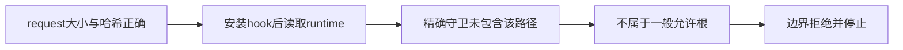

# S-ref_C正式失败冻结审计与runtime读取绑定核查

2026-11-14。仅执行只读审计，未修改入口／守卫／runtime、未导入模型或运行CPU测试／forward／CUDA／训练，未重读真实点数组或checkpoint，未复用request。

## 1. 结论

**正式失败冻结审计通过，20项检查全部满足。根因已定位为精确runtime读取绑定遗漏；文件本身完整，当前不涉及模型或3900步数值合同失败。**

原训练runtime位于旧共享目录，新训练入口位于新目录。请求虽绑定了runtime的大小和SHA256，安装前核验及授权检查也通过，但安装文件策略后再次加载runtime时，既不在一般只读根内，也没有加入精确文件读取守卫，因而被边界规则拒绝。

这是我在隔离入口接入中遗漏了复用runtime的读路径。先前CPU文件策略测试只加载模型模块及初始化文件，没有执行实际runtime的同策略读取，因此没有发现这一部署目录差异。

## 2. 冻结审计结果

已消耗request SHA256：

`6d63c000de45f02cee7e7318abedaef0bb96b39e32a5e0ae6f40bdfbf2c67b21`

核验同一冻结容器`shu-common-25721452-notebook-zbpgzu-0`及GPU身份，退出码1，原worker与tmux均已退出；该request不得再次执行。

有界只读采集32文件、唯一内容703,017字节，在32文件／8MiB／60秒范围内。两次读取的哈希及dev／inode／mode／size／mtime／ctime一致，排除atime干扰。

- 输出精确4文件：`startup_failure.json`、`launch.log`、`worker.pid`、`exit_code.txt`。
- 安装15个payload与4个授权／runtime／launcher／claim控制文件，逐个匹配冻结运输映射和本机材料化字节。
- 上传压缩包及3个校验文件匹配本机冻结文件。
- 5份精确相关源码为runtime、预算父工具、preflight helper、native读取helper及CUDA读取守卫。
- 授权回执、单向runtime和唯一claim均匹配request，没有循环反向绑定。

输出没有metrics、order_plan、初始化指纹、optimizer、模型构造、checkpoint或完成记录。日志定位在runtime文件哈希读取，早于runtime编译执行、模型构造、训练分派与optimizer，因此**已提交训练更新为0**。这来自精确失败位置与产物清单，不能把没有运行的长期训练视作通过。

本轮未重新验证315个数据文件；安装前那次315训练文件哈希通过记录仍保留，不能把它写成此次审计重新认证数据。没有修改科研设置或再次GPU准入。

## 3. 精确runtime的文件身份

```text
/home/jovyan/adapointr_work/PoinTr/third_party/bcsp_scq_foldC_training_20261113_v1/bcsp_p1_training_runtime_v1.py
```

大小11,268字节，SHA256：

`939e317dd447d04c62897849c0230f1918dc65c46ec556acdb60c9d69dfebeee`

服务器当前文件、request绑定、本机原runtime三者一致；读路径及父目录无符号链接，读取前后内容属性稳定。故不能解释为文件损坏、缺失、上传出错或哈希漂移。

## 4. 读取守卫的调用链

1. `authorize()`在系统audit hook安装前完成源码哈希核对，所以通过不证明安装hook后的读取可达。
2. 新入口的只读根包含隔离模型根、新entryroot、Conda环境、provider等；旧runtime所在共享目录是另一兄弟目录，不在这些根内。
3. 原native精确读取守卫只包括encoder／factory／LQI decoder／LQI factory四份源码；外层额外绑定只包括SCQ residual／factory及原SCQ初始化，遗漏runtime。
4. hook安装后，`source_module('scq_parent_training_runtime', ...)`先执行`exact()`的哈希读取，尚未编译runtime即回落到一般边界规则，被拒绝。



因此应补一个精确只读文件绑定，不应把整个旧third_party目录或项目根放行。失败首错中的`write/read boundary`是通用边界报错文本；本次实际操作是哈希校验所需的只读打开，并不是runtime试图写入旧目录。

## 5. CPU覆盖缺口与唯一建议

CPU子进程已经核验模型模块／初始化读取、train-only NPZ与final-only checkpoint策略，但没有在同一策略下读取并加载复用runtime。应补的回归必须到达实际调用点，而不只检查request有哈希字段。

后续如单独授权最小修订，范围建议为：

- 仅将`q['implementation']['runtime']`加入已有精确只读守卫；保留大小、SHA256、原始路径链接、文件身份和禁止写入检查，不改一般允许根。
- 人工回归在同一audit policy下读取并编译／加载这个精确runtime，绑定其实际依赖；保留runtime写入、哈希／字节漂移和同目录未绑定文件读取拒绝检查，以及训练NPZ／checkpoint边界。
- 通过一批CPU回归及新P3后，创建全新待授权request、运行与控制路径。保持模型、数据、初始化、loss、顺序、3900步、优化器与资源阈值不变，不重复GPU准入。

本轮到只读审计结束，未实施修订、重跑或创建新request。

## 6. 证据

- [正式冻结审计JSON](freeze_verification_v1.json)
- [runtime读取合同核查JSON](runtime_read_contract_findings_v1.json)
- [实际runtime源码回读](downloads/related/0_bcsp_p1_training_runtime_v1.py)
- [实际失败记录](downloads/output/startup_failure.json)
- [实际入口源码回读](downloads/installed/bcsp_scq_rf_Sref_C_training_entry_v1.py)
