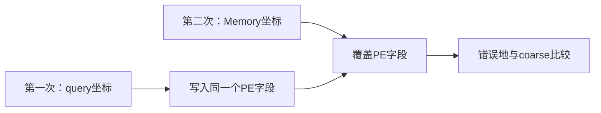

# SCQ-RF正式失败冻结审计与坐标hook合同核查

2026-11-14。范围：只读失败产物审计与坐标消费者合同核查。未修改服务器或候选代码、未导入模型、未运行CPU测试／forward／CUDA、未复用request。

## 1. 结论

**失败证据的正式冻结审计通过，21项检查全部满足；CUDA准入本身仍为失败。已确认短入口的hook采集合同存在错误，不能把当前报错直接解释为模型坐标传递错误。**

我在短入口中把共享位置编码模块的两次调用写入同一个`PE`字段，遗漏了真实decoder先处理query、再处理Memory的调用语义。第二次记录覆盖第一次，而随后的断言仍将该字段当作query坐标比较。这一采集错误有精确绑定源码支持，足以解释误报路径。CPU入口fixture只调用一次位置编码，因而没有覆盖这个真实场景。

同时，本次没有保存各消费者张量或逐项相等性结果，不能独立数值认证其他消费者都正确，也不能宣称RF CUDA通过。RF-Static／RF-Requery尚未运行，科研效果未知。

## 2. 正式冻结审计

执行request SHA256：

`85854f243d29000cc7a0ee87b03f4ce23974fc92d94d6fd479fd695e68c7ab32`

当前仍为已尝试、已消耗，不得复用。核验同一容器`shu-common-25721452-notebook-zbpgzu-0`及冻结GPU身份；退出码为1，固定tmux与原worker均已结束。

本次只读读取29个文件、唯一内容共2,301,443字节，服务器采集约4.02秒，在32文件／8MiB／60秒范围内。清单包含：

- 6个失败输出文件；
- 12个安装payload与4个控制／claim文件；
- 3份实际相关源码：SCQ factory、LQI decoder、AdaPoinTr母版；
- 服务器上传压缩包及3个校验文件。

两次读取的全部内容哈希及dev／inode／mode／size／mtime／ctime指纹相同，排除atime影响。安装payload与冻结映射一致，授权回执、单向runtime、launcher与本机原始字节一致；唯一claim与request绑定一致。没有未登记输出文件、完成记录或后续RF阶段。

事件顺序只有S-ref的原生optimizer参数分类记录、第一次forward调用前claim和阶段恢复记录。实际计数固定为**1 forward／0 loss／0 backward／0 step**。分类记录参数总数40,596,676符合S-ref预期，不代表RF模型已构造或通过。

恢复日志中的state、RNG、模式、BN动量恢复与梯度清理均为true；本审计核验这些记录及其绑定源码，没有重新加载模型来复演恢复。

8条资源记录的全部阈值均独立重算通过。记录峰值RSS为1,022,558,208字节，SMI占用587MiB，torch allocated为170,098,176字节、reserved为180,355,072字节。资源样本不是连续峰值保证，也不是硬隔离证明；本次直接退出原因为坐标消费者断言。

机器结果：[formal_failure_freeze_audit_v1.json](formal_failure_freeze_audit_v1.json)。

## 3. 坐标hook合同错误

| 环节 | 精确源码行为 | 影响 |
|---|---|---|
| 真实decoder | [LQI decoder第97行](downloads/related/1_bcsp_lqi_decoder_v1.py#L97)：同一`coordinate_pe`先接收`q_pos`，再接收`v_pos` | 同一模块有两种坐标角色，不能只保留最后一次输入 |
| 采集hook | [入口第177行](downloads/installed/bcsp_scq_rf_cuda_admission_v1.py#L177)：两次均执行`consumers.update(PE=...)` | 第二次Memory坐标覆盖query快照 |
| 一致性断言 | [入口第186行](downloads/installed/bcsp_scq_rf_cuda_admission_v1.py#L186)：将query／decoder／PE／rebuild统一与coarse比较 | `PE`此时角色错误，实际比较Memory与coarse |
| CPU fixture | [测试第78行](downloads/installed/test_rf_cuda_entry_cpu_v1.py#L78)：只调用一次`coordinate_pe(q_pos)` | 无法发现共享模块第二次调用覆盖记录的问题 |

Memory与query都是batch×256×3，因此只检查shape不会区分角色。真实decoder并没有因为两次位置编码而改变query坐标；源码显示其self／cross KNN使用`q_pos`，排序也从`q_pos`生成。母版FC重建条件和中心仍使用返回coarse。上述静态调用关系与正确坐标路径相容，但缺少本次逐消费者数值快照，不能扩大为全部路径的运行认证。

这是对错误采集口径的确认，不需要通过放宽容差、改变RF公式、调整模型参数或追加forward来解释。详细源码锚点及证据限度见[hook_contract_findings_v1.json](hook_contract_findings_v1.json)。

## 4. 唯一建议的后续范围

如继续，下一次仅需单独授权短入口与其人工回归的最小修订：

1. 将位置编码两次调用按顺序及角色分开保存，明确query快照与Memory快照；分别与decoder的`q_pos`、`v_pos`比较，并严格检查调用次数。
2. 在断言前记录各消费者调用次数、shape及逐项相等性，避免合并断言再次丢失定位信息。
3. CPU fixture覆盖同一共享模块先query、后Memory两次调用，使用shape相同但数值不同的坐标；保留真实合同错误应拒绝的回归。
4. 保持RF模型／初始化／provider、资源阈值、精确相等判据和5 forward／4 loss／4 backward／0 step不变。通过针对性CPU验证和新P3后，再创建新版本待授权request。

本轮没有实施这些修订、创建新request、运行forward或重试。旧失败和旧request保留，不改写为成功。
