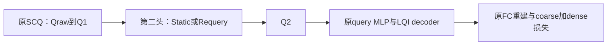

# SCQ-RF隔离实现、CPU验证与P3缺口报告

日期：2026-11-14。范围：本机 implementation-only；无服务器操作、CUDA、真实数据或checkpoint读取、训练、optimizer step。

## 1. 本轮结论

RF-Static／RF-Requery隔离候选及初始化已实现，静态检查通过。唯一一次人工CPU批次通过前46项检查，在完整loss反传后的“第一／第二头所有参数梯度均非零”断言处失败，已停止，未修改或重跑。**本轮CPU验证未通过，P3未通过，不具备新模块CUDA准入条件。**

该失败存在明确的测试fixture错误：测试将第一头SCQ的输出bias改为非零，但没有将其输出weight从零改为非零，却要求第一头隐藏层所有参数均有非零梯度。零输出weight将阻断隐藏层梯度，这一现象符合链式法则，不能当成RF设计失败或Mamba/CUDA失败。

这并不排除同一个组合断言的其他分项还有问题：本次没有持久化逐参数梯度值，因而只能确认一个足以导致断言失败的源码原因，不能声称其他梯度分项已经独立通过。

## 2. 隔离实现与唯一公式

固定原SCQ得到Q1与N0。RF-Static使用原N0；RF-Requery使用同一provider的`KNN8(M,Q1)`。两臂均以当前Q1重新计算局部相对几何与描述量：

`h = [z, mean(LN(F邻居)), max(LN(F邻居)), Q1, μ, σ, ρ]`，维度1802。

第二头固定1802→128→3、精确GELU、输出层weight／bias零初始化，`Q2=Q1+delta1`；没有gate、clamp、新loss或额外监督。第二次邻居选择是两臂唯一的计算分支。Static没有复用Qraw处的相对几何。

没有修改母版、原SCQ、LQI decoder或训练runtime源码。新factory在原SCQ模块的返回接口交接Q2，原base forward继续使用同一coarse变量，保留原参数路径。第一头记录的N0是整数索引，可以复用；参与RF计算的Q1直接取原forward返回值，保留计算图，不从detach日志恢复。

新增参数为**231,171**；两臂初始化state完全一致。固定私有CPU Generator seed为**2026111402**，V1按Linear默认等价均匀分布初始化；V2及bias为零。初始化二进制924,684字节，SHA256：

`a4024fbdb49feb41c609ae1171f04c2cb14ab794fc3663855d81395c6a1ea79e`

原生模型预计参数总量40,827,847仅为协议预期，尚未测量原生CUDA模型。CPU人工构造的模型总参数不得冒充该数值。

## 3. 已通过的46项检查涵盖什么

完整逐项清单见[失败证据](cpu_batch_v1/failure_v1.json)。以下是已完成检查的归纳，不是完整批次通过证明。

| 检查组 | 已保存证据 |
|---|---|
| 身份与初始化 | 本次绑定源码未变；两臂初始state相同；共有参数／BN buffer保留；构造不消耗共有CPU随机流；严格state_dict重建通过 |
| 机制与公式 | Q1等于Qraw、邻居不变、邻居改变三类人工案例；Static重算Q1几何；独立float64描述量重算；原KNN重复点／等距行为；批量8形状与独立性 |
| 局部梯度 | 第二头零输出时V2有效梯度、V1零梯度符合预期；诊断性非零V2下梯度到达V1和连续M/F/z/Q1；整数索引不求导；诊断记录detach |
| 完整调用链 | RF零输出时与原S完整8192预测精确一致；Q2进入实际query-MLP、位置编码、排序、self/cross-KNN、FC重建条件和dense中心；非零诊断头时两臂预测可区分 |
| 守卫与分组 | 无GT模型参数；拒绝错dtype／shape／非有限／非法索引／错初始化哈希；无新增注册attention；共有optimizer分组原样保留，四组新增权重／bias分类及完整唯一分区通过 |
| 原损失 | 原无去噪训练返回结构保留；原8192点cdist loss中coarse与dense各调用一次；未添加辅助损失 |

CPU使用保留的人工构造器、替代grouper／FPS和因果surrogate Mamba；调用原母版forward、LQI decoder、FC head及`get_loss()`。因此这些检查不能证明真实Mamba、PointNet2、CUDA数值或显存通过。B=8检查覆盖的是RF张量路径，而非完整原生模型batch8训练。

## 4. 失败原因与尚未覆盖范围

原第一头形式为`delta0 = W2·GELU(W1·h+b1)+b2`。本次人工诊断只设置`W2.bias=[.18,-.1,.07]`，保留`W2.weight=0`，所以即使Q1发生非零平移，`dLoss/dW1`仍包含为零的W2因子。测试把“输出已有非零平移”误当成“隐藏层梯度已打开”。这是测试设置和断言前提不一致。

失败发生在完整loss已经调用`backward()`之后。没有运行optimizer或保存训练权重。失败后的“参数未更新、BN恢复”检查没有到达；该人工模型只存在于已退出的CPU进程中，没有复用它继续执行。不得据前46项通过将整批测试写成通过。

本次未使用原生SSM参数对象。共有分组作为外部输入被保留，但尚缺精确继承runtime策略的人工`_no_weight_decay`标记回归。该项应与下一次fixture修订合并，不另建通用分组框架。

## 5. P3结果与限定下一步

[P3缺口复核](P3_gap_review_v1.json)状态为`LOCAL_RF_IMPLEMENTATION_P3_NOT_PASSED_CPU_FAILURE_STOP`。全部冻结源码及初始化仍与静态记录相同，失败证据保留；没有创建CUDA或训练execution request。

依据已确认计划第5.3节“一次失败保存结果后停止，不自动修复重跑”，本轮到此停止。建议下一次仅授权：

1. 修正人工完整模型fixture，在诊断副本为第一头输出weight设置固定非零值；保留生产实现、冻结初始化与科研公式。
2. 分开记录逐参数梯度与Q2梯度，保留零初态梯度预期和非零诊断态梯度验证，避免组合断言掩盖原因；补精确继承no-decay策略的人工标记检查。
3. 使用新版本测试和新输出目录执行唯一一次CPU批次，再完成新P3。此次失败批次不得复用为通过记录。

通过后才准备并单独授权RF模块专用CUDA零更新验证，沿正式计划固定**5 forward／4 full loss／4 backward／0 step**；不追加训练或重复旧母版的全部preflight。

## 6. 文件索引

- [第二头隔离实现](bcsp_scq_rf_residual_v1.py)
- [最小factory接口适配](bcsp_scq_rf_factory_v1.py)
- [本次人工CPU测试](test_scq_rf_cpu_v1.py)
- [初始化清单](initialization_manifest_v1.json)
- [静态审查及有限输入哈希](static_review_v1.json)
- [失败产物](cpu_batch_v1/failure_v1.json)
- [P3缺口复核](P3_gap_review_v1.json)

本轮产物保存在本机项目目录，未部署、推送、创建运行授权回执或启动任何服务器进程。
