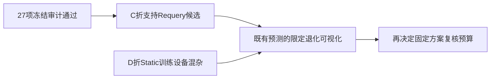

# SCQ-RF三臂两折评分冻结审计与结果解读

日期：2026-11-15。此文仅解释已经冻结的Native评分；不重算几何距离，不运行模型，不执行bootstrap、显著性检验或正式gate。

## 证据与计数

正式只读审计27项通过：210病例、42来源；630模型评分与420共享控制，共1050病例行、210来源行；6个折内比较、630个配对病例差值。共享控制与历史冻结结果逐行相同。评分退出码0。每来源五类缺损先平均，再对每折21个来源等权汇总。

## 三臂结果

距离单位mm；覆盖率为2mm阈值下的百分比。E/J均沿用冻结参考区定义，不赋予新的临床含义。

| 折 | 模型 | E_P95 ↓ | J_P95 ↓ | E Cover@2mm ↑ | J Cover@2mm ↑ | CD-L1 ↓ | 严重病例/105 |
|---|---|---:|---:|---:|---:|---:|---:|
| C | S-ref | 9.030 | 11.963 | 61.91% | 49.61% | 5.953 | 9 |
| C | RF-Static | 7.619 | 9.811 | 57.51% | 49.30% | 4.984 | 6 |
| C | RF-Requery | 6.932 | 9.178 | 67.62% | 55.35% | 4.318 | 3 |
| D | S-ref | 5.273 | 7.765 | 67.22% | 53.82% | 3.130 | 2 |
| D | RF-Static | 5.795 | 8.360 | 63.48% | 50.74% | 3.332 | 2 |
| D | RF-Requery | 5.029 | 7.538 | 69.36% | 53.97% | 2.755 | 2 |

## 核心对照：RF-Requery相对RF-Static

C折是主要机制证据：两臂同设备、同参数规模、同初始化及批次合同。E_P95降低0.687mm，21来源中17改善、4回退；J_P95降低0.633mm，15改善、6回退；CD-L1降低0.666mm，18改善、3回退。E/J的2mm覆盖率分别提高10.11与6.05个百分点。已选主要距离、覆盖及离群指标方向一致，支持保留重查询候选。

C折严重病例6→3，但净减少不能替代病例转换：新增1、挽回4、共同严重2。该标签严格沿用E_P95>20mm或J Cover@2mm=0，属于几何风险标记，不是临床安全结论。>20mm预测离群比例从5.96%降至4.20%；质心偏差均值15.57→13.29mm，coarse质心偏差17.57→14.22mm。coarse与dense同时改善，与空间条件改善相容；仅凭这些相关统计不能确定具体因果步骤。

D折Requery相对Static的E_P95降低0.766mm、J_P95降低0.822mm、CD-L1降低0.578mm，E/J覆盖率提高5.87/3.23个百分点。但Static_D训练GPU UUID及驱动不同，不能把差异全部归因于重查询。三臂预测虽在同一当前设备上完成，也不能消除训练设备混杂。D折严重病例2→2，实际新增2、挽回2、无共同严重病例。

## 对S-ref的比较与解释边界

C折Requery相对S-ref的E_P95降低2.098mm、J_P95降低2.785mm、CD-L1降低1.635mm，E/J覆盖率提高5.71/5.74个百分点；严重病例9→3，没有相对S-ref新增严重病例。D折Requery相对S-ref改善较小：E_P95降低0.244mm，J_P95降低0.227mm，J覆盖率仅提高0.15个百分点；E_P95来源胜负为11/10，不能描述为普遍改善。D折S-ref与Requery的历史训练设备相同，但仍仅为一次种子训练结果。

Static增加第二阶段并未形成稳定全指标收益：C折E_P95改善但E覆盖率下降4.40个百分点；D折多项距离和覆盖指标回退。因此现有证据更支持“重查询具有潜在价值”，不支持“增加残差头本身即可可靠改善”。相对S-ref的比较含新增参数/计算路径；同规模Static/Requery对照才更接近重查询因素的检验。

## 尚未解决的退化

C折parietotemporal类的Requery−Static：E_P95 +1.693mm、J_P95 +2.048mm、CD-L1 +0.467mm，尽管2mm覆盖率提高。这说明平均覆盖改善与尾部/形状误差改善不能互相替代。random_1的J_P95也有轻微回退（+0.203mm）。不能用总体均值掩盖这些区域。

C折新增严重（相对Static）：`train__053__frontoorbital`；共同严重：`train__012__parietotemporal`、`train__025__parietotemporal`。D折新增严重（相对Static）：`train__069__random_2`、`train__087__frontoorbital`；后者相对S-ref也新增严重。

## 建议下一步

先复用现有预测做一个限定几何可视化：三个核心对照新增严重病例、C折两个共同严重病例，再从已列挽回病例按预先写明的固定规则选少量改善对照；同时检查C折parietotemporal回退。使用已保存Q0→Q1→Q2→dense判断偏位、过度残差、远端离群和局部覆盖变化是否同向。不新增forward、不调参、不筛除病例、不扩展诊断框架。范围须另行确认后执行。

若诊断未发现实现或表示问题，再讨论固定方案的重复种子/独立验证预算；当前不追加训练。不能宣布统计显著、临床可靠或正式gate通过。每折21个来源是汇总单位，105个缺损不是105个独立受试者；两折为单种子、反复使用的开发集，收益仍需复核。

证据文件：`audit_report_v1.json`、`descriptive_results_v1.json`；原始评分位于`outputs/scq_rf_score_impl_20261115_v1/unified_scores_v1/`。审计复核了已有指标、几何恒等式和汇总；没有独立重算最近邻距离或重新加载模型。
