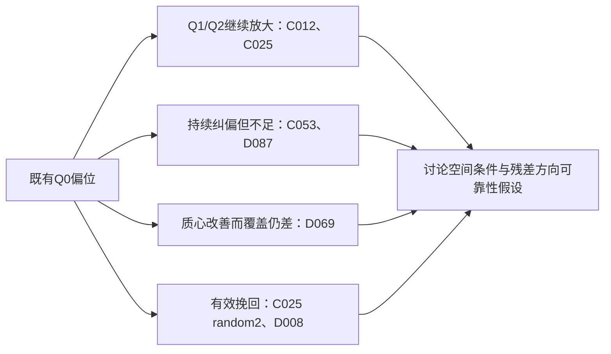

# SCQ-RF：七个固定病例的Q0→Q1→Q2→dense阶段诊断

日期：2026-11-15。复用既有21份预测，无新forward、训练、参数修改、checkpoint加载、配准、过滤或重采样。原评分文件未修改。

## 固定范围与方法

对象为Requery相对Static新增严重的3例、C折共同严重的2例，以及每折挽回列表中字典序第一例，共7例、3臂。改善对照在读取数组前已固定：C train__025__random_2，D train__008__frontoorbital。它们是按既有风险标记选出的诊断对照，不代表独立测试样本，也不一定具有高精度接口。

所有点集按原D-only归一化逆变换至世界mm。每例三臂各保存Q0/Q1/Q2（各256点）和dense（8192点），验证逐点残差等式；计算质心偏差、回转半径比、点到冻结A2的距离尾部，以及冻结A1 E/J的面积加权支持距离和2mm覆盖率。新计算为限定病例的诊断，不替代正式性能。所有dense诊断值与冻结评分对应值一致。

逐点残差关系及质心平方误差分解均通过。所有视图均保留原始点，固定XY/XZ/YZ和统一0—40mm显示色标；超过40mm的数值仅颜色饱和，统计不截断。HTML提供同步旋转及GT bbox+10mm的显示缩放，ROI不影响任何统计。三维接触不能仅由二维投影重合认定。

## Requery质心误差轨迹

下表单位mm。Q0/Q1/Q2点数相同；dense点数不同，末级变化不能直接解释为单一模块的因果效应。

| 折/病例 | 角色 | Q0 | Q1 | Q2 | dense |
|---|---|---:|---:|---:|---:|
| C / train__053__frontoorbital | new_severe_vs_Static | 64.27 | 51.00 | 50.29 | 48.80 |
| C / train__012__parietotemporal | shared_severe | 82.94 | 102.69 | 130.87 | 132.03 |
| C / train__025__parietotemporal | shared_severe | 57.69 | 60.88 | 71.77 | 70.25 |
| C / train__025__random_2 | fixed_rescued_control | 50.99 | 30.75 | 8.42 | 7.64 |
| D / train__069__random_2 | new_severe_vs_Static | 22.96 | 14.19 | 11.52 | 11.83 |
| D / train__087__frontoorbital | new_severe_vs_Static | 68.09 | 61.92 | 38.21 | 35.97 |
| D / train__008__frontoorbital | fixed_rescued_control | 52.16 | 41.71 | 15.67 | 9.40 |

## 病例级解释

### C / train__012__parietotemporal：早期偏位被两级反馈继续放大

Requery质心误差82.94→102.69→130.87→132.03mm。Q0→Q1增加19.75mm，Q1→Q2再增加28.18mm；对应E_P95 79.60→104.27→130.02mm。dense的E_P95虽回落至117.30mm，仍有100%预测点距A2超过20mm、J覆盖为0。主要空间问题在dense之前已成立，不能仅归因于dense展开。Static同例也严重，但最终质心72.05mm、E_P95 30.66mm；Requery在本例存在更强的残差放大。

### C / train__025__parietotemporal：反馈继续恶化位置，dense未能挽回

Requery质心57.69→60.88→71.77→70.25mm，两个反馈阶段都增加偏位。Q1→Q2增加10.89mm；最终E_P95 55.67mm、J覆盖为0、A2>20mm点占98.60%。Static最终也很差，Requery的最终误差反而较Static小，说明“共同严重”不等同于“Requery新增错误”。

### C / train__053__frontoorbital：第一阶段纠偏不足，第二阶段未能救回

Static/Requery的Q0质心误差接近：64.87/64.27mm；Q1时已分化为34.28/51.00mm。Requery Q1→Q2继续小幅改善至50.29mm，最终48.80mm，并非第二阶段把原本良好的位置推坏。相较之下，Static最终18.86mm、E_P95 5.43mm；Requery最终E_P95 29.60mm、J覆盖3.15%、A2>20mm比例82.79%。Requery Q1→Q2的J_P95仍有37.69→39.87mm局部回退；不能只凭质心改善认定接口改善。

### D / train__087__frontoorbital：大幅纠偏仍不足，差异在第一阶段前后已明显

Requery Q0为68.09mm，Q1仅改善至61.92mm；Static对应58.76→22.49mm。Requery第二阶段实际大幅改善至38.21mm，dense为35.97mm，最终E_P95 21.25mm、J覆盖23.22%、远端点占52.53%。因此本例更符合“已有偏位、第一阶段纠偏不足、后续救回不充分”，不支持简单将失败归因于重查询阶段新增偏移。D折Static训练设备不同，以上跨臂差异仅描述，不能作纯机制归因。

### D / train__069__random_2：质心改善与形状／接口覆盖脱钩

Requery质心22.96→14.19→11.52→11.83mm；Q2与dense的A2>20mm点占比均为0。Q1→Q2虽然质心改善2.67mm，J_P95却从34.66增至40.93mm，E_P95从27.07增至27.45mm；最终E_P95仍21.82mm、J_P95 36.47mm、半径比约0.747、J覆盖16.00%。问题包含残余位置误差与范围／局部覆盖不足，不能用删除远端离群点解决，也不能把它说成单纯平移错误。

### 两个固定改善对照：大Q0偏差也可能被重查询有效挽回

C train__025__random_2：Requery质心50.99→30.75→8.42→7.64mm；Q1→Q2改善22.33mm。E_P95 30.38→13.55→9.64mm，远端点在Q2/dense降至0。不过最终J覆盖仅1.29%、J_P95 13.25mm、半径比0.690；风险标签由严重变为非严重不等于高精度接口已恢复。

D train__008__frontoorbital：Requery质心52.16→41.71→15.67→9.40mm，Q1→Q2改善26.04mm；E_P95 31.98→9.89→3.76mm，最终J覆盖74.37%。本例显示第二阶段与后续dense可以共同修复较大早期偏差；但也不是临床精度认证。

## 能得出的结论

1. 5个退化例并非同一种故障：2个C折共同严重例存在反馈继续放大偏位；C053和D087主要是纠偏不足；D069显示位置指标改善与接口／形状覆盖脱钩。
2. 在这7例中，没有证据支持把dense作为统一首发根因。dense常降低支持距离尾部，但不能普遍挽回已经错误的coarse空间位置；某些病例的dense也会轻微增加质心误差或远端点比例。
3. 大Q0偏差不是失败病例特有：两个改善对照也从约51—52mm开始，随后被有效挽回。因此不能据此直接制定“大Q0偏差即拒绝”规则；推理时也没有GT质心可供使用。
4. 同为256点的Q0→Q1→Q2更适合比较阶段几何变化；256→8192的覆盖提升混合了点数和展开因素，不是受控结构消融。
5. 三臂经过分别训练；跨臂Q0、Memory和权重不相同，Q0不是去掉反馈后的反事实模型。本次可定位误差在已保存阶段的表现，不能证明某个算子是唯一根因。

## 下一步建议与边界

保留RF-Requery候选，先形成针对“早期空间条件＋残差更新方向可靠性”的一个最小可证伪假设，并同时以退化和挽回病例约束它；不立即改dense loss、限制所有残差幅度或按GT阈值做推理筛选。有效挽回对照需要22—26mm的第二阶段质心纠偏，盲目限幅可能损害这部分收益。

若要提出新守卫，其输入必须是推理时可得的D/Memory/当前query证据；本次GT距离仅作离线诊断，不能变为推理特征或将病例剔除。未授权任何新实现、forward、训练、参数扫描或正式gate。

## 文件与复查

- `index.html`：全部7例静态视图与离线同步三维页面入口。
- `figures/`：每例XY/XZ/YZ，21张图；颜色／坐标范围在同一病例内统一。
- `html/`：7个自包含三维页面，可切换全局范围与GT显示ROI。
- `seven_case_stage_summary_v1.png`：7例阶段质心、远端点和接口覆盖曲线。
- `stage_metrics_v1.csv`：84行阶段诊断；`stage_transition_changes_v1.csv`：63行阶段变化。
- `stage_diagnostic_result_v1.json`：全部数值、源文件绑定、世界坐标与限制。

