# Fixed11 stage geometry panels

Existing predictions only. Shared world bounds per case, static display subsampling only. Selected diagnostic cases, not unbiased efficacy evaluation.

## C train__001__frontoorbital

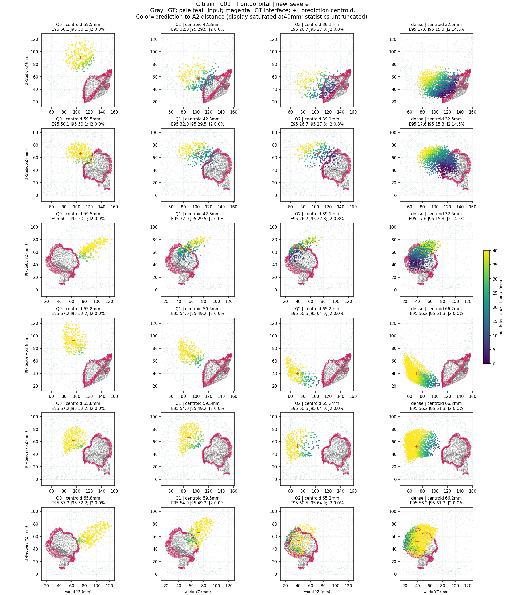

## C train__025__random_2

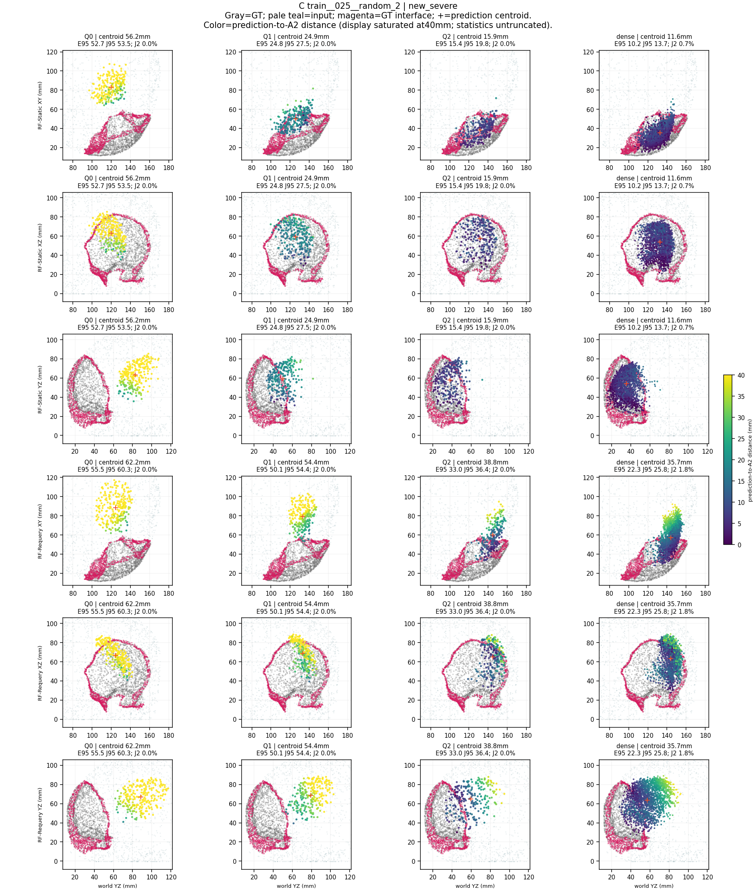

## C train__026__frontoorbital

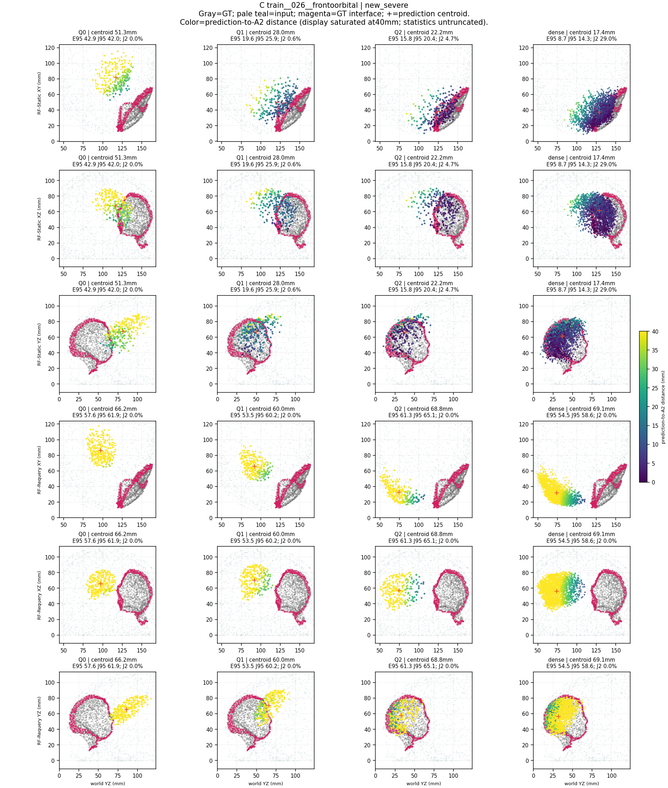

## C train__036__frontoorbital

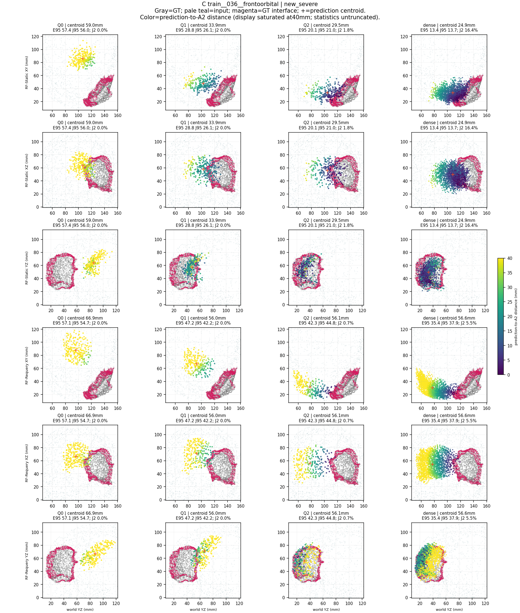

## C train__038__random_1

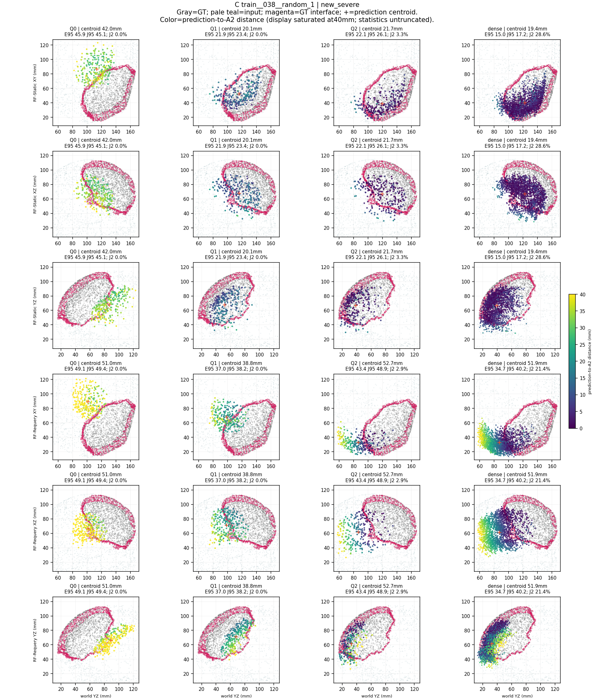

## C train__094__parietotemporal

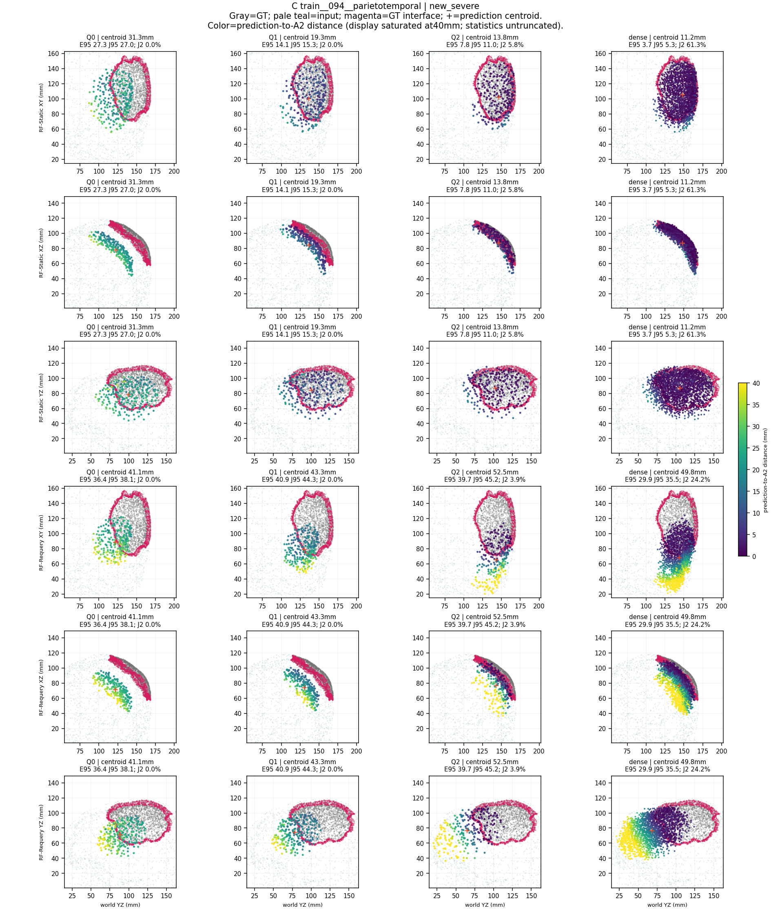

## C train__094__random_2

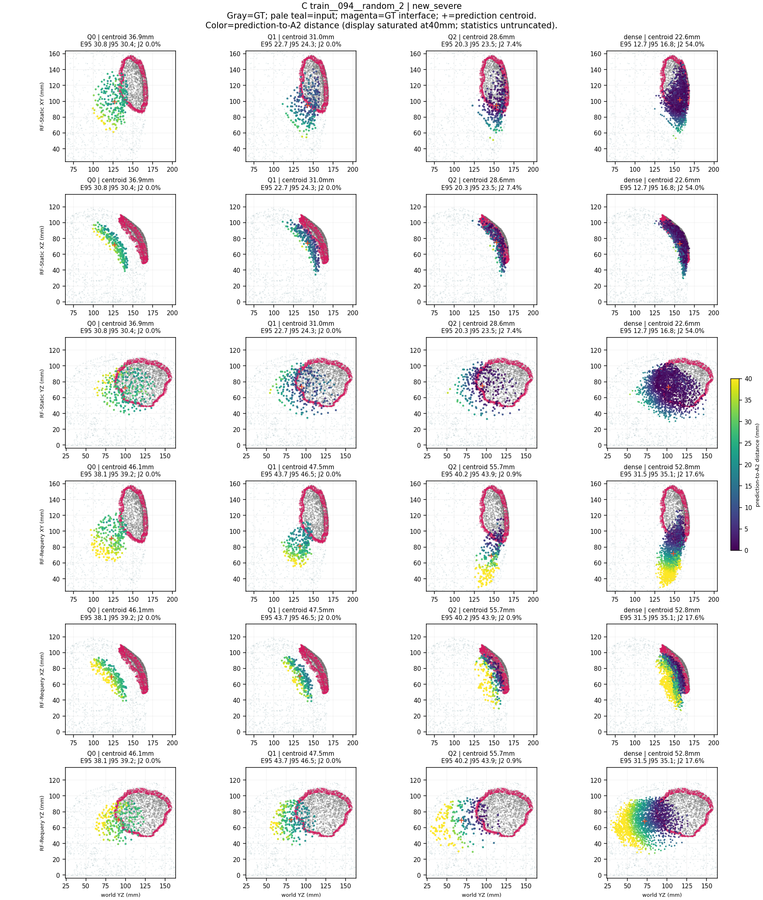

## C train__041__parietotemporal

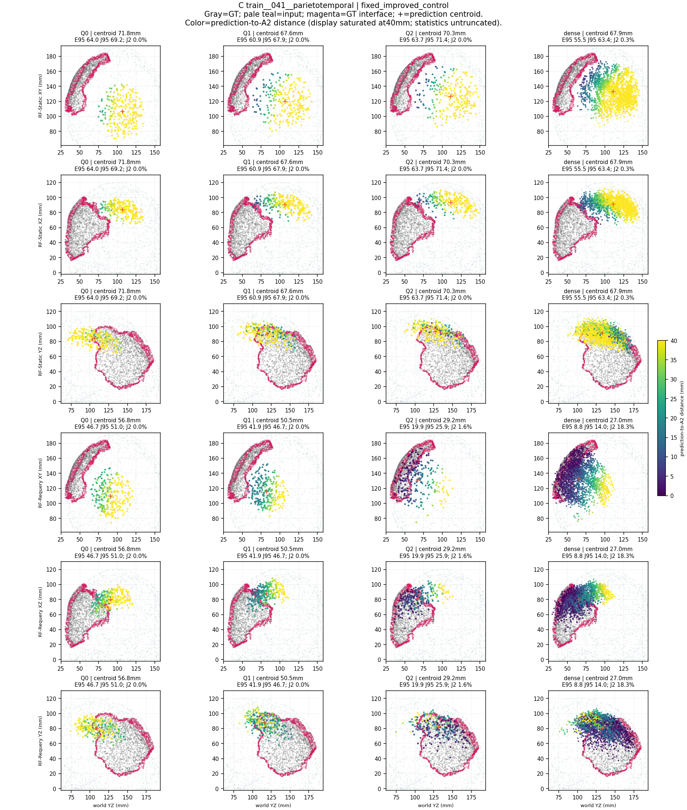

## D train__008__frontoorbital

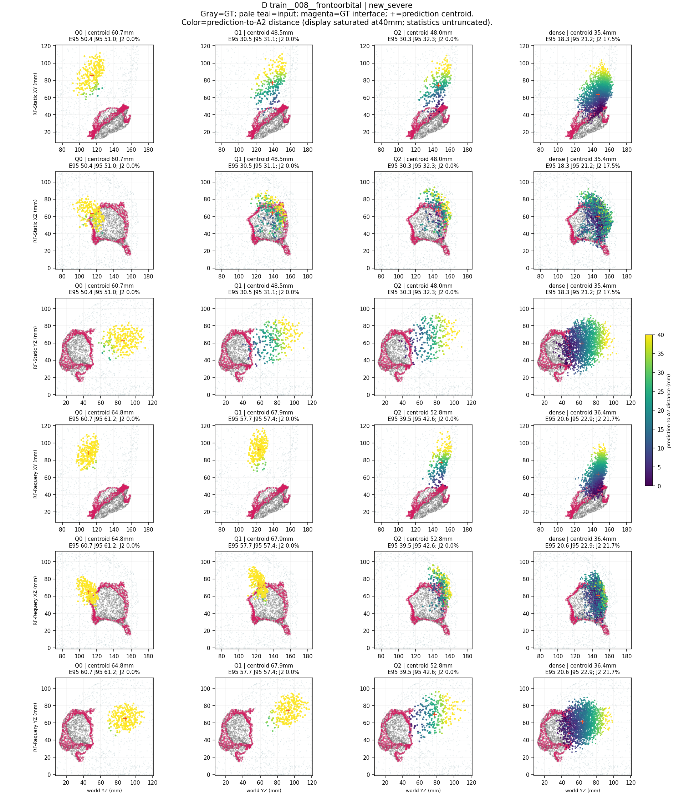

## D train__046__parietotemporal

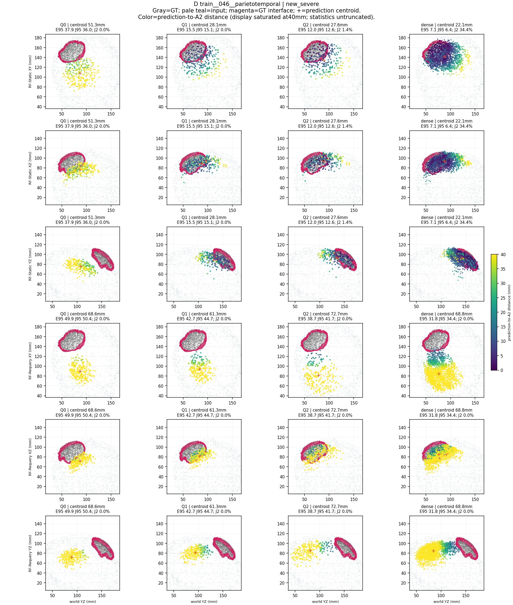

## D train__101__bilateral

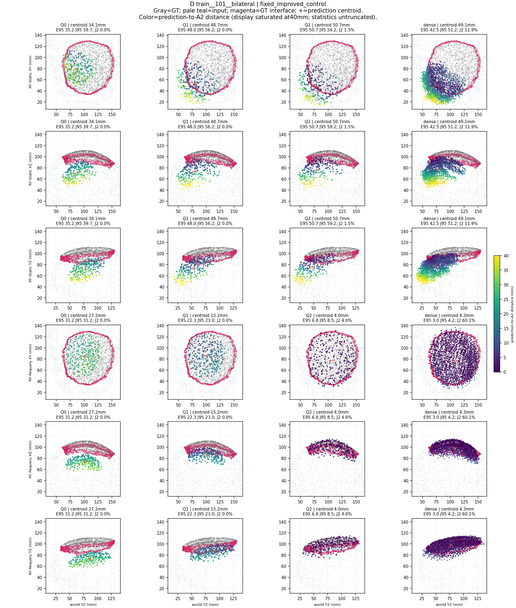

