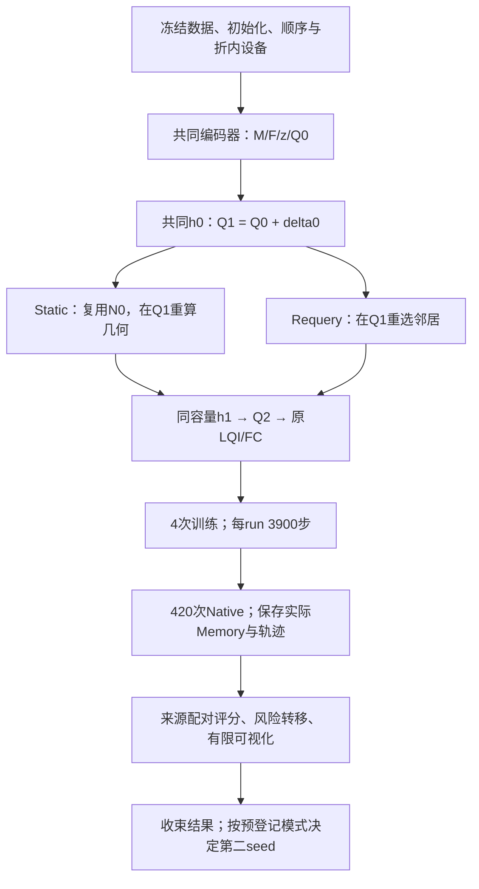

# Cranial-BCSP-FullMamba：SCQ-RIVE正式实验计划书

**重查询增益复核与反馈失效归因｜审阅修订v2｜2026-11-15**

状态：`PROTOCOL_PROPOSED_AWAITING_CONFIRMATION`。本文件是可供确认的科研方案，不是execution request。本次编制仅阅读本机证据、核对有限源码和检索文献，没有连接服务器、修改模型、读取真实点集payload、加载checkpoint、运行评分或forward。确认计划也不等于授权训练。

## 📋 1. 审阅结论与修订理由

**原草案方向合理，建议修订后采用。** 当前优先问题是RF-Requery相对RF-Static的增益是否能在折内设备匹配条件下复现，以及平均收益与新增严重失败为什么并存。继续调整DAC系数或叠加结构，信息价值低于这一复核。

本阶段不创造新的网络结构；RIVE是研究阶段名称。它应产出可复核的正面、混合或负面结论，为下一项独立假设提供依据，不能保证获得论文所需的创新增益。

| 原草案内容 | 评价 | 本版处理 |
|---|---|---|
| Static/Requery、C/D、首批4次从头训练 | 保留；直接针对D设备混杂与训练策略总效应 | 折内同设备；首批上限4，不补跑择优 |
| 保留8k→8k、V1、3900步 | 保留；避免多因素变化 | 数据、loss、排序、初始化母版和计数均继承 |
| 先恢复全部6个历史权重、再次CUDA准入 | 超出scratch复核的必要范围 | 以历史报告/评分、当前训练初始化和实际依赖为主；旧权重只在确有重放需要时恢复 |
| seed0改善才做seed1 | 可形成条件选择与停止偏倚 | 训练前选定“4-run有界探索”或“8-run重复研究”；不得把只对正向结果增加seed包装成无条件稳定性证据 |
| seed1改变初始化与随机流 | 方向正确但加载冻结初始化可能覆盖seed | 明确哪些参数改变、哪些零值/固定buffer保留，并在新增训练前冻结字节 |
| M/F/N0/N1可选 | 容易重现历史机制证据缺失 | 同次Native保存M、实际索引及阶段坐标；小型F/z也纳入明确预算 |
| 逐病例阶段图、运行效率全面测量 | 全量图/微基准不是主结论必需 | 全量数字，最多12个病例可视化；独立测速另行授权 |
| “无实质退化”“不可接受回退” | 缺少预先阈值，容易事后解释 | 改用明确方向、风险转移和CI；不凭空规定临床等效界值 |
| P/S/I/X失效分类 | 适合组织观察，尚不足以确认因果 | 改为可重叠的描述标签与连续轨迹；反事实需单独设计 |

**本阶段最值得花计算预算的工作是完整匹配对照，不是扩展通用审计、传输或库存框架。**

## 📚 2. 证据基础、已有结果与文献更新

### 2.1 本机既有证据

主要依据以下已冻结材料，历史数值不当作RIVE新结果：

- [SCQ-RF完整报告](E:/Codex/2026-06-06/mamba-ccf-c-1-high-resolution/docs/cranial_bcsp_scq_rf_20261115_final/Cranial_BCSP_FullMamba_SCQ_RF_完整实验报告_zh_2026-11-15_v1.md)。报告SHA256：`73962c29960804dea2e430b43ff405bafe2d776f3bd36900358bb1e6d41dfccd`。
- [SCQ-DAC完整报告](E:/Codex/2026-06-06/mamba-ccf-c-1-high-resolution/docs/cranial_bcsp_scq_dac_20261115_final/Cranial_BCSP_FullMamba_SCQ_DAC_完整实验报告_zh_2026-11-15_v1.md)。报告SHA256：`cf8a79fc5fa19a2d24a7353c2f47935bc2ecc7cdcfea59b946d9f30a555aa35a`。
- RF报告所链接的训练、预测、评分和七例阶段诊断冻结证据；DAC固定20例、实际Memory、双邻域proposal及离线几何对照。

| 历史RF比较：Requery−Static | C | D |
|---|---:|---:|
| 来源等权ΔE_P95，mm | −0.687 | −0.766 |
| ΔJ_P95，mm | −0.633 | −0.822 |
| ΔJ Cover@2mm，百分点 | +6.05 | +3.23 |
| ΔCD-L1，mm | −0.666 | −0.578 |
| 来源E改善/回退 | 17/4 | 13/8 |
| Static→Requery严重病例数 | 6→3 | 2→2 |
| 新增/挽回严重病例 | 1/4 | 2/2 |
| 核心限制 | 同设备、单训练seed、开发集多轮曝光 | Static迁移GPU UUID及driver，另有前述限制 |

以上是按病例评分、来源内五缺损等权、折内21来源等权的结果。D的正向均值仍值得保留，但不是严格消除设备混杂的结构证据。严重净数减少不等于没有伤害；必须同时看新增与挽回。

DAC固定20例中5120个query的两路方向余弦全部为正，C/D均值约0.9761/0.9739，组合权重约0.9881/0.9870，接近直接重查询。DAC相对Requery的E改善仅0.102/0.021mm，J覆盖下降0.196/0.306个百分点，严重3/2例没有挽回。**这支持停止当前固定DAC公式的训练投资，不是“DAC重训失败”，也不是所有双邻域机制均无效。** 压力20例不代表完整开发来源分布。

SCQ历史Qraw偏位并非失败专属；RF存在大步有效纠偏与大步反馈放大两种现象。现有证据不支持统一clamp或把“残差更小/更一致”当作更可靠。

### 2.2 截至2026-11-15的直接相关文献

本次为围绕决策的定向检索，使用作者预印本、出版页面和会议原文入口；不宣称穷尽全部论文或完成用户31篇文献的逐篇全文重读。下表区分全文、摘要与出版预览的证据深度。

| 文献及核验层级 | 与当前计划的关系 | 不能据此推出的结论 |
|---|---|---|
| **CompletionMamba，TIP 2025**；作者机构记录/摘要：Local与Shape-aware Mamba | 支持同时重视局部几何和整体形状条件 | 不证明当前两阶段重查询有效；不能仅以“Mamba补全”为创新。[原始论文入口](https://doi.org/10.1109/TIP.2025.3597041)、[作者机构记录](https://research-repository.uwa.edu.au/en/publications/completionmamba-taming-state-space-model-for-point-cloud-completi/) |
| **3DMambaComplete，2026修订v2**；方法正文 | HyperPoint、空间offset与展开均有先例；v2正文明确使用Cross-Attention Block，不能作为“全网无attention”的现成证据。[方法正文v2](https://arxiv.org/html/2404.07106v2) |
| **DAPointMamba，AAAI 2026**；作者预印本摘要与录用信息 | 点云序列化可能损害局部拓扑，域适配空间条件值得关注 | 跨域对齐任务不等同本研究的单域骨块重查询；本轮不据此加入域适配模块。[作者稿](https://arxiv.org/abs/2511.20278)、[会议入口](https://doi.org/10.1609/aaai.v40i8.37596) |
| **FusionMamba，Information Fusion 134，104378，2026**；出版预览 | 已涉及空间感知SSM、局部/全局融合及残差几何对齐；必须作为最邻近创新边界 | 本次未获完整代码/全文细节，不能认定其与RF等价，也不能声称没有重叠。[出版页面](https://www.sciencedirect.com/science/article/pii/S1566253526002575) |
| **MedPCFM，arXiv:2606.24433v1，2026-06-23**；方法/实验正文 | 医学点云补全已有PTv3确定性与flow-matching竞争基线；使用SkullFix/SkullBreak，值得后续公平适配 | 其划分、点数、归一化及训练预算与当前协议不同，不能搬用论文数值排名。[全文](https://arxiv.org/html/2606.24433) |
| **High-Resolution Cranial Defect Reconstruction…，MICCAI 2023**；作者摘要/论文信息 | 支持颅骨点云补全及迭代高分辨率路线 | 迭代聚合/mesh效果不能替代本轮单次8k Native的E/J比较。[作者稿](https://arxiv.org/abs/2308.03813)、[出版DOI](https://doi.org/10.1007/978-3-031-43996-4_32) |
| **CDRMamba，BSPC 103，107376，2025**；出版摘要 | 已有3D U-Net结合Mamba的颅颌面缺损修复工作 | 属体积医学图像框架，不能当作同表示点云直接对照，也不能称首次Mamba颅骨修复。[出版页面](https://www.sciencedirect.com/science/article/abs/pii/S1746809424014344) |
| **RealPC，ICCV 2025**；会议摘要 | 提醒理想化合成补全不保证真实非均匀数据表现 | 工业真实点云不能证明临床适用性。[会议页面](https://openaccess.thecvf.com/content/ICCV2025/html/Pathak_Revisiting_Point_Cloud_Completion_Are_We_Ready_For_The_Real-World_ICCV_2025_paper.html) |
| **Thickness and design features of clinical cranial implants，IJCARS 2024**；论文摘要 | 临床implant涉及厚度、rim与体积，超出单纯骨块点云距离 | 研究性2mm覆盖与20mm风险阈值不是临床安全认证。[论文入口](https://doi.org/10.1007/s11548-024-03068-4) |

MedPCFM正文使用Poisson表面采样再FPS，确定性设置包括2048/2048、16384/16384、32768/32768，生成式采用不同输入/缺损点数比例，并联合训练SkullFix/SkullBreak。其实验还使用更长训练预算。**这些差异说明以后要适配共同任务，不构成本轮改采样、点数或loss的理由。**

近期MPath Mamba面向SemanticKITTI语义场景补全，PPC-MT仍为混合架构；不能因时间更新就视作更直接的颅骨完整骨块对照。文献所能提供的是设计背景与竞争压力，RF的有效性仍由本研究匹配实验检验。

### 2.3 与用户文献库的衔接

用户收集的颅骨Transformer、对称性、直接缺损预测、扩散/flow、occupancy/SDF、数据增强、自监督及临床研究继续作为研究背景。RIVE不同时试验这些因素。几何表示与实体缺损沿用已收束的选择：SkullBreak为主，SkullFix后续外部适用性，MUG500+不提升为未经独立医学核验的高精度解剖GT。

## 🎯 3. 科研问题、可证伪假设与结论层级

**RQ1——训练策略总效应：** 在固定数据、loss、初始化和折内设备下，只改变第二头的邻居选择规则，联合从头训练所得Requery是否优于同容量Static？

**RQ2——有限重复：** 改善方向能否在预先指定的另一组初始化与训练随机流中保留？两seed不构成总体稳定性保证。

**RQ3——失败模式：** 空间位置、分布范围、目标覆盖、远端离群与接口缺失分别在哪一阶段出现或扩大？实际Memory及邻居变化是否与这些误差共现？

假设H1：seed0两折来源等权ΔE_P95均<0。若某折为0或>0，记为未同时支持H1，不用“近似不劣”替代。

假设H2：若执行seed1，两折方向均保持<0；完整列出4个fold×seed单元，不只报告总平均。

可靠性目标H3：每单元相对Static `new_severe=0`，同时ΔJ_P95≤0、ΔJ Cover2≥0。该目标比平均E改善更严格；不满足时允许保留平均有效的结论，但不能称可靠性目标达成。

这些符号判据是研究方向判断，不是临床非劣界限、统计显著性检验或既有SCQR正式gate的复用。数值很小的差异即便符号有利，也应报告不确定性，不能自行解释为有实际价值。

**关键解释边界：** 两臂联合训练后encoder、Q0、Memory和两个头都可能分化，因此RQ1估计的是训练配置的总效应。不能把两模型的Q1/邻居不同写成同权重单次重查询的独立因果效应。后一问题须冻结同一完整状态作干预，且改变邻域可能产生分布外输入；本轮不自动加入该实验。

## 🦴 4. 数据、任务与不可变合同

设完整骨实体为C，移除实体为G，残余为D，C=D∪G且体素互不相交。输入为∂D，目标为∂G；边界包含源分割中存在的外表面、内表面、孔道/腔体边界及缺损暴露切壁。输出不是完整颅骨，也不是仅补原有外表面片。

∂G中，E为继承原始骨组织边界的自由表面，J为移除骨块与残余骨的共享切除界面。E不等于外板；J是本合成实体任务的接口定义。

| 项目 | 固定值 |
|---|---|
| 来源与病例 | SkullBreak已开放84来源×5缺损=420病例 |
| 缺损类型 | bilateral、frontoorbital、parietotemporal、random_1、random_2 |
| 每折 | train63来源/315例；dev21来源/105例 |
| C/D关系 | dev来源互斥；train来源重叠；可能存在跨折训练/开发角色交叉，须按manifest记录，禁止同折泄漏 |
| 表示/点集 | BCSP Geo-V1面积采样，输入8192、输出8192；不重采样、不调8k/16k |
| 坐标 | center/scale仅由D确定；G同变换，评分恢复world-mm |
| 模型 | 原FullMamba encoder、LQI decoder、SCQ h0、RF h1、原FC头 |
| coarse | 256，每中心32子点 |
| loss | 继承实际coarse CD+dense CD及原归约；不新增loss，不改变loss后端 |
| 关闭 | denoise、H1/H2、额外rim/位置监督、BNCal、TTA、ICP、删点与病例择优 |
| checkpoint | 固定epoch99/update3900，禁止dev择优与自动resume |

两个折都已反复开发曝光。新训练不能把它们变成新盲测。confirmation20继续封存；未来确认前另核验来源独立性和历史曝光。SkullFix尚未完成本RF外部验证；MUG分支不重新开启。

历史路径名与开发折名相反：C开发输入曾在`data/bcsp_geov1_foldd_8192_seed0_v1/points`，D在`data/bcsp_geov1_foldc_8192_seed0_v1/points`。执行以source/fold manifest和逐输入哈希为准，不能按路径词义推断，不猜测新容器路径。

## 🧮 5. 唯一结构差异与计算图

实际encoder输出：M∈R^(256×3)、F∈R^(256×384)、z∈R^1024，初始query Q⁰∈R^(256×3)。不是从8192原输入或GT另选一套Memory。

共同第一步：

\[
N_i^0=\operatorname{KNN}_8(M,Q_i^0),\quad
\delta_i^0=h_0(\Phi(Q_i^0,N_i^0;F,z)),\quad Q_i^1=Q_i^0+\delta_i^0.
\]

唯一差异：

\[
N_{i,S}^1=N_i^0,\qquad
N_{i,R}^1=\operatorname{KNN}_8(M,Q_i^1),\qquad
Q_i^2=Q_i^1+h_1(\Phi(Q_i^1,N_i^1;F,z)).
\]

两臂都在Q¹处重新计算相对几何。Static只复用N⁰整数索引，没有复用Q⁰处旧几何。φ拼接z、邻域LN特征mean/max、query坐标、相对坐标均值μ/标准差σ/平均距离ρ，共1802维；LN eps=1e−5，σ沿用sqrt(var+1e−6)。h0为1802→384→3，h1为1802→128→3，GELU不变。

两臂参数均40,827,847，h1新增231,171。h0/h1输出层零初始化；第一头与第二头不共享权重。初始化时第二头为零不能证明训练后无差异。

Q²必须进入query MLP、位置编码、排序、decoder局部邻域、FC中心、返回coarse和coarse loss。整数KNN不求导，选中特征和相对坐标的连续路径保留梯度。所有观察张量在计算完成后detach，不修改训练图。

原LQI本已按输入query做cross-KNN；RF研究的是**decoder前第二个coarse残差头的邻域规则**，不能描述为此前网络完全没有位置条件。



## 🎲 6. 初始化、随机流与设备配对

### 6.1 seed0是历史初始化复核

复用历史冻结的共同母版、h0与h1初始化字节，保留所有buffer和参数分组；h1的历史来源seed为2026111402。**正式身份以冻结文件大小、SHA256、参数名/shape/dtype和零输出层为权威，不在服务器运行时重生成再比较。** 训练流编号0不意味着所有旧初始化都由整数0生成。

同fold两臂共有参数与状态初态一致，h0/h1逐参数一致。折内实际3900批次、drop记录、LR/BN序列逐项匹配。C与D来源不同，不要求跨fold批次相同。初始化构建不得污染正式训练随机流。

### 6.2 seed1必须真正改变随机初始化

若选择重复研究，seed1在训练前另做一个共同母版；不允许仍加载全部seed0字节，只改变批次顺序后称为完整独立初始化重复。

建议冻结的随机流命名：`model_init=2026111501`、`h0_hidden_init=2026111502`、`h1_hidden_init=2026111503`、`train_order=1`；这是一组预登记新seed，不扫描其他值。具体初始化分布必须沿用历史实现。

- backbone/LQI/FC随机参数与h0/h1非零隐藏层按上述新流产生并离线冻结。
- h0/h1输出层仍严格零；BN初始常数沿用原定义；SCQ固定buffer Pfix沿用原字节，不当作待调随机因素。
- V1采样资产seed仍为0，不重新生成点集。
- 两臂、两折使用同一seed1模型初态，折内共享新的实际batch顺序；新初始化必须与seed0有预期参数差异。
- 若既有factory无法支持该含义，只能先提出精确初始化接口适配；未经实施验证不得填写“seed1已准备”。不得改动seed0 loader或重新生成历史初态。

两个seed只能描述两组随机配置的有限重复，不能可靠估计训练方差或证明所有seed稳定。

### 6.3 设备原则与迁移

同fold两臂使用同GPU UUID、driver、PyTorch/CUDA、Mamba/PointNet2 provider、FP32/TF32和loss后端。首选四run同设备；C/D设备可不同，但报告为两个匹配块，不将其均值差解释为fold本身效应。

配对完成前设备改变：停止该未完成块，记录已运行结果为不完整/设备混杂，不将新设备补一个臂拼成严格配对。另行授权是否迁移整个配对；任何新增run均超出首批4次预算，不能自动补齐。因资源选择继续单臂时仍可存档，但退出严格主要比较。

相同GPU型号不等于消除软件和设备差异；同设备也不消除native Mamba有限梯度非确定性。沿用已接受的有限差异披露，不追求无证据必要性的位级确定框架。

## 🗂️ 7. R0：最小证据与资产核对

只核对实际执行链：冻结factory/encoder/decoder/SCQ/RF/runtime、当前provider、初始化字节、train/dev manifest和真实训练/评分资产。不遍历通用环境库存，不新开发传输框架。

必须确认：

1. 同fold train/dev来源互斥、每源五缺损、63/21来源、315/105病例及预期文件哈希；C/D重叠关系有明细。
2. D-only坐标合同、V1输入/目标与A1/A2参考、评分代码身份一致。
3. Static/Requery唯一差异与Q²所有消费者和实际loss后端；新入口不会绕过原合同。
4. seed0历史初态、优化器参数组、固定最终checkpoint和批次顺序可恢复。
5. 历史RF/DAC报告、score和风险表可引用；**不要求为scratch训练恢复全部六个旧终态checkpoint到服务器**。仅当后续确实要重放旧模型时，按已核验本机备份精确恢复所需文件。

交付一份简洁`readiness_and_delta_review.json`，列出实测值、差异和结论。不要把报告中的历史SHA称作本次实测权重SHA。若路径/身份不足，列精确缺项并停止，不继续扩大核验。

## 🧪 8. R1：限定接入与数值准入

优先复用已通过的RF训练/预测逻辑。必要改动限于新run绑定、同次观察字段和新seed接口；不改模型公式、loss、表示、排序或资源阈值。

人工CPU回归应集中覆盖：Static复用索引但使用Q1几何；Requery实际KNN8；Q²进入所有消费者；初始化字节/参数组/顺序；观察启用不消费RNG或改变输出；真实加载顺序；计数及失败落盘。不得为每个字段无限叠加独立工具。

**不默认重复既有GPU preflight。** 若本次同设备/provider和同模型执行路径均能由有效既有CUDA记录支持，只做资源核对和针对性CPU验证。若换设备/provider或真实调用路径有变化，才单独创建一次最小人工CUDA request：两臂各1次batch1 eval与1次batch8 train，共4forward、2完整loss、2backward、0optimizer step；不使用真实dev，不另加warmup或重复跑到通过。它只验证运行准入，不证明模型效果。若需对比观察开关，优先以既有同输入人工测试完成，不能暗增未登记forward。

P3仅汇总已有代码/测试/绑定/缺口，不自动补代码、部署或训练。通过后才创建待授权训练request；每个request完整SHA256单独执行授权。失败即停，不自动修复重跑或resume。

## 🏋️ 9. R2：首批四次配对训练

| 顺序 | run逻辑名 | fold | 臂 | seed | 更新 |
|---:|---|---|---|---:|---:|
| 1 | RIVE_S_C_s0 | C | RF-Static | 0 | 3900 |
| 2 | RIVE_R_C_s0 | C | RF-Requery | 0 | 3900 |
| 3 | RIVE_S_D_s0 | D | RF-Static | 0 | 3900 |
| 4 | RIVE_R_D_s0 | D | RF-Requery | 0 | 3900 |

四run均scratch，共15,600更新、124,800训练曝光、1,200次被drop的病例曝光。每run：batch8、100 traversals×39完整batch=3900步，31,200曝光、300drop；epoch0…99。明确区分唯一病例数、曝光数与独立样本数。

优化器AdamW：lr1e−4、betas=(0.9,0.999)、eps=1e−8，沿用matrix weight decay 5e−4及exempt 0分组、gradclip10。LR=1e−4×max(0.9^(epoch/21),0.02)；BN momentum=max(0.9×0.5^(epoch/21),0.01)。FP32、TF32=false。上述必须与实际runtime序列相符，发现冲突先解释，不静默修正旧合同。

保存每步loss、实际病例序列/曝光、LR/BN、资源与SCQ/RF必要几何摘要，最终checkpoint及SHA256。无需保存每步完整M/F。训练不访问dev评分，不依据C折loss或结果改变D。

训练结束后正式只读冻结审计核对退出码0、3900步、100traversals、31,200曝光/300drop、初态、顺序和产物SHA。审计通过不自动授权后续预测。

## 🔬 10. R3：420次Native与同次机制记录

四模型各105dev，batch1、eval/inference_mode，共420次完整forward；0loss、0backward、0step、0额外warmup。不使用GT定位/配准、TTA、删点、BNCal或病例筛选。

每份预测必须来自同次真实模型执行，并保存：

| 必须字段 | 目的 |
|---|---|
| P[8192,3]、返回coarse[256,3] | 正式性能，coarse与Q²核验 |
| Q0/Q1/Q2、delta0/delta1 | 阶段关系与分布轨迹 |
| M[256,3]、F[256,384]、z[1024] | 实际Memory条件，可离线复算描述子；非重跑encoder |
| N0、N1_used各[256,8] | 真实执行索引；Static明确N1_used=N0 |
| source/fold/type/model/seed、输入与checkpoint SHA、D-only中心/尺度 | 追溯与world-mm还原 |

F/z以FP32原值保存，不先PCA或挑选“有意义通道”；全量raw F约157.5MiB/420份，属于有界记录，不需要新forward。M、Q及索引同一Memory编号空间；保存原序及排序映射约定，禁止用另一次FPS结果解释旧索引。

Static的“在Q1处本可选的新邻居”与实际`N1_used`不同。离线如计算`N1_candidate`必须单列，复用原KNN及精确tie规则；不能覆盖真实索引。无法精确复算tie时只报告距/集合敏感性，不能伪造实际执行记录。全量不增加“旧/新proposal双支计算”，以免改变调用预算。

计算前后状态和CPU/CUDA/Python/NumPy RNG指纹，确保推理没有更新模型或消费未约定随机流。所有额外数组detach保存；若hook改变P/Q或RNG，先判观测接口不合格，不把差异解释为科研效应。

输出小型manifest、计数与完整SHA256清单。正式只读预测冻结审计后，预测压缩包与`.sha256`、`.bytes`、`.contents.sha256`下载到本机核验；不是裸哈希替代数组备份。

## 📏 11. 统一评分与风险定义

原评分器为权威：A1为体素暴露面中心及物理面积权重，按实体邻接划分E/J；A2为每A1面四个子面中心的离散参考；Ref-B marching-cubes只作继承的敏感度参考。不能重新提取另一套参考后还称同协议。

主指标为A1-E→预测的面积加权最近邻P95，mm。每病例先求其P95，五缺损等权成来源均值，21来源等权成fold均值。不是合并全部点求一个P95。

同时报告J_P95、E/J Cover@0.5/1/2mm、CD-L1、Pred→A2 P95及>20mm点比例、dense/coarse质心偏差、回转半径比与bbox。CD-L1是预测与固定GT8192的双向**未平方**欧氏NN均值半和。距离一律world-mm，覆盖为面积比例，覆盖差值以百分点报告。

继承风险：

\[
\mathrm{severe}= [E\_P95>20\mathrm{mm}]\lor[J\_Cover@2\mathrm{mm}=0].
\]

placement_tail为dense质心偏差>20mm；compact_distribution为radius_ratio<0.9。不改变严格边界，不改阈值，不把这些研究标签称作临床安全标准。连续指标与边界附近原值也必须报告。

每fold完整列出新增、挽回、共同严重以及全部病例ID：baseline severe=挽回+共同；candidate severe=新增+共同。另列受影响source数，不能把同源五缺损解释为五位独立患者。接口覆盖不能替代形状，反向离群降低不能替代目标区域被覆盖。

保留Nop_D与GT8192两个共享控制，每病例各一次，共420控制行。若复用已有控制，必须核对同输入/参考/评分器和原值，明确其为复用，不重新算一次再假装新独立结果。

正式结果表计数：模型420行、共享控制420行，共840病例评分行；模型84来源行、控制84来源行，共168来源行；模型两臂差值210病例行、42来源行。以上不是840个独立医学样本。

正式只读评分审计核验行数、来源归约、风险代数、CSV/JSON、manifest及SHA。若不重新计算完整NN距离，名称应注明“冻结与内部一致性核验”，不声称独立重评分。

## 📊 12. 统计计划与方向判断

对fold f、来源s，令d_fs为该来源五缺损E_P95的Requery−Static均值，主要估计量Δ_f=mean_s(d_fs)。两fold分开报告原值、均值、中位数、改善/持平/回退来源数及分布。可附42来源等权描述性均值，但不把两个训练重叠fold合成独立实验的CI。

探索性bootstrap：每fold从21来源有放回抽21来源，来源内五缺损与两臂配对共同带走，10,000次；固定NumPy `Generator(PCG64(seed))`，C用2026111501、D用2026111502；如执行seed1分别用2026111511/2026111512。取`quantile(method='linear')`的2.5/97.5百分位。实现前固定NumPy版本、来源排序和完整算法，不根据结果切换BCa或增抽次数。

CI条件于已训练模型和已曝光来源，不包含训练seed方差，也不能消除开发集选择偏倚。不以CI跨零与否代替风险或效应量，不开展大量显著性检验。次要指标和五类型均完整描述，不以最优类型替代主指标。

| seed0结果 | 固定解释 |
|---|---|
| 两折ΔE<0 | 方向性支持同设备单seed增益；继续看CI、J和风险 |
| 一折ΔE<0、另一折≥0 | 增益不一致；不得称两折复现 |
| 两折ΔE≥0 | 未支持当前配置平均增益；保留负结果 |
| ΔE改善但new_severe>0或J方向回退 | 平均有效与可靠性目标不一致，不能晋级为可靠最终方案 |
| 身份、数据、计数或设备配对不合格 | 执行无效/不完整，不能计作科学正负结果 |

若要求更严格的“有限可靠性目标通过”，每个被执行单元须同时ΔE<0、ΔJ_P95≤0、ΔJ Cover2≥0、new_severe=0。它是项目决策标签，不证明真实人群无伤害。当前无证据支持另设0.1mm/1pp等临床等效界值，故不使用“无实质退化”的模糊表述。

## 🔁 13. R4：第二seed的预算与选择偏倚控制

**训练前选择并登记以下一种模式；未选择时默认模式A。**

- **模式A：有界开发复核。** 本轮最多4run、420预测；无论正负均完成并收束。单seed结果不得声称跨seed稳定。以后是否增加seed另立补充协议，并披露是在看过结果之后决定的。
- **模式B：预登记有限重复。** 科研设计包含seed0+seed1共8run、840预测，按两批分别请求执行授权。第二批不以seed0效果有利为启动条件；有效协议、资源/预算与用户授权仍是必要条件。正面、负面、两折不一致结果均应纳入重复计划。若成本原因停在4run，完整披露未完成，不将缺失单元视为通过。

不默认一次授权8run。模式B只是提前避免“只为正向结果重复”的设计选择。NaN/资源故障和身份异常允许停止，但不允许挑一个更好seed替代；同理不得反复补seed直到显著。

seed1固定结构、点集、loss、评分器和3900步；独立初始化按第6节。每fold两臂同设备，其间不可只迁移一臂。训练顺序预先固定，例如S_C1→R_C1→S_D1→R_D1；执行前如需调整顺序只能按资源事实、在新结果前记录。

报告每seed×fold原始效果及风险，不对仅2seed作高精度随机效应推断。不把新seed在同一开发集的重复称独立测试。

## 🔎 14. R5：限定失败归因，不增加模型调用

### 14.1 全量数值与最多12个可视化病例

全420份保存输出都计算阶段质心/回转半径/bbox、delta分布、邻居重合、Memory支持距离和最终E/J/反向距离。它们是同次预测的离线分析，不追加模型forward。

固定7个既有历史病例：C/012 parietotemporal、C/025 parietotemporal、C/053 frontoorbital、D/069 random_2、D/087 frontoorbital、C/025 random_2、D/008 frontoorbital。它们已用于形成假设，明确标注“已知压力/挽回示例”，不是独立验证。

再加至多3个RIVE新增严重病例，按ΔE_P95降序、同值按完整规范case_id字典序；超过3个时其余病例仍全部列在风险表，不删除。另加2个训练前按`SHA256('SCQ_RIVE_V2_CONTROL|'+canonical_case_id)`排序选择的开放dev对照，排除上述7个；选择规则不使用新评分。重复ID去重，不为凑满另筛，**总计最多12病例，每例比较两臂**。

所有图固定world-mm、相同相机/坐标范围，区分D、E、J、Q0/Q1/Q2、dense及大步更新；不能用不同缩放掩盖离群。报告原生位置与未配准形状。

### 14.2 阶段轨迹的可计算描述

对每阶段k，记录质心误差c_k=||mean(Qk)−mean(G8192)||，半径比、各轴bbox范围、距离D/实际M的NN摘要；dense同法。k=0,1,2及dense的P95与均值单位必须区分归一化和mm。

标签允许重叠，并同时显示连续值：

- **位置尾部持续/放大：** 沿用20mm位置标签，记录c1−c0、c2−c1、c_dense−c2；正值只说明质心距离增加，不足以判残差错误。
- **范围偏紧：** radius_ratio<0.9，继承研究阈值；不排除过度展开或多簇离群，后者用完整分布显示。
- **接口严重漏覆盖：** J Cover2=0；其他J退化保留连续差值，不另调“切壁失败”阈值。
- **目标覆盖/反向离群不一致：** E/J覆盖与Pred→A2指标分开，不强行归为单一机制。

不能把coarse256与dense8192的原始NN P95差直接称“dense放大”：点数与表示密度不同，coarse本来是生成中心。coarse只作位置/范围描述；必要的coarse→目标距离是辅助值，不能替代最终完整表面评分。

### 14.3 Memory信息差异与解释限制

离线按真实索引重算LN特征mean/max、相对几何及邻域集合重合；报告定义，例如|N0∩N1_used|/8，不与Jaccard混用。Static预期重合1，不能据其“稳定”认为更正确；Requery有邻居变化也不意味着获得更好的条件。

描述邻域到Q1的距离、覆盖Memory区域、特征差与更新范数之间的关系。关联以source聚合/配对散点展示，最多预定这几项，不扫描大量指标找相关。两臂encoder与M不同，不能把token序号跨模型相减；跨臂几何只能在共同world坐标下比较，不假定逐query对应是解剖对应。

仅凭Q2更远、局部支持更差或delta更大，最多给出“与反馈放大相容”的解释，不能声称找到唯一因果根因。D/069式质心改善但E/J仍差，优先记为“位置改善不足以解决形状覆盖”，而不是证明decoder必然有bug。

本阶段不自动增加Oracle、decoder-only分支、checkpoint instrumentation或GT方向门控。若上述保存证据仍不足，只列出一个明确待检验反事实及精确调用预算，另行授权；不得重开通用诊断工程。

## ⏱️ 15. 资源预算、失败与执行边界

沿用经接受的资源监测与超限停止合同；不再为专属cgroup或完整host procfs开发框架。精确阈值以实际继承runtime为准，若与下表建议冲突，在request前一次说明，不能静默放宽。

| 项目 | 拟冻结上限/要求 |
|---|---|
| 新训练 | 首批4run；每run 3900步；串行，无自动重试/resume |
| 训练墙钟 | 每run 3600s，历史25–29分钟仅为预算依据，不是完成保证 |
| GPU | Torch allocated≤20GiB、目标GPU SMI使用≤22,528MiB；设备总容量须实际满足 |
| CPU | 工作进程树RSS≤8GiB，保留原监测范围/采样口径；不能谎称硬隔离 |
| 磁盘 | 启动前可用量≥拟新增最坏产物+4GiB安全余量；首批总新增上限12GiB，不以逐run 4GiB代替全矩阵容量计算 |
| 最终checkpoint | 每run保留1个最终状态，当前历史约490MB/个，仅作估计；无必要不留逐epoch副本 |
| Native | 420完整forward，墙钟1800s，包含同次观察写盘；0额外warmup |
| Native原输出与机制数组 | 合计≤1GiB；先根据字段精确字节核算，压缩包另计，禁止截断数组凑预算 |
| 本机评分 | 18,000s、进程树RSS8GiB、输出2GiB，2线程、GPU不可见；沿用既有评分预算 |
| 归因图/表 | 最多12病例、≤512MiB，不新跑模型 |

显存和RSS为采样监测，不能保证捕获瞬时峰值；Torch峰值与SMI记录分口径披露。监测器必须先落盘实际值/子条件/错误文本，再停止。未知SMI PID映射不能自动被解释为外来进程，也不为此无限扩展守卫；沿用用户已接受的科研运行合同。

同模型/数据身份不符、非有限loss/梯度、资源超限、计数/来源合同破坏立即停止，保留失败路径。启动失败不是科学阴性；几何结果差是有效科学结果。两者都不能自动重试。资源不足不能偷偷降batch/点数或换loss后端；需要变更则另立匹配协议。

效率：报告训练/预测执行elapsed、参数量与资源记录，标为受监测任务耗时。CUDA计时需要同步与独立设计，不把包含IO的elapsed或encoder O(N)当端到端加速证据；FLOPs和独立测速不是本轮完成前提。

服务器仅在项目及明确数据/结果路径内操作，不引用E盘路径。不得因本机可能有备份自动删除服务器文件；权重/预测归档下载、SHA与成员核验独立完成后，清理仍须精确清单授权。GitHub只发布代码、配置、文本/表格证据，不默认上传checkpoint、预测数组或医学原始数据。

## ✅ 16. 完成标准与停止扩展标准

**准备完成：** 一次有限差量核对、必要最小入口与集中CPU验证/P3、明确设备/初态/顺序/资源，得到最终待授权request。没有实际必要不恢复旧六权重、不重跑GPU准入、不新建通用框架。

**首批科研完成：** 四run有效冻结、420 Native完整冻结、本机归档验证、统一评分与来源统计、风险转移和最多12例诊断完成，保存结论。负结果同样可以完成阶段。

**若模式B完成：** 增加seed1四run及420预测，所有预设单元如实报告。模型总数8、Native总数840；不能将模式A的四run收束写成跨seed稳定。

**不纳入本阶段：** 新DAC/gate、全局限幅、loss/采样/点数扫描、S-ref额外训练、SkullFix重训、临床implant制造、强基线全量适配或新确认集访问。若未来需要其中一项，基于本轮证据提出单因素假设和独立预算。

| 结果 | 后续研究建议 |
|---|---|
| 匹配增益与J/风险方向均好，额外seed同向 | 将重查询保留为候选；再做独立来源与强基线适配，仍不称临床可靠 |
| 均值改善但新增严重/形状覆盖差持续 | 保留有效纠偏，提出一个不依赖GT的可证伪空间条件或形状假设；不直接clamp |
| 两折或seed方向相反 | 结论不稳定；先收束和报告异质性，不挑seed/类型 |
| 同设备匹配后无增量 | 停止RF作为主要创新继续叠加，评估更强的共同任务基线或生成表示 |
| Memory指标与失败不能区分 | 不建立未经验证的可靠度门控；承认现有诊断不足 |

## 📦 17. 交付物与建议目录

以下是逻辑目录，尚未创建执行内容：

```text
scq_rive/
  protocol/       # 本计划、预算模式、来源/初态/指标清单
  readiness/      # 一次差量与资源核对、CPU/P3、必要时CUDA记录
  training/      # fold/arm/seed：配置、顺序、日志、最终checkpoint及SHA
  native/        # 同次P/Q/M/F/z/索引、manifest、四文件下载归档
  scoring/       # 840行、168来源行、配对差值、风险、bootstrap
  diagnosis/     # 全量数字、最多12例图、关联与因果边界
  closure/       # 完成/偏差/未执行单元、解释、后续单一问题
```

必要结果空表：

| seed | fold | Static E | Requery E | ΔE与来源CI | 来源胜/平/负 | ΔJ_P95 | ΔJ Cover2 | 新增/挽回/共同严重 | 状态 |
|---|---|---|---|---|---|---|---|---|---|
| 0 | C | 待执行 | 待执行 | 待执行 | 待执行 | 待执行 | 待执行 | 待执行 | 未启动 |
| 0 | D | 待执行 | 待执行 | 待执行 | 待执行 | 待执行 | 待执行 | 待执行 | 未启动 |
| 1 | C | 模式B | 模式B | 模式B | 模式B | 模式B | 模式B | 模式B | 未授权 |
| 1 | D | 模式B | 模式B | 模式B | 模式B | 模式B | 模式B | 模式B | 未授权 |

论文层面还需要与T0/M0/F0/LQI/S-ref及CompletionMamba、3DMambaComplete、FusionMamba和医学PTv3等做公平适配。该工作在RIVE后独立安排；不能以有限内部消融代替充分竞争比较。重点核验输入/输出语义、共同source划分、训练预算和同一E/J评分，而非跨论文CD数字拼表。

## 🧭 18. 确认后的最近一步

建议先采用**模式A**控制预算：确认本版，再单独授权一次R0–R1必要范围的差量与资源就绪核对；能够复用的历史证据直接复用。若需要新入口，只做一次集中最小适配与针对性验证；通过后创建首个待授权训练request。

若用户现在就希望回答随机种子重复问题，可在训练前选择模式B，但仍分批单独执行授权。无论选哪一模式，均不新增结构，不根据新结果调参，不重复已足够的GPU验证。

**本文件完成时：SCQ-RIVE正式修订方案已形成；RIVE的训练、预测、评分、统计与科研结论均尚未产生。**
