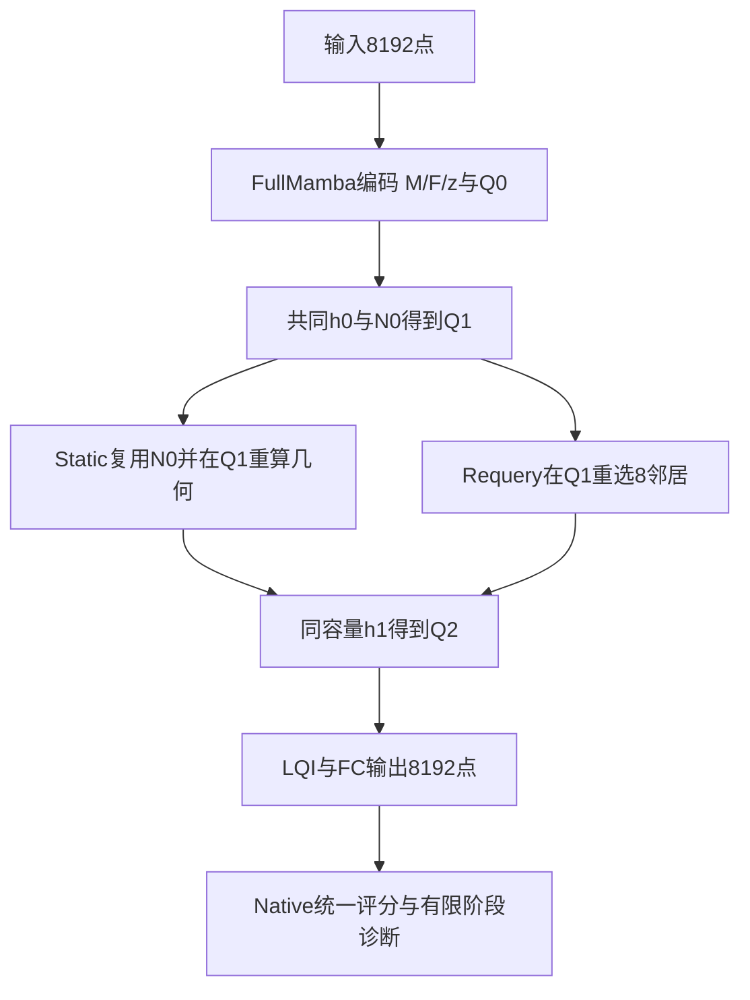

# Cranial-BCSP-FullMamba：SCQ-RIVE完整实验报告

**重查询增益复核与反馈失效归因｜正式收束版 v1｜2026-11-16**

报告状态：已完成本轮模式A核心匹配对照、统一评分及限定几何诊断，并正式收束当前RF-Requery候选。原计划未执行的统计与机制分析在第13节逐项披露，不以“阶段收束”代替“所有原计划项目全部完成”。

本报告依据本机已冻结材料编制。本次撰写没有连接服务器、读取模型权重、运行forward、训练、重评分、bootstrap、调参或清理文件。报告中的数值均来自已有结果与审计；未额外生成实验结果。

## 摘要

SCQ-RIVE旨在复核：在相同FullMamba母版、同容量残差头、相同初态、训练顺序及设备条件下，第二个coarse残差头在Q1处重新选择Memory邻居，能否稳定优于复用Q0邻居的静态方案。此前SCQ-RF观察到重查询收益与新增严重失败并存，且旧D折比较存在跨设备／驱动差异。本轮通过四组重新训练隔离该混杂，不引入新结构或改变表示与loss。

实验使用SkullBreak已开放84来源、每来源五种实体缺损。每折训练63来源315例、开发21来源105例；两折、两臂共四个模型，每模型从头训练3900步，输入／输出均8192点。完成420次Native预测、840行统一CPU评分及11例既有预测的阶段诊断。

结果呈折相关：Requery相对Static的来源等权E_P95在C折退化0.586mm，在D折改善0.655mm；两折合并仅改善0.0346mm。J@2mm在C/D分别下降3.368/2.061个百分点；严重病例合计17→18，新增9例、挽回8例。诊断发现，重查询既存在有效纠偏，也存在反馈放大，且位置、范围、覆盖与离群指标可不同向变化。现有证据不支持把重查询升级为稳定更优或可靠的默认方法。

**正式决定：收束当前RIVE候选，不继续围绕同一冻结公式叠加反馈或调参；保留混合与负面证据。** 后续优先形成“输入几何如何直接约束coarse生成”的独立最小假设，而不是把未验证的GT方向、限幅或失败门控直接加入推理。

## 1. 研究背景与实验目的

### 1.1 与前序工作的关系

本研究主线已经固定骨组织完整边界的表面点云表示，保留源分割中存在的内／外表面、孔道或腔体边界及实体切除暴露面；不是仅采样颅骨外轮廓。模型目标是移除骨块的完整边界，而非完整颅骨或单层原有表面片。既往采样搜索、输入密度、FullMamba替换、LQI及SCQ/RF等研究形成了本轮共同母版与数据资产。

RIVE是一个**匹配复核与机制归因阶段**，不是新增网络模块的名称。本轮不再次证明FullMamba替换本身是否优于Transformer，也不重新比较8k/16k或采样方法，更不把历史不同设备、不同阶段数值拼接成新配对结果。

### 1.2 需要回答的问题

1. 同设备、同初态、同顺序条件下，RF-Requery相对同容量RF-Static的收益能否在C、D两折同时保留？
2. 目标表面精度改善是否同时带来接口覆盖改善，是否新增严重失败？
3. 已有失败首次出现在哪些保存阶段，后续反馈是在挽回、放大还是改变误差分布？
4. 当前证据是否足以继续投入该候选，还是应保存结果并转向独立假设？

### 1.3 预设方向目标

H1：seed0两折来源等权ΔE_P95均<0。H2：若执行另一个独立初始化seed，方向保持；本轮选择模式A，因此H2未执行。H3：每折new_severe=0、ΔJ_P95≤0、ΔJ@2mm≥0。它们是原计划的科研方向目标，不是临床非劣界值，也不是既有SCQR正式gate。

## 2. 数据、任务语义与划分

### 2.1 数据范围

| 项目 | 本轮固定范围 |
|---|---|
| 主数据 | SkullBreak已开放84来源×5缺损=420病例 |
| 缺损类型 | bilateral、frontoorbital、parietotemporal、random_1、random_2 |
| 每折训练 | 63来源、315例 |
| 每折开发 | 21来源、105例 |
| 两折开发 | 来源互斥，共42来源、210例 |
| 两折训练重叠 | 42来源；C开发21来源出现在D训练中，D开发21来源出现在C训练中 |
| 数据变更 | 不重采样、不创造新缺损、不筛掉困难病例、不调整source/fold |
| 本轮未参与 | SkullFix外部验证、MUG500+、封存confirmation20 |

同折训练／开发按来源隔离。跨折角色交叉是现有划分事实，因此两折不是完全独立的训练重复，更不能把两折合并当作独立外部验证。数据已反复用于开发，本轮不能声称新盲测或临床泛化认证。

### 2.2 实体与表面目标

令C为完整骨实体，G为移除实体，D为残余实体；C=D∪G且D、G在体素前景上互不相交。输入为∂D，监督目标为∂G。

- E：G继承自原骨组织边界的自由表面，可包括外板、内板及原有孔道边界，不等于“外表面”。
- J：G与D的共享切除界面，承担本合成任务的接口吻合评价。

实体缺损来自既有数据，不采用在完整外表面点云上删一片点的替代构造。源分割边界的保留不等于原始数据已经获得独立临床高精度认证；点云也不自动构成水密implant。

### 2.3 点数与坐标

沿用BCSP Geo-V1面积采样：输入8192、目标8192；coarse为256个中心，每中心生成32个子点得到8192点dense。中心和尺度仅由缺损输入D确定，G使用相同变换，评分恢复world毫米坐标。此轮没有以GT中心重新归一化、ICP对齐、TTA或离群点剔除。

历史开发输入目录名与fold标签存在交叉，不依据目录词义猜测来源。实际执行以冻结病例索引、source/fold清单与逐输入哈希绑定为准；目录适配不改变病例与点集字节。

## 3. 模型与唯一比较因素

### 3.1 共同架构

两臂共享已有FullMamba encoder、LQI decoder、SCQ第一残差头h0、RF第二残差头h1与原FC稠密化输出。共同Memory为实际encoder产生的M∈R^(256×3)、F∈R^(256×384)，全局特征z∈R^1024。它们不是另从原输入或GT采样的一套理想Memory。

继承的静态配置含历史AdaPoinTr/attention风格字段，但实际网络由隔离factory替换构造。不能仅据旧YAML/JSON中的字面字段误称本轮又使用了Transformer decoder；实际身份以冻结factory、模型构造记录与共同状态指纹为准。

两臂均为40,827,847参数，h1为231,171参数。Static也有相同第二头，因此本轮比较不把额外容量、额外残差头与“重新选邻”混为一谈。

### 3.2 共同第一步与第二步差异

共同第一步：

\[
N_i^0=\mathrm{KNN}_8(M,Q_i^0),\quad
\delta_i^0=h_0(\Phi(Q_i^0,N_i^0;F,z)),\quad
Q_i^1=Q_i^0+\delta_i^0.
\]

唯一选邻差异：

\[
N_{i,S}^1=N_i^0,\qquad
N_{i,R}^1=\mathrm{KNN}_8(M,Q_i^1),\qquad
Q_i^2=Q_i^1+h_1(\Phi(Q_i^1,N_i^1;F,z)).
\]

**Static复用整数邻居索引，但仍在Q1处重新计算相对几何；不是复用Q0处的旧几何。** 两臂h0/h1不共享参数；描述子拼接全局z、局部LayerNorm特征mean/max、query坐标与相对位置统计，共1802维。h0为1802→384→3，h1为1802→128→3，GELU；LayerNorm eps=1e−5，标准差沿用sqrt(var+1e−6)。

Q2进入后续query MLP、位置条件、排序、decoder局部邻域、FC中心、coarse返回及其loss。KNN整数索引不求导，选中特征和相对几何的连续路径保留梯度。LQI原有的位置条件与本轮decoder前第二残差头重查询是不同环节。

### 3.3 能估计的效应

两臂从共同初态联合训练后，encoder、Q0、Memory与残差头都可以分化。本轮估计的是**训练配置的总效应**，不是冻结同一完整模型仅在一次推理中切换选邻的独立因果效应。跨臂query索引也不是逐解剖点对应。

## 4. 训练合同、环境与执行

### 4.1 训练设置

| 项目 | 设置或实测合同 |
|---|---|
| 预算模式 | A：四次训练，结果无论正负均收束，不默认增加seed |
| 训练顺序 | Static_C→Requery_C→Static_D→Requery_D |
| batch／drop_last | 8／true |
| 遍历／每遍批数 | 100／39 |
| 更新／曝光／drop | 3900／31200／300，每模型 |
| 精度与优化器 | FP32、AdamW，lr=1e−4、betas=(0.9,0.999)、eps=1e−8 |
| 实际参数组weight decay | 0或5e−4；bias／一维参数与规定no-decay参数为0 |
| optimizer对象默认值 | weight_decay=0.01，但实际参数组显式覆盖；不能误报为所有参数用0.01 |
| 梯度裁剪 | 原clip阈值10，forward/backward/clip/step各3900 |
| 调度 | 继承冻结LR／BN调度；各100次，同折两臂全序列一致 |
| 监督 | 继承实际coarse CD+dense CD、原后端与归约；未新增rim、位置、尺度或DAC loss |
| checkpoint | 固定epoch99／step3900最终状态；不以dev分数择优 |
| 关闭 | denoise、H1/H2、BNCal、训练中dev评价、resume、推理后配准与删点 |

每遍315例中39×8=312次曝光、drop3例；100遍共31200次曝光与300次drop，二者是执行计数，不是新增患者数。

### 4.2 初始化与数值限制

共同模型、h0与h1初始化来自冻结字节，最终权威是大小、SHA256、参数名／shape／dtype及状态指纹，不在服务器运行时按seed重新生成后要求字节相等。训练流seed0不意味着所有历史初始化都由整数0生成。h0/h1输出层零初始化，其隐藏层与共同母版遵循冻结初始化。

同折两臂完整初始化、实际批次顺序、曝光、优化器分组与LR/BN序列已配对；C/D因来源不同，不要求跨折批次相同。接受并披露Mamba有限梯度非逐位确定性；相同seed和设备不等价于独立重复已完成，也不能用它解释掉有效结果。

### 4.3 环境与资源

四模型均在容器qx2k0r-0、NVIDIA GeForce RTX 4090 D上训练，GPU UUID为`GPU-383d118a-368c-94e3-166a-cad3efab8fd7`，driver 570.190，Python 3.10.20、PyTorch 2.4.1+cu118、CUDA 11.8、NumPy 2.2.6、timm 1.0.27。项目根为`/home/jovyan/adapointr_work/PoinTr`。

有效训练墙钟上限3600s、RSS≤8GiB、SMI设备用量≤22528MiB、Torch peak allocated≤20GiB、输出≤2GiB，保留磁盘余量与失败即停合同。部分旧配置的86400s及旧stage字段是历史来源，实际RIVE run_identity与有效资源合同优先，不能据旧字段误判为另一科研任务。

资源来自采样监测及Torch峰值记录，不是专属cgroup硬隔离；SMI与Torch显存口径分开。以下为监测任务的执行耗时，不是独立速度基准或Mamba端到端加速证据。

| 运行 | 更新 | 遍历 | 曝光／drop | 训练elapsed，s | Torch峰值allocated，GiB | 训练审计检查数 |
|---|---:|---:|---:|---:|---:|---:|
| RF-Static_C | 3900 | 100 | 31200／300 | 1489.370 | 12.997 | 39 |
| RF-Requery_C | 3900 | 100 | 31200／300 | 1494.554 | 12.993 | 43 |
| RF-Static_D | 3900 | 100 | 31200／300 | 1498.867 | 12.997 | 40 |
| RF-Requery_D | 3900 | 100 | 31200／300 | 1492.265 | 12.993 | 45 |

四组均退出0，各3902条资源记录通过；SMI记录峰值均14638MiB，RSS约1.67GB。Requery_C与Requery_D的完整折内配对审计通过。没有因科学结果不理想而重训或择优替换模型。

## 5. Native预测、归档与完整性

四模型每组105次完整forward，共420次Native开发集预测；不增加测试时增强、Oracle、warmup择优或额外模型更新。推理前后四模型状态及CPU/CUDA/Python/NumPy RNG指纹按既有快照合同保持一致，不将其夸大为所有数值非确定性的普遍证明。

实际每份NPZ包含九类字段：prediction、coarse、Qraw、delta、Q0、Q1、Q2、delta0、delta1。coarse与Q2对齐；保存Q0+delta0≈Q1、Q1+delta1≈Q2及总残差关系。420份数组有限值和阶段方程已在正式预测审计中检查。

预测归档为426个成员：420份预测及6个日志／清单文件。压缩包大小45,697,569bytes，SHA256：

`4be9df6d5a5bf5620a14a6242c3c145fb198ae050e4a8abbef75247eafbe8b07`

本机位置：`E:/ResearchBackups/AdaPoinTr/BCSP_FULLMAMBA_SCQ_RIVE/2026-11-16_native_development_eval/development_predictions_v1.tar.gz`，配套`.bytes`、`.sha256`、`.contents.sha256`。既有本机核验与后续审计通过。本报告不等于四个训练checkpoint已完成本机独立备份或GitHub发布证明。

## 6. 评分方法与统计解释

### 6.1 冻结参考与指标

A1为原体素暴露面中心及物理面积权重，按实体邻接关系划分E/J；A2由每A1面四个子面中心形成更密离散参考；Ref-B为继承的marching-cubes敏感度参考。不能重新提取不同参考后仍称原协议。

对区域R∈{E,J}的参考面中心a及面积权重w，计算d(a,P)=min_p||a−p||。主指标E_P95为E区域按w加权的95%分位数；J_P95同理。Cover@r为满足d≤r的区域面积比例，报告0.5/1/2mm。CD-L1为预测P与固定GT8192的双向未平方欧氏最近邻均值半和。反向Pred→A2距离与>20mm点比例用于观察远端预测离群。

质心偏差为预测均值与GT8192均值的距离；回转半径比为两者绕各自质心的RMS半径之比。质心不等于连续实体体积中心，半径接近1也不保证位置、厚度、拓扑或局部形状正确。

### 6.2 聚合单位

先逐病例求指标，再同来源五缺损等权得到来源均值，最后每折21来源等权。不是把所有点或所有缺损合并求一个P95。两臂比较保持source配对；差值Δ=Requery−Static，距离负值为改善，覆盖正值为改善，百分比的差以百分点表示。

每例另有Nop_D与GT8192两个共享控制，共420控制行，复用并逐行核对冻结基线，不重复伪装成独立预测。最终420模型行＋420控制行=840病例评分行，168来源行；不是840个独立医学样本。GT8192控制面对另一套离散参考时也不必处处为零。

### 6.3 风险标签

严重几何：`E_P95>20mm OR J Cover@2mm=0`；位置尾部：质心偏差>20mm；紧缩：回转半径比<0.9。严格边界不变。这些标签是研究描述，不是临床安全认证；各类风险可重叠，不能相加为独立患者。

### 6.4 本轮实际统计范围

实际评分request冻结bootstrap=0、p_values=false、formal_gate=false、seed0_only=true。结果为描述性配对比较，没有新置信区间、显著性、等效或临床非劣结论。源级bootstrap即使未来另行做，也不能消除训练seed方差或反复开发曝光；本报告不补算。

## 7. 主结果

### 7.1 分折完整主要指标

以下均为来源等权；比例已乘100，相关Δ单位为百分点。

| 指标 | C Static | C Requery | C Δ | D Static | D Requery | D Δ |
|---|---:|---:|---:|---:|---:|---:|
| E_P95，mm | 12.543 | 13.129 | 0.586 | 6.518 | 5.863 | -0.655 |
| J_P95，mm | 15.546 | 16.576 | 1.030 | 9.591 | 8.578 | -1.013 |
| CD-L1，mm | 8.285 | 8.686 | 0.401 | 3.426 | 3.231 | -0.196 |
| E Cover@2mm，% | 54.150 | 49.321 | -4.829 | 64.046 | 65.664 | 1.618 |
| J Cover@2mm，% | 41.308 | 37.940 | -3.368 | 53.142 | 51.081 | -2.061 |
| 反向>20mm离群，% | 13.782 | 16.021 | 2.239 | 2.973 | 2.512 | -0.461 |
| 质心偏差，mm | 21.543 | 23.604 | 2.060 | 12.909 | 11.512 | -1.396 |
| 回转半径比 | 0.883 | 0.918 | 0.036 | 0.929 | 0.898 | -0.031 |

### 7.2 来源级效应异质性

| 折／指标 | 改善来源 | 持平 | 回退来源 | Δ中位数，mm | 最好Δ，mm | 最坏Δ，mm |
|---|---:|---:|---:|---:|---:|---:|
| C／E_P95_mm | 8 | 0 | 13 | 1.016 | -8.897 | 9.178 |
| C／J_P95_mm | 9 | 0 | 12 | 1.259 | -11.905 | 12.786 |
| C／CD_L1_mm | 8 | 0 | 13 | 0.949 | -8.673 | 7.713 |
| D／E_P95_mm | 13 | 0 | 8 | -0.198 | -8.374 | 3.995 |
| D／J_P95_mm | 13 | 0 | 8 | -0.267 | -9.274 | 4.870 |
| D／CD_L1_mm | 14 | 0 | 7 | -0.155 | -4.646 | 4.156 |

### 7.3 两折合并描述值

两折各21开发来源，以下是42来源等权描述值，不构造独立双折重复的CI。

| 指标 | Static | Requery | Δ |
|---|---:|---:|---:|
| E_P95，mm | 9.5304 | 9.4958 | -0.0346 |
| J_P95，mm | 12.5688 | 12.5773 | 0.0085 |
| CD-L1，mm | 5.8556 | 5.9584 | 0.1027 |
| E Cover@2mm，% | 59.0980 | 57.4926 | -1.6054 |
| J Cover@2mm，% | 47.2250 | 44.5105 | -2.7145 |
| 反向>20mm离群，% | 8.3777 | 9.2667 | 0.8890 |
| 质心偏差，mm | 17.2261 | 17.5580 | 0.3319 |
| 回转半径比 | 0.9060 | 0.9082 | 0.0023 |

合并主E仅−0.0346mm：它来自C退化与D改善的抵消，不是稳定收益。J_P95几乎抵消，CD反而上升约0.103mm；J@2mm下降2.714个百分点。不能以“合并E略降”掩盖接口代价，也不能据近零均值宣布统计等效。

## 8. 风险转移与缺损类型

### 8.1 全部风险标签

| 折／标签 | Static | Requery | 新增 | 挽回 | 共同 |
|---|---:|---:|---:|---:|---:|
| C／严重几何 | 15 | 16 | 7 | 6 | 9 |
| C／质心>20mm | 31 | 40 | 17 | 8 | 23 |
| C／半径比<0.9 | 62 | 51 | 7 | 18 | 44 |
| D／严重几何 | 2 | 2 | 2 | 2 | 0 |
| D／质心>20mm | 16 | 9 | 5 | 12 | 4 |
| D／半径比<0.9 | 40 | 57 | 21 | 4 | 36 |

严重病例合计17→18，新增9、挽回8、共同9。D严重总数2→2仍有2例新失败与2例挽回；净值不能代表个体无伤害。C的紧缩病例减少同时位置尾部增加，D的位置改善同时紧缩增加，属于方向不一致的几何权衡。

**C折新增严重：** `train__001__frontoorbital`, `train__025__random_2`, `train__026__frontoorbital`, `train__036__frontoorbital`, `train__038__random_1`, `train__094__parietotemporal`, `train__094__random_2`。

**C折挽回严重：** `train__012__parietotemporal`, `train__013__frontoorbital`, `train__041__parietotemporal`, `train__047__frontoorbital`, `train__061__frontoorbital`, `train__081__random_1`。

**D折新增严重：** `train__008__frontoorbital`, `train__046__parietotemporal`。

**D折挽回严重：** `train__069__random_2`, `train__101__bilateral`。

### 8.2 五缺损类型完整分层

每折每类型21例；下表为Requery−Static，距离mm、J覆盖差为百分点。仅作描述，不挑最优类型改变训练合同。

| 折／类型 | ΔE_P95 | ΔJ_P95 | ΔCD-L1 | ΔJ@2mm |
|---|---:|---:|---:|---:|
| C／bilateral | -0.216 | -0.171 | -0.069 | -0.255 |
| C／frontoorbital | 0.567 | 0.877 | -0.449 | 2.828 |
| C／parietotemporal | 0.479 | 1.103 | 0.052 | -8.568 |
| C／random_1 | -0.122 | 0.426 | 0.559 | -2.013 |
| C／random_2 | 2.221 | 2.915 | 1.911 | -8.832 |
| D／bilateral | -2.134 | -3.212 | -0.824 | 0.751 |
| D／frontoorbital | -0.374 | -0.627 | -0.850 | 0.877 |
| D／parietotemporal | 0.502 | -0.129 | 1.168 | -4.393 |
| D／random_1 | -0.114 | 0.312 | 0.364 | -5.625 |
| D／random_2 | -1.155 | -1.410 | -0.836 | -1.915 |

C的random_2有明显回退；D的bilateral与random_2主距离改善，但parietotemporal主距离回退。该分层说明异质性，不证明某种缺损可作为最终适应证，也不能用它们后验筛选病例或扫描专用参数。

## 9. 训练中的机制行为与执行证据

两臂均3900条几何记录通过原合同；Static两折3900条均N0=N1，Requery仅第一条相等。两臂均有3899步非零RF记录，与零输出层初始化后逐步学习相容。

| 折／臂 | N0=N1记录 | 平均邻域重合 | 第二残差均值范数 | 最大query delta范数 |
|---|---:|---:|---:|---:|
| C／RF-Static | 3900 | 1.0000 | 0.080599 | 0.665146 |
| C／RF-Requery | 1 | 0.6448 | 0.167518 | 0.760818 |
| D／RF-Static | 3900 | 1.0000 | 0.048756 | 0.592265 |
| D／RF-Requery | 1 | 0.6578 | 0.139942 | 0.563649 |

范数均为D-only归一化单位，且是训练全程摘要，不能直接称毫米或当作最终模型病例级残差。Requery平均第二残差更大，说明训练行为确有分化；“大”本身不证明错误，历史有效挽回也可能需要大步移动。不能仅以抑制残差、邻域更一致或输出更紧缩判定可靠。

本报告没有从训练loss曲线推断开发性能，也不虚构未重新提取的最终loss、最优epoch或独立测速。原始metrics与几何日志的完整计数及哈希由训练审计保存；模型选择固定最终checkpoint。

## 10. 11例既有预测的分阶段几何诊断

### 10.1 范围与方法

用户在评分后明确限定“新增严重病例＋固定改善对照”。实际纳入全部9个新增严重及每折1个改善对照，共11例、22份预测，形成88条阶段指标、66条阶段变化和11份两臂三投影病例图。

改善对照的规则在读取预测数组前固定：每折选E_P95改善且Requery不严重者中ΔE最小者，以病例名打破并列。它使用已知评分选择，是描述性明显改善对照，不是训练前预设的无偏正常样本。C094两个缺损来自同一来源，不应视为独立患者。

按保存的Q0/Q1/Q2/dense恢复world-mm，计算E/J P95与覆盖、质心、半径、反向离群及CD。指标用完整点集；显示固定步长抽稀。每例所有阶段、两臂、三视图使用共同范围与等比例坐标，保留全部预测范围；颜色表示预测→A2距离，显示色条饱和于40mm，数值不截断。不做配准、裁剪或离群删除。

22份dense的E/J P95、2mm覆盖、CD、反向>20mm离群与质心偏差，共154值，均与冻结评分一致。另核验质心误差平方变化：||e+d||²−||e||²=2e·d+||d||²，用于描述平均移动方向，而非逐点语义对应。

### 10.2 Requery逐例轨迹

序列顺序均Q0→Q1→Q2→dense，距离mm；两臂完整数值见配套CSV。

| 折／病例 | 角色 | 质心偏差轨迹 | E_P95轨迹 | dense J_P95 | dense J@2mm |
|---|---|---|---|---:|---:|
| C／train__001__frontoorbital | 新增严重 | 65.818→59.466→65.233→66.212 | 57.174→53.951→60.491→56.231 | 61.326 | 0.0% |
| C／train__025__random_2 | 新增严重 | 62.199→54.391→38.788→35.687 | 55.493→50.110→33.006→22.311 | 25.839 | 1.8% |
| C／train__026__frontoorbital | 新增严重 | 66.235→59.966→68.831→69.139 | 57.564→53.502→61.304→54.534 | 58.635 | 0.0% |
| C／train__036__frontoorbital | 新增严重 | 66.935→55.965→56.094→56.551 | 57.124→47.181→42.333→35.366 | 37.863 | 5.5% |
| C／train__038__random_1 | 新增严重 | 50.974→38.761→52.723→51.884 | 49.109→37.035→43.378→34.707 | 40.248 | 21.4% |
| C／train__094__parietotemporal | 新增严重 | 41.107→43.348→52.488→49.815 | 36.355→40.882→39.680→29.856 | 35.502 | 24.2% |
| C／train__094__random_2 | 新增严重 | 46.076→47.471→55.725→52.778 | 38.078→43.694→40.219→31.498 | 35.065 | 17.6% |
| C／train__041__parietotemporal | 改善对照 | 56.843→50.471→29.226→26.959 | 46.741→41.863→19.923→8.823 | 14.000 | 18.3% |
| D／train__008__frontoorbital | 新增严重 | 64.802→67.923→52.844→36.399 | 60.740→57.706→39.470→20.617 | 22.921 | 21.7% |
| D／train__046__parietotemporal | 新增严重 | 68.623→61.350→72.676→68.839 | 49.874→42.734→38.658→31.843 | 34.448 | 0.0% |
| D／train__101__bilateral | 改善对照 | 27.224→15.167→3.982→4.328 | 31.238→22.316→6.800→3.000 | 4.224 | 60.1% |

### 10.3 可重复的主要观察

1. 9例新增严重的Requery在Q0均已有>40mm质心偏差，并高于对应Static。最终失败并非只在dense出现；但训练已令Q0分化，不能据此认定重查询在单次推理直接改变Q0。
2. Q1→Q2质心误差增加7/9，E_P95增加3/9、J_P95增加5/9。C036质心仅增加约0.129mm，其E还改善，不能与大幅发散混为一类。
3. C001、C026、C038呈第二阶段多指标放大。C038的质心增加约13.962mm、E增加6.343mm、J增加10.735mm，但反向离群比例下降，说明目标覆盖与离群并不总同向。
4. C025、D008在Q1→Q2明显改善，只是挽回不足。D008 dense E=20.617mm刚越过20mm严重阈值，J@2mm反而优于Static，不能写为“接口全面恶化”。
5. C094两例和D046存在质心变差但部分覆盖指标改善。D046半径比在Q1→Q2由约0.917增至1.353，与偏位中心周围扩张相容，但不是唯一机制证明。
6. C041、D101两个改善对照均从第二次反馈获益。D101 dense E=3.000mm、J=4.224mm、J@2mm=60.1%、反向>20mm离群为0；C041仍有26.959mm质心偏差。非严重不等于高精度，Q0偏位也不是失败特有标记。
7. 9例的dense E均低于Q2，但coarse256与dense8192点数不同。不能把NN距离下降全部归为dense模块的形状修正，也不能由质心变化单独判断dense是否“放大”。

### 10.4 图像与证据入口

[11例原生坐标图集](E:/Codex/2026-06-06/mamba-ccf-c-1-high-resolution/outputs/scq_rive_stage_visual_20261116_v1/index.html)；[两臂分阶段轨迹汇总](E:/Codex/2026-06-06/mamba-ccf-c-1-high-resolution/outputs/scq_rive_stage_visual_20261116_v1/fixed11_stage_trajectories_v1.png)；[88条阶段指标](E:/Codex/2026-06-06/mamba-ccf-c-1-high-resolution/outputs/scq_rive_stage_visual_20261116_v1/stage_metrics_v1.csv)；[66条阶段变化](E:/Codex/2026-06-06/mamba-ccf-c-1-high-resolution/outputs/scq_rive_stage_visual_20261116_v1/stage_transition_changes_v1.csv)。

## 11. 对实验结果的专业解释

### 11.1 同设备控制后，原有正向印象没有稳定复现

RIVE消除了本轮两臂间设备／驱动差异，并控制初始化、数据与顺序，因而不能把当前C折退化继续归给旧D折设备迁移。C、D方向相反是有效的开发实验观察。它说明当前训练配置的作用依赖折、来源和误差分布，但只有两折seed0，无法区分折构成、训练随机性及复杂表示学习的具体贡献。

与旧RF不一致不证明旧结果造假、实现必错或模型完全不可训练；也不能在未进行冻结同状态反事实前断言哪个代码模块导致差异。应保留两阶段来源和配置，分别报告。

### 11.2 尾部距离、局部吻合和全局范围必须联合看

D的E/J P95下降，而J@2mm也下降，意味着误差分布并非整体向零平移；可能改善较差区域同时损失原本近距离支持。该解释与指标共存相容，但不是逐点迁移因果证明。仅用CD或P95会遗漏接口精度代价，单看覆盖也会遗漏远端离群与未覆盖形状。

同样，半径更接近1可能来自改善覆盖，也可能来自错误位置扩张；质心靠近GT可能仍伴随错误骨块形状。报告不将任何一项摘要量替代完整表面质量。

### 11.3 重查询并非总有害，也未表现为可靠默认策略

新增与挽回同时存在，且诊断有明显改善病例。这排除了“一律关闭重查询就能解释全部机制”的简单结论，但不构成继续默认采用的充分理由。方法晋级需要整体效果、接口与风险方向的共同支持；当前证据未达到。

### 11.4 从后处理纠偏转向生成阶段空间条件，是问题重定义而非已证根因

多例Q0已偏、后续纠正不可靠，提示有价值的下一问题是coarse的空间支撑与形状生成是否过度依赖自由坐标回归和后续补救。它值得形成独立假设，但Q0偏位也可被成功挽回，因此不能直接把“Q0偏”映射为失败标签、门控或强制限幅。需要未来单因素比较才能验证。

## 12. 实验问题、工程问题及其影响

### 12.1 已观察到的科研问题

- 跨折主指标方向不一致；合并均值掩盖个体大回退。
- 两折接口近距离覆盖均下降，可靠性方向目标未达成。
- 位置、范围与形状误差相互耦合，残差方向和幅度不足以给出无GT可靠判据。
- 训练日志存在邻居变化，却未证明这些邻居提供更有用的空间条件。
- 现有指标是离散几何评价，尚不验证骨厚、水密性、制造适配或临床接口安全。

### 12.2 工程异常与科学负结果的区分

本阶段先前遇到的安装长调用／字段替换与开发输入路径绑定问题，属于传输和调用接口问题；这些失败没有被当作模型科学阴性，也没有把不完整预测混入正式评分。最终四组训练、420预测及评分均完成并冻结，正式结果来自有效运行。

旧completion.stage／静态模板字段保留历史名称，run_identity与实际factory、计数和SHA用于消除身份歧义。类似历史标签不宜在报告中静默删除，也不能单凭字符串判断模型分支。工程合同通过只说明实验身份和执行可用，不说明方法有效。

资源监测为采样制，不能保证捕获所有瞬时峰值；训练elapsed包括实际任务开销，不足以声称比其他Mamba或Transformer更快。本轮也未运行不同算法的独立性能基准。

## 13. 原计划差异、未完成分析与证据限制

| 项目 | 原计划或期望 | 本轮实际及解释 |
|---|---|---|
| 预算 | A四run或B八run二选一 | 用户采用A，四run完成后无论正负收束；seed1未执行，不称跨seed稳定 |
| 来源bootstrap／CI | 修订计划列出算法和预算 | 实际冻结评分request明确不执行；无CI或p值，不声称统计等效／显著 |
| Memory／F／z／实际N0/N1 | 计划更完整同次保存 | 实际预测九字段未含这些逐例完整数组；训练摘要不能代替该证据 |
| 全420预测机制数字 | 计划有更宽阶段／邻域分析 | 现有全量coarse/dense摘要及后续11例阶段指标，不等于全420例完整E/J与Memory归因 |
| 可视化选例 | 原计划历史压力例＋少量新增＋预设对照 | 用户后续授权9新增＋2明显改善；选择范围变更明确披露，非无偏代表抽样 |
| 因果反事实 | 需要同一状态干预另行授权 | 未执行；跨臂联合训练差异不能当单次重查询因果效应 |
| 临床和外部来源 | 主任务之外需独立核验 | 未开展SkullFix本RF外部验证、真实病例临床评价或confirmation20访问 |

开发集已经多轮曝光；来源层级相关性与跨折训练角色交叉必须保留。原始分割精度与GT8192采样分布也限制解剖解释。现有冻结审计主要核验内容哈希、计数、指标聚合与内部一致性；评分审计及诊断冻结审计没有重跑全部最近邻距离，不应称独立算法复现。

**完成状态的准确表述：模式A有界核心匹配对照、评分与后来限定诊断已完成，披露上述缺项后正式收束；不能宣称修订计划所有统计和机制分析无缺项完成。** 这些缺项不自动构成追加工具、forward或训练的理由。

## 14. 假设结论与正式科研决定

| 目标 | 判断 |
|---|---|
| H1：两折ΔE均<0 | 未同时支持：C回退、D改善 |
| H2：独立seed方向复现 | 未执行模式B，不能判断 |
| H3：每折无新增严重、J_P95不回退且J覆盖不下降 | 两折均未达到；C另有J_P95回退 |
| 执行有效性 | 四组训练与同折配对、Native、评分及限定诊断均有效冻结 |
| 当前候选晋级 | 不晋级为稳定优于Static或可靠的默认方案 |

收束的是当前冻结RF-Requery配置。RF-Static是本轮参照，不因此被认证为全历史最优或临床可用。保留失败与挽回、所有两折结果与权重身份，不挑折、挑缺损、选seed或通过开发择优checkpoint补出正结论。本次没有执行新的正式gate。

## 15. 下一阶段研究建议

### 15.1 优先级一：只制定一个输入条件化coarse生成假设

建议问题：**相对“自由生成初始coarse再由局部残差反复纠偏”，在coarse产生时直接利用输入的空间位置与范围条件，能否同时改善完整骨块覆盖和接口精度，并减少新增严重失败？**

这是独立的新假设，不是当前报告已验证的修复。先明确输入可见量、唯一坐标生成公式、插入接口与对照，再决定实施。输入几何支撑不能简单等同“每点必须贴近残余骨”，因为缺失骨块内部区域本应离观测输入较远；未经验证的最近邻投影或边界吸附可能破坏目标形状。

保持同一表示、同一划分、8k→8k、loss和3900步，先避免同时改变空间条件、残差门控、采样和目标。若改变必须另立匹配协议，不能把结果归到单一模块。

### 15.2 最小研究设计应先回答的事项

1. 新条件如何由D或实际Memory获得，不读取GT骨块、GT中心、风险标签或配准变换作为推理输入？
2. 它是否能在共同初始化和合理容量对照下单独改变coarse生成路径，而不隐含多处改动？
3. 预期首先改善哪个可观察阶段与最终E/J指标？若只改善质心、矩或半径但dense/接口不改善，应判假设未获支持。
4. 如何保护当前确实被重查询挽回的病例，而不依据它们反复调门控阈值？完整列出新增和挽回，不只报告净严重数。
5. 预算、停止标准、是否从开始就预登记第二seed，需在看到新结果前确定；不能只对正向结果追加重复。

上述是设计条件，不是本轮新增执行request。本报告不指定尚无依据的0.1mm、1个百分点临床容差，也不自动要求增加全量诊断。

### 15.3 应避免的路线

- 继续叠加同类反馈头、固定DAC、统一clamp或GT方向门控，期待通过参数扫描消除个别失败。
- 将Q0偏位、残差更大、邻域变化更多直接当作可部署失败检测器。
- 再用同一开发病例反复挑公式，最后把开发改善写成独立泛化证据。
- 单独优化质心、尺度或CD，忽略J覆盖、目标覆盖与远端离群。
- 只追加seed直到均值好看，或用历史异设备数值替代本轮严格配对。

### 15.4 更长期的论文路线

若新的输入条件化假设无法形成明确可证伪结构，建议停止局部反馈串行修补，将资源转向共同任务上的生成表示或强基线比较。待核心候选有稳定证据后，再规划独立来源／SkullFix适用性、真实缺损与外部公平基线；这些均需要匹配数据语义、划分、点数、归一化、预算和E/J参考，不宜跨论文直接拼CD数值。

本报告不重新开展最新文献检索，也不据论文名称声称首创或方法领先。创新边界和竞争方法实现应在下一份正式计划中另行核验，不能以RIVE内部消融替代论文完整比较。

## 16. checkpoint、关键哈希与复现入口

四组最终checkpoint均489,927,058bytes；以下SHA来自正式训练审计中的实测流式哈希，本次撰写未再次从服务器读取或反序列化权重。文件名可复用ckpt-last.pth，必须同时绑定run／fold身份，不能仅靠basename区分。

| 运行 | 最终checkpoint SHA256 |
|---|---|
| RF-Static_C | `80c59d40fe3d0a415e41c67f1b036f619e2e862fde829f42a66ecb73e950eb97` |
| RF-Requery_C | `5fc095755fa22fec79230394f3d3cd5dc461fd18e4ff1e366e52e5ae033dc87e` |
| RF-Static_D | `f196f5b1bf406e4018baf11ae5d977dc445f515ea4b72aff431a061e64740b45` |
| RF-Requery_D | `e2528ee8a65f3c8a1a44798a89af1d47a94c3a02aa2c0de2a48ed6bf1a880533` |

共同参数初态SHA256：`8697bfc3b9d7dfd2c0003ec54253cf77cd146f2926a41138ffeacc1ec4f7d255`；共同状态初态：`d0f4c3699fe66a2ba2b4879c1bd41ba363a325fa152d79a4055773be3e0f4167`。

C折实际批次顺序canonical SHA256：`349189dcada4c41b9e6b0152fa24695b2c71ce5fce4144865247d03c445f795f`；D折：`2c9f3e9afb2cfe9ae46c0566bdbced465c64acc2a564654914d2163d74e5e838`。raw order文件哈希另见pair contract，不能混用两种哈希。

训练配对合同SHA256：`0ce612b00b453bc5e5da2fe22552b2c61c38ff20d46c3bd07f7521a8359fe652`。

评分request SHA256：`fb84bccd3ebcbaa5346ff8897d8e05cf9c10586c99411040bd01dae51856b9e7`。指标实现SHA256：`af938519125b25b6d22d862dd4967dabef3be6d97d38e60eb9995ee7e9ce9766`。

## 17. 交付、证据与保存状态

本报告及配套JSON／哈希清单保存在本机项目docs目录；预测备份已有独立路径。本次不自动推送GitHub、不复制checkpoint、不制作全实验恢复包、不清理服务器。报告的checkpoint哈希清单只是身份凭据，不能代替权重字节的本机备份。

以下材料为关键证据入口，完整大小和SHA256见配套`report_evidence_manifest_v1.json`。

- [正式修订计划v2](E:/Codex/2026-06-06/mamba-ccf-c-1-high-resolution/docs/cranial_bcsp_scq_rive_20261115/Cranial_BCSP_FullMamba_SCQ_RIVE_正式实验计划书_审阅修订v2_2026-11-15.md)

- [模式A共同合同](E:/Codex/2026-06-06/mamba-ccf-c-1-high-resolution/outputs/scq_rive_training_implementation_20261115_v1/RIVE_modeA_pair_contract_v1.json)

- [来源划分与有限就绪核对](E:/Codex/2026-06-06/mamba-ccf-c-1-high-resolution/outputs/scq_rive_training_implementation_20261115_v1/RIVE_R01_readonly_review_v1.json)

- [35项正式预测冻结审计](E:/Codex/2026-06-06/mamba-ccf-c-1-high-resolution/outputs/scq_rive_fourmodel_native_prediction_preparation_20261115_v1/post_prediction_freeze_20261116_v1/freeze_verification_v1.json)

- [27项正式评分冻结审计](E:/Codex/2026-06-06/mamba-ccf-c-1-high-resolution/outputs/scq_rive_score_freeze_20261116_v1/audit_verification_v1.json)

- [完整分折／来源／缺损描述结果](E:/Codex/2026-06-06/mamba-ccf-c-1-high-resolution/outputs/scq_rive_score_freeze_20261116_v1/descriptive_results_v1.json)

- [29项正式诊断冻结审计](E:/Codex/2026-06-06/mamba-ccf-c-1-high-resolution/outputs/scq_rive_stage_visual_freeze_20261116_v1/audit_verification_v1.json)

- [正式收束决定](E:/Codex/2026-06-06/mamba-ccf-c-1-high-resolution/outputs/scq_rive_closure_decision_20261116_v1/SCQ_RIVE_综合科研判断与正式收束决定_zh_v1.md)

### 四组训练审计

- [training_freeze_Static_C](E:/Codex/2026-06-06/mamba-ccf-c-1-high-resolution/outputs/scq_rive_training_implementation_20261115_v1/post_training_freeze_v1/freeze_verification_v1.json)

- [training_freeze_Requery_C_request_preparation_v1](E:/Codex/2026-06-06/mamba-ccf-c-1-high-resolution/outputs/scq_rive_training_implementation_20261115_v1/Requery_C_request_preparation_v1/post_training_freeze_v1/freeze_verification_v1.json)

- [training_freeze_Static_D_request_preparation_v1](E:/Codex/2026-06-06/mamba-ccf-c-1-high-resolution/outputs/scq_rive_training_implementation_20261115_v1/Static_D_request_preparation_v1/post_training_freeze_v1/freeze_verification_v1.json)

- [training_freeze_Requery_D_request_preparation_v1](E:/Codex/2026-06-06/mamba-ccf-c-1-high-resolution/outputs/scq_rive_training_implementation_20261115_v1/Requery_D_request_preparation_v1/post_training_freeze_v1/freeze_verification_v1.json)

## 18. 最终结论

SCQ-RIVE完成了一次同容量、同设备、同初态和顺序的有限匹配复核。当前RF-Requery在C/D呈相反主指标方向，接口覆盖两折下降，新增严重失败未被消除。已有诊断确认有效纠偏与错误放大共存，却没有找到可可靠部署的区分信号。

因此，本轮以“当前候选未获得跨折稳定收益且可靠性方向目标未达成”的混合／负面结论正式收束。其价值是排除了继续凭历史平均改善盲目叠加反馈的依据，并把下一步问题收敛到输入条件化空间生成与完整形状／接口联合验证。该结论不否定Mamba课题，不否定所有重查询，也不把工程成功混同科研成功。
