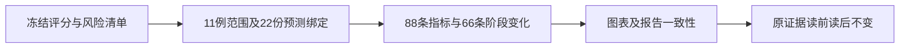

# SCQ-RIVE分阶段几何诊断：正式只读冻结审计

日期：2026-11-16。审计结论：**PASS**。

## 审计对象与边界

对象为`outputs/scq_rive_stage_visual_20261116_v1`的22个冻结文件：清单所列21个文件及清单本身。保持原诊断、图表、预测、评分、代码与配置不变，仅在独立审计目录新增凭据。

本次未连接服务器、加载checkpoint、运行forward、训练、调参、生成预测、重新渲染图表或重算最近邻评分。读取22份既有预测及11份点集，仅复核已有坐标、残差、质心和半径的代数关系；参考几何文件仅核验哈希。文件内容、大小、修改时间做读前读后对照；不把读取可能产生的atime变化当作内容变化。

## 结果

29项自动检查全部通过。两份代表性病例图另行完成人工核看。

| 核验项 | 结果 |
|---|---|
| 冻结文件及目录集合 | 22文件、1个figures子目录，无缺项或额外文件；21项大小和SHA256匹配清单 |
| 原评分证据 | 上游正式评分审计为PASS，其12个评分产物仍匹配原哈希 |
| 病例范围 | 冻结风险清单全部9例新增严重病例，另按原规则独立重选每折1例改善对照；共11例，无替换或扩张 |
| 预测绑定 | 22份成员与冻结病例索引一致，大小与SHA256均匹配；原预测压缩包大小与哈希不变 |
| 阶段完整性 | 两臂×11例×四阶段=88条唯一记录；256点coarse与8192点dense计数正确 |
| 残差与坐标 | 22份Q0+delta0≈Q1、Q1+delta1≈Q2成立；88条world质心、质心偏差及半径比独立复核一致 |
| dense与评分一致性 | 22份dense×7项=154个指标值与冻结评分一致 |
| 阶段变化 | 66条唯一相邻阶段记录完整；差值、质心平方误差及方向分解重新核对一致 |
| 表格 | 两个CSV全部单元格与JSON记录一致；报告11行数值表的轨迹、J_P95及覆盖率一致 |
| 图像 | 11份病例图＋1份汇总图完整；所有PNG块CRC通过，HTML与病例图映射一致 |
| 绘图合同 | 冻结源码使用同病例共享范围、等比例投影、统一0–40mm显示色条；统计使用完整点集，显示抽稀不改变指标 |
| 证据不变 | 所有纳入追踪的原始输入与产物读前读后大小、SHA256与修改时间一致 |

## 科研结论一致性

独立从保存指标核对：9例新增严重病例的Requery在Q0均有>40mm质心偏差，且高于对应Static；Q1→Q2质心偏差增加7例、E_P95增加3例、J_P95增加5例；9例dense的E_P95均低于Q2。

这些计数与原报告一致，不改写既有解释。C036质心仅小幅增加，不能与大幅发散等同；256→8192点存在覆盖密度差异；两个改善对照是有意选择的描述性样本，不能代表无偏总体收益。审计通过不等于候选有效、因果机制被证明或获得训练授权。

## 人工图像核看

- C／train__001__frontoorbital：两臂、四阶段、三投影排列完整；Requery偏位及Q2退化与标题数值相符；坐标范围与色条可读。
- D／train__101__bilateral：Requery在Q1/Q2明显靠近GT，dense显示较好覆盖；Static偏位持续，图像与数值相符。

人工核看限定上述两份代表图，未声称逐点验证所有PNG。其余图通过冻结哈希、完整PNG校验、索引与源码合同核对。PNG校验和源码核对不是像素到原始点的一一语义证明。

## 审计限制与下一步

本次没有重新计算E/J/CD最近邻距离。对这些指标核验的是冻结链、dense与正式评分的一致性，以及中间阶段已保存记录、表格和报告之间的一致性。质心、半径及残差代数则直接读取既有数组独立核对。

本次诊断可以作为RIVE正式复盘的冻结证据。下一步可汇总训练、统一评分与本诊断，作出RIVE继续或收束的科研判断；不需要因为审计通过而自动新增诊断或训练。本次未创建任何新execution request。

## 文件

- `audit_verification_v1.json`：29项判据、输入／产物指纹及计数。
- `manual_visual_review_v1.json`：代表图人工核看记录。
- `audit_stage_visual_v1.py`：本次只读审计入口。
- `audit_artifact_manifest_v1.json`：审计交付文件大小与SHA256（不含自身）。
