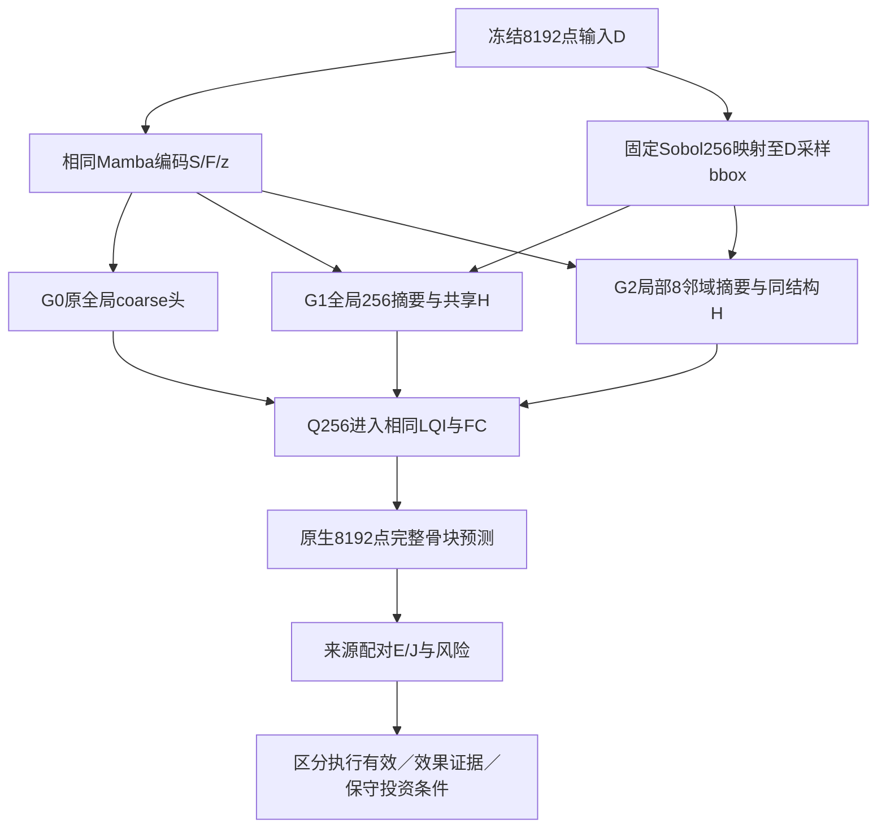

# Cranial-BCSP-FullMamba：BCSP-SPCG正式实验计划书

**空间探针条件粗生成与完整骨块可靠性验证｜审阅修订v2｜2026-11-16（Asia/Shanghai）**

状态：`PROTOCOL_REVISED_AWAITING_USER_CONFIRMATION`。这是下一阶段研究参考，不是execution request；确认本计划也不自动授权实现、真实输入读取、GPU验证、训练、预测或清理。

## 0. 审阅结论与本版决策

**方向合理，建议修订后作为一次有界开发验证采用；目前不具备“已经有效”或“已经确认结构创新”的证据。** 保留原草案G0/G1/G2、固定Sobol256探针、G2的k=8、1416维读出和六run矩阵，不追加RF/DAC、不改变数据、采样、loss或decoder。重点修正数学解释、可归因范围、梯度／置换准入、统计与资源闭环。

本轮问题从“如何再把错误query修回去”改为：**在首次coarse生成之前，用不依赖预测Q0的输入空间探针读取实际Memory，是否能在相同生成头下比全局聚合产生更好的完整骨块？** 这是值得验证的假设，不是RIVE已经证实的根因。

必须分清三种判断：①执行与比较是否有效；②局部聚合配置有无效果证据；③是否满足保守的后续资源投资条件。严格投资条件未通过不等于所有空间条件机制被统计否定；执行失败也不能充当方法负结果。

### 本轮唯一模型矩阵

| ID | 名称 | 首次coarse路径 | 角色 |
|---|---|---|---|
| G0-LQI | 既有FullMamba-LQI、无SCQ/RF | z→原coarse MLP→Q256 | 本轮新训练的实用参照 |
| G1-GP | 全局摘要探针 | 固定D-only探针＋全部256个Memory的摘要→共享H→Q256 | 与G2等参数的全局聚合对照 |
| G2-SPCG | 空间局部探针 | 同探针＋8近邻Memory摘要→同结构H→Q256 | 唯一新候选 |

六个预定训练身份：G0_C、G1_C、G2_C、G0_D、G1_D、G2_D；每run3900更新，合计23400更新上限；每模型105例Native，共630完整预测。第二seed与额外同k非局部对照均不属于首批授权。

## 1. 历史证据与研究边界

RIVE在四组同GPU、同驱动、同折初态和完整批次顺序的有效配对中，Requery−Static的E_P95为C +0.586mm、D −0.655mm；J Cover@2mm两折分别−3.368、−2.061个百分点。合并主E仅下降0.0346mm，严重病例17→18，新增9、挽回8。正式训练、预测、评分及11例阶段诊断已经冻结。

诊断显示早期偏位、反馈放大和挽回不足并存；位置变近不一定改善形状或接口，Q0偏位也不是失败特有标记。P2的低阶位置／范围约束与后续反馈没有形成稳定收益，因此本轮不再换名重做这些机制。RIVE只有seed0、未执行bootstrap及全量Memory归因，不能据此确立输入条件不足的唯一因果解释。

RIVE已归档并按用户确认清理了服务器上的四个训练权重、预测和相关运输产物；它们的本机备份保留。**SPCG从头训练不以恢复或加载四份RIVE训练权重为前提。** 所需的是正确的未训练FullMamba-LQI母版、已有source/fold、数据、初始化来源、provider和评分身份。只有另行授权历史复演时才恢复相应旧权重。

本轮输入仍是骨组织完整边界表面点云，输出仍是缺失骨块完整边界。Sobol点只是模型内部的**体积空间探针**，并不把训练数据改成体积点云，也不是缺损定位结果或输出表面采样方案。

## 2. 文献审阅与新颖性边界

本次截至2026-11-16作定向一手来源检索，结合用户此前颅骨Transformer、对称、扩散／flow、SDF／occupancy、厚度与临床文献方向；没有声称逐篇精读此前全部题名清单。访问层级详见`literature_verification_v2.json`，不能把摘要或README核验写成完整源码审计。

| 来源 | 本次核验深度 | 对本研究的约束 |
|---|---|---|
| 3DMambaComplete，2024首版／2026 v2 | v2方法正文；§3.2–3.4 | 最新正文含跨注意力生成HyperPoint及后续spread，不能仅概括为输入点加offset，也不是全无Attention先例。[v2全文](https://arxiv.org/html/2404.07106v2) |
| CompletionMamba，TIP2025 | 作者机构记录／摘要 | local SSM与shape-aware传播已有研究；局部KNN或全局形状条件本身不是新颖性。[作者机构记录](https://research-repository.uwa.edu.au/en/publications/completionmamba-taming-state-space-model-for-point-cloud-completi/) |
| GDPNet，Computers & Graphics2026-10 | 出版摘要／引言片段；KSM完整公式与代码未核验 | 输入keynode/anchor生成coarse骨架高度邻近；不能认为“移至首次coarse”便自动避开先例。[出版页](https://www.sciencedirect.com/science/article/abs/pii/S0097849326001810) |
| FusionMamba，Information Fusion2026-10 | 出版摘要／亮点／引言预览 | LGSA与几何残差对齐邻近；完整公式级差异仍待确认，不武断认定它只发生在coarse之后。[出版页](https://www.sciencedirect.com/science/article/pii/S1566253526002575) |
| AnchorFormer／SeedFormer | CVF／ECVA官方摘要及相关正文片段 | 区域anchor、patch-seed条件早有先例。[AnchorFormer](https://openaccess.thecvf.com/content/CVPR2023/html/Chen_AnchorFormer_Point_Cloud_Completion_From_Discriminative_Nodes_CVPR_2023_paper.html)、[SeedFormer](https://www.ecva.net/papers/eccv_2022/papers_ECCV/html/5127_ECCV_2022_paper.php) |
| DAPointMamba，AAAI2026 | 会议记录／摘要 | 关注跨域patch与空间／通道SSM对齐，不是本轮单域head的直接等价物。[官方页](https://ojs.aaai.org/index.php/AAAI/article/view/37596) |
| Hyper-PCN，CVPR2026 | 官方摘要／仓库README，未完整审计代码 | anchor与高阶关系已存在；固定Sobol读出是否实质不同仍需谨慎说明。[官方页](https://openaccess.thecvf.com/content/CVPR2026/html/Li_Hyper-PCN_Hypergraph-Based_Point_Cloud_Completion_via_High-Order_Correlation_Modeling_CVPR_2026_paper.html) |
| BuildingComSSSM，2026-05 | 出版亮点／摘要 | keypoint生成和扩散含self/cross-attention，不能直接作为全无Attention母版。[出版页](https://www.sciencedirect.com/science/article/pii/S1569843226001858) |
| MedPCFM，2026-06-23 | 预印本相关方法／实验正文 | Kwarciak与Wodzinski的PTv3确定性及flow基线直接相关，但点数、采样、归一化、训练预算不同，禁止搬用CD排名。[全文](https://arxiv.org/html/2606.24433v1) |
| MedPCFM-TED，2026-09及MICCAI2026 SASHIMI | 官方会议摘要／元数据 | 补入最新的一步颅骨implant生成参照；其速度与质量需共同任务适配后比较。[官方页](https://papers.miccai.org/miccai-2026-sat/SASHIMI_017.html) |
| Plausible but Unimplantable，2026-10-21 | 作者预印本摘要／状态 | 强调形状外观与可植入性分离；它审计的特定零样本模型不能推出本任务所有点模型无效。[预印本](https://arxiv.org/abs/2610.30035) |
| High-Resolution Cranial Defect Reconstruction，MICCAI2023 | 作者摘要及版本元数据 | 颅骨点云与迭代分辨率路线的医学背景，不等同本轮单次8k Native。[作者稿](https://arxiv.org/abs/2308.03813) |

2026-11的Multi-Path Mamba Diffusion主要研究语义场景补全，不作为颅骨骨块直接竞争基线。[作者记录](https://arxiv.org/abs/2611.04583)

**创新定位：** 目前只能称“在BCSP任务和无Transformer Attention的FullMamba中，验证无Q0依赖的固定探针局部Memory读出与直接coarse生成的组合”。Sobol、KNN、anchor、局部条件和提前几何注入均不是独占概念。六run的价值首先是判断是否值得继续，而非保证论文创新成立。

就近方法只做一次有限公式／接口差量核查；全文或代码不可得时明确`PENDING`，缩小原创性主张，不无限扩展准备框架。若确认实质同构，不能仅靠任务改名声称新结构。

## 3. 可证伪问题与最高可支持结论

主问题H-SPCG：在同一直接生成head下，局部8近邻Memory聚合相对全局256聚合，是否在两个开发折改善最终完整骨块E_P95，并有一致的接口与风险方向？

| 比较 | 能估计的效应 | 不能单独证明 |
|---|---|---|
| G2−G1，主要 | 等参数、同初态下“局部8集合替代全局256集合”的端到端训练配置效应 | 纯空间对应因果；它还改变基数、平均平滑、特征异质性及梯度分布 |
| G2−G0，关键实用 | 新完整生成方案相对原LQI的任务表现 | 某一个几何标量独立贡献 |
| G1−G0，解释性 | 固定探针与共享生成头／全局摘要方案的改变 | 局部Memory已有效 |

所有模型从头联合训练，结束时encoder与head通常分化；跨模型差值不是同权重切换KNN的反事实。G1/G2等参数，不等于等信息带宽、等表达自由度或纯单因素空间匹配。

允许的负结果包括：G2只改善质心而不改善E/J；G1/G2都难以展开；局部选邻重复度高；两折方向相反；均值改善但新增严重事件；或者G2胜G1仍输G0。应限定为本公式、本预算及已曝光开发条件下的证据，不上升为所有局部条件理论无效。

## 4. 不变的数据与任务合同

| 项目 | 固定合同 |
|---|---|
| 来源 | SkullBreak已开放84来源×5实体缺损=420例 |
| 每折 | train63来源315例；dev21来源105例 |
| 折间依赖 | dev互斥；train重叠42来源；C/D开发来源也在另一折train出现，不是独立双重复 |
| 缺损类型 | bilateral、frontoorbital、parietotemporal、random_1、random_2 |
| 输入／目标 | ∂D→∂G，骨组织完整边界，含源分割存在的内外板／孔道边界和切壁 |
| E/J | E为G继承的原骨自由表面，不等于外板；J为D/G共享合成切除界面 |
| 采样／点数 | 冻结BCSP Geo-V1面积采样，8192→8192，不重采样 |
| coarse／子点 | 256／每中心32，共8192 dense |
| 坐标 | 继承D-only center/scale，G同变换；world-mm评价，无GT校正 |
| checkpoint选择 | epoch99/update3900最终状态；不按dev选最佳 |
| 封存与外部 | confirmation20封存；SkullFix适用性另立计划；MUG不提升为已认证精细解剖GT |

输入目录词义与历史fold可能交叉，使用冻结source/fold manifest及逐输入SHA，不按目录名猜测。已曝光开发集不能因新训练变成新盲测。

## 5. 唯一生成公式

### 5.1 探针资产与D-only坐标

在获授权实施阶段，以兼容的固定PyTorch版本建立一个新SobolEngine：dimension=3、scramble=False、无fast_forward，取最初256点（推荐新引擎draw_base2(8)，FP32）。缓存U∈R^(256×3)，冻结原始float32字节、shape、dtype、顺序与SHA；本计划未创建U，也没有其真实SHA。

Sobol是低差异序列，生成器有状态，不能在每次forward继续draw或因不同软件版本默认为同一资产。[PyTorch官方接口](https://docs.pytorch.org/docs/stable/generated/torch.quasirandom.SobolEngine.html) 当前文档不等于项目2.4.1运行环境，未授权升级；权威是实施时核验并冻结的实际字节。

由当前输入的8192个D_norm采样点计算l=min(D_norm)、h=max(D_norm)，而非读取GT或另用完整NRRD推断盒。定义

\[
A_i=l+(h-l)\odot U_i.
\]

U与A不是可学习点、不是监督对应点，也不等于Q。**Q不限制在bbox(D)内，不使用A+残差、tanh、sigmoid、半径clamp或骨表面吸附。** D-only采样bbox与原始完整分割bbox可能不同，需明确具体来源。

数值策略只选一种：若任何轴h−l<1e−6或输入非有限，失败停止并记录，**不clamp后悄悄替换数据**。这是数据／数值合同，不是效果筛选。

体积探针可落在颅腔、盒角或距残骨较远处；低差异体积覆盖不保证表面、切壁或缺损覆盖。旋转不变性也未建立，本轮不据结果选轴、PCA对齐或扫描探针偏移。

### 5.2 实际Memory与共同描述子

输入原有encoder产生S∈R^(B×256×3)、F∈R^(B×256×384)、z∈R^(B×1024)。必须确认S/F按同一Memory编号对齐；不能用原8192点替代S，也不能跨模型按token编号认定解剖对应。

逐token无affine LayerNorm：Fhat_j=LN(F_j;eps=1e−5)。对选定集合N_i：

\[
f_i=|N_i|^{-1}\sum_{j\in N_i}\widehat F_j,\quad d_{ij}=S_j-A_i,\quad
\mu_i=|N_i|^{-1}\sum_{j\in N_i}d_{ij},
\]
\[
\rho_i=|N_i|^{-1}\sum_{j\in N_i}\|d_{ij}\|_2,\quad
\tau_i=\sqrt{|N_i|^{-1}\sum_{j\in N_i}\|d_{ij}-\mu_i\|_2^2+10^{-6}},
\]
\[
x_i=[z,f_i,A_i,\mu_i,\rho_i,\tau_i]\in R^{1416},\qquad
Q_i=H(x_i),\quad H:1416\to1024\to384\to3.
\]

两隐藏层GELU、末层线性，含bias，所有256探针共享H。输入维度1024+384+3+3+1+1=1416。三层参数数为1,845,763；原G0头1,836,800，替换净增8,963。完整模型参数数仍须CPU实际构造核验，G1/G2必须完全相等；不得保留未使用旧head参数参加optimizer后仍声称替换完整。

新H使用固定独立CPU随机流`head_init_seed=2026111600`，固定兼容PyTorch版本的nn.Linear默认初始化，再冻结字节。末层**不沿用SCQ的零输出层初始化**，否则直接生成的全部Q会初始严格重合。G1/G2加载同一H；共同未训练母版和原G0头按其冻结来源保留。初始化过程不得污染正式训练随机流。

### 5.3 G1／G2集合定义与数学更正

G1：N_i={1,…,256}；G2：N_i=KNN_8(S,A_i)。k=8仅指G2，不能把G1写成同样8点。

令Sbar=mean_j S_j，在G1中精确有

\[
f_i=\overline{\widehat F},\quad\mu_i=\bar S-A_i,\quad
\tau_i=\sqrt{256^{-1}\sum_j\|S_j-\bar S\|^2+10^{-6}},\quad A_i+\mu_i=\bar S.
\]

因此G1的f、τ在各探针间恒定；A/μ有代数冗余，ρ仍随探针变化。原稿把G1的τ也称为探针相关统计，需要更正。G1不是无几何对照，而是带全局形状／坐标条件的共享坐标生成器。

ρ是选中集合到探针的**平均距离**，不是最小最近邻距离；τ表示集合绕自身均值的RMS离散尺度，不是距探针远近。一个远而紧的邻域可同时ρ大、τ小。

G2−G1同时改变集合基数256→8及特征平滑／异质性；本轮保留该合理的全局对照，但不把结果写成已经排除“少平均保留信息”替代解释。若后续有足够正证据，最直接追加控制是预登记的每探针固定非局部8-token集合，**不纳入本轮六run，不事后补称已验证**。

### 5.4 梯度、排序和计算资源

KNN整数索引不求导；选中特征和几何值的连续运算在实际requires_grad路径上求导。真实S若来自对不可学习D的FPS/gather，可合法requires_grad=False，不强制S.grad存在。必须检查H参数及F/z到encoder可训练参数的预期梯度路径存在、有限；人工可导S叶张量可单独验证几何导数，不能据此声称FPS索引可导。

固定输入数组的距离并列按Memory原始索引稳定打破；不通过加epsilon扰动距离伪造不同几何。它保证固定数组复现，不保证并列坐标／异特征下的集合置换不变。实际torch/kernel的排序策略需在限定CPU/CUDA准入中核验。

G1应避免物化B×256×256×384特征复制：全局F均值算一次后expand；全局μ和τ按上式算一次，ρ用B×256×256距离计算。G2只gather B×256×8×384。代数简化的FP32舍入差异按预定容差与朴素参考比较，不靠开发分数选择实现。

注意力约束指无可达Transformer self/cross-attention或内容QK-softmax分支；允许冻结的Mamba、FPS/KNN、局部图、MLP与确定性均值。模型中遗留的未调用类／配置字符串不等于已执行attention。KNN、距离和原Chamfer并非整体线性复杂度，禁止声称全网络严格O(N)。

## 6. 模型接入与监督不变

插入点为原global_feature可用且首次learned_coarse尚未生成的位置，Q须真实进入原mlp_query、位置编码、LQI、排序／逆排序、FC中心、返回coarse及coarse loss。G1/G2跳过并替换旧coarse_pred，不先计算旧Q0再修正；h0/h1均不注册或调用。

共同母版为既有六层Mamba encoder、八层LQI decoder和原FC重建，grouper与512／256取点不变。G0保留原`1024→1024→768→reshape256×3`，不重命名它为SPCG。继承配置中的旧attention字段须按实际factory／调用路径核查，不静默修改其它分支。

监督保持原coarse CD(Q256,G8192)+dense CD(P8192,G8192)、FP32 cdist及原归约。`loss_sparse=0`可能只是去噪项关闭；实际get_loss仍有coarse监督。需要核对真实返回值和runtime相加，不新增rim、排斥、矩、厚度或位置loss，也不更换Chamfer编译后端。

共享H使G1/G2与G0的输出槽位参数化不同。共同z可能主导初始输出，产生低多样性Q，这是一种可检验风险，不是必然坍缩或数学上不能表示多表面。除常数输出、非有限或确认断路外，不以未论证的半径阈值拒绝方法；不挑初始化、不加A残差或排斥loss来补救同一公式。

## 7. 最小准备与CPU准入

### 7.1 S0：一次有限差量核对

只核对：LQI未训练母版与实际coarse插入接口、get_loss返回、源代码/provider身份、D-only点集与fold/order、评分参考、共同初态生成方式及磁盘生命周期。继承已完成数据QC和环境证据，不全盘库存，不重做采样研究，不恢复四个RIVE已训练权重。

本轮尚无实现授权。确认计划后先单独授权S0只读核对；如接口明确，再集中做隔离head、factory、最小runtime/入口适配和针对性测试。不要逐个文件滚动试跑或新增通用传输／审计框架。

### 7.2 单批限定人工CPU检查

测试清单在implementation-only前冻结，建议一批≤32条，覆盖：

| 检查 | 正确要求 |
|---|---|
| 数学与shape | x1416、Q256×3、dense8192×3；手算全局μ/τ恒等式；ρ与min距离分开 |
| 两臂初态 | U、H和共同模块参数／buffer匹配；仅选邻规则配置不同 |
| D置换 | 仅bbox和A应不变 |
| 固定Memory置换 | S/F联合置换、无距离并列的人工head集合及输出在容差内一致 |
| 全模型置换 | 记录继承FPS/序列化敏感性，与G0共同解释；不作为必须严格不变的硬门 |
| 并列与重复 | 固定原数组稳定索引策略；不把并列下集合置换不变混作承诺 |
| 梯度 | H/F/z预期路径存在且有限；S按实际requires_grad处理；人工几何导数单列 |
| 输出多样性 | 记录中心化RMS半径、最小／中位槽位间距、精确重复数及总loss下Q梯度分布，不选初始化 |
| 完整入口 | 用人工路径覆盖真实authorize/materialize/config加载及模型分派，不仅测试mock函数 |
| 不读GT | probe/head/Native只接D及D-derived条件，人工sentinel拒绝GT和评分参考访问 |
| 后端与消费者 | 实际Q消费者／loss路由、no-decay及数值设置合同正确 |

CPU通过不代表CUDA通过。一次验证失败即保留失败并停止，不自动改fixture重跑；新修订需明确版本与授权。纯文本静态核查不冒充CPU／GPU执行结果。

## 8. 有界CUDA零更新与真实D可行性

在新模块CPU/P3通过后，另建待授权request。全程scratch，禁止加载RIVE训练权重或进行optimizer.step。

| 部分 | 完整forward | loss | backward | optimizer step | 输入 |
|---|---:|---:|---:|---:|---|
| 人工G0/G1/G2，各eval batch1一次＋train batch8一次 | 6 | 3 | 3 | 0 | 冻结解析／人工多表面点集及人工目标 |
| 真实D可行性，仅G2 eval batch1 | 5 | 0 | 0 | 0 | 预选开放训练输入D，不读G |
| 总上限 | **11** | **3** | **3** | **0** | 无额外warmup完整forward |

真实五例：在C、D共同训练来源交集中，按`SHA256('SPCG_V2_FEAS|'+canonical_source_id)`排序取前五个不同来源，依次绑定bilateral、frontoorbital、parietotemporal、random_1、random_2。先冻结实际五个ID、文件SHA及元数据，再创建request；不因预测表现换例。该规则目前未运行。

同次真实forward保存实际S/F/z、A、G2索引和摘要；仅用D-derived标量比较G1全局与G2局部描述，不新增G1完整forward或分支loss。记录min(A→S)、mean8距离ρ、S→A最近距离、邻域集合重复率、各Memory被选次数及局部F方差。这里评估空间采样／邻域覆盖，不能称缺损定位准确率，也不借GT盒外比例调探针。

人工train会改变普通BN与RNG；应在每次规定调用后恢复初始状态，并核验最终参数／buffer及CPU/CUDA/Python/NumPy RNG与准入前一致。真实D部分eval不更新状态。保留真实Mamba provider、FP32/TF32设置、梯度及显存证据；不要求已接受存在有限非确定性的SSM梯度逐位一致。

应用级GT边界：forward/head无G参数，数据接口只读取partial及D-only变换，评分参考仅进入后续CPU评分。若D和G同在一个NPZ，不能谎称操作系统已禁止进程读取其中G；以显式接口、访问追踪和sentinel契约控制，不为硬隔离另造框架。

同次观察不得改变原生输出或增加完整模型调用。没有额外恢复复演、冻结权重切换或decoder-only诊断预算；若将来必要另行定义。

## 9. 六run训练合同

| 项目 | 冻结值 |
|---|---|
| 顺序 | G0_C→G1_C→G2_C；C块归档处理后G0_D→G1_D→G2_D |
| 每模型 | 315例，batch8、drop_last=true；100遍×39批=3900更新 |
| 曝光／drop | 31200／300；六run合计187200／1800，不是独立患者数 |
| 初态 | scratch；共同encoder/LQI/FC逐字节匹配；G1/G2同H、U；G0旧head独立保留 |
| 数值 | FP32、TF32=false；继承确定性设置及有限Mamba梯度非确定性披露 |
| optimizer | AdamW lr1e−4、betas(0.9,0.999)、eps1e−8、clip10；实际组WD=0或5e−4 |
| 调度 | LR=1e−4·max(0.9^(epoch/21),0.02)；BN momentum=max(0.9·0.5^(epoch/21),0.01)，继承实际调用时序 |
| 计数 | forward/backward/clip/step各3900；LR/BN调度各100；0人工更新计入正式步数 |
| checkpoint | 仅最终epoch99／step3900，无dev择优、BNCal、resume或自动重试 |
| 不变项 | 输入、target、点数、原CD后端、数据顺序、decoder、输出消费者及资源阈值在同折三臂一致 |

每折三臂GPU UUID与driver相同，优先六run同设备；跨折换设备可形成另一个配对块并披露，不能将只迁移某一臂的结果称严格配对。设备在块内中断时停止，标明不完整，不自动重训已完成模型。

计划六个正式训练身份，每身份最多一次正式启动尝试，原上限六次、23400更新；训练claim消耗后不复用。传输／安装失败但尚未claim训练，与已进入正式尝试分开记录。任一正式尝试失败即停止矩阵，不能自动重试、resume或继续只留下有利配对；新尝试／补齐必须另立授权补充协议，不假装仍在原六次预算内。

未完成单元为`INCOMPLETE/EXECUTION_FAILED`，不是科学负值；其相关完整M/U不可判通过。已有效完成的结果仍如实保留，不根据C折loss或效果修改D。

## 10. 初始化、训练观察与预算纪律

正式训练复用原fold订单，不仅复用seed名字。每批ID、实际顺序、LR/BN、曝光与drop均留证。初始化构造应在正式训练流开始前结束，保存字节与fingerprint，不能在运行时按seed反向重生成要求比对。未使用旧coarse/head不得遗留在optimizer。

每步仅保留原loss、资源及低成本Q中心／半径等标量。固定在用于更新`{1,39,390,1950,3900}`的**同次前向**记录更细Q间距、精确重复与总loss下Q梯度分布，不加额外forward/backward。这里梯度来自总loss，不能声称已隔离coarse分支梯度；若同次coarse NN分配索引本来可见，可另记录目标分配到多少槽位，不能为此增加autograd.grad调用或改loss。

保存每个预定模型的状态、源码、配置、order、optimizer分组与最终checkpoint SHA。共享H初始Q低多样性只作诊断；除常数输出、非有限或实现断路外，不以事后阈值硬拒绝，更不能按真实开发GT重抽初始化。

首批只研究seed0。现在预留第二seed的命名：共同模型初始化流2026111611、SPCG头初始化流2026111612、训练order流1，U与点集不变；若独立母版生成接口不能保持此含义，须在任何新结果前改协议。第二seed为另行确认的完整六模型矩阵，不只给G2补seed。其投入依赖预设投资规则，是条件式后续研究，报告选择偏差；不自动获得跨seed或外部确认结论。

## 11. 资源与存储生命周期

沿用墙钟每run≤3600s、Torch peak allocated≤20GiB、SMI≤22528MiB、RSS≤8GiB及资源超限先落盘再停。它们是拟沿用的监测合同，不是本候选已经通过的实测结果，也不是cgroup硬隔离。不升级PyTorch、不编译／重装已有provider，不用fallback掩盖后端变更。

原计划只写每run输出≤2GiB而未闭合六run总空间。最近一次已冻结清理回读显示可用10,015,997,952bytes，约9.33GiB；本计划没有重新连接服务器，启动前必须重查。不能由历史~0.5GB checkpoint断言六个模型与预测全部同时驻留必然可行。

本版采用**按折三run分块、先保存再清理**的存储方案，拟将每run全部输出上限冻结为1GiB，包含checkpoint、optimizer状态、日志、临时副本及本run控制文件；实际序列化估算必须先证实可行，不能仅把旧2GiB改成1GiB而跳过核算。

| 单折同时驻留项目 | 拟定上限 |
|---|---:|
| 三run全部输出 | 3×1GiB |
| 315次Native输出及同次有限Memory观察 | 0.5GiB |
| 该块压缩／运输中间副本 | 0.5GiB |
| 新准备文件、源码副本、初始化及可写cache／tmp合计 | 0.5GiB |
| 安全余量 | 4GiB |
| 启动一个完整折块所需可用量 | **至少8.5GiB** |

若六run同时保留，按相同方法至少需约12.5GiB，因此当前9.33GiB快照不足以承诺全矩阵同时驻留。8.5GiB也只是经实际字节估算和新状态核验后才可采用的条件预算，不是本轮资源准入已通过。

C块训练及315次Native冻结后，下载代码／结果与三个最终checkpoint，逐项核验四文件归档及成员；**用户单独确认精确删除清单后**才能腾出C块服务器大文件。未获清理授权时保留原件，D块必须等量新增空间或等待授权，不得越界继续。全体六run预测完成前，不计算或解读C的dev性能用于改变D。只读核验C归档完整性不等于评分。

如果现有runtime无法在最小适配内接受该1GiB上限，或实际输出／准备资产估算不满足，不降低batch、点数或模型，不自动放宽阈值；先明确容量缺口并暂停正式训练。不得借此重新建设通用库存、传输或审计框架。

## 12. Native预测与同次机制字段

总数630完整forward，按C、D各315组织；每模型105例，batch1、eval/inference_mode、无loss/backward/step、BNCal、TTA、ICP或点筛选。状态与RNG前后证据按已验证合同保存。输出非有限是执行故障，不删除该病例后补分数。

全部保存prediction[8192,3]、coarse[256,3]；G1/G2另存probe[256,3]、μ／ρ／τ，G2存实际N[256,8]，而非事后猜索引；G1用“全部256”集合标记，不为对称性复制巨大特征矩阵。

source/fold/type/model/seed、输入SHA、D-only变换和checkpoint SHA必须绑定。dtype／坐标约定必须明确，partial与GT不写入公开预测清单；未来GitHub只发布代码、标量与静态图，不默认公开数组或权重。

为了避免再次出现“计划要Memory但实际没存”的缺项，事先固定每折5个不同来源、五种缺损的展示病例：按`SHA256('SPCG_V2_MEM|'+source_id)`对21个dev来源排序取前五，依次分配五缺损。对这10个病例的全部三模型，共30份同次输出，保存实际S/F/z（FP32）及排序映射；每份约0.4MiB，完整Memory预算可控。选例在新预测／评分前冻结，不因表现更换。

其余病例仅有coarse/dense和探针／索引时，不宣称全队列Memory特征归因已完成。观察只detach同次张量，不能新增完整forward。原始结果、压缩包、SHA256、bytes和内容清单按块冻结并在本机核验，结束后统一评分。

## 13. 统一评价、配对与风险

继承唯一评分器与A1/A2/Ref-B。主终点为A1 E参考面中心→预测8192的物理面积加权P95，mm；另报J_P95、E/J Cover@0.5/1/2mm、CD-L1双向未平方欧氏NN均值半和、Pred→A2 P95和>20mm点比例、质心／回转半径与bbox。

病例先求指标、同source五缺损等权、每折21来源等权。主比较G2−G1；关键实用G2−G0；解释G1−G0，三者全量报告，两折分开，不挑有利类型。42来源合并仅描述，不包装为独立双训练复制。

severe=`E_P95>20mm OR J_Cover2=0`；placement_tail=`centroid>20mm`；compact=`radius_ratio<0.9`。逐病例列基线／候选、new/rescued/shared及受影响source数；不以净数代替新增失败，不把研究20mm／2mm阈值变成临床装配公差。保留边界病例连续数值而不改阈值。

共享Nop_D与GT8192控制每病例各一次，共420控制行；与630模型行合计1050评分行、模型126来源行＋控制84来源行=210来源行。不是1050个患者，也不是630个独立缺损来源。

coarse256→GT的距离仅阶段描述，与dense8192直接比较含分辨率差异；质心、半径或CD不能替代完整形状／切壁支持，E也不只代表外板。

## 14. 已确定的统计协议

**本版明确计划执行来源配对bootstrap，不再保留“可选、事后再决定”的模糊项。** 它只处理未来已有标量，不运行额外模型；具体评分／统计入口仍需implementation-only、CPU验证与单独执行授权。本轮尚未计算任何SPCG区间。

| 项目 | 固定定义 |
|---|---|
| 单位 | 同折21来源；每来源五缺损和两臂配对共同带走 |
| 估计量 | 各来源指标差d_s的等权均值，候选−参照 |
| 次数 | 2000，不见结果后增加次数或换CI方法 |
| RNG／库 | NumPy1.26.4、Generator(PCG64)，沿用已可用CPU环境，不安装升级 |
| C／D seed | 2026111601／2026111602 |
| 来源顺序 | 冻结canonical_source_id字典序 |
| 重采样 | 每次有放回抽21个来源，保存同折2000×21索引矩阵与SHA |
| 复用 | 同一折三个比较、全部指标复用同一索引矩阵 |
| CI | 均值差重采样分布的2.5%／97.5%，quantile(method='linear') |
| 检验 | 不计算多套p值，不将CI排除0设为自动投资必要条件 |

报告原均值／中位数、改善／持平／回退来源数、完整差值分布、CI及风险原值。CI条件于已训练模型与已曝光来源，不包含训练seed方差、不能消除开发选择偏差，也不建立临床等效性。小于显示舍入精度的差异保留原值，不能利用四舍五入改严格方向。

若统计执行失败，标记`NOT_RUN/FAILED`并说明，不能补造区间；不影响已经有效的点估计存在，但完整计划应披露缺项。禁止本轮结果出现后切换bootstrap次数、随机种子、BCa或病例级抽样。

## 15. 三层决策与明确的实用投资门

### 15.1 E0：执行有效

源／初态／数据／provider与实际调用一致，CPU/P3与限定CUDA通过，六个训练身份和计数完整，预测／评分冻结通过，GT边界与资源合格。任何未完成单元不填作0或负效果。E0通过不意味着SPCG有效。

### 15.2 科研证据层

G2−G1两折ΔE<0是“局部聚合组合获得跨折方向性开发信号”；若折间相反，未支持稳定方向。J／覆盖／CD／风险矛盾须完整保留。只改善coarse矩而dense E/J无一致收益，未完整支持本任务假设；不说所有空间条件机制已被否定。

### 15.3 M与U：保守投资条件，不是临床／统计gate

M对G2−G1，U对G2−G0，**各自在C、D分别**同时要求：

\[
\Delta E\_P95<0,\quad\Delta J\_P95\le0,\quad
\Delta E\_Cover2\ge0,\quad\Delta J\_Cover2\ge0,\quad
\Delta CD\le0,\quad new\_severe=0,
\]

且所有规定单元有效、输出有限。U因此不再用“清晰记录”“明显劣于”等无法唯一执行的措辞。风险标签可重叠，两个比较分别完整计算，不将相对G1的无新增自动套到G0。

这些交集条件有意保守，表示有限预算下是否有资格考虑继续投入。阈值附近一次很小变化也可能令new_severe增加，故必须同时解释连续数值、挽回与效应量；不能把M/U失败等同于科学机制无效。反之，极小幅全部有利也不等于实际价值已成立。满足M/U仅进入**单独人工研究决策**，不自动训练第二seed或打开封存数据；不凭空制定临床最小有意义差异。

| 观察 | 最高结论／动作 |
|---|---|
| E0不完整 | 执行不合格或研究不完整，不能晋级；保留有效部分 |
| 两折方向相反 | 本公式未获得跨折稳定支持，按有界模式收束 |
| E改善但J覆盖回退或新增严重 | 存在开发信号与可靠性代价，未达投资条件，不扫描补救 |
| G2胜G1但U失败 | 新head内部有局部配置信号，整体实用价值不足 |
| G1/G2都胜G0而彼此相近 | 头／探针参数化可能有价值，未证明局部读出额外有效 |
| E0、M、U均满足 | 评估幅度、来源异质性与新颖性后，另行决定预定第二seed；仍非最终方法 |

## 16. 归因范围与展示规则

全210个开发病例、三模型的coarse/dense数值均统一报告。第一组展示使用第12节预选的10个Memory病例；9个RIVE历史new-severe作为已知压力清单单列。任何重复ID去重，不为凑数补选。

评分后只再选择至多3个G2−G1新增严重病例（按ΔE降序、并列case_id）与2个明显改善病例（每折ΔE最小且G2不严重者）；明确为事后解释。总图上限24个不同病例，无额外模型调用，不扫描probe半径或权重。

统一world-mm、等比例范围，保留全部预测与离群，区分原生位置和局部ROI视图；不GT-ICP、删点或只给最佳病例。同一probe ID是查询槽位，不保证不同模型Q_i具有相同解剖语义。

检查早期Q范围、目标覆盖、接口、反向离群与所存Memory支持的共现。没有保存全量Memory，不宣称全队列条件信息机制；没有同权重反事实，不声称已定位唯一因果根因。冻结权重切换局部／全局读出、复演或新instrumentation本轮均不执行。

## 17. 有界实施顺序与完成标准

| 阶段 | 有界工作 | 授权／完成边界 |
|---|---|---|
| S0 | 一次只读差量核对母版／实际接口、source/fold与预算 | 不加载旧训练权重，不全盘库存 |
| S1 | 隔离head＋factory＋必要最小入口／runtime和针对性CPU/P3 | 同一集中implementation-only范围，不逐点扩张 |
| S2 | 固定11forward／3loss／3back／0step CUDA及训练D-only可行性 | 新request，单独执行授权，失败即停 |
| S3C | G0/G1/G2_C三个3900步 | 每run明确请求与冻结，同设备，无dev效果调参 |
| S4C | 315次Native、冻结下载／哈希及归档 | 不解读C效果；下一折前空间与清理授权闭环 |
| S3D/S4D | 同公式D三run及315次Native | 不根据C改设置，不复用旧身份猜路径 |
| S5 | 1050行统一CPU评分、固定bootstrap、风险与有限诊断 | 不追加训练／forward；执行失败与科学结果区分 |
| S6 | 完整报告、收束或进入独立继续决策 | 负结果也完成；第二seed／G3／外部均另立协议 |

首批科研完成：六身份有效冻结、630 Native、1050行评分、来源统计、全部比较与风险、规定同次观察及有限诊断完成，保存正面／混合／负面结论。若任何项未执行，报告偏差和原因，不宣称原计划无缺项完成。

如果工程准备一次集中收尾后仍无法明确插入接口或保证最小计数／资源，应报告精确阻断，不继续扩展通用审计工具。已足够的共同provider证据复用，新head的真实CUDA准入只做本版限定一次，不以CPU通过代替CUDA。

## 18. 后续论文路线与临床边界

SPCG六run首先判断“该方案值不值得继续”，不能仅凭Mamba、Sobol或KNN名称组成创新。后续若有稳定信号，应核对GDPNet、3DMambaComplete等公式级差异，优先用同k非局部控制削弱聚合基数／平均解释，再决定是否形成方法主贡献；不是现在加第七、第八臂。

论文比较还需匹配任务的AdaPoinTr/T0、历史M0混合架构或更强医学确定性／生成式基线；MedPCFM与MedPCFM-TED是新增直接相关参照。必须重核输入／目标语义、来源划分、预算、点数、坐标和E/J，不能搬用原论文CD或耗时排名。

独立训练seed不能代替新来源。SkullFix适用性需审核历史曝光；confirmation20只有在模型、阈值和分析锁定后另行授权；MUG500+不重新升级为未经独立影像核验的高精度GT。

J覆盖是合成切壁的离散距离支持，不等于真实Rim间隙、厚度、水密性、穿透安全或可打印／可植入。即使未来有更好点云分数，也需要实体／网格及临床评价才可外推。近期临床信任审计可作为该边界背景，不能据此断言本方案必定不可用。

## 19. 必要交付与最少工程约束

保留文档／公式与来源索引、U字节及SHA、真实接口差量、共同初态和head快照、一次CPU/P3、一次CUDA证据、六run身份／完整计数／实际顺序／最终checkpoint、630预测与同次限定Memory、1050行评分／source配对／bootstrap索引、风险转移、有限图与最终报告。

执行请求必须绑定最终源码与配置哈希、hostname/GPU资源身份、实际输入路径、固定输出／tmux／日志／PID／退出码；一次启动、失败即停、无自动retry/resume。长任务沿用既有短入口，不新增通用传输框架。Windows本机与服务器是不同文件系统，不把E盘路径传给服务器执行。

授权、runtime与launcher按已有单向绑定顺序冻结，不重复引入循环哈希依赖。归档必须压缩包＋SHA256＋bytes＋内容清单，本机成员读回核验后才考虑服务器清理；每次清理仍需独立精确清单及用户确认。Git提交／tag／push以本机规范仓库为准；不自动发布权重或医学数据。

## 20. 确认后的最近一步

建议确认本版后，仅进行一次有限S0只读差量核对：**正确的未训练LQI母版、首次coarse真实插入点、实际loss与GT接口、已保留provider／点集／顺序及按折存储预算**。不恢复RIVE四份旧权重，不重复环境安装，不运行SPCG实验。

S0没有实质歧义后，再单独授权集中implementation-only＋针对性人工CPU验证／P3；通过后创建限定CUDA待授权request。不能把计划确认、源码静态审阅或历史GPU通过当作本候选已经准入。

**本版形成时：SPCG仍没有实现、测试通过、GPU结果、训练结果或评分。人工／文献审阅与数学推导不属于实验执行。**
