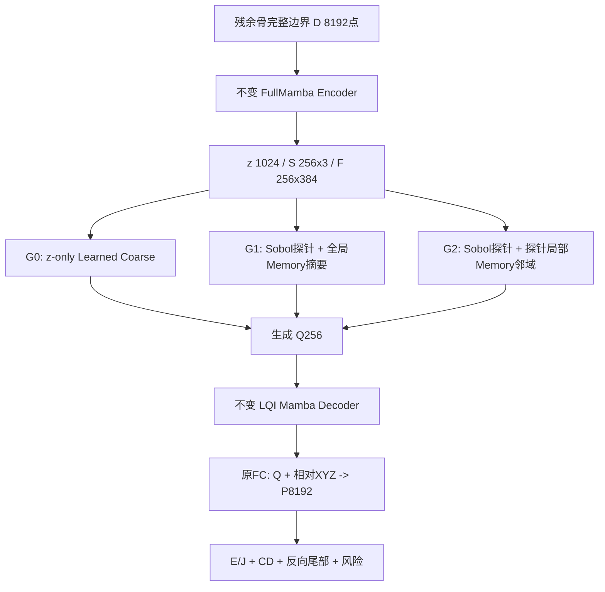

# Cranial-BCSP-FullMamba：BCSP-SPCG 正式实验计划书

**中文名称：空间探针条件粗生成与完整骨块可靠性验证**  
**英文名称：Spatially Probed Coarse Generation for Cranial-BCSP FullMamba**  
**研究代号：BCSP-SPCG（简称 SPCG）**  
**文档版本：v1.0 / 2026-11-16（Asia/Shanghai）**  
**性质：下一阶段待执行、可预注册的研究计划；不是已经完成的实验报告。**  
**主要依据：用户上传《Cranial-BCSP-FullMamba：SCQ-RIVE完整实验报告》（2026-11-16）、历次 P0–SCQ-DAC 实验事实及截至2026-11-16可核验的公开文献。**

> **总决策（先读）：** 当前 SCQ-RIVE 已经在同 GPU、同初始状态、同数据顺序的配对训练中显示：RF-Requery 相对 RF-Static 的 E_P95 在 Fold C 退化 +0.586 mm、Fold D 改善 −0.655 mm，J_Cover@2mm 在两折分别下降 3.368 / 2.061 个百分点，严重事件总数17→18且新发9例、挽回8例。因此**停止在当前 RF/DAC 上叠加反馈或搜索门控**。下一步提出一个真正不同的、作用于**首次 coarse 生成接口**的最小假设：由输入 D 所定义的固定空间探针，从真实 Memory 空间位置与特征获取局部条件，并直接生成256个 coarse 点。先以同容量“全局摘要探针”作核心对照，检验局部空间条件是否比仅有全局信息更能支持完整骨块生成；不假定实验必然成功。

---

## 0. 执行摘要与一句话结论

本轮唯一结构研究问题：**在不借助自由回归 Q0 后的多次残差补偿、保持无 Transformer Self/Cross-Attention、保持 SkullBreak BCSP V1 表示/训练/评价不变时，D-only 的空间探针所读出的局部 Encoder Memory 是否有助于直接生成更准确、更完整、更可靠的缺失骨块 coarse 点集？**

计划拟分三个模型：

| ID | 模型 | 首次 coarse 生成 | 核心角色 | 与其他模型的归因关系 |
|---|---|---|---|---|
| **G0-LQI** | 无 SCQ/RF 的既有 FullMamba-LQI | `z → MLP → 256×3` | 新的同轮 matched 基线 | 与G1/G2头结构不同，是实用比较，不是同参数单因素证明 |
| **G1-GP** | Global-Probe，**全局摘要探针** | 固定256个 D-only 探针 + 全局 Memory 统计，直接输出 Q | 与 G2 **同参数、同接口、同头**的机制对照 | 保留相同探针、输入维度、MLP、损失；不含探针邻域的局部读出 |
| **G2-SPCG** | Spatial-Probe，**局部空间探针** | 固定256个 D-only 探针 + 实际 Memory 的 k=8 邻域特征与相对几何，直接输出 Q | 唯一新候选 | **G2−G1**针对“探针与局部 Memory 的空间匹配读出”的组合效应 |

**首批硬预算：G0/G1/G2 × Fold C/D × seed0 = 6 次完整从头训练（每次3900更新，合计23,400更新），每模型105例Native开发预测，共630次模型预测。** 第二个训练 seed、额外消融、SkullFix、confirmation20均是独立的条件式后续研究，不自动开启。

**最重要的防误读：** G2 的创新并不是FPS/KNN、把一个样本点平移成 HyperPoint、单纯加坐标输入、再叠一层 residual，也不是声称先验知道缺损位置；空间探针只是**不依赖 Q0 的查询位置**，为直接 coarse 生成提供 D-only 条件。G1/G2 是否优于已存在方法、局部条件是否真的提供信息，均须由数据和文献全文/代码进一步证明。

---

## 1. 已有证据：从 RIVE 正负结果出发，而不是重新发明问题

### 1.1 RIVE 已经实测的事实（来源：2026-11-16 正式报告）

- 目标任务是 `∂D → ∂G`：残余骨 D 的**完整骨边界**输入，生成移除骨块 G 的**完整骨边界**，包含原有自由表面 E 和与 D 共用的人工切壁 J。不是完整颅骨预测，也不是只补外板的一块表面。
- SkullBreak 已开放的84个来源，每来源五种合成实体缺损，共420例；Fold C/D 各63来源训练(315例)、21来源开发(105例)，开发来源互不重叠，训练来源交叉重叠42个。**两折不是独立外部盲测**。
- RIVE 两臂均40,827,847参数，同一GPU RTX4090D、同一初始化与batch顺序，各3900更新；全部有效执行记录通过其冻结审计。
- Requery−Static：C的 E_P95 +0.586 mm、J_P95 +1.030 mm、CD +0.401 mm、E_Cover@2mm −4.829pp、J_Cover@2mm −3.368pp；D的 E_P95 −0.655 mm、J_P95 −1.013 mm、CD −0.196 mm、E_Cover@2mm +1.618pp、J_Cover@2mm −2.061pp。
- 42开发来源合并 E_P95 改善仅0.0346mm，CD恶化0.1027mm，J_Cover@2mm下降2.7145pp；不能仅凭合并E宣称优越。
- severe研究标记为`E_P95>20mm OR J_Cover@2mm==0`，RIVE合计 Static17→Requery18，**新发9、挽回8**，须同时呈现。
- 已有11例Q0/Q1/Q2/dense轨迹：有反馈放大、纠偏不足、位置变近但形状/接口仍差；9例新严重的Requery Q0质心距离都>40mm，但其他被挽回病例同样可能Q0很远，**不能以大Q0偏位为通用失败检测器**。
- RIVE完成的是 mode A、seed0；没有运行第二seed、bootstrap、全量Memory/N0/N1归因、SkullFix与独立确认。报告正式决定收束当前RF-Requery公式，而非宣称全部重查询理论无效。

### 1.2 与更早实验保持一致的证据

1. P0的GT平移/刚体配准仅为离线诊断，不是推理操作；误差不仅是统一平移，形状收缩、层/面覆盖不足仍存在。
2. P1 Mamba Encoder（混合Transformer Decoder）在C/D呈现正负结果，不能从局部改进推断Mamba普遍优于Transformer。
3. P2的H1质心/半径监督、H2范围缩放没有稳定转化为E/J改善；**不能重复包装为coarse新机制**。
4. FullMamba F0完成去attention工程替换，但prefix-only条件性能不稳；LQI以Query局部条件改善D折但新增失败。
5. SCQ B/S中，S对B的两折平均有明显改善；195/210例S的Qraw质心误差>20mm，205/210例经SCQ后质心拉近，但退化病例大量同样位置改善，**位置不是完整骨块质量的充分条件**。
6. RF-Requery在先前单轮有较好开发结果，RIVE严格复核后不稳定；SCQ-DAC在20例冻结权重诊断中旧/新更新余弦全部为正、均值约0.975，未挽回严重病例，因而停止固定公式训练投资。

### 1.3 本轮明确不解决的事项

- 不再扫描 xyz/Morton/PCA/geodesic 序列化，或8k/16k采样、改变coarse数、改输出点数；前期已充分显示这些改变和本研究假设是不同维度。
- 不追加第三次、第四次坐标反馈，**不继承 h0/h1 到新候选**；否则无法检验“在 coarse 产生之前利用空间结构”。
- 不引入GT缺损中心/GT BBox/GT E/J标注作为推理条件；不用GT-ICP选择输出，不以结果筛除已知失败病例。
- 不同步加rim loss、对称性、法向、曲率、厚度、实体闭合、多输出头或新Decoder。
- 不宣称同样的KNN/局部条件已经是全新方法，不将研究性J覆盖当作临床装配公差。

---

## 2. 文献核验、方法邻近性与新颖性边界（截至2026-11-16）

本节同时覆盖用户所列的优先方向与新检索结果；**“核验”仅表示核对到论文机构/期刊/会议页、摘要或公开预印本，不等于已逐行阅读其所有全文/代码**。提交论文前必须在可取得的全文/仓库核对关键结构图和源码。

| 优先 | 论文与年份 | 公开来源可支持的事实 | 对SPCG的约束 |
|---|---|---|---|
| 医学1 | Wodzinski et al., *High-Resolution Cranial Defect Reconstruction by Iterative, Low-Resolution, Point Cloud Completion Transformers* (2023) | 颅骨缺损点云补全及迭代高分辨率研究，骨缺损任务不能按通用PCN语义等同 | 固定颅骨实体缺损及world-mm指标；不能仅凭参数/模型名对比 |
| 医学1 | Wodzinski et al., *Automatic Skull Reconstruction by Deep Learnable Symmetry Enforcement* (2025) | 可学习对称性用作颅骨重建先验 | 本轮不引入对称性，以免与直接空间条件生成混因 |
| 医学1 | *SkullBreak / SkullFix* dataset (2021) | 两数据集来自公开CT数据且缺损生成/划分不同；公开论文范围并非本研究已开放84来源的等价说法 | 严格区分当前本地已开放84来源子集与论文描述的数据集整体 |
| 医学1 | Wodzinski等 *MedPCFM* (2026预印本) | PTv3点云补全及flow matching，使用SkullFix/SkullBreak和下颌骨数据 | 后续任务匹配强基线，不将其方法描述成Mamba |
| 医学1 | *CDRMamba* (2025在线记录) | U-Net/Mamba的3D医学影像分割/修复，不是同一输入输出点云协议 | 对比应注明体数据及目标差异；不能照搬其DSC/HD和本任务比较 |
| 医学1 | Fishman et al., *Thickness and design features of clinical cranial implants...* (2024) | 临床植入体厚度及Rim结构与合成设计数据存在差异 | E/J点云评价不等于可制造厚度/真实implant认证 |
| Mamba2 | *3DMambaComplete* (2024) | 通过HyperPoint生成/扩散及点集变形完成点云；从输入点构造/位移关键点已有先例 | **绝不可宣称“首次基于输入坐标生成coarse点”** |
| Mamba2 | *CompletionMamba* (IEEE TIP 2025) | 局部SSM、点序列因果结构及shape-aware Mamba | 只加局部KNN/shape-code不是新颖点 |
| Mamba2 | *PointMamba* (NeurIPS 2024) | 空间填充曲线序列化及Mamba点云骨干 | 序列化改变和空间Token不是新颖点 |
| Mamba2 | *PPC-MT* (2026预印本) | PCA几何结构与Mamba-Transformer混合解码 | 不用PCA作为本轮单独新增变量，且其decoder含Transformer |
| Mamba2 | *DAPointMamba* (AAAI 2026) | 跨域patch扫描和空间SSM对齐，解决点云序列化破坏局部几何的问题 | “空间对应/局部patch”不是独创；其任务为跨域补全 |
| Mamba2 | *FusionMamba* (Information Fusion 2026) | 空间感知局部-全局聚合、残差几何对齐 | “再加一个geometry correction”重合明显，所以本轮移至**直接生成接口** |
| Mamba2 | *BuildingComSSSM* (2026) | Geometry-Aware Mamba，但关键点生成含Self-Attention、点扩散含Cross-Attention | 不能将该网络照搬而宣称全无Attention |
| 前沿3 | *Hyper-PCN* (CVPR 2026) | Hypergraph、anchor-based关系和高阶相关性 | 空间anchor与结构关系已有研究，需把本轮说成可证伪的任务特定设计而非概念首创 |
| 前沿3 | *GDPNet* (Computers & Graphics 2026) | 结构生成/细节恢复解耦，Keynodes Shift | 与直接coarse生成高度邻近，提交论文前**强制**核对keynode shift公式和实际代码 |
| 前沿3 | *Revisiting Point Cloud Completion: Are We Ready for the Real-World?* (ICCV 2025) | 常规基准与复杂真实拓扑存在差距 | SkulBreak合成开发不能外推真实手术环境 |
| 前沿3 | *RDS-Net*（检索到2026年在线条目，所列期刊卷期为2026年12月，晚于本计划日；不可据此宣称目前已正式出刊） | 公开页面介绍递归结构精修/跨尺度细节生成 | 本轮不在decoder上堆叠递归结构，避免重复旧RF错误 |

**创新性谨慎陈述：** SPCG暂时只能定义为“面向BCSP实体缺损、在无Transformer-Attention的FullMamba中，验证无Q0依赖的D-only固定空间探针局部Memory读出对**首次coarse直接生成**的有效性”。在同容量G2−G1结果、跨seed和近邻文献结构逐一核对完成前，不宣称首次、SOTA或确定创新贡献。

### 2.1 精确公开文献入口（优先一手）

1. Wodzinski et al. 2023：<https://arxiv.org/abs/2308.03813>
2. Wodzinski et al. 2025：<https://pubmed.ncbi.nlm.nih.gov/40009971/>
3. SkullBreak/SkullFix 数据集：<https://www.sciencedirect.com/science/article/pii/S2352340921001864>
4. MedPCFM：<https://arxiv.org/abs/2606.24433>
5. CDRMamba：<https://www.sciencedirect.com/science/article/pii/S1746809424014344>
6. Fishman 2024：<https://pubmed.ncbi.nlm.nih.gov/38430381/>
7. 3DMambaComplete：<https://arxiv.org/abs/2404.07106>
8. CompletionMamba：<https://pubmed.ncbi.nlm.nih.gov/40853794/>，DOI `10.1109/TIP.2025.3597041`
9. PointMamba：<https://proceedings.neurips.cc/paper_files/paper/2024/hash/395371f778ebd4854b88521100af30ad-Abstract-Conference.html>
10. PPC-MT：<https://arxiv.org/abs/2603.00870>
11. DAPointMamba：<https://ojs.aaai.org/index.php/AAAI/article/view/37596>
12. FusionMamba：<https://www.sciencedirect.com/science/article/pii/S1566253526002575>，DOI `10.1016/j.inffus.2026.104378`
13. BuildingComSSSM：<https://www.sciencedirect.com/science/article/pii/S1569843226001858>
14. Hyper-PCN CVPR2026：<https://openaccess.thecvf.com/content/CVPR2026/html/Li_Hyper-PCN_Hypergraph-Based_Point_Cloud_Completion_via_High-Order_Correlation_Modeling_CVPR_2026_paper.html>
15. GDPNet：<https://www.sciencedirect.com/science/article/abs/pii/S0097849326001810>
16. Real-world ICCV2025：<https://openaccess.thecvf.com/content/ICCV2025/html/Pathak_Revisiting_Point_Cloud_Completion_Are_We_Ready_For_The_Real-World_ICCV_2025_paper.html>
17. RDS-Net：<https://www.sciencedirect.com/science/article/pii/S0031320326011957>
18. AdaPoinTr：<https://pubmed.ncbi.nlm.nih.gov/37924200/>

对于用户清单中未逐一检索到可核实论文正文或实现的条目，仅保留为后续系统性文献审查线索，不据题名推断其实验数字、模块代码、发表年份或新颖性结论。

---

## 3. 新研究问题、反例与待证伪假设

**唯一假设 H-SPCG：** 相对于“同样的256个空间探针只接收全局Memory摘要”，让每个固定探针读取实际Encoder Memory中空间最近的8个Token及其相对几何，能够为**首次coarse直接生成**提供更有用的病例特异结构信息，进而改善完整骨块的 E/J 形状、覆盖与严重几何可靠性。

**该假设不依赖：** 一个先自由预测、再修正的 Q0；不依赖GT缺损框、GT接触面；不要求所有生成点贴近D；不改变Mamba/Decoder的attention-free路径；不假设只是把Q拉向已观察骨表面。

### 3.1 必须同时允许的反例

- **大缺损区域远离 D 的所有 Memory Token。** 固定探针的最近邻可能属于离缺损很远的残存骨，此时局部读出可能不如全局上下文。新head输出**无距离截断**，不能强制q黏附到S。
- **D-only bbox可能遗漏G的外伸范围。** 探针位置在D包围盒内，**预测坐标不限制于盒内**；但若大量GT骨块在此之外，局部空间特征未必充分，应报告外盒比例而非补建oracle盒。
- **内外板/孔道与切壁相互接近。** 欧氏kNN不代表真实表面内在连通或解剖语义，可能跨层聚合。
- **全局 z 已含大量信息。** 局部特征可能在训练中被忽略；只增加同维头未必形成有效读出。
- **固定探针的空间覆盖与实际颅骨方向相关。** D-only坐标归一化并不保证姿态对齐；Sobol探针不具旋转不变性，源数据朝向必须由冻结合同比对。
- **coarse重建好但dense变差。** 若改善只出现在Q256，而完整E/J、CD、覆盖没有改善，不支持H-SPCG主张。

### 3.2 结果所能支持的最高表述

- **G2−G1**：可估计“在相同直接coarse头与探针结构下，采用局部Memory读出而非全局摘要”的端到端训练配置效应。因为同时改变局部特征与局部相对几何，**不能单独证明某个标量特征的因果贡献**。
- **G1−G0**：包含模板探针、坐标映射与head改变，**不能独立证明局部几何**。
- **G2−G0**：对原LQI的实用完整任务性能比较，**不能把增益归因于唯一结构细节**。
- 当前C/D开发反复用于提出假设，**任何seed0正向结果仅是开发证据**，没有多seed和独立来源前不宣称最终方法。

---

## 4. 固定任务、数据与几何评分合同（不得漂移）

| 类别 | 唯一合同 |
|---|---|
| 数据 | 已开放SkullBreak BCSP V1；84来源×5合成实体缺损 |
| Fold C | 63来源/315训练；21来源/105开发 |
| Fold D | 63来源/315训练；21来源/105开发 |
| Fold依赖 | C/D开发来源互斥，训练来源交叉重叠42，**不是独立双训练复制** |
| 输入 | `∂D`，缺损残余骨与背景相接的完整边界，包括内外表面、孔洞/腔体及暴露切壁，面积采样8192 |
| GT | `∂G`，移除骨块完整边界，含E自由表面和J共用接触壁，8192采样 |
| 输出 | 256 coarse、每query32个相对XYZ、dense8192 |
| 坐标 | D-only的center/scale归一化；所有世界mm评价统一逆变换；禁止GT校正 |
| 学习 | 原 `CD(coarse,GT8192)+CD(dense,GT8192)`，原训练归约与FP32 cdist后端；denoise=off |
| 模型选择 | epoch99/step3900，**不按dev最佳** |
| 指标 | A1 E/J面积加权P95及Cover0.5/1/2；A2反向P95/>20mm点比例；CD-L1(双向欧氏未平方平均半和)；质心/半径；资源 |
| 风险 | `severe=(E_P95>20mm) OR (J_Cover@2mm==0)`；另`placement_tail=centroid_err>20mm`、`compact=radius_ratio<0.9` |
| 保留集 | `confirmation20`封存；已曝光历史official test不能洗成新盲测；SkullFix单列后续任务适用性；MUG500+不作已认证精确GT |

**评价层级：** 每病例先计算各指标，五缺损等权得source均值，再折内21来源等权；配对检验单位为source，病例用于新发/挽回风险及缺损分层。不要将420个缺损或840行控制+模型数据当420/840个独立患者。

**边界语义：** J是合成实体移除后D/G共用切壁；J Cover@2mm是离散参考面的距离覆盖率，**不是**临床Rim接触间隙、植入体闭合性或厚度。

---

## 5. 结构设计总览：直接 coarse 生成，不再追加RF补偿

### 5.1 共同骨干和删除项

三臂均保留：

1. `8192×3` partial D → 原grouper/FPS/KNN/DGCNN/PointNet++局部几何；
2. 六层已冻结结构的Mamba encoder，输出真实 `S∈R^(B×256×3)`, `F∈R^(B×256×384)`, `z∈R^(B×1024)`；
3. 已实现且无Transformer self/cross attention的八层LQI decoder；
4. 原始 query feature `mlp_query([z,Q])`、位置编码、排序/逆排序、原local graph分支、relative FC密集重建；
5. 原loss、点数、训练日程、数据划分、物理mm评价。

**G0**调用原 `coarse_head(z)` 输出Q；**G1/G2**以 `spcg_head(z,S,F,D_norm)` **替换**原coarse_head产生Q（不是`Q_old+delta`）。**删除且不调用**SCQ的`h0`及RF的`h1`，不保留训练后S/RF权重或辅助loss。每个模型在原“Q进入mlp_query”接口保持输出 `(B,256,3)`。



### 5.2 为什么与旧SCQ/RF不同

| 项目 | 旧SCQ/RF | 新SPCG |
|---|---|---|
| 条件读取位置 | 从 `z→Q0` 已经生成的位置做kNN，再加一/二次残差 | **Q存在之前**，使用D-only固定探针读取Memory信息 |
| 坐标生成 | `Q1=Q0+δ0`，`Q2=Q1+δ1` | `Q=H(z, a_i, local/global summaries)`，**单步直接输出** |
| 初始query是否需“猜对缺损处”才能取邻域 | kNN受Q0/Q1位置影响 | 探针位置来自D bbox，**不依赖初始预测Q0** |
| 大步纠偏 | 依赖残差路径 | 输出Q无半径/clamp限制；允许跨大距离直接生成 |
| 参数增量 | SCQ/RF新增各自头 | 新head替换旧coarse_head；G1/G2等参数，**无SCQ/RF** |
| 机制缺口 | 更新方向/局部邻域选择不稳定 | 探针局部Memory是否含可用的缺损空间条件，仍待验证 |

---

## 6. G1/G2 唯一数学公式与精确接口

### 6.1 D-only固定探针 A：不预测缺损位置，不读GT

输入`D_norm∈R^(B×8192×3)`为已经使用D-only中心/尺度归一化的残颅点。计算`l=min_p D_norm[p]`和`h=max_p D_norm[p]`。构造固定低差异点集`U={u_i}`，其中`U.shape=(256,3)`，由**不加扰动的三维Sobol序列**预计算（`scramble=False`），将其缓存为模型非可学习buffer、记录精确字节哈希；不要每次forward重新draw。定义：

\[
 A_i=l+(h-l)\odot u_i,\qquad i=1,\ldots,256.
\]

- `A_i`**仅是读取空间证据的固定探针，不是必须输出的coarse中心**。最终生成 `Q_i`不受`bbox(D)`或`||Q_i-A_i||`限幅。
- 不用GT/G bbox、缺损类型或oracle rim标签，不用对称面和ICP。D点序置换不得改变bbox与U。
- `U`顺序和代码版本冻结，不因看到C折结果改Sobol/PCA/grid/轴方向。
- 极端退化轴 `h-l<1e-6` 要检查并使用仅为数值安全的clamp；若源输入整体退化，应失败停止而非隐形替换数据。
- 采用Sobol是固定、均匀覆盖D bbox的**工程选型**，不是声称Sobol优于别的探针布局；本轮不搜索探针。

### 6.2 共同读出函数的维度

对于每个探针 `A_i`，选定索引集`N_i`，其中 `|N_i|=k`，取真实Mamba Encoder Memory 的 `S_j`和`F_j`。先逐token对F做**无affine LayerNorm**（epsilon=1e−5），记 `\hat F_j=LN(F_j)`。

\[
 f_i=\frac1{|N_i|}\sum_{j\in N_i}\hat F_j\ \in\mathbb R^{384},\qquad
 d_{ij}=S_j-A_i,
\]
\[
 \mu_i=\frac1{|N_i|}\sum_{j\in N_i}d_{ij}\in\mathbb R^3,
 \qquad \rho_i=\frac1{|N_i|}\sum_{j\in N_i}\|d_{ij}\|_2\in\mathbb R,
\]
\[
 \tau_i=\sqrt{\frac1{|N_i|}\sum_{j\in N_i}\|d_{ij}-\mu_i\|_2^2 +10^{-6}}\in\mathbb R.
\]

本轮直接生成head的输入：

\[
 x_i=[z,\ f_i,\ A_i,\ \mu_i,\ \rho_i,\ \tau_i]
 \in\mathbb R^{1024+384+3+3+1+1}=\mathbb R^{1416}.
\]

头部共享于全部256个探针：

\[
 Q_i=H_{\theta}(x_i),\qquad
 H_{\theta}:1416\rightarrow1024\rightarrow384\rightarrow3,
\]

隐藏层GELU；最后一层输出线性坐标、**无tanh/sigmoid/半径clamp/坐标吸附**。记`Q∈R^(B,256,3)`，直接送往原`mlp_query`与Mamba Decoder。`H`按同一独立CPU随机流预初始化；**G1/G2全部head参数初始字节相同**，且相同类型的静态probe buffer逐字节相同。

**参数数核对（待实际源码确认）：** 若三层线性含bias，`H`权重/偏置参数量为 `1416×1024+1024 + 1024×384+384 + 384×3+3 = 1,845,763`；原常见`1024→1024→768` coarse MLP为1,836,800参数。**这只是根据已知历史结构做的接口估算，不代替实际构造/模型state_dict参数核验**。重要的是G1/G2最终参数数必须完全一致。

### 6.3 G2-SPCG：空间局部读出（唯一候选）

对每个固定探针，使用真实Memory空间位置在`S`中选 `k=8`最近邻：

\[
 \mathcal N_i^{G2}=\operatorname{KNN}_{8}(S,A_i).
\]

将该索引集代入6.2节的`f_i,mu_i,rho_i,tau_i`，直接预测`Q_i`。不在训练中改变k、距离尺度、归一化方式或引入Learned Attention。KNN整数索引不求导；被取出的F/S连续值参与梯度。即使最近邻都离探针很远，也不构造特殊GT/阈值fallback：由 `rho_i,tau_i`明确向head暴露这种情况，**不保证head学得会使用**。

### 6.4 G1-GP：同参数、同探针的全局读出对照

仍为**同一个 `H:1416→1024→384→3`**、同样的`A_i`、同样的Memory以及相同输出消费者；唯一替换的是每探针读出对应的Memory集合：

\[
 \mathcal N_i^{G1}=\{1,\ldots,256\}\quad(\text{全部Memory}),
\]

按完全相同的6.2节公式计算mean特征、全局相对位置均值、距离均值与空间离散尺度；因此`f_i`在各探针相同，但`mu_i,rho_i,tau_i`仍是**与当前探针有关的全局几何统计**。G1不是“无坐标”或“无几何”，也不能解释为完全禁止D-only空间信息。其作用是控制额外头、探针ID/坐标、全局几何表示，只移除**探针特异的局部邻域选择**。

**核心消融的准确归因：** `G2−G1`主要估计“固定probe在实际Memory上使用空间局部而非全局集合进行聚合”的组合效果；局部特征变化与局部几何统计同时发生。若后续需要进一步区分这两个子因素，应另外预注册同参数G3，但不在本轮同时扩展。

### 6.5 G0-LQI：历史接口原样保留

G0原`z→(1024→1024→768)→Q(256,3)`，训练/decoder/输出均无SCQ/RF；必须本轮同设备、同折从头训练，不拿历史LQI的异轮分数替代matched基线。保留原coarse loss，不替换`query`为新模块缓存，不把`loss_sparse=0`误读为没有coarse监督。

### 6.6 必须保证的工程可识别性

- 全模型没有 Transformer Self-/Cross-Attention 运行分支；允许FPS/KNN/PointNet++/DGCNN/MLP/FFN/Norm/FC重建。G1/G2聚合权重是**确定性均值/KNN**，不是内容QK Softmax attention。
- 所有候选的训练输入、目标与batch顺序一致；G1/G2由于读出方式不同而从头联合训练，结束时共享上游Encoder权重一般会分化。这种结构总效应不能冒充冻结同一个模型的纯局部读出反事实。
- `torch.cdist(A,S)`只用于**输入D与Memory**近邻聚合；正式loss的 `cdist(P,G)`沿用原实现与归约，不改变精度/后端。
- 对KNN距离完全相等的情况，需要按Memory稳定索引进行确定性tie-break，并验证所用PyTorch/kernel满足预定策略；如无法建立可复现排序，先停止准入。
- 不修改既有LQI query的XYZ排序/逆排序约定；确认训练与eval使用相同Q信息而无GT排序泄漏。
- D-only bbox在归一化坐标中计算，输出世界mm仍使用既有D-only中心/scale反变换；不得“为了便于训练”在head内部使用GT bbox或单病例新对齐。

---

## 7. 可执行参考伪代码、张量形状与失效检查

以下是**接口伪代码，不是已验证可直接运行的原项目补丁**；真实模型构造、GELU实现、BN/NORM、grouper输出及`get_loss`必须由实际冻结源码核对后适配。禁止为了让伪代码能运行而静默改动研究公式。

```python
# PyTorch 2.4 风格伪代码。省略batch维的复杂reshape和项目特有factory。
# 仅表达必须满足的数学接口；不能将其直接标记为已通过CUDA。
import torch
import torch.nn as nn
import torch.nn.functional as F

class ProbeCoarseHead(nn.Module):
    def __init__(self, use_local: bool):
        super().__init__()
        self.use_local = use_local
        # 必须预计算并锁定当前项目可用torch版本的Sobol实际字节
        probe = torch.quasirandom.SobolEngine(
            dimension=3, scramble=False
        ).draw(256).contiguous()
        self.register_buffer("probe_u", probe, persistent=True)
        self.net = nn.Sequential(
            nn.Linear(1416, 1024), nn.GELU(),
            nn.Linear(1024, 384), nn.GELU(),
            nn.Linear(384, 3),
        )

    def forward(self, partial_xyz, memory_xyz, memory_feat, global_z):
        # partial_xyz [B,8192,3], memory_xyz [B,256,3]
        # memory_feat [B,256,384], global_z [B,1024]
        B = partial_xyz.shape[0]
        lo = partial_xyz.min(dim=1).values
        hi = partial_xyz.max(dim=1).values
        if torch.any((hi - lo) < 1e-6):
            raise RuntimeError("Degenerate D-only bbox; fail closed")
        A = lo[:, None, :] + (hi - lo)[:, None, :] * self.probe_u[None]
        # A [B,256,3]；不参与输出坐标截断
        Fnorm = F.layer_norm(memory_feat, (384,), eps=1e-5)
        dist = torch.cdist(A.float(), memory_xyz.float())  # [B,256,256]
        if self.use_local:
            # 正式实现必须审计tie-break；普通topk在并列距离时未必稳定
            ind = deterministic_knn8(dist, memory_xyz)
            nbr_S = batch_gather(memory_xyz, ind)       # [B,256,8,3]
            nbr_F = batch_gather(Fnorm, ind)             # [B,256,8,384]
        else:
            nbr_S = memory_xyz[:, None, :, :].expand(B, 256, 256, 3)
            nbr_F = Fnorm[:, None, :, :].expand(B, 256, 256, 384)
        d = nbr_S - A[:, :, None, :]
        mu = d.mean(dim=2)
        rho = torch.linalg.vector_norm(d, dim=-1).mean(dim=2, keepdim=True)
        spread = torch.sqrt(
            ((d - mu[:, :, None, :])**2).sum(-1).mean(dim=2, keepdim=True)
            + 1e-6
        )
        f = nbr_F.mean(dim=2)
        z = global_z[:, None, :].expand(B, 256, 1024)
        x = torch.cat([z, f, A, mu, rho, spread], dim=-1)
        assert x.shape == (B, 256, 1416)
        Q = self.net(x)  # [B,256,3]，这是直接生成，不是A+残差
        assert torch.isfinite(Q).all()
        return Q, {"probe": A, "rho": rho, "mu": mu, "spread": spread}
```

`deterministic_knn8`与`batch_gather`是项目专用接口占位符，**不得臆造它们已存在**。G1的`dist`只需诊断，正式实现可不做大矩阵KNN；核心前向公式与结果必须保持一致。`f`采取mean而非max是本次**唯一冻结的读出类型**，不因实验结果不理想改回SCQ mean+max。

### 7.1 首批形状与数据约束测试

| 测试 | 预期 | 失败意味着什么 |
|---|---|---|
| G0/G1/G2输出 | `Q:[B,256,3]`, `P:[B,8192,3]`，均有限 | 接口未打通 |
| G1/G2 probe_u | 字节、顺序、shape完全相同；`requires_grad=False` | 核心消融不成立 |
| G1/G2 H初态 | 每个weight/bias的name/shape/dtype/value一致 | 同容量对照未配对 |
| Partial重排 | A与Q的输出在给定容差下相同（不变的backbone本身也需核查） | 数据顺序依赖或非确定性超合同 |
| 完整预测路径 | Q真实参与`mlp_query`、位置编码、LQI、FC中心、coarse loss | 只修改日志/中间可视化 |
| 首次训练反传 | Head、z上游、选定Memory F/S连续梯度finite | 梯度断路 |
| G2局部vs G1全局 | 非退化D样本descriptor存在可观测差异；不设事后效果阈值 | 输入区分假设不成立 |
| 零GT条件 | 推理call graph不能访问G、GT E/J、GT bbox、缺损class、任何评分脚本 | 数据泄漏，立即停止 |
| 非注意力 | 不调用`MultiheadAttention`/Transformer Self/Cross Attention或隐式QK-Softmax分支 | 违反架构要求 |
| D反归一化 | 纯同次D元数据还原world-mm；不依赖GT | 无效Native |
| kNN边界 | 重复/并列距离tie-break固定；所有索引0..255 | 复现性失效 |

### 7.2 几何可行性只读检查（0新训练）

在冻结探针坐标、k=8和公式之后，可用**既有已开放的训练/开发D-only输入及实际Memory身份**做有限诊断：

- `A`及`S`的真实坐标范围、每探针最近邻距离`rho_i`、局部有效特征方差、极端远邻比例、重复索引与非有限；若尚无实际Memory数组，则精确限定少量forward预算并另行执行，不声称报告里已经有。
- Sobol探针对D外表面/内表面及大缺损是否覆盖（仅以D-only几何图展示；不能凭图将已知GT缺损位置写入探针）。
- **离线GT可用、推理不可用的参考诊断：** G的A1/E/J、GT8192相对D-only bbox的外盒比例；只作为可能的表达风险解释，**不得依据个别来源/缺损调Sobol盒或选轴**。
- 注意实际Memory只有256点。诊断邻域必须用真实`S/F`而非原8192输入点代替，且不能把输入PointNet++子采样形成的`S`视作切壁语义GT。
- 首轮仅排除工程与表达上的明显不可行：全局/局部descriptor全等、bbox退化、KNN全部误指、梯度失联、明显GT泄漏等。不能用开发E/J分数在正式训练前微调邻域k或head宽度。

**前置停止：** 若G2和G1在普通数据上的全部descriptor不可区分，或Sobol探针与真实Memory接口发生结构错误，则停止；应修正实现或放弃假设，不开启6-run训练。若descriptor有差异但难以解释其解剖意义，仍可以进行一次冻结公式的有限证伪，但不能承诺成功。

---

## 8. 分阶段实施计划与明确停止条件

| 阶段 | 核心活动 | 新训练 | 必须落盘 | 准入/停止 |
|---|---|---:|---|---|
| S0 | 四份RIVE权重/源码/报告/数据清单只读核验；选定G0-LQI母版 | 0 | `source_of_truth.json`, sha清单 | 未能恢复共同母版或评分合同则停止 |
| S1 | G1/G2公式、Sobol U、张量接口、无Attention计算图审计 | 0 | `spcg_formula_v1.md`, `model_diff.json` | 发现多处结构偷偷变化则停止 |
| S2 | 人工CPU/P3，真实Mamba零更新CUDA，D-only/邻域可行性 | 0 | P3、CUDA请求/输出、完整state/RNG证据 | 不finite/梯度/资源/输入差异则停止 |
| **S3** | **G0/G1/G2 × Fold C/D × seed0** 同设备配对训练 | **6** | run日志、3900步、固定checkpoint、源码/配置SHA、资源 | 任一run失败即冻结该失败，严禁选择性继续只保留好的模型 |
| S4 | 六模型每折105病例Native预测及统一A1/A2评分 | 0 | 630个prediction、来源汇总、风险转移、全量Q | 未通过统一评分审计则不比较效果 |
| S5 | 分折/来源/缺损/严重风险/形状与coarse归因；负面同样收束 | 0 | `paired_results`, `risk_transition`, `failure_attribution` | 无双折主指标和接口一致证据则不晋级 |
| S6 | 条件式多seed复核；必要时同容量细化消融G3 | 最多6+2，**另行决策** | seed预注册、重复CI、独立机制证据 | 不从历史开发中选择有利seed |
| S7 | 固定模型后的独立确认、SkullFix适用性与公平强基线 | 后续单独计划 | 真正独立来源/执行身份、临床边界 | 保留confirmation封存至最终确认 |

### 8.1 阶段权限与研究成本纪律

本计划书**没有授权**云端启动、写旧checkpoint、清理旧容器、打开confirmation20、访问真实病例或在GitHub推送。阶段S0–S2完成后的训练须使用独立的可执行实验请求/明确预算合同；不能将“计划存在”视为训练已开始。

- 在不同阶段的工程“准入”不等于科研“成功”；成功/失败均留不可变日志与状态哈希。
- 任一折训练启动前，G0/G1/G2三臂需要完整地注册同折计划；不得先看G2_C结果再修改G2_D配置。
- 若云环境换GPU/驱动，**同折三臂必须在新设备重新建立配对块**，不能无提示让某一臂独自迁移后继续声称严格同设备。换设备不自动允许重跑已获得正/负结果。
- 训练的0-step人工测试绝不计入3900正式optimizer updates；诊断decoder-only不计入完整Native病例预测。

---

## 9. 训练合同、配对与资源

### 9.1 六run必须共用的冻结训练合同

| 项 | 固定值/精确含义 |
|---|---|
| 数据 | 每折315训练病例；每来源五种缺损；冻结D-only归一化及8192点身份 |
| 更新 | `100 traversals × floor(315/8)=100×39=3900` |
| batch | 8，`drop_last=True`；每遍曝光312、drop3；每run31,200曝光、300 drop；六run共187,200曝光、1,800 drop |
| 模型初始化 | **scratch**，不加载训练后的RF/SCQ/LQI权重；共同encoder/decoder/FC逐字节配对 |
| G1/G2 head | 同一初始化快照字节+相同Sobol U，差异仅在局部vs全局聚合集合 |
| RNG | seed0训练流；新head单独固定CPU随机流；不得影响模型母版初始化的随机流 |
| 优化器 | AdamW，lr=1e-4，betas(0.9,0.999)，eps1e-8；梯度clip=max_norm10 |
| weight_decay | 每组显式指定：矩阵5e-4，bias/一维/特定SSM A_log/D等no_decay为0；**不要把optimizer默认0.01误当实际组值** |
| 调度 | `LR=1e-4*max(0.9^(epoch/21),0.02)`；`BN momentum=max(0.9*0.5^(epoch/21),0.01)`，均冻结同折序列 |
| loss | 原 `CD(Q256,G8192)+CD(P8192,G8192)`，原normalize与PyTorch cdist实现及归约；无denoise/H1/H2/rim/厚度新增loss |
| 数值 | FP32、TF32=false，明确记录CUDA/PyTorch/Mamba provider与已知非位级确定性 |
| checkpoint | 固定epoch99/update3900最终权重；不使用开发集最佳epoch、不resume自动重试、不重新用GT校准BN |
| 推理 | batch1、eval/inference_mode、无TTA、无ICP/GT-Oracle、无点删除/阈值筛选 |

**配对范围：** 同折三臂使用相同的病例ID、8192点文件字节、所有实际batch/source顺序、优化器/scheduler起点、训练更新次数；相同名字`seed0`本身不足以证明这些条件已匹配。不同Fold来源/顺序不同，不要求跨折三臂完全相同输入顺序。

### 9.2 计算与硬件准入

- 预计设备以能够运行历史39.9M LQI的RTX4090D 24GiB为基础，目标batch8；但G1/G2引入256×256 probe-memory全局统计，其峰值必须**实际测量**，不得由以前RF的~13GiB直接断言必然满足。
- CUDA零更新测试至少包括：G0 eval1、G1 eval1、G2 eval1、G1 train8、G2 train8，完整loss和backward；检查真正native Mamba执行、有限梯度、BN/RNG恢复和所有Q消费者。
- 推荐继续使用既有范围内的训练预算墙钟≤3600秒、Torch allocated≤20GiB、SMI显存≤22528MiB、RSS≤8GiB、输出≤2GiB；这些须作为**拟沿用**的准入而非已经监测的结果。若不满足，先报告瓶颈并决定是否停止，不能私自把G2调成更小head后仍声称原假设。
- 训练吞吐、peak memory与推理延迟只作当前合同描述；若论文声明效率优势，应在同设备独立测速，不能用训练日志的总elapsed直接推导相对AdaPoinTr加速。

### 9.3 随机种子和追加预算

- **第一批seed0是开发性验证，不是多seed稳定性证明**。
- 若G2在同折对G1呈现一致准确率和风险正向信号，**先冻结计划中的第二个具体seed值、设备、顺序和全部三臂矩阵，再启动追加6run**；不能只为G2增加一个新seed，也不能一直重复直到表现最好。
- 推荐从研究设计上将第二seed登记为`seed1`（但需要与旧项目训练随机流命名冲突/初始化合同核对）；它是条件式资源投入，不能被写作本轮已执行。
- 若G2失败，原则上以负面结果收束此具体probe公式，不通过扫描k、宽度、Sobol偏移、损失权重寻找看起来更好的开发成绩。

---

## 10. Native推理、保存字段与机械一致性

### 10.1 预测清单

首批6模型×105开发病例=**630完整模型forward**；另有共享 Nop_D、GT8192 两种控制，**每病例算一次**，共420控制评分行。若每模型评分一行，则本轮统一评分可形成630模型行+420控制行=1050行，不得称1050个独立患者。

每模型每病例必须存：

| 字段 | 形状/定义 | 用途 |
|---|---|---|
| `prediction` | [8192,3] | 正式dense与全部E/J/CD/离群评分 |
| `coarse` | [256,3] | 原coarse head输出；G0或G1/G2均直接训练 |
| `probe` | [256,3]，仅G1/G2 | D-only Sobol探针位置，排查配置漂移 |
| `probe_mu`, `probe_rho`, `probe_spread` | 256×(3,1,1)，G1/G2 | D-only几何关联诊断；不用于模型选择时重算阈值 |
| `probe_neighbor_idx` | [256,8]，仅G2；建议保存 | 检查实际256 Memory选择而非8192输入替代 |
| `source_id, defect_type, fold, model_id` | 结构化元数据 | 消除历史路径交叉歧义 |
| `partial_sha`, `transform_id` | 确切输入哈希/D-only坐标变换身份 | 防GT泄漏、可重放 |

若保存全部Memory F/S过于昂贵，可按训练前固定的代表样本另存完整`S/F`并保存哈希；**不能据没有保存的Memory张量宣称全队列机制已验证**。预测时不得以额外forward提取日志造成独立预测计数变更；优先同次hooks或原始路径返回，核查参数/RNG/BN不变。

### 10.2 不得后处理

- 预测不做GT平移、刚体ICP、对称GT镜像、TTA、点清理、按病例挑最佳checkpoint。
- 严格记录0个optimizer step/0 loss/0 BNCal；batch1 eval记录状态前后hash。输出`NaN/Inf`不是被删除的样本，而是严重执行故障，应报全病例可用率及原因。
- GT索引、E/J参考只在**推理输出完成后**进入CPU评价器；机器/请求资源绑定证明推理进程无法读取这些评价信息。
- 原有预测官方test曝光史不改变；confirmation20只在最终候选与所有比较/统计规则锁定后独立授权打开一次。

---

## 11. 统一物理几何指标、统计层级与主要对比

### 11.1 主终点与辅助终点

1. **主终点** `E_P95`：对A1中E区的面中心到预测8192点的欧氏最近邻距离求**按物理面积加权的95分位**；先逐病例再来源等权平均；**不是**所有点拼接后的全局P95。
2. **关键安全/接口共终点** `J_P95`, `J_Cover@2mm`，同时保留E Cover@0.5/1/2及J Cover@0.5/1/2。
3. `CD-L1(P8192,G8192)`：双向未平方欧氏最近邻均值的半和；训练归一化loss不得与world-mm CD数值直接比较。
4. `pred→A2 P95`与`pred→A2 >20mm`比例，防止生成点虽然覆盖局部目标却大量落到远处。
5. `coarse Q256`的A1 E/J、质心、回转半径、实际bbox与GT距离**仅作为阶段诊断**；256点和8192点参考覆盖具有分辨率差异，不能把E/J差异全部归咎于dense模块。
6. **风险病例** 逐病例记录`severe/new/rescued/shared`，`centroid>20mm`，`radius_ratio<0.9`，分层frontoorbital/parietotemporal等。
7. **资源** 参数、训练显存、train step、实际推理耗时，并注明benchmark条件与是否独立重复。

### 11.2 正式比较关系与主解释单位

- **主机制比较 G2−G1**：两者同head、同参数、同probe、同输入/输出/训练/decoder/优化器，差别在于局部 vs 全局的Memory集合统计。按21来源/折配对；先看每折方向，再看中位差和胜/负来源数，不能只看两折合并均值。
- **实用比较 G2−G0**：研究新的直接空间条件生成是否优于原FullMamba-LQI learned-only；参数结构不同，不作因果机制证明。
- **架构比较 G1−G0**：判断固定probe+直接coarse头在全局信息条件下是否已改善；若G1明显胜G0而G2无优势，可能是探针/头结构变化有益而局部读出不有益。
- 不将历史RIVE Static/Requery的数值在无匹配身份条件下算为本轮paired结果；可在附录仅列冻结历史作背景。
- 两Fold训练源有交叉、各来源五缺损相关，主统计单位是来源；不能把42来源当42个独立训练seed或跨模型外部复现。

### 11.3 统计预注册（仅当对应数据实际产生）

第一批seed0：

- 报告每折source等权均值、来源配对差均值/中位、胜/负/持平(严格零差)、21来源条形/散点分布、完整病例风险转移。
- 可预注册每折来源级**配对bootstrap**：在21个source中有放回抽21个，保留同source五缺损一组，固定2000次采样与随机种子；以“候选−参照”的来源均值差生成探索性95%CI。不能以病例105为独立单位抽样，也不能将CI称作外部泛化/训练seed不确定度。
- **折间训练交叉依赖**意味着跨折联合CI不宜包装成两个独立样本训练复现；每折分开报告，合并只给描述性等权均值，不做虚假独立性显著性检验。
- 多比较（G2−G1，G2−G0，G1−G0）优先顺序预登记；不能只报告最有利一组及最有利缺损类别。
- 没有实际运行bootstrap前，报告必须标`NOT_RUN`，不得填入凭空估计的CI或p值；即使执行，不能修复C/D开发集反复观察的问题。

第二训练seed如果获授权：

- 报告两个seed×两个fold的逐条件差值，至少确认相同方向是否稳定；不把两个seed直接混成42×2独立患者。
- 不根据第一个seed后验调整模型公式/超参，再把第二seed称为同一方法确认。

---

## 12. 预注册决策门（开发研究，不是临床合格标准）

**原则：研究晋级必须同时看完整E、接口J与新增风险。** 既有20mm严重阈值来自旧合同，仍然不是临床公差。新结构是否值得确认不能只看平均E或质心。

### 12.1 硬性工程门 E0（训练之前）

**全部必须成立**：S0–S2核验通过；G1/G2参数量完全相同且模型可按要求单独构造；相同Sobol U；G1/G2初始head权重逐值匹配；共同母版参数/状态一致；真实CUDA完整loss/backward有限且训练batch8在资源范围内；运行图不含禁止Attention；无GT/密封数据泄漏；KNN与反归一化可复现。任一失败停止，不允许通过改变研究变量来“修好”仍声称同一公式。

### 12.2 主研究支持门 M（G2对G1）

在**两个Fold分别**按来源等权比较，定义`Δ=G2−G1`：

1. 两折 `ΔE_P95 < 0`，并同时报告每折来源均值、中位数、胜负数量；
2. 两折 `ΔJ_P95 ≤ 0`；
3. 两折 `ΔJ_Cover@2mm ≥ 0`；
4. 两折 `ΔE_Cover@2mm ≥ 0`，且`ΔCD-L1 ≤ 0`，作为防止局部优化损害全形状的共同检查；
5. 两折相对G1**无新增severe**（`new_severe=0`），且不存在非有限输出；
6. 必须公开每折 `old/new/rescued/shared`，以及`centroid>20mm`、`radius_ratio<0.9`风险转移，即使其它指标改善也不能遗漏；
7. 不把`mean radius ratio closer to 1`当作独立通过条件，不把一个来源极大改善抵消多个来源严重退化后叫稳定。

这是**有意严格的后续确认投资门**，不是统计证明或外部可用性认证；尤其第5项有可能导致即使均值有改善也暂不晋级，其意义是避免重复RF新增严重失败。条件中的数学不等式是**预先约定的方向目标，不是已知可实现的物理非劣界值**。

### 12.3 实用价值门 U（G2对G0）

除了M门，要求G2与原LQI基线G0在两折的E_P95、J_P95、J_Cover@2mm、CD及严重风险有清晰的对比记录。若G2相对G1获益却整体明显劣于G0，不能称“取得可用模型”；其结果最多支持局部关联有效，但新generator总体结构仍需重审。**不以某个未论证的0.01mm阈值宣称临床非劣。**

### 12.4 三档结论与动作

| 观察结果 | 最高结论 | 动作 |
|---|---|---|
| E0失败 | 实施尚未合格 | 不训练；修正工程后要重新冻结清单与身份 |
| G2−G1只改善coarse质心/半径，dense E/J不一致 | H-SPCG未获支持 | 保留负结果，禁止追加rim loss掩盖 |
| G2−G1的E/J部分改善，但有新增severe或覆盖下降 | 有条件开发性信号、可靠性不足 | 不进入确认；记录失败机制；不扫描k、模板或额外反馈 |
| G2−G1满足M，但G2远差于G0 | 局部空间关联在新头内部有效，整体generator未证更优 | 作为机制观察，不能写为有效新方法 |
| G2同时满足M/U且资源可接受 | 值得**进行独立第二seed和进一步归因**的开发候选 | 先锁定计划/权重/源码，再另行执行，不将本轮称最终方法 |
| 新seed与独立来源仍稳定、强基线公平 | 可以评估论文主贡献 | 仍须审查相关工作和临床边界 |

### 12.5 为什么不直接规定“必须改善多少mm”

目前没有来源于临床验证的SPCG最低有意义改善量；把`0.1mm/1pp`随意写成通行门槛不专业。本计划只冻结**方向与不能新增灾难事件的开发研究目标**。如果最终论文要提出非劣/临床阈值，应从独立临床设计误差、点密度和接口公差研究得到证据，在观察新结果之前另立确认协议。

---

## 13. 机制归因、失败诊断和反事实界限

### 13.1 新generator优先检查的三类失败

**A. 初始coarse严重空间错位**：评估G0/G1/G2在同一病例coarse质心、E/J P95、回转半径与目标bbox相对位置，但不能把这类离线GT误差作为推理时的probe调整信号。

**B. 位置更近但形状/接口漏覆盖**：即使G2 coarse质心下降，若E/J Cover@2mm不升、J_P95增大、半径比<0.9或预测→A2虽近但参考表面缺口很大，仍判为未解决。D/069 random_2等历史机制案例可用于解释，不用于选择probe参数。

**C. 局部探针条件不具有任务对应性**：probe到真实Memory的8邻域可能跨内外板、局部洞道或远离未知骨块。可只读报告`rho`分布、局部F方差、probe空间覆盖，不能未经额外验证即称它们为“自适应缺损定位结果”。

### 13.2 事先固定的病例展示原则

- 全210开发病例先完成正式评分及来源配对；**不能**只根据11例RIVE失败做新模型结论。
- 只读可视化固定三组：①RIVE报告列明的9个new-severe（现阶段只作为历史压力病例），②至少每折用不可依赖G2分数的固定哈希选5个未指定压力病例，③完成评分后按预先固定规则选G2的new severe与明显改善用于说明。第三组**显式标注为事后病例解释**，不能当无偏支持。
- 全图使用统一world-mm坐标、等比例轴、全预测点展示，必要ROI只改变视图而不改变评分；不GT-ICP、去离群或拼接不同模型不对应的query槽位作“同一解剖点”比较。
- G2与G1的探针ID相同，但**各模型训练后的Q_i不保证相同解剖语义**，不允许逐index差分直接解释解剖移动方向。

### 13.3 何种反事实可以、何种不可以

- 可在**训练结束后**于一份冻结G2权重中替换局部统计为全局统计，观察同权重即时敏感度；这是有分布偏移的**诊断**，不是G1同训练配置的性能。
- G1/G2独立从头训练后其encoder和head权重分化；两者的正式Native性能差是**结构方案的端到端训练总效应**，不能冒充同一权重切换KNN后的因果纯效应。
- 不用GT中心/方向给probe调好后再测试；GT-Oracle只可在另行明确标注的离线诊断中使用，不可并入Native主成绩。
- 不依赖此前“固定失败病例Q0偏位”的统计构造“如果Q0偏了就用probe”的门控，因为本轮根本没有自由Q0，而且旧数据已证明偏位非失败特有。

### 13.4 特别记录的负面情况

- G2探针局部Mean被网络忽略（对F局部扰动的Q响应很小）：报告条件通路弱，但不自动把症状归为Mamba状态遗忘。
- G2比G1更多新发severe：优先报告这些病例的空间探针邻域/全局形状表现，但**本轮不据此添加GT修补**。
- 某类缺损（例如frontoorbital或random_2）平均显著退化：预注册类型表完整呈现；不能事后只给成功类型宣称适用范围。
- 模型输出整体被Sobol探针锁定在D bbox：观察到该现象可判直接生成head表达不足，**不**通过推理时人工向外平移增强成绩。

---

## 14. 实验公平性、容量控制和可能的混杂

| 对照因素 | G0 | G1 | G2 | 审计要点 |
|---|---|---|---|---|
| FullMamba Encoder | 相同 | 相同 | 相同 | 原6层Mamba、局部图branch一致 |
| LQI Decoder | 相同 | 相同 | 相同 | 原8层无Attention，不改位置编码/排序 |
| 采样/归一化/GT | 相同 | 相同 | 相同 | D-only、8192/8192、相同文件字节 |
| Coarse直接生成 | z-only | z+全局探针摘要 | z+局部探针摘要 | 两新head同结构 |
| 空间探针A | 无 | 相同Sobol D bbox | 相同Sobol D bbox | 不因缺损类别调模板 |
| SCQ/RF残差h0/h1 | **无** | **无** | **无** | 不允许潜在历史factory偷偷注册/调用 |
| 总参数 | 历史LQI预估39.90M | 需要原生计数 | 与G1**完全一致** | G0结构不同，如实披露非同容量 |
| head参数 | 历史头约1.837M | 公式约1.846M | 与G1相同 | 原生字节/实际构造为权威 |
| 近邻聚合 | 无 | 256全Memory均值 | k=8邻近Memory均值 | **G2−G1核心单因素组合** |
| 损失/训练 | 相同 | 相同 | 相同 | coarse/dense CD一致 |
| 训练初始化 | 共同模块配对 | 与G2所有参数配对 | 与G1所有参数配对 | 独立head随机流，不污染共同状态 |
| 训练设备 | 同一配对设备块 | 同一配对设备块 | 同一配对设备块 | GPU UUID/驱动必须绑定 |
| Native评分 | 相同 | 相同 | 相同 | 同设备、同CPU评分实现、无后处理 |

特别注意：**G1虽然不取局部kNN，仍使用D-only全局位置统计，不能将G2的改善描述为“加入坐标从零变有坐标”。** 实际新信息是probe与Memory的**局部对应关系**。如果要独立检验局部特征和相对几何各自价值，需在新候选完成主验证后单开同参数消融，不能擅自把G1改成“全部置零”来夸大对比。

---

## 15. 论文创新、强基线与独立适用性路径

### 15.1 什么才可能形成有说服力的创新

需同时具备：

1. **问题层**：BCSP完整缺失骨实体表面（包括E和J）与普通PCN输入缺失语义不同；说明D-only位置缺陷及free-coarse缺乏显式局部条件的可证伪假设。
2. **方法层**：固定空间probe如何在**首次coarse阶段**汇聚实际Mamba Memory并直接生成 Q；其与3DMambaComplete HyperPoints、GDPNet Keynodes Shift、Hyper-PCN Anchors、CompletionMamba局部SSM、FusionMamba几何校正的**公式级差异**。
3. **归因层**：G1/G2严格等参数、同初态/顺序，报告正负case、额外seed、来源统计、新发/挽回风险和空间探针消融；不能只用G2 vs旧M0的不同口径均值。
4. **结果层**：E/J、CD、覆盖、反向离群均足够一致且无不可接受的新增严重失败；外部适用性和临床边界如实披露。

目前1是任务事实，2是拟实施公式，3/4**未执行、未成立**。不得在论文草稿中提前写“首次SPCG”或“显著优于现有方法”。

### 15.2 当前最重要的强基线及公平条件

- **T0 AdaPoinTr-Implant-8192**：历史官方适配强参照；只有在相同BCSP输入/目标点数、来源、训练预算、评价器和world-mm E/J口径下才可公平比较，不能跨文献原始CD排榜。
- **G0 FullMamba-LQI learned-only**：本轮必须同训练设备重新配对，不能仅引用旧单seed历史成绩。
- **P1 M0 Encoder Mamba+Transformer Decoder**：供论文陈述“保持无Attention约束的代价”；它不是本轮G1/G2机制因果对照。
- **MedPCFM 的PTv3 deterministic与flow matching**：医学点云补全与SkullBreak数据相关，后续若能实现同`∂D→∂G`、内外/切壁完整边界、8192点及统一来源/指标才可列正式公平结果。不同原始数据任务不得直接比较数字。
- **Wodzinski 2023/2025颅骨重建**：迭代补全和对称性研究作为医学任务方法对比，需先核实输出目标是implant实体/表面还是完整颅骨。
- **3DMambaComplete、CompletionMamba、FusionMamba、GDPNet**：方法新颖性对照；若移植代码，必须处理其PCN/ShapeNet与当前完整骨块实体目标的差异。

### 15.3 后续数据验证的层级

1. **SkullBreak Fold C/D**：已严重开发曝光，支持机制发现，不是确认集。
2. **新增训练seed**：只可证明受限的训练稳定性，不能替代新来源泛化。
3. **SkullFix独立来源划分**：可研究跨合成缺损构造/数据来源适用性，须先审核历史曝光与表示/GT定义；不能把早已见过的SkullFix直接叫新盲测。
4. **confirmation20**：如确属仍封存且与训练来源隔离，只有确定最终模型/公式/阈值/统计报告模板后**一次性正式确认**，禁止参与挑结构、挑seed或改G2超参。
5. **MUG500+/真实临床**：MUG部分数据缺乏认证的精细实体implant GT，不应生成高精度医学结论；真实临床还要求厚度、Rim、网格闭合、接触穿透、安全性专家验证，不能由当前点云E/J代替。

---

## 16. 完整风险表与预先指定的处理

| 风险 | 触发征兆 | 不允许的补救 | 允许的专业处理 |
|---|---|---|---|
| 直接probe离缺损远 | `rho`大、Q偏位、E/J不佳 | 根据GT缺损中心移动探针 | 作为输入局部读出的负证据；关闭该公式，不宣称适用 |
| 近邻跨颅骨内外板 | 相似坐标但不同骨层，局部聚合混杂 | 用GT层标签在推理时强行分层 | 记录为下个独立研究问题；本轮不加层分类loss |
| 输出Q被探针盒束缚 | G2严重漏出盒外的G表面 | 在主结果中用GT平移/尺度扩盒 | 报告表达失败，不调bbox后再称同一实验 |
| 位置正确而J覆盖不佳 | coarse质心改进，J_P95/Jcover退化 | 单用质心/半径优化保证“成功” | 保留E/J与反向指标，判机制尚未获支持 |
| G1/G2参数不等 | 实际构造差异 | 用“差一点参数”包装为严格同容量 | 修改实现并重冻结，之后才准入 |
| G0历史分数与本轮不同 | old LQI与本次seed0训练漂移 | 选择历史好看的一组替代matched | 保存来源差异，解释训练身份与随机性 |
| C正D负或反向 | 双折主E方向不一致 | 只汇总两折均值或后验挑type | 否定跨折方向假设，保留负结果 |
| 新严重事件 | E>20或Jcover=0的新病例 | 只报告净数或删病例 | 按来源/类型记录新增/挽回/共同并限制晋级 |
| 训练显存超限 | native batch8 OOM | 给G2单独降batch/点数 | 停止，另立完全匹配的优化实验 |
| 折/路径名不符 | 历史开发目录词义交叉 | 根据目录字符串改变fold | 只用manifest、source/fold和逐文件哈希 |
| CUDA/BN状态污染 | 推理后参数/buffer变更 | 静默补跑或BNCal | 冻结失败记录，修复工程后重新授权 |
| 新文献高度重合 | GDPNet/HyperPoint中已含同公式 | 称任务不同就“首次” | 缩小创新主张，优先科学对照或换独立问题 |
| 复现偏差 | 同设备/seed仍成绩浮动 | 挑最好checkpoint或无限重试 | seed独立报告，必要时停止结构晋级 |

---

## 17. 归档、实验矩阵与机器可读清单建议

### 17.1 不可变目录建议

```text
spcg_20261116_v1/
  docs/
    BCSP_SPCG_plan_v1.md
    formula_and_interface_v1.md
    literature_boundary_v1.md
  identity/
    source_report_sha256.json
    source_and_split_manifest.json
    checkpoint_source_of_truth.json
    method_diff_and_attention_audit.json
    probe_U256.sha256
  preflight/
    CPU_P3/
    native_cuda_zero_step/
    D_only_probe_feasibility/
  training/
    G0_C_seed0/
    G1_C_seed0/
    G2_C_seed0/
    G0_D_seed0/
    G1_D_seed0/
    G2_D_seed0/
  prediction/
    native_630_manifest.json
    native_predictions.tar.gz
    native_predictions.sha256
  evaluation/
    case_metrics.csv
    source_metrics.csv
    paired_source_deltas.csv
    defect_type_metrics.csv
    risk_transitions.json
    E_J_reverse_A2_summaries.json
  diagnostic/
    fixed_case_selection.json
    coarse_and_dense_stage_metrics.csv
    probe_local_vs_global_readout_review.json
    figures/
  audit/
    implementation_audit.json
    six_training_freeze_audit.json
    prediction_freeze_audit.json
    scoring_freeze_audit.json
    report_source_manifest.json
  closure/
    GO_NO_GO_decision.md
    full_experiment_report.md
```

这些都是**推荐的交付文件名与目录**，不是当前已经存在的真实产物。不可引用、覆盖、移动先前RIVE的任何真实实验结果来冒充SPCG运行。

### 17.2 每个训练run必须记录

- run_id、fold、完整source列表、batch顺序canonical SHA、训练/开发文件字节哈希、数据归一化版本、实际GPU UUID/driver、Python/Torch/CUDA/SSM后端哈希。
- G1/G2 head与Sobol U预初始化及state_dict逐权重比较结果；G0/G1/G2共同模块state hash。
- 实际optimizer.param_groups weight_decay/LR，BN动量，3900 committed updates、31200曝光、300 drop、随机状态变化记录；`loss_sparse`字段的去噪语义。
- 训练过程loss +有限梯度/非有限中断记录、显存/RSS/SMI采样与Torch峰值、loss调用数、反向/step数。
- 最终checkpoint按 `(run_id,fold,seed,arch,source_hash)` 唯一绑定、SHA256、文件bytes、能否重新加载并按固定病例复演；若未完成恢复验证，必须显式标记。
- 所有失败启动、报错、hotfix和新的不可变执行request分开归档，不将“工程修复的成功执行”冒称科研新实验重复。

### 17.3 正式评分固定模板

| Fold | 比较 | ΔE P95(mm) | ΔJ P95(mm) | ΔE Cover2(pp) | ΔJ Cover2(pp) | ΔCD(mm) | E胜/负来源 | severe旧→新 | 新发/挽回 | 备注 |
|---|---|---:|---:|---:|---:|---:|---:|---|---|---|
| C | G2−G1 | **待运行** | **待运行** | **待运行** | **待运行** | **待运行** | **待运行** | **待运行** | **待运行** | 机制主比较 |
| D | G2−G1 | **待运行** | **待运行** | **待运行** | **待运行** | **待运行** | **待运行** | **待运行** | **待运行** | 机制主比较 |
| C | G2−G0 | **待运行** | **待运行** | **待运行** | **待运行** | **待运行** | **待运行** | **待运行** | **待运行** | 实用比较 |
| D | G2−G0 | **待运行** | **待运行** | **待运行** | **待运行** | **待运行** | **待运行** | **待运行** | **待运行** | 实用比较 |
| C/D | G1−G0 | **待运行** | **待运行** | **待运行** | **待运行** | **待运行** | **待运行** | **待运行** | **待运行** | 架构改变说明 |

**绝不把RIVE的已有数值填作这些待运行单元格。**

---

## 18. 各结果分支下的科学结论与下一步方向

### 情形 A：G2全面优于G1，且优于G0，风险受控

支持“在直接coarse生成阶段，探针局部Memory读出能够提供额外空间条件”的开发性假设；下一步按预先登记的seed1和独立来源确认；同时核验GDPNet、3DMambaComplete源码差异后决定论文方法命名。**仍不能直接宣称临床适用。**

### 情形 B：G1与G2都优于G0，彼此接近

说明把自由回归换成256个固定探针参与的直接生成head可能有效，但**局部Memory对应没有被证明额外有效**。应保留负消融，不为了讲“局部结构感知创新”事后补造成功原因。

### 情形 C：G2优于G1，但仍显著差于G0

局部空间读出在新设计内部可能有信息价值，但生成表示/训练归纳偏置整体不充分。下阶段应换机制问题或停止该头，而不是直接追加第N次残差；若要发展论文，需先有可用的原任务方法。

### 情形 D：G2只改进coarse位置、dense E/J恶化或严重病例增加

直接否定“局部空间探针足以改善完整骨块可靠性”的主要假设，重申P2与RIVE所示低阶位置/范围≠完整表面。禁止在本轮同时添加J loss或GT补偿来“通过门”。

### 情形 E：G1/G2都失稳，且大幅偏离原FullMamba-LQI

优先怀疑探针到骨缺损的空间对应不足、实例坐标不稳定或coarse参数共享导致表达受限。只读归因后**关闭该具体公式**。若后续仍继续研究，可独立考虑真正结构化的缺失骨块表示（例如分层表面/跨尺度拓扑条件），但必须重新核对文献并单独预注册，不能把后续内容视作SPCG已批准扩展。

### 情形 F：开发集正向，但第二seed或独立来源反向

说明当前支持依赖训练轨迹/来源构成，不获得稳定优越性证据。所有seed与来源结果都必须报告；不能改名为“优选seed方法”或重新挑一个不同的确认集。

---

## 19. 研究与临床边界（硕士论文表述模板）

**若尚未执行，本研究应写：**

> 根据SCQ-RIVE同设备匹配实验，RF-Requery在Fold C/D呈现相反的主要E_P95方向且两折J_Cover@2mm均下降，新增严重事件与挽回并存。基于此，本研究提出BCSP-SPCG研究假设：通过由残缺输入定义的固定空间探针，在首次coarse生成阶段直接聚合实际Mamba Encoder Memory，而非在自由生成Query后叠加残差补偿。计划以相同参数的全局探针对照评估空间局部条件读出的贡献。目前该方法仍处于拟验证阶段，尚无SPCG实验结果。

**若未来满足开发性门，也只能写：**

> 在SkullBreak BCSP V1的预设开发折及冻结的点数/训练协议下，SPCG相对同容量的全局探针对照在E/J及完整骨块指标显示一致的开发性改善，并按来源与病例风险进行报告。后续仍需跨seed、独立来源和实体/临床适用性验证。

**禁止的推断：**

- “首次提出基于空间anchor的Mamba点云补全”“彻底解决颅骨切壁匹配”“全网络严格线性复杂度”“已达到临床可制造植入体要求”“两折就是独立外部验证”“只要E P95下降就证明医学成功”“MUG500+提供本任务全部临床厚度精确真值”。
- 文献中的颅骨修复、一般点云物体补全、体素分割、CT生成、mesh/实体implant设计采用不同任务协议；不把公开CD值直接与本任务world-mm E/J排名。

---

## 20. 实施清单（执行前逐项打勾）

### S0：资产与任务身份

- [ ] 只读核对RIVE报告、四权重SHA、数据来源清单、Fold交叉、历史test暴露/confirmation20边界。
- [ ] 恢复原FullMamba-LQI无attention母版并检查所有真正Self/Cross-Attention调用点。
- [ ] G0正式配置、原coarse MLP、`mlp_query`、LQI decoder、FC与get_loss返回值逐项对照。
- [ ] 训练/开发输入索引按sourceID+hash绑定，不信历史目录名。

### S1：公式与比较冻结

- [ ] 固定Sobol U256字节、D bbox公式、k=8、LN/mean/距离/spread、Head1416→1024→384→3。
- [ ] 固定G1全局集合与G2局部集合的唯一比较差异；禁止多尺度/额外注意力/GT先验。
- [ ] G1/G2完整模型参数相等，初始化逐字段相等，共同母版与G0保持相同值。
- [ ] 论文邻近方法GDPNet/3DMambaComplete/CompletionMamba等查核结构重叠风险，形成引用索引。

### S2：工程准入

- [ ] CPU/P3包含所有shape、loss、真实内存访问路径、梯度、KNN索引与状态恢复。
- [ ] native CUDA batch1和batch8零更新前/反向正常，FP32/TF32后端及预算通过。
- [ ] GT/评分脚本不能被推理forward或probe构造访问。
- [ ] G2局部与G1全局描述量在非退化数据可区分，且无非有限输出。

### S3：训练

- [ ] 注册6run固定完整矩阵，不按C结果调整D。
- [ ] 每折三臂GPU/驱动一致，common init与每批ID顺序真正配对。
- [ ] 各3900更新、31200曝光、300drop、固定最终checkpoint。
- [ ] 每run单独完成checkpoint权重/状态/源码/配置/资源冻结。

### S4–S5：预测、评分与归因

- [ ] 每臂105病例、六模型630 Native完整forward；无TTA/ICP/BNCal/额外优化。
- [ ] 统一A1 E/J、A2反向、CD、E/J Cover、完整病例风险与来源层级统计。
- [ ] G2−G1主机制比较与G2−G0实用比较完整报告，正负结果同等保存。
- [ ] 完整显示C/D差异、五缺损类型、new/rescued/shared和固定病例图；不只展示成功例。
- [ ] 依据第12节门槛写明继续、收束或独立确认；无新实验时不填写虚构数据。

---

## 21. 一页研究决策与最终建议

**最小可执行顺序：** `RIVE收束/恢复FullMamba母版 → SPCG-G1/G2公式审计 → CPU/真实CUDA零更新 → 同设备G0/G1/G2×C/D的六次配对训练 → 630 Native → world-mm E/J联合评价与风险转移 → 根据预注册门决定是否投入第二seed/独立来源`。

**研究命题定位：** 我们不是继续寻找“能否把Q修得更近GT”的新后处理，而是检验：**在无Transformer-Attention的Mamba补全架构中，将真实D-only空间结构提前进入首次coarse生成，能否减少自由空间回归后需多次纠偏所带来的任务不稳定性？**

**为什么这条路线值得一次有界证伪：** 旧P0/RIVE多次暴露早期coarse空间错位、反馈有效与放大并存，旧H1/H2已证简单中心/尺度约束不足，RF增量没有稳定复现；而最新文献显示局部SSM、HyperPoint/Keynode平移、几何校正已有大量先例。SPCG正好检验不同的*空间条件进入时间点*，并设置可严谨归因的相同参数全局对照。

**什么时候应及时放弃：** G2只有位置收益、完整E/J不改善；G2−G1跨折反向；新发严重风险无法接受；或者最邻近论文已提出本质相同公式且缺乏新的方法差异。此时应保留证据、停止扫描并考虑更高层级的生成表示或同任务强基线研究。

**目前状态：只有计划书、文献核验与历史RIVE证据；没有实施任何SPCG训练、模型、预测、评分或新确认。**

---

## 附录A：必需事实校验卡

| 事实 | 正确数值/边界 | 禁止误写 |
|---|---|---|
| RIVE C ΔE | +0.586 mm（Requery退化） | “两折重查询E都改善” |
| RIVE D ΔE | −0.655 mm（Requery改善） | “RIVE彻底失败，所有案例都坏” |
| RIVE C/D ΔJcover2 | −3.368 / −2.061 pp | “J接口也稳定改善” |
| RIVE严重转移 | Static17→Requery18；新增9、挽回8 | “仅净增1，可忽略风险” |
| RIVE样本 | Fold C/D各21开发来源、105缺损 | “210独立患者” |
| G0/G1/G2训练 | 拟执行每折三臂共6run | “已训练/已复现” |
| SPCG严格主比较 | G2局部读出 vs G1全局读出，等参数 | “G2 vs G0仅差相对坐标” |
| 探针位置来源 | D-only bbox × 固定Sobol U | “真实缺损中心或GT bbox” |
| 输出 | 缺失骨块完整边界∂G，E+J | “外板表面片/完整颅骨” |
| 临床外推 | 仅合成实体缺损点云重建 | “直接可打印的最终临床植入体” |

## 附录B：文献审阅任务卡（准备投稿前必须完成）

- [ ] 获得并阅读**3DMambaComplete** HyperPoint Generation/Spread中输入坐标偏移与coarse构造公式、完整实现代码。
- [ ] 阅读**GDPNet** Keynodes Shift Module 的确切数学结构及何时注入空间条件；判断与SPCG是否存在实质重合。
- [ ] 阅读**FusionMamba** 的LGSA/CM模块及其输入/输出；避免将局部坐标校正重新命名为新方法。
- [ ] 核对**CompletionMamba、DAPointMamba、PointMamba、PPC-MT**与本方法在序列组织、局部聚合及无attention解码的边界。
- [ ] 核对**MedPCFM** 的SkullBreak表面任务与BCSP ∂D→∂G是否一致；仅在任务一致的情况下比较。
- [ ] 核对**Wodzinski 2023/2025** 的植入体目标、GT评价、对称性使用条件；不把对称性当作普遍准确的无GT解剖先验。
- [ ] 核对**Fishman 2024**真实植入体厚度与Rim指标；将合成实体缺损点云结果限定在算法研究层。
- [ ] 对未能核验全文/代码的用户82篇清单条目列为`BIBLIOGRAPHY_PENDING`，不能声称已精读完成。

*文档结束 — BCSP-SPCG v1.0，拟执行、尚无新实验结果。*
