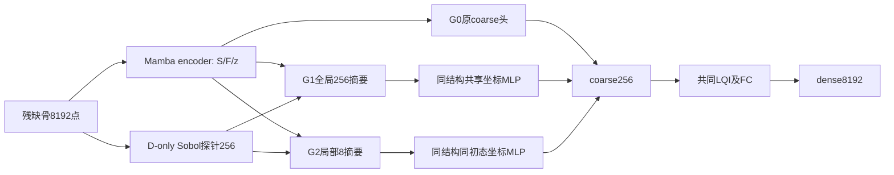

# Cranial-BCSP-FullMamba：BCSP-SPCG 完整实验报告

版本：v1；报告日期：2026-11-17。研究阶段：当前固定SPCG候选已完成六运行评价与有限诊断，科研结论已收束；本报告不自动授权新实验、归档推送或服务器清理。

## 摘要

本研究针对全Mamba颅骨点云补全中反复出现的骨块位置偏差、漏覆盖与严重离群，考察能否在首次coarse生成前引入不依赖旧coarse的空间条件。提出并固定一个诊断性候选：在残缺骨输入包围盒内布置256个固定Sobol探针，读取encoder Memory的特征和几何摘要，以共享MLP直接生成256个coarse点，再接入相同LQI decoder和8192点重建路径。

采用SkullBreak已开放84个来源、每来源5种实体缺损，固定C/D两折，训练G0原头、G1全局256-Memory摘要、G2局部8邻域摘要共六模型。每模型8k→8k、3900次更新，使用固定初始化和同折批次顺序；统一完成630份Native预测、1050行病例评分与每折2000次来源配对bootstrap。评分及5例有限几何诊断均正式冻结。

核心结果为：G2相对G1的E P95在C/D折分别回退1.5270/1.8720mm；D折95%来源区间[0.9379,2.8983]mm。C折J Cover@2mm提升7.0196个百分点，但D折未稳定复现，且G2相对G1新增严重病例为9/7例、挽回4/0例。三个固定退化病例的显著异常在已保存coarse节点已存在，dense未能纠正。G1也未确立对G0的整体优势。

因此收束当前固定G2方案，不将G1/G2晋升为可靠优胜方法。结论只适用于本方案、本预算、seed0与已曝光开发条件；局部集合基数、平均平滑与空间性耦合，Memory等采集缺项、D折部分跨设备及开发选择偏差均限制机制归因。下一阶段应先回答coarse是否能可靠利用D-only空间证据，而非立即叠加模块或继续扫描参数。

## 1. 研究背景与实验目的

此前FullMamba、SCQ与反馈类实验表明：局部接口支持、质心/尺度矩或个别覆盖指标改善，不能保证完整骨块形状与尾部可靠性提升。旧coarse偏位还可能令依赖它进行局部重查询的路径读取到不适合当前缺损的位置。SPCG的动机是把空间条件前移到首次coarse生成之前，并避免先生成错误Q0再反馈修正的依赖。

本轮主要问题是：在相同生成头结构、初态和训练预算下，以局部8个Memory替换全局256个Memory的描述，是否改善两个开发折的最终骨块E P95，同时保持接口与严重失效方向一致？辅助问题是新头整体是否优于原LQI全局coarse头。

这里验证的是端到端训练配置，不是同一权重下切换邻域的因果反事实。固定探针、Sobol、KNN、局部条件或MLP本身不构成新颖性证明；本轮首先判断方案是否值得继续投入，而非保证论文创新成立。

## 2. 数据、几何目标与固定划分

|项目|本轮实际范围|
|---|---|
|数据来源|SkullBreak已开放84个来源×5种实体缺损，共420例|
|每折训练/开发|63来源315例 / 21来源105例|
|两折关系|开发来源互斥；训练集合重叠42来源；某折开发来源可能在另一折训练中出现|
|缺损类型|bilateral、frontoorbital、parietotemporal、random_1、random_2|
|输入|残缺骨组织完整边界 ∂D，固定8192点|
|目标|缺失实体骨块完整边界 ∂G，固定8192点；不是完整颅骨或仅缺失外板片|
|coarse/dense|256中心，每中心32子点，共8192点|
|采样|冻结BCSP Geo-V1面积表面采样；本轮不重采样、不修改缺损|
|坐标|D-only中心/尺度，GT用同变换；评价回到原始world-mm|
|checkpoint|最终epoch99、step3900；不按开发集选择最佳epoch|
|本轮未评价|封存confirmation20、SkullFix外部适用性、MUG、真实临床缺损|

骨组织完整边界包含源分割中存在的内侧/外侧表面、孔道或腔体边界以及切除后暴露的切壁；这不是凭空恢复分割中不存在的细节。E表示骨块继承的原骨自由表面，不能简化成颅骨外表面；J表示D/G共享的合成切除界面。

C/D是相依的交叉划分，不是两个完全独立的患者队列或训练重复。最终630份模型预测对应210个不同开发病例、42个独立来源，不能按630个独立患者计算不确定性。已反复开放的开发集也不能被本次新训练变为盲测集。

## 3. 模型及三臂设计

共同母版为六层Mamba encoder、八层LQI decoder和原FC重建。保留原grouper与512/256实际取点、Mamba配置、局部计算和输出消费者；不启用SCQ/RF、H1/H2或其他历史候选。无可达Transformer self/cross-attention分支不等于全网络严格线性复杂度，FPS/KNN、距离与Chamfer仍有自身计算开销。

|臂|首次coarse生成|Memory集合|完整参数量|解释|
|---|---|---|---:|---|
|G0|原1024→1024→768，reshape为256×3|原全局路径|39,903,169|冻结参考|
|G1|共享1416→1024→384→3 MLP|全部256个Memory|39,912,132|全局摘要的新头对照|
|G2|与G1相同结构/初态MLP|每探针最近8个Memory|39,912,132|局部聚合候选|

新H有1,845,763个参数；原coarse头1,836,800个，替换净增8,963。G1/G2删除旧头，不保留未用参数参加optimizer。两臂等参数，但不等信息带宽或等聚合平滑；G0与新头的槽位参数化也不同。

G2−G1是主要比较；G2−G0是实用参考；G1−G0用于解释新头/探针参数化。三者全部报告，不能只选择有利比较。

## 4. SPCG唯一公式与实际接入

### 4.1 固定探针

固定U∈R^(256×3)：三维Sobol、scramble=false、最初256点、FP32、固定顺序，以冻结字节而非运行时seed重生成作为身份。由当前8192点D_norm计算逐轴l=min(D_norm)、h=max(D_norm)：

\[
A_i=l+(h-l)\odot U_i.
\]

若输入非有限或任何轴范围<10^-6，停止，而不是clamp并替换。A不是可学习点、不等于Q或解剖对应；体积包围盒覆盖不保证薄骨表面、缺损或切壁覆盖。Q不被限制在输入bbox内，没有A+残差、tanh、sigmoid或表面吸附。本轮不根据结果改轴、对齐或偏移探针。

### 4.2 Memory描述与直接坐标生成

实际encoder输出S∈R^(B×256×3)、F∈R^(B×256×384)、z∈R^(B×1024)。先对每token做无affine LayerNorm，eps=10^-5；S/F须按同一Memory编号对齐。

\[
\widehat F_j=LN(F_j),\quad d_{ij}=S_j-A_i,\quad
f_i=\frac{1}{|N_i|}\sum_{j\in N_i}\widehat F_j,\quad
\mu_i=\frac{1}{|N_i|}\sum_{j\in N_i}d_{ij},
\]
\[
\rho_i=\frac{1}{|N_i|}\sum_{j\in N_i}\|d_{ij}\|_2,\qquad
\tau_i=\sqrt{\frac{1}{|N_i|}\sum_{j\in N_i}\|d_{ij}-\mu_i\|_2^2+10^{-6}},
\]
\[
x_i=[z,f_i,A_i,\mu_i,\rho_i,\tau_i]\in R^{1416},\qquad Q_i=H(x_i).
\]

H为1416→1024→384→3，两隐藏层GELU、末层线性，均含bias；256探针共享H。G1的N_i为全部256个Memory，G2为KNN8(S,A_i)。固定数组距离并列用Memory原索引稳定打破；它不保证FPS/序列化全模型严格置换或旋转不变。

G1中f和τ在各探针间恒定，μ=mean(S)−A，A+μ=mean(S)，但ρ仍随探针变化。因此G1本身有全局几何条件，不能称为无几何对照。ρ是平均距离，τ是邻域绕自身均值的RMS离散尺度，二者不可混为最近邻距离或定位置信度。

### 4.3 接入及梯度

factory仅替换真实PCTransformer.forward内的首次learned_coarse赋值；Q继续进入原mlp_query、坐标编码、LQI、排序/逆排序、FC中心、返回coarse与coarse loss。没有先算旧Q0再修正。KNN整数索引不求导，选中特征/几何的连续路径按实际requires_grad传播；S来自不求导D的FPS/gather时可以合法无grad。已核验H、encoder、decoder与重建路径的实际有限梯度，但记录的Q梯度来自总loss，不能称为隔离了coarse loss的贡献。

## 5. 初始化、训练与资源合同

所有模型scratch训练，共同encoder/LQI/FC初态按冻结证据匹配。G0保留旧头；G1/G2同一U与H字节，head_init_seed=2026111600，使用冻结默认Linear初始化，末层不做SCQ式全零输出。正式训练不按开发效果挑初始化。

|项目|固定合同|
|---|---|
|输入/输出|8192→8192；batch8、drop_last=true|
|训练预算|100遍×39批=3900次更新；每run曝光31200、drop300|
|总完成量|6run、23400次更新、187200曝光、1800drop；不等于独立样本数|
|optimizer|AdamW，lr=10^-4，betas=(0.9,0.999)，eps=10^-8，实际参数组WD为0或5×10^-4|
|梯度|继承clip10；FP32、TF32=false；披露有限Mamba梯度非确定性|
|LR|10^-4·max(0.9^(epoch/21),0.02)，沿用实际调度时序|
|BN momentum|max(0.9·0.5^(epoch/21),0.01)，沿用实际调度时序|
|监督|原coarse CD(Q256,G8192)+dense CD(P8192,G8192)，FP32 cdist及原归约|
|禁止变更|无新增rim/矩/厚度/位置loss，无BNCal、resume、开发择优或自动重试|
|检查点|仅最终epoch99/step3900用于本轮评价|

训练loss的归约及归一化空间与后续world-mm评分不同，不能把训练CD数值直接当作报告的mm级CD-L1。去噪关闭或某稀疏loss变量为0也不代表实际coarse监督不存在。

### 5.1 数值与设备延续限制

原设备UUID为GPU-c25d6be2-173c-031a-89c6-b96e0f5f8190；新设备为GPU-4b19574a-832d-b4fe-e655-a57462954d6a。两者为RTX4090D，驱动570.190；实际训练身份另保留Python3.10.20、Torch2.4.1+cu118、CUDA11.8等版本。

C三臂和G0_D在原设备训练；G1_D/G2_D在新设备训练。原GPU不可恢复后，用户明确接受跨设备延续，并将启动磁盘阈值调整为6GiB，其他科研配置及3900步合同不变。这一经授权偏离必须保留：D的G1/G2为同设备核心配对，任何对G0_D的比较都不是严格同设备架构消融。相同型号/驱动和统一推理设备不消除训练设备混杂。

### 5.2 实施与CUDA准入

核心隔离模块32项人工CPU验证及P3通过。随后真实CUDA准入最终冻结为11次完整forward、3次loss、3次backward、0次optimizer step：6次人工两种batch/模式调用，以及5次仅D的真实输入可行性调用。实际Mamba调用、预期梯度、状态/RNG/模式恢复和资源检查通过；记录396次原生SSM调用。CUDA准入只证明运行路径和数值可执行，不证明训练效果。

准入峰值allocated约12.81GiB、reserved约13.98GiB，24条资源记录；实际值和完整计数由冻结文件给出。早期SMI选择器、精确读取/输出绑定、传输和UTC守卫等失败均按版本保留，后续修订单独授权。不能把“六个有效完成训练”描述成“全部请求首次无失败”，也不把启动失败记为模型科研负分。

## 6. 六运行训练完成与过程记录

|运行|更新/遍历|曝光/drop|耗时/分钟|峰值allocated/GiB|峰值reserved/GiB|训练设备|
|---|---|---|---:|---:|---:|---|
|G0_C|3900/100|31200/300|24.97|12.93|13.76|原设备|
|G1_C|3900/100|31200/300|25.18|12.97|13.79|原设备|
|G2_C|3900/100|31200/300|25.61|12.97|13.79|原设备|
|G0_D|3900/100|31200/300|25.64|12.93|13.76|原设备|
|G1_D|3900/100|31200/300|25.23|12.97|13.79|新设备|
|G2_D|3900/100|31200/300|25.46|12.97|13.79|新设备|

六份正式训练冻结均通过，包含checkpoint字节哈希、完整实际批次顺序、初始化、3900条loss/几何记录、曝光计数和资源证据。每折批次顺序完全一致，G1/G2完整原始初态指纹一致。

### 6.1 固定步骤训练观察

训练中在{1,39,390,1950,3900}同次更新前向保留详细几何及总loss下Q梯度，无额外观察forward。下面仅摘录第1步与第3900步的**单批**loss，不是全epoch均值或独立验证曲线。两端批次不同，不能将下降量解释为泛化提升。

|运行|step1 coarse/dense CD|step3900 coarse/dense CD|step3900总loss下Q梯度L2|
|---|---|---|---:|
|G0_C|0.454457/0.365549|0.022661/0.013308|0.021145|
|G1_C|0.519463/0.429022|0.029497/0.014521|0.019453|
|G2_C|0.507631/0.416186|0.025160/0.015027|0.022946|
|G0_D|0.447591/0.366468|0.023026/0.013216|0.021502|
|G1_D|0.496954/0.409989|0.029157/0.014456|0.018177|
|G2_D|0.483524/0.396475|0.023623/0.014224|0.022624|

这些记录表明路径获得非零有限梯度，且训练损失在记录端点降低；但不能据此决定哪个模型更好。详细记录的首个batch未发现精确重复coarse点，也不能据此证明全队列不存在近似低多样性、范围收缩或错误位置生成。

## 7. Native预测、参考指标与统计方法

### 7.1 冻结预测

六模型每个105例，合计630次Native forward。eval/inference模式、不更新参数或BN、不计算loss/backward、无对齐/后处理；每模型状态和CPU/CUDA/Python/NumPy RNG前后相等。存储prediction[8192,3]与coarse[256,3]，全部FP32、有限；没有实际Memory、probe、μ/ρ/τ或邻域索引。

原计划要求更完整的机制材料，但实际授权Native范围只保存coarse/dense。本报告将遗漏明确记为NOT_COLLECTED，不能由最终预测猜测邻域，不能用计划文字代替实际产物，亦未为补齐而自动重跑模型。

预测归档共635个普通文件：630份预测及5份清单/调用/几何/完成/资源记录。压缩包58,926,842字节，SHA256为`a2f3384a95906cad6523cd0eb0c0c9954a4bd4252017934b825da1f0d49f07c7`；已在本机核验。原输入目录与fold名称可能交叉，按逐病例来源manifest及哈希读取，不靠目录名猜测。

### 7.2 评分对象与定义

|指标/对象|定义与含义|
|---|---|
|A1|由体素实体骨块边界面中心构成的面积加权参考；有E/J分区|
|A2|A1每面四个子参考位置，各分配四分之一面积权重|
|B|既定marching-cubes三角面中心与面积；不声称具有精确J分区|
|主指标 E P95|E参考点到预测的面积加权95%最近距离/mm|
|J P95、Cover@τ|J到预测的距离分位数；面积加权距离≤τ比例，τ为0.5/1/2mm|
|CD-L1|预测与固定GT8192双向未平方欧氏最近距离均值之和的一半/mm|
|反向P95/离群|预测→A2/B距离；包括>0.5/1/2mm比例及既定A2>20mm比例|
|位置/范围|相对GT8192质心偏差、包围盒、回转半径比及协方差谱|
|coarse/dense|同次保存的两个点集及其既定几何摘要；不作相同点数因果比较|

风险标签严格沿用：placement_tail为质心偏差>20mm；compact_distribution为半径比<0.9；severe_geometry为E P95>20mm或J Cover@2mm=0。标签可重叠，阈值是研究标签，不能称临床风险认证。

每病例计算G0/G1/G2及两个共享控制Nop_D、GT_8192，共1050行；同来源5缺损等权平均，再每折21来源等权。共享控制每病例只计算一次，420行与旧冻结控制逐行完全相等。所有病例和缺损类型保留，不按效果剔除。

### 7.3 预注册来源bootstrap

每折按canonical_source_id字典序排列21来源，用NumPy1.26.4的Generator(PCG64)生成2000×21有放回整数索引。C种子2026111601、D种子2026111602；每折全部指标与三组比较共用同一矩阵并保存NPY、来源顺序与SHA。估计量为来源均值差，候选减参考；95%区间为2.5/97.5百分位，quantile(method='linear')。

两折分开报告；不做合并确认性区间、不删除未定义来源、不改用病例级抽样、BCa或其他事后方法。无p值、无多重比较校正、无正式gate执行。区间条件于已训练模型与已曝光开发来源，不包含训练seed方差，不消除设备混杂，也不代表临床等效。

## 8. 主要实测结果

### 8.1 三臂两折绝对指标

均值为来源等权的病例指标均值，不是全体点合并后的分位数。误差单位mm，越低越好；覆盖率越高越好。

|折|臂|E P95|J P95|CD-L1|E Cover@2mm/%|J Cover@2mm/%|
|---|---|---:|---:|---:|---:|---:|
|C|G0|8.8220|11.2788|4.9088|58.81|44.46|
|C|G1|8.7319|11.5945|5.0347|54.49|39.85|
|C|G2|10.2589|13.5252|5.5305|61.01|46.87|
|D|G0|5.8343|7.8273|3.5629|65.27|53.51|
|D|G1|5.4049|7.7237|3.0353|65.82|50.73|
|D|G2|7.2769|9.9567|3.5472|61.05|51.10|

### 8.2 共享控制与指标解释

|折|控制|E P95/mm|J P95/mm|CD-L1/mm|J Cover@2mm/%|
|---|---|---:|---:|---:|---:|
|C|Nop_D|29.2639|3.4907|37.1852|61.04|
|C|GT_8192|1.3101|1.2390|0.0000|99.76|
|D|Nop_D|30.0648|3.4979|37.1395|60.87|
|D|GT_8192|1.3492|1.2762|0.0000|99.65|

Nop_D不生成骨块，但残骨与目标J共享切除界面，因而其J支持可能较高，完整骨块E覆盖和CD却很差。这说明J指标不能单独证明骨块补全成功；必须联合E、反向离群与完整形状。GT_8192对自身CD为0，但到连续/离散面参考的P95非0，反映固定有限采样参考差异，并非GT模型错误。

### 8.3 主比较 G2−G1：来源配对区间

|折|指标|均值差|95%区间|中位差|改善/回退来源|
|---|---|---:|---|---:|---|
|C|E P95/mm|+1.5270|[-2.0929, +5.0968]|+0.4401|9/12|
|C|J P95/mm|+1.9308|[-1.9257, +5.7112]|+1.5397|8/13|
|C|CD-L1/mm|+0.4958|[-2.2996, +3.2842]|-0.1936|11/10|
|C|J2/百分点|+7.0196|[+2.6035, +12.1417]|+4.2888|17/4|
|D|E P95/mm|+1.8720|[+0.9379, +2.8983]|+1.1965|3/18|
|D|J P95/mm|+2.2329|[+1.0999, +3.4507]|+1.4932|5/16|
|D|CD-L1/mm|+0.5119|[+0.1312, +0.9835]|+0.4405|5/16|
|D|J2/百分点|+0.3750|[-2.0916, +3.0094]|-0.0778|9/12|

C折主指标平均回退，区间跨0，不能宣称已确定的总体劣势或等效；D折E/J/CD区间均为正，18/21来源的E回退。C折覆盖提升并非跨折稳定结果，也不能抵消严重失败。本轮不支持固定局部8集合优于全局256集合。

### 8.4 相对G0及全部六个比较

下表给出所有比较的E/J与J覆盖，避免只报告最有利方向；其余逐指标区间与原始来源差值保存在paired_comparison.json。

|折|候选−参考|ΔE/mm [95%区间]|ΔJ/mm [95%区间]|ΔJ2/百分点 [95%区间]|
|---|---|---|---|---|
|C|G2_minus_G1|+1.5270 [-2.0929, +5.0968]|+1.9308 [-1.9257, +5.7112]|+7.0196 [+2.6035, +12.1417]|
|C|G2_minus_G0|+1.4369 [-1.7955, +4.9071]|+2.2464 [-1.3198, +5.9249]|+2.4134 [-1.3045, +6.5350]|
|C|G1_minus_G0|-0.0902 [-2.1829, +1.6221]|+0.3156 [-1.6659, +2.0305]|-4.6062 [-8.2103, -0.7688]|
|D|G2_minus_G1|+1.8720 [+0.9379, +2.8983]|+2.2329 [+1.0999, +3.4507]|+0.3750 [-2.0916, +3.0094]|
|D|G2_minus_G0|+1.4426 [+0.2426, +2.6485]|+2.1294 [+0.7939, +3.4110]|-2.4064 [-5.2975, +0.5785]|
|D|G1_minus_G0|-0.4294 [-1.8238, +0.6061]|-0.1036 [-1.6322, +1.1651]|-2.7814 [-5.2213, -0.7804]|

G2对G0的E均值两折约回退1.44mm；G1对G0只有很小的E变化，区间跨0，而J覆盖下降。C折G1对G0的J覆盖区间为负，D折亦为负但存在训练设备混杂。不能据某个小幅E下降把G1晋升为全面优胜基线。

## 9. 可靠性、位置、范围与缺损异质性

### 9.1 风险与几何分布

|折|臂|严重病例/105|质心>20mm/105|半径比<0.9/105|平均质心偏差/mm|平均半径比|反向A2>20mm/%|
|---|---|---:|---:|---:|---:|---:|---:|
|C|G0|10|18|70|15.2883|0.8666|6.365|
|C|G1|6|25|81|17.2602|0.8373|6.222|
|C|G2|11|14|59|14.6391|0.8870|5.516|
|D|G0|2|9|50|11.0352|0.9130|2.907|
|D|G1|2|8|68|10.6267|0.8820|1.907|
|D|G2|9|12|38|12.1994|0.9381|2.509|

G2相对G1的平均半径比两折更接近1，紧缩病例减少；但E/J及新增严重未改善。C折平均质心更好而D更差，不支持跨折一致的定位修复。分布矩改善与表面/接口精度应分别评价。

### 9.2 新增严重与挽回

|折|候选−参考|参考严重|候选严重|新增|挽回|
|---|---|---:|---:|---:|---:|
|C|G2_minus_G1|6|11|9|4|
|C|G2_minus_G0|10|11|9|8|
|C|G1_minus_G0|10|6|4|8|
|D|G2_minus_G1|2|9|7|0|
|D|G2_minus_G0|2|9|7|0|
|D|G1_minus_G0|2|2|1|1|

相对G1，G2两折合计16例新增严重、4例挽回，仅是描述性合计。不能用净增加12例掩盖16例新进入失败的事实，也不能将相对G1与相对G0的风险转移混为同一组。阈值事件还应结合连续误差与固定病例图解释。

### 9.3 缺损类型分层：G2−G1

|折|缺损|ΔE/mm|ΔJ/mm|ΔJ2/百分点|
|---|---|---:|---:|---:|
|C|bilateral|+1.1960|+1.0091|+4.4449|
|C|frontoorbital|-2.3244|-1.3305|+6.3386|
|C|parietotemporal|+0.2161|+0.6653|+17.2550|
|C|random_1|+7.4610|+8.1944|+0.0205|
|C|random_2|+1.0864|+1.1154|+7.0389|
|D|bilateral|+1.7034|+1.9414|-3.3838|
|D|frontoorbital|+3.5005|+4.1854|-5.5454|
|D|parietotemporal|-0.4068|-1.1510|+10.1676|
|D|random_1|+0.9861|+1.7005|-0.9012|
|D|random_2|+3.5769|+4.4883|+1.5380|

C折random_1平均回退较大；D折frontoorbital和random_2回退突出。C折frontoorbital的局部改善未在D折复现，D折parietotemporal则有少量改善。该表是完整分层描述，不是事后把某类型改成主任务、筛掉不利类型或形成新确认性亚组。

## 10. 固定五例 coarse／dense 机制诊断

### 10.1 选例与展示

只复用已有预测：取G2相对G1新增严重中按病例ΔE降序、并列case_id排序的前三例；每折再取G2不严重且ΔE最小的一例。选例是事后解释，已在读取选中预测数组前固定，不代表总体失败率。全三模型均展示，不只挑G2或单一投影。

每例XY/XZ/YZ全局投影及XY局部图，共20张主图和1张总览。全部保留world-mm原位坐标、等比例范围及所有离群点；GTbbox+10mm仅作显示ROI，不能转用为推理定位器。颜色40mm上限仅作显示，不截断距离统计。coarse256与dense8192点数不同；覆盖变化不能直接解释为因果修复。

|病例|用途|G2 coarse质心/mm|G2 dense质心/mm|G2 coarse E95/mm|G2 dense E95/mm|dense反向>20mm/%|
|---|---|---:|---:|---:|---:|---:|
|train__051__random_1|新增严重|97.552|97.699|96.870|88.555|99.37|
|train__072__random_1|新增严重|89.779|90.631|80.656|72.455|100.00|
|train__008__random_2|新增严重|23.879|22.314|46.650|35.557|0.00|
|train__012__parietotemporal|改善对照|13.333|12.501|10.134|4.590|0.06|
|train__046__parietotemporal|改善对照|29.368|26.672|7.890|4.575|32.42|

### 10.2 病例解释

- **051/random_1：大范围错位已在coarse。** G2质心约97.6mm，dense约97.7mm，几乎全部点距目标A2>20mm，J支持为0。coarse到dense质心只移动约2.03mm，无法纠正近100mm偏位。G1该例明显较好。
- **072/random_1：尺度近似正确但位置错误。** G2 coarse半径比约0.999，质心仍偏89.8mm；dense仍偏90.6mm，所有点距A2>20mm。G0该例也严重，因此“新增”仅指相对G1，并不等于只有G2会失败。
- **008/random_2：漏覆盖不一定伴随反向离群。** G2 coarse/dense半径比约0.592/0.581，集中在目标一部分。反向>20mm比例为0，但dense E/J P95为35.6/44.5mm；即预测点靠近目标某处，却没有覆盖目标全体。
- **012/parietotemporal：改善在coarse阶段已出现。** G1质心由coarse83.9mm到dense84.4mm；G2为13.3到12.5mm，dense E95由71.6降到4.59mm。它证明G2能改善个别病例，但不抵消其他病例新增失败。
- **046/parietotemporal：改善不等于正常。** G2 E/J P95较G1明显下降，但dense仍有26.7mm质心偏差、半径比1.383和32.42%反向>20mm点。按E挑出的改善病例不能包装为完整几何最优或安全结果。

这3个选中退化病例不支持“正确coarse主要经dense放大成大偏移”的解释；明显异常在可观察coarse节点就存在，dense没有纠正。但返回coarse不证明错误在内部计算图中首次产生的位置；没有Memory/探针/索引及同权重反事实，不能唯一归因于某个内部组件。

## 11. 综合科研分析

### 11.1 主假设的结论

在本轮公式和预算下，局部8-Memory摘要相对全局256摘要没有产生跨折方向一致的完整骨块改善，可靠性代价更明显，故不支持继续投入当前G2候选。D折核心G1/G2为同设备，不能把该不利结果归咎于G0_D设备迁移。C折主区间跨0，也不能以此将均值回退或新增严重视为不存在。

### 11.2 为什么覆盖更高、P95却更差

覆盖率回答“有多少目标面积附近存在预测支持”，P95关注目标较差部分的距离。一个模型可以增加局部密度或覆盖一块界面，同时遗漏另一部分目标、错置整个骨块或生成多余表面；两类指标可同时向相反方向变化。Nop_D对J的高支持进一步说明接触区域的单向距离本身不足以评价完整implant。需要双向几何、E/J分区和风险共同解释。

### 11.3 为什么矩和loss不能取代几何评价

半径近似1不能约束骨块位置，质心正确不能保证表面形状，训练归一化CD降低也不能证明开发尾部可靠。固定coarse点集与dense密集点集还存在预算差异；即使E/J数值下降，也不能把它直接归功于某个残差机制。

### 11.4 尚未解决的竞争解释

可能相关但尚未被证实的解释包括：体积探针对薄骨表面的空间支持不足；邻域重复或跨内外表面读取；局部特征/平均基数变化；共享头的输出槽位展开能力；全局z对坐标的主导；coarse条件信息被后续路径怎样利用。当前不具备逐一裁决这些解释的实际Memory证据。八对256也同时改变基数、平滑和梯度分布，不能当纯空间对应因果消融。

## 12. 实验问题、偏离与处理

|问题|已采取处理与保留限制|
|---|---|
|早期SMI/GPU选择器、UTC顺序、源码/输出读取绑定、传输编码问题|版本化失败凭据保留，限定修订后另行授权；科研模型与既定loss不随这些故障改变。失败请求不被隐藏为一次成功。|
|存储不足与设备不可恢复|按授权处理重复分片；G1_D起接受新设备及6GiB启动阈值，保留G0_D跨设备限制；并非恢复原设备条件。|
|Mamba梯度有限非确定性|明确接受与披露；固定合同降低可控差异，不把seed相同当逐步数值严格可复现。|
|机制产物缺失|Memory/probe/邻域等记为NOT_COLLECTED；不补造、不自动追加forward。|
|评分/诊断审计出现J P95约0.001014mm差异|仅审计独立实现改变求和次序，冻结原值可复现；新版恢复排序累计权重阈值，19项边界回归、20项审计通过，原分数与旧失败不变。|
|仅seed0与已曝光开发集|来源区间不替代多seed、盲测或外部验证；不按新结果临时改变病例、缺损或统计方案。|
|点云无拓扑/厚度保证|结果不能外推为可打印、可植入、水密、无穿透或真实临床边缘吻合。|

审计差异具体为008/G0/coarse的J P95：保存20.185363458096mm，独立审计20.186377176239mm。冻结定义用排序累计权重末值乘0.95；旧审计用weights.sum()乘0.95，FP64累计次序差异令离散CDF选中相邻距离。本次修复不放宽容差或更改科研指标，说明数值定义本身也是复现合同的一部分。

## 13. 完成状态、结论与投资决策

|层面|状态|
|---|---|
|六个有效训练模型|完成并正式冻结|
|630次Native预测/归档|完成并正式冻结|
|1050行评分/来源bootstrap|完成，27项评分后审计通过|
|5例既有预测几何诊断|完成，新版20项正式诊断审计通过|
|原计划全部机制采集|不完整，Memory等缺项明确披露|
|当前固定G2科研候选|收束，不追加seed/参数扫描或自动训练|
|G1晋升新基线|证据不足，不晋升|
|Mamba主研究方向|本轮负结果不构成否定，另立最小问题后再研究|

本轮是完成了评价并形成负向/混合科研结论，不是“模型未跑起来所以失败”。原计划保守投资条件要求主E方向、接口/覆盖、CD和无新增严重等共同满足，现有主方向与新增严重已不利于继续投资。本报告不执行新的正式E0/M/U gate或临床gate；已冻结事实足以决定不向当前候选追加预算。执行质量通过不等于方法有效；机制材料缺项也不能抹去已经有效完成的Native性能评价。

## 14. 下一阶段建议

### 14.1 优先任务：明确coarse如何利用输入空间证据

建议先形成一个最小、可证伪问题：**在不改输入表示、dense重建与既定训练预算的条件下，coarse生成能否可靠利用仅来自D的空间证据，减少错误区域生成与目标漏覆盖，同时不增加反向离群和新增严重？**

这不是马上指定新的模块名字。新方案必须先写清可用信息、唯一公式、插入点、变化因素及反例；不能直接以输入均值/包围盒代替缺损位置，也不能以GT框或离线配准充当可部署条件。

### 14.2 最小新方案应具备的证据合同

1. 对照尽量保持相同初始化、数据、同设备、批次顺序、输出点数和loss；若同时改聚合基数/参数化，明确组合效应，不能称单一空间机制。
2. 若未来要主张局部性本身，预先考虑同k非局部或其他可辨识控制；当前无正向信号，不应为补救旧公式立即追加第七/第八臂。
3. 最少同次保存实际空间证据和输出响应，确保字段与清单存在；避免训练结束才追补Memory。观察不额外改变主输出或训练计数。
4. 必须以Native完整骨块E/J、双向覆盖/离群及新增严重共同判断；单个矩、探针外观或次指标不能代替补全收益。
5. 新诊断只有在不同结果能够改变继续/收束决定时才值得运行；如果不能区分竞争解释，不继续扩展通用采集/审计框架。
6. 真正有稳定跨折信号后，再另行规划完整多seed、未曝光确认集、SkullFix外部适用性及网格/实体接口验证；不按现有负结果选有利病例或给单个候选补seed。

### 14.3 本轮之后的具体工作顺序

首先保存本报告与决策记录；随后如获授权，整理代码、配置、六模型结果、统计索引、负结果与关键checkpoint的本机归档，再按明确范围推送轻量材料。清理服务器必须在本机备份核验与精确清单授权之后。当前报告生成不执行任何归档、推送、删除、重训或新forward。

## 15. 复现索引与关键身份

### 15.1 冻结资产

|资产|字节数|完整SHA256|
|---|---:|---|
|probe_U_fp32_v1.bin|3072|`ba87509aedc575f9b2db006025417261f8d478461e79518c4e8c0d83c6efcbbf`|
|head_initialization_fp32_v1.bin|7383052|`e0177f8ae5d1da31c4eb2f0bfd2d0ec8844255b00dcf31307fbbd33f43346b39`|

G0原始初态指纹：`366e5a6c752270708d30a2459933812d92accb8bb24f84adb29a2c6a15053f46`。

G1/G2共享完整初态指纹：`3cfdbac9149b99e24ea6641fb9e00cf975754ad21c7a88fc6d34e17e01724ab9`。

C折冻结order SHA256：`6ab424177d5227bd34585a710eedca578acdd2eeb226bec10cdfc86ee89cec9d`；D折：`4f68edd55912be0dccfb3d2a1cc72e499d3d499a36aa5f3788550145b3095720`。每折三臂使用同一实际顺序，不只复用seed名称。

### 15.2 六个最终checkpoint

本表记录服务器实验产物身份，不表示报告生成时已重新下载或完成本机长期权重备份。

|运行|字节数|SHA256|
|---|---:|---|
|G0_C|478810419|`baffbe5e5b0aa19274c49b9dfa4182d8053813d527c4c2f55c34b395ee00ef69`|
|G1_C|478923818|`dd5ad567eadc66ef1b47d708128f48aa2221ee1df6bbd954b830cc59a11835ce`|
|G2_C|478923818|`7b0ee55071b8a4d3d916e9324fd306c5edcdea4079f3c30851591f99651376d8`|
|G0_D|478810419|`3c6f9b213440f5af10777e98c309842f55f96ab46dbbbccf2647748ecae5f5cc`|
|G1_D|478923818|`beac40e64a15eba8be8c6c583eca1d2171ccf293d96ba1dbc9dd51c9811dd275`|
|G2_D|478923818|`61aec7309b20a67bb0db74dcec7a78d3148265e80fd04fff6699ca0d459ededb`|

精确服务器路径与设备、最终状态、loss摘录及证据文件均保存在同目录report_facts_v1.json和evidence_manifest_v1.json。不在本报告中通过反序列化权重重新验证模型。

### 15.3 核心文件与阅读入口

- [正式修订计划](E:/Codex/2026-06-06/mamba-ccf-c-1-high-resolution/docs/cranial_bcsp_spcg_20261116_v2/Cranial_BCSP_FullMamba_BCSP_SPCG_正式实验计划书_审阅修订v2_2026-11-16.md)
- [SPCG head源码](E:/Codex/2026-06-06/mamba-ccf-c-1-high-resolution/outputs/spcg_implementation_20261116_v1/bcsp_spcg_head_v1.py)
- [factory接入源码](E:/Codex/2026-06-06/mamba-ccf-c-1-high-resolution/outputs/spcg_implementation_20261116_v1/bcsp_spcg_factory_v1.py)
- [实际CUDA准入冻结](E:/Codex/2026-06-06/mamba-ccf-c-1-high-resolution/outputs/spcg_training_20261116_v1/pending_transport_v1/payload/SPCG_CUDA_formal_freeze_v3.json)
- [六模型预测索引](E:/Codex/2026-06-06/mamba-ccf-c-1-high-resolution/outputs/spcg_native_prediction_preparation_20261117_v1/implementation_v1/SPCG_sixmodel_input_index_v1.json)
- [预测正式冻结](E:/Codex/2026-06-06/mamba-ccf-c-1-high-resolution/outputs/spcg_native_prediction_preparation_20261117_v1/implementation_v1/post_prediction_freeze_v1/formal_freeze_result_v1.json)
- [冻结指标源码](E:/Codex/2026-06-06/mamba-ccf-c-1-high-resolution/outputs/cranial_bcsp_geov1_20261024/blue_pair_eval_v1/bcsp_eval_metrics_v1.py)
- [评分完整区间](E:/Codex/2026-06-06/mamba-ccf-c-1-high-resolution/outputs/spcg_score_implementation_20261117_v1/unified_scores_v1/paired_comparison.json)
- [评分正式冻结](E:/Codex/2026-06-06/mamba-ccf-c-1-high-resolution/outputs/spcg_score_freeze_20261117_v1/audit_verification_v1.json)
- [5例几何图浏览](E:/Codex/2026-06-06/mamba-ccf-c-1-high-resolution/outputs/spcg_coarse_dense_visualization_20261117_v1/index.html)
- [5例诊断报告](E:/Codex/2026-06-06/mamba-ccf-c-1-high-resolution/outputs/spcg_coarse_dense_visualization_20261117_v1/固定五例_coarse_dense几何诊断报告_zh_v1.md)
- [诊断正式冻结v2](E:/Codex/2026-06-06/mamba-ccf-c-1-high-resolution/outputs/spcg_visualization_freeze_20261117_v2/audit_verification_v1.json)
- [科研决策记录](E:/Codex/2026-06-06/mamba-ccf-c-1-high-resolution/outputs/spcg_scientific_decision_20261117_v1/SPCG_科研结论与继续收束决策记录_zh_v1.md)
本报告以本机已冻结证据为权威，不以对话记忆、计划预期或训练loss替代真实开发结果。未重新检索/认证计划中所有外部文献，也不将本轮数据与异任务、不同点数/采样/归一化/训练预算的论文CD排名直接比较。

## 16. 最终结论

BCSP-SPCG完成了从隔离实现、真实Mamba/CUDA准入、六模型固定训练、630次Native预测到来源配对评分和有限几何诊断的研究闭环。当前固定局部8邻域方案未获得跨折可靠的完整骨块收益，并引入新的严重失败；其局部覆盖或尺度改善不足以证明整体有效。当前候选应收束，G1不晋升，G0作为冻结参考保留。

最有价值的后续问题不是继续修补当前参数，而是可验证地建立D-only空间证据与coarse位置/覆盖之间的联系，并同时约束遗漏和多余几何。现有证据确定了这一研究优先级，但尚未确定唯一内部根因或新的有效公式。
