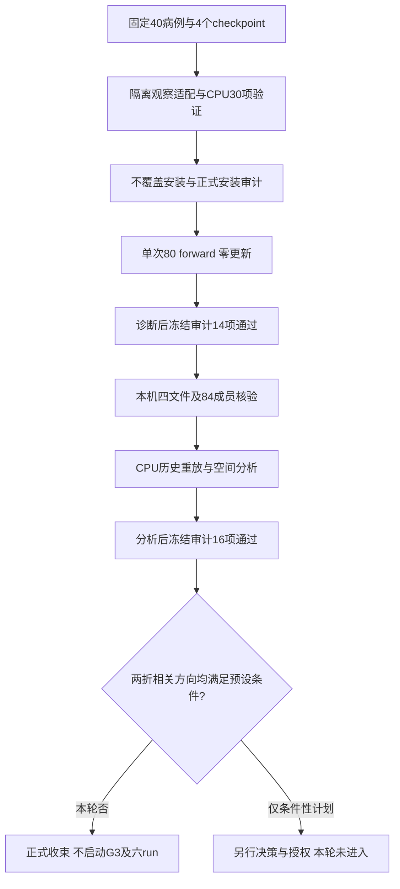

# Cranial-BCSP-FullMamba：BCSP-TRACE完整实验报告

## 探针—Memory空间证据与锚点条件验证

**报告日期：2026年11月17日**  
**实验性质：冻结权重、零更新机制观察与离线重放诊断**  
**最终状态：本轮D0正式收束；未启动G3或后续六运行训练矩阵**

本报告以修订版实验计划、固定病例清单、服务器运行记录、两次正式结果冻结审计、本机下载核验和正式收束记录为依据。所有TRACE结果均来自已冻结产物；本次撰写未新增forward、训练、评分、参数搜索或服务器操作。附带的`report_facts_v1.json`保存报告数值，`report_evidence_manifest_v1.json`绑定28份关键证据的路径、大小和SHA256。

---

## 摘要

此前BCSP-SPCG实验显示，将全Memory汇聚替换为Sobol探针的局部8邻域条件，并未稳定改善缺失骨块补全，部分病例在coarse阶段已经产生明显位置或形状误差。BCSP-TRACE旨在检验一个较窄的解释：**Sobol探针与实际encoder Memory之间的空间支撑不足，是否与局部条件模型G2相对全局条件模型G1的退化具有一致关联，从而值得投入Memory坐标锚点候选G3（A=S）训练。**

本轮从已开放SkullBreak开发数据中固定40病例、40来源，C/D两折各20病例，每种缺损各4例。5个此前已曝光的严重／改善案例作为解释性对照，其余35个来源构成主要关联分析。使用冻结G1_C、G2_C、G1_D、G2_D四模型，每模型20次完整forward，共80次，loss、backward、optimizer step、BNCal及训练均为0。通过隔离观察适配采集实际输入、Memory坐标与特征、探针、coarse头输入、描述子、Q/P以及G2原生FP32近邻分数和索引。随后在本机CPU进行同病例历史预测重放、几何核验和预设关联分析。

80条Q/P均与历史预测逐字节一致，观察器未改变已比较预测。诊断后冻结审计14项通过，CPU分析后冻结审计16项通过。主要结果为：C折17个非压力来源的Spearman相关为0.1422、类型调整秩相关为0.0558；D折18来源分别为−0.0671、0.3307。D折未调整相关不满足严格大于0的预设条件，因此两折未形成共同投入动机。全部记录均有256个不同Memory坐标；G2的Memory命中并集至少覆盖99.22%的点，未观察到普遍严重的Memory漏用或邻域集合塌缩。固定严重回退病例051、072的典型探针距离与改善病例012接近，进一步限制了仅以“探针过远”解释主要失败的说法。

据此，本轮以`NO_SUPPORT_OR_INCONCLUSIVE`正式收束，不实施G3或启动六运行训练。结论是当前距离关联不足以支持这一候选的投入，而非证明空间条件、Memory特征或所有锚点方法无效。下一阶段宜先明确“条件信息是否足够、是否被coarse头有效利用”的最小可证伪问题，并复用已有证据，避免继续依据直觉替换锚点或扫描邻域参数。

**关键词：**颅骨点云补全；FullMamba；冻结权重诊断；空间条件；Memory；coarse生成；精确重放；可靠性

## 1. 研究背景与实验定位

### 1.1 主任务与前期技术路线

研究主任务是根据残缺颅骨输入，预测缺失骨块的完整边界点云。输入“表面”指原始骨组织与背景相接的边界，包含原分割中存在的外板、内板、孔道／腔体及实体缺损形成的暴露切壁，并非仅外轮廓。目标是缺失骨块完整边界，而非完整颅骨全部边界、单独外板片或已满足临床设计规范的植入体。

在前期Cranial-BCSP-FullMamba研究中，encoder和decoder的指定全局交互路径均已采用Mamba替换，并保留既有局部几何与dense重建路径。LQI条件序列组织在本轮作为冻结母版使用。TRACE没有重新设计Mamba模块，也不是一个新架构的性能训练实验。

### 1.2 SPCG给出的直接问题

SPCG三臂中，G0使用原始coarse头；G1使用Sobol探针及全Memory汇聚；G2使用相同Sobol探针及8邻域描述子。此前来源等权结果如下，差值为G2−G1，正向距离增加表示退化：

| 历史SPCG指标 | Fold C | Fold D |
|---|---:|---:|
| E P95差值，mm | +1.5270 | +1.8720 |
| E P95来源bootstrap 95% CI，mm | [−2.0929, 5.0968] | [0.9379, 2.8983] |
| J P95差值，mm | +1.9308 | +2.2329 |
| J Cover@2mm差值，百分点 | +7.0196 | +0.3750 |
| 新增严重病例／挽回病例 | 9／4 | 7／0 |

这些数据来自SPCG正式冻结记录，不是TRACE产生的新性能结果。它们说明，局部条件或部分覆盖率改善不能自动转化为完整骨块尾部精度和可靠性提升。研究需要先查明实际信息路径，而非立即引入更复杂反馈或更多条件。

### 1.3 TRACE针对的假设

一个直观解释是：Sobol探针位于输入bbox内部，某些探针可能离实际Memory较远，从而取到不适合的局部描述子。如果这种现象与G2相对G1的退化一致相关，将探针改为实际Memory坐标可能值得进一步测试。

但该解释存在必要限制：缺失骨块所在位置本来没有观测骨面，离输入表面较远并不必然错误；把锚点放在已有骨组织上，也不必然更有利于生成缺失骨块。因此，TRACE先做冻结权重观察，只有达到预设投入条件后，才考虑G3，而不是假定G3天然合理。

## 2. 实验目的、研究问题与停止标准

### 2.1 直接目的

1. 取得实际计算图消费的S/F/z/A、局部描述子、head输入及Q/P，确认历史失败并非由观察工具改变模型所致。
2. 描述Sobol探针到Memory及输入点集的几何关系、近邻复用、Memory命中分布和特征／coarse变化。
3. 检查主要空间指标与冻结历史G2−G1误差的关联是否跨折一致。
4. 用有限证据决定是否投入G3，避免仅凭几何直觉启动六次训练。

### 2.2 竞争解释

| 解释 | 本轮可提供的证据 | 本轮不能完成的证明 |
|---|---|---|
| 探针空间支撑不足 | 距离、邻域命中及其与历史回退的关联 | 距离是唯一根因或A=S必然有效 |
| Memory特征信息不足 | 特征变化的描述统计 | F/z完全不包含缺损相关信息 |
| coarse头没有有效使用条件 | 实际head输入、Q及误差关系 | 观察相关性足以证明某输入分支无效 |
| 空间序列、局部多表面或dense传播失配 | 与既有coarse/dense证据相容的限制 | 各机制的因果贡献已经分离 |

本轮不新增GT Oracle、特征置换forward、额外seed或可训练读出；没有用更多诊断逐步修补出阳性结论。

### 2.3 事前投入规则

主要关联定义为每折非压力来源中Spearman(R_case, Delta E)，其中Delta E=E_G2−E_G1。另计算缺损类型调整后的秩相关。只有两折两项相关均严格大于0、数据完整且G3锚点前提成立，才形成“暂时投入动机”。

严格大于0是本轮预算筛选规则，不是统计显著性、最小临床重要差异或因果识别标准。即使通过，也只进入人工投入决策；未通过则本轮收束，不更换指标或病例补救。

## 3. 实验范围与实际完成情况

| 阶段 | 原定内容 | 实际状态 |
|---|---|---|
| 计划审阅与P0 | 冻结病例、资产、接口、重放及资源合同 | 完成 |
| D0观察适配 | 隔离实现、人工CPU验证、P3 | 完成；新版30项CPU通过 |
| 安装与冻结 | 最小6文件不覆盖安装及正式审计 | 完成；安装后审计10项通过 |
| D0真实采集 | 四模型共80次完整forward，零更新 | 完成，退出码0 |
| 诊断后冻结 | 清单、哈希、计数、状态/RNG与资源 | 完成，14项通过 |
| 本机下载 | 归档四件套、全部成员核验 | 完成，84成员通过 |
| CPU重放与分析 | 80条重放、空间描述及固定关联 | 完成，唯一一次执行，退出码0 |
| 分析后冻结 | 独立复核80记录、重放及汇总 | 完成，16项通过 |
| 条件性G3 | A=S实现、CUDA及G0/G2/G3六次训练 | 未启动；预设投入条件未满足 |

TRACE全部新模型更新为0，新checkpoint数量为0。G1/G2所用权重均为SPCG已冻结的最终权重，不能把它们称为TRACE新训练权重。

## 4. 数据与固定病例设计

### 4.1 来源与划分

数据来自已开放SkullBreak的既有84来源、每来源5种缺损，共420病例。每折原训练使用63来源315病例，开发21来源105病例。C/D开发来源互斥，但两折训练来源重叠；某折开发来源可能用于另一折训练。因此两折不等于完全独立患者队列或外部临床验证。

本轮不加入SkullFix、MUG或封存测试数据，不生成新缺损，不重采样，不改变坐标与归一化。

### 4.2 40例的确定性选择

每折20病例来自20个不同来源，每类缺损4例。类型顺序为bilateral、frontoorbital、parietotemporal、random_1、random_2。先预留5个已知案例的来源，再按`SHA256("BCSP_TRACE_D0_v2|"+fold+"|"+case_id)`升序补足，跳过已使用来源。所有清单在执行前冻结，不因运行结果更换病例。

| 已曝光固定案例 | 折 | 设置目的 |
|---|---|---|
| train__051__random_1 | C | 已知严重偏位 |
| train__072__random_1 | C | 已知严重偏位 |
| train__012__parietotemporal | C | 固定改善对照 |
| train__008__random_2 | D | 覆盖不足对照 |
| train__046__parietotemporal | D | 改善伴随离群对照 |

5例只用于解释，主要关联使用其余C=17、D=18来源。每病例在G1和G2各预测一次，因此40病例对应80条模型记录，不能写成80个独立来源。

### 4.3 输入、目标与评分分区

输入D为8192个残缺骨组织边界点，模型输出P为8192个缺失骨块边界点，coarse Q为256点，每点32个dense后代。尺度与中心来自原D-only defective_bbox合同。

E是缺失骨块原有自由表面分区，不等同于仅外板；J是实体合成切除形成的共享切壁。E P95是主要关联使用的历史指标；J、Cover及风险用于重放可比性核验，不在本轮替换主指标。

GPU推理不读取GT、E/J、真实缺损中心或风险标签。GT仅在另行授权的本机CPU评分副本中用于重放指标核验，没有反向进入模型或锚点生成。

## 5. 模型与计算图

### 5.1 真实插入点

母版PCTransformer由encoder返回coor与x，经increase_dim和max汇聚生成global_feature。SPCG factory将唯一首次coarse赋值

`self.coarse_pred(global_feature).reshape(bs,-1,3)`

替换为

`self.spcg_head(xyz,coor,x,global_feature)`。

因此本报告中S=coor，F=x，z=global_feature。后续mlp_query、LQI decoder及dense重建保留既有路径。本轮没有在输出后增加配准、平移、投影或形状修补。

### 5.2 G1/G2共同条件头

设归一化输入bbox上下界为l、u，共享冻结Sobol点集U有256点：

\[
A_i=l+(u-l)\odot U_i.
\]

对F作逐token、无可学习仿射的LayerNorm，eps=10⁻⁵。G1实际邻域为全部256个Memory，G2为相对A的8个近邻。记邻域N_i、delta_ij=S_j−A_i：

\[
f_i=\frac{1}{|N_i|}\sum_{j\in N_i}\operatorname{LN}(F_j),\qquad
\mu_i=\frac{1}{|N_i|}\sum_{j\in N_i}\delta_{ij},
\]

\[
\rho_i=\frac{1}{|N_i|}\sum_{j\in N_i}\|\delta_{ij}\|_2,\qquad
\tau_i=\sqrt{\frac{1}{|N_i|}\sum_{j\in N_i}\|\delta_{ij}-\mu_i\|_2^2+10^{-6}}.
\]

\[
x_i=[z,f_i,A_i,\mu_i,\rho_i,\tau_i]\in\mathbb{R}^{1416},\qquad Q_i=H(x_i).
\]

H为1416→1024→384→3，前两层GELU。Q为绝对坐标，不是A+Delta。两臂结构容量一致，但训练后的F、z和head权重可能不同；不能将G1/G2预测差直接归因于单一距离变量。

### 5.3 实际近邻数值口径

G2按FP32的`(S-A).square().sum(-1)`及stable argsort取前8，分数并列时维持Memory槽位顺序。CPU几何统计使用FP64，但FP64近并列排序不能取代实际FP32消费者索引。

本轮保存原生分数矩阵并核验原索引；FP32／FP64平方距离复核界限为`64*eps_FP32*max(1,abs(d2_FP64))`。这只是运算核验界限，不是医学容差。

### 5.4 条件性G3的地位

G3原拟唯一替换为A_i=S_i，其余k、描述子、H及后续路径保持。该候选会联合改变锚点空间分布、邻域特征配对和进入序列的空间组织，不能视为纯距离因果干预。A=S且包含自身邻居时，最近邻距离为0、所有Memory至少被命中一次是定义结果，不是性能收益。

G3在本轮未实现或训练，本报告没有其预测或性能结果。

## 6. 观察采集方法与等价性验证

### 6.1 最小观察适配

复用冻结head已有capture读取S/F/z/A/mu/rho/tau/index和Q。新增隔离观察器在H首层使用只读pre-hook读取实际x，并从x的[1024:1408]段取得f。G2仅在实例级包装实际argsort输入分数，返回同一个张量，不改变排序公式或输出。

观察器退出时恢复原方法、capture状态和hook。没有修改冻结生产head源码、模型公式、参数或decoder排序。

### 6.2 每条实际保存字段

| 字段 | 单病例shape | 语义 |
|---|---|---|
| D | 8192×3 | 归一化残缺输入 |
| S | 256×3 | 实际Memory坐标 |
| F | 256×384 | head消费的Memory特征 |
| z | 1024 | 实际全局特征 |
| A | 256×3 | Sobol探针 |
| x | 256×1416 | H首层实际输入 |
| f／mu／rho／tau | 256×384／256×3／256×1／256×1 | 实际局部或全局汇聚条件 |
| Q／P | 256×3／8192×3 | Native coarse／dense |
| index（仅G2） | 256×8，int64 | 实际近邻索引 |
| native_d2（仅G2） | 256×256，FP32 | 实际排序分数矩阵 |

除索引外保存字段均为FP32。G1明确标注ALL256，不伪造一个未实际消费的8邻域。

### 6.3 CPU验证与准备失败

初次人工CPU批次在前4项通过后，于实际factory构建前报FileNotFoundError。原因是测试的exact映射虽读取了本机母版，传入factory的配置仍保留服务器路径。该错误发生在首次模型forward之前，不能解释为模型或空间机制失败。

另行授权后，仅在测试副本中建立buildq，将mother_source绑定到已核验的同字节本机文件，并断言大小和SHA256一致；观察器、生产入口和分析实现保持不变。新版单批30项检查全部通过，覆盖真实冻结head／factory、母版forward／FC接口、输出等价、状态/RNG、FP32并列近邻、完整80次人工循环、失败即停，以及实际读取守卫下的模块加载与异常收尾。本机P3随后通过。

这些CPU验证使用人工encoder／decoder或小型模型，不冒充真实Mamba CUDA验证；实际CUDA观察能力由之后一次真实D0执行及正式审计确认。

## 7. 执行环境与权限合同

### 7.1 服务器环境

| 项目 | 固定／实测记录 |
|---|---|
| 容器 | shu-common-25721452-notebook-yxwd3w-0，uid=1000 |
| 项目 | /home/jovyan/adapointr_work/PoinTr |
| GPU | NVIDIA GeForce RTX 4090 D |
| GPU UUID | GPU-4b19574a-832d-b4fe-e655-a57462954d6a |
| 驱动 | 570.190 |
| Python | 3.10.20，adapointr-mamba环境 |
| PyTorch／CUDA | 2.4.1+cu118／11.8 |
| NumPy／timm | 2.2.6／1.0.27 |
| 模式 | eval、inference_mode、FP32、TF32关闭 |
| 后端 | 冻结Mamba／CausalConv及Python3.10 PointNet2 provider；不联网升级 |

GPU入口没有调用loss；既有PyTorch cdist分支不在本轮被当作训练loss运行。前期有限Mamba梯度非确定性不是本轮梯度结果，因为本轮没有backward。

### 7.2 冻结权重

四个最终权重均为478923818 bytes：

| 角色 | SHA256 |
|---|---|
| G1_C | dd5ad567eadc66ef1b47d708128f48aa2221ee1df6bbd954b830cc59a11835ce |
| G2_C | 7b0ee55071b8a4d3d916e9324fd306c5edcdea4079f3c30851591f99651376d8 |
| G1_D | beac40e64a15eba8be8c6c583eca1d2171ccf293d96ba1dbc9dd51c9811dd275 |
| G2_D | 61aec7309b20a67bb0db74dcec7a78d3148265e80fd04fff6699ca0d459ededb |

加载沿用最终epoch99／update3900、weights_only及strict state_dict合同，不使用部分加载或fallback。运行设备与原SPCG Native预测设备一致，但共同推理设备不能消除历史训练设备条件差异。

### 7.3 唯一执行与资源合同

执行顺序G1_C→G2_C→G1_D→G2_D，每模型20病例，固定tmux会话`TRACE_D0_memory_20261117_v1`。单次claim在启动前落盘。墙钟900秒、RSS≤8GiB、torch峰值≤20GiB、SMI显存≤22528MiB、产物≤1GiB、启动磁盘余量≥6GiB／运行≥4GiB。失败即停，不自动retry或resume。

安装前核验77个复用文件和上传四件套；不覆盖安装6文件后，另做正式安装冻结。执行前再次重验资产和资源。每个模型采集前后核验参数／buffer和CPU/CUDA/Python/NumPy RNG指纹。

### 7.4 本机CPU环境

CPU分析使用既有Python3.9.21环境，NumPy1.26.4、SciPy1.13.1、psutil5.9.0、scikit-image0.24.0，2线程，CUDA_VISIBLE_DEVICES为空。保留前台执行会话，外部监测器按1800秒、RSS8GiB、输出1GiB约束；没有脱离托管的后台评分进程。

## 8. 离线重放、几何指标与统计方法

### 8.1 历史预测重放

首先比较Q/P字节。对非字节一致情况，事前规定normalized rtol=2×10⁻⁵、atol=2×10⁻⁶，world最大偏差≤0.01mm，E/J P95和CD差≤0.01mm，E/J Cover@2mm差≤0.001绝对比例，风险标签不变。

这些是TRACE新冻结的工程可比性限值，不是此前已认证的跨设备容差或临床等效阈值。实际80条均逐字节一致，因此没有通过放宽容差接受差异。

40例不覆盖每来源全部五种缺损，故不以该子集重新宣称原210开发病例的来源均值得到复现；只验证所选80条记录。

### 8.2 空间量定义

采用FP64几何统计，定义Memory典型间距：

\[
\ell_S=\operatorname{median}_j\min_{k\ne j}\|S_j-S_k\|_2.
\]

设d_i,1、d_i,8分别为探针到Memory的第1和第8最近距离：

\[
r_i=d_{i,1}/\ell_S,\quad t_i=d_{i,8}/\ell_S,
\]

\[
R_{case}=\operatorname{median}_i r_i,\quad
T_{case}=\operatorname{median}_i t_i,\quad
\nu_{case}=\frac{1}{256}\sum_i\mathbf{1}(r_i>2).
\]

ell_S必须有限且正，不能添加epsilon掩盖退化。R为主要连续空间量，T和nu为描述量；r>2只是事前描述阈值，不定义临床“缺乏支持”。

另保存探针到D距离、Memory唯一点数、命中次数／并集覆盖／归一化熵、邻域集合数量、局部协方差特征值、F/f通道方差及Q协方差特征值。后几类用于证据完整性和描述，不在结果后挑选为新主要终点。

Memory命中熵按p_j（所有邻域访问中第j点占比）计算：

\[
H_{hit}=-\frac{\sum_{j:p_j>0}p_j\log p_j}{\log256}.
\]

高熵或大命中并集只表示访问分布，不证明所取特征对缺失区域有用。

### 8.3 关联与类型调整

每折分别在非压力子集上计算Spearman(R_case, Delta E)，并列采用平均秩。类型调整先对两变量在本折子集内取平均秩，再各自减去所属缺损类型的平均秩，最后计算剩余秩的Pearson相关。

常量、零间距或不可估分层不删除病例、不换算法；标为不可估并停止自动投入。主要分析未进行p值筛选、新bootstrap、距离阈值扫描或多指标择优。类型调整也不是完整混杂控制，不能处理所有缺损大小、位置和encoder质量差异。

## 9. 实验流程与可复核证据链

这条证据链分开记录了技术实现准入、真实执行完整性、历史预测可比性与科研投入决策。CPU通过不被直接写成CUDA通过，执行退出码0也没有代替正式审计。

## 10. 实验结果

### 10.1 运行、重放与采集完整性

唯一一次GPU诊断退出码0，80条claim与80份trace完整；四模型各20次，状态/RNG前后一致。实际保存12个共同字段，G2另有原生距离矩阵和索引。正式审计验证了字段shape、dtype、ZIP CRC及全部文件SHA256。

本机80条Q/P均与原SPCG Native同病例预测逐字节相等，重放world最大偏差均为0，E/J及风险核验一致。由此可确认本次采集没有改变这些病例的Native预测。该结论限定80条记录，不外推为所有输入下观察等价或所有硬件下确定性保证。

CPU完整分析仅执行一次，退出码0、stderr为空；生成`case_evidence.json`和`summary.json`。正式分析冻结独立复核保存数组、空间量、平均秩和汇总判据，与原结果一致。

### 10.2 主要关联结果

| 指标 | Fold C | Fold D |
|---|---:|---:|
| 主分析来源数 | 17 | 18 |
| Spearman(R_case, Delta E) | +0.1421568627 | −0.0670794634 |
| 类型调整秩相关 | +0.0557663520 | +0.3306755189 |
| 本折两项均严格>0 | 是 | 否 |
| 科研含义 | 小幅正向，不能称强关联 | 调整前后方向不一致 |

全部256个Memory锚点唯一性的前提成立，但两折共同方向条件未满足。最终结果状态为`NO_SUPPORT_OR_INCONCLUSIVE`，正式收束状态为`BCSP_TRACE_D0_FORMALLY_CLOSED_NO_G3_INVESTMENT`。

没有计算这些相关系数的显著性或置信区间，因此不使用“显著相关”“显著无效”或“统计证明无关”等措辞。

### 10.3 全部40病例的空间描述

下表为G2每折20例的描述统计，**包括5个已曝光解释案例**，不与17/18例主要关联子集混用。

| G2几何描述 | Fold C | Fold D |
|---|---:|---:|
| R_case中位数 | 0.9196 | 0.9289 |
| R_case最小—最大 | 0.8549—1.0662 | 0.8480—1.1789 |
| T_case中位数 | 1.9798 | 1.9847 |
| T_case最小—最大 | 1.8719—2.1234 | 1.8516—2.1825 |
| nu_case中位数 | 11.91% | 12.11% |
| nu_case最小—最大 | 8.59%—17.58% | 7.03%—25.78% |
| Memory命中并集比例中位数 | 100% | 100% |
| Memory命中并集比例最小值 | 99.61% | 99.22% |
| 命中归一化熵中位数 | 0.9820 | 0.9816 |
| 不同邻域集合数中位数／256 | 249 | 248 |
| 不同邻域集合数范围 | 243—254 | 242—252 |

全部80条记录均有256个不同S坐标。本轮没有病例的nu达到50%，但该比例是描述量，不是事后新增的GO/NO-GO门槛。

G1/G2同病例的S/A距离统计一致；G1实际ALL256使其命中并集和归一化熵均为1、唯一邻域集合数为1。这是汇聚定义的结果，不能视为G1空间信息更优，也不能把G1的重复全邻域误称为G2的局部塌缩。

### 10.4 固定严重与改善病例

| 固定病例 | R_case | T_case | nu_case | G2−G1 E P95，mm |
|---|---:|---:|---:|---:|
| C／051／random_1 | 0.9112 | 2.0069 | 10.16% | +78.9967 |
| C／072／random_1 | 0.9173 | 1.9325 | 12.50% | +66.5975 |
| C／012／parietotemporal | 0.8923 | 1.9620 | 12.50% | −67.0515 |
| D／008／random_2 | 1.1789 | 2.1825 | 25.78% | +30.2439 |
| D／046／parietotemporal | 0.9242 | 1.9786 | 9.38% | −9.6832 |

这里的Delta E是个体缺损病例差值，不是来源五类型均值。051、072显著量级的个体回退并不伴随异常大的R；012改善时的R也接近它们。008同时具有较大R和回退，说明个别失败与较稀疏支撑可以共存，但不能从这一已知案例推出整体解释。

### 10.5 资源与执行成本

| 指标 | 实测记录 | 预设上限／下限 |
|---|---:|---:|
| GPU资源记录数 | 161 | 80组before/after＋1条complete |
| GPU最后资源记录耗时 | 43.824秒 | ≤900秒 |
| RSS峰值 | 2028949504 bytes，约1.89GiB | ≤8GiB |
| torch allocated峰值 | 241082368 bytes，约229.9MiB | ≤20GiB |
| torch reserved峰值 | 285212672 bytes，272MiB | ≤20GiB |
| SMI显存峰值 | 722MiB | ≤22528MiB |
| 记录中最低磁盘空闲 | 7789871104 bytes，约7.25GiB | ≥4GiB |
| 完整服务器输出大小（含归档） | 169710432 bytes，约161.85MiB | ≤1GiB |
| CPU分析耗时 | 208.922秒 | ≤1800秒 |
| CPU分析峰值RSS | 194658304 bytes，约185.6MiB | ≤8GiB |
| CPU资源记录数 | 209 | 全部监测条件通过 |

GPU耗时是监测器口径，最后记录在压缩前，不是严格端到端推理benchmark。torch峰值在每个模型前重置，本表取记录中的最大值；SMI包含另一种设备查询口径，不能要求与torch逐字节相同。监测有采样间隔，不构成硬隔离或独占GPU证明。

## 11. 结果分析

### 11.1 当前证据不支持“距离过远足以解释主要失败”

如果典型探针距离是G2相对G1回退的主要一致伴随因素，应至少在本轮固定主要子集中呈现方向一致的关联。然而C折相关较弱，D折未调整相关接近0并为负；最严重固定案例的距离也不异常大。多项证据共同限制了该解释的充分性。

不能反过来说距离绝不重要。R_case是256探针的中位数，可能掩盖个别关键探针；ell_S是全局典型尺度，可能无法描述薄板、多表面或缺损附近的各向异性。当前协议没有验证其他局部尺度，也不应在本轮结果后立即改指标再求阳性。

### 11.2 几何可访问性与条件有效性是不同问题

接近全Memory的命中并集、较高熵和较多邻域集合，说明G2不是简单地漏掉绝大部分Memory或把多数探针映射为同一集合。但被访问的特征仍可能不包含目标区域所需信息，或不能被H解释为正确的coarse坐标。

现有F/f方差和Q协方差只能描述变化，无法单独证明“具有足够的缺损位置编码”或“head未利用条件”。本报告不据这些方差命名新机制。

### 11.3 类型调整结果提示关系依赖分层，但不能据此选有利口径

D折主要相关为−0.0671，类型调整后为0.3307。两者回答不同条件下的问题，方向变化可与类型间差异有关，但样本量有限、类型内每组只有少数来源，不能据此确认特定混杂机制。

预先要求两项均为正的意义是避免只报告更有利的调整结果。C折虽通过符号规则，但0.1422与0.0558也不构成强投入证据。本次规则的功能是预算约束，而不是把小正值赋予统计或临床重要性。

### 11.4 不启动G3具有明确科研理由

G3=A=S会令自身最近邻距离归零，但其锚点位于已有骨组织，仍需从输入外推缺失骨块的位置和形状。如果现有距离关联没有一致支持，仅凭定义性覆盖改善投入六run，无法形成有力的预期证据链。

因此本轮没有把“技术上可实现”混为“科学上值得训练”。停止G3并非已经证明其性能差，而是缺少本计划要求的投入动机。未来若提出独立且更直接的证据，可以在新协议中重新论证，而不是复用本轮授权继续。

### 11.5 TRACE的实际科研价值

本轮没有获得新模型性能收益，但补齐了真实消费者空间证据，排除了“观察适配改变了原预测”这一可比性疑问，并给出了一个不应优先投入的固定候选。对于有限实验资源，这种结果能减少缺乏证据的结构试错。

其价值应表述为可复核的诊断与候选筛选，不宜单独包装成已经建立普适机制的核心方法贡献，更不能据此承诺CCF C论文录用或临床收益。

## 12. 出现的问题与局限

### 12.1 工程问题

| 问题 | 实际处理 | 对科研结论的影响 |
|---|---|---|
| P0合并长查询85秒无回传 | 保留超时记录，确认无残留核验进程，再以同范围短查询完成核对 | 不能将其归因于模型／依赖失败；没有新增模型执行 |
| Windows人工fixture保留服务器母版路径 | 单独授权后仅修正测试副本与保留目录，SHA256不变 | 初次失败在首次forward前；不改变最终模型和数据 |
| 初始capture缺实际x与原生近邻分数 | 隔离pre-hook与实例观察包装，CPU验证后真实执行 | 80条历史逐字节重放及状态证据支持本次观察未扰动 |
| 分阶段绑定和本机／服务器文件系统不同 | 精确路径、哈希与不覆盖安装，分开记录本机证据与服务器目标 | 防止误把本机路径当运行路径，代价是额外准备与审计 |

这些问题均有失败或修订记录，未覆盖历史证据。后续应复用成熟短入口和数据合同，避免继续开发通用传输／库存框架，把时间投入可以改变科研判断的对照。

### 12.2 实验与统计局限

1. **探索性开发集复用。** 35个非压力来源并非全新的外部测试；5个固定案例明确由此前结果选择。病例数不能按两臂重复记录翻倍。
2. **来源规模有限。** 每折17／18来源、每类少量样本，关联估计不稳定；没有做显著性、区间或多seed方差估计。
3. **并非因果干预。** 距离、缺损位置／大小、特征质量及训练结果可能共同变化。没有随机分配空间条件，也没有同权重因果替换实验。
4. **两折并非独立重复。** 训练来源重叠，且SPCG历史设备差异仍需保留。共享推理设备只能控制本次推理条件。
5. **空间标量表达有限。** 中位距离、命中熵等无法证明多表面语义、接触界面、方向或邻域信息质量正确。
6. **G3未测试。** 本轮停止的是该候选的预算投入，不是关于其训练效果的直接负结果。
7. **GT可靠性边界。** 合成实体缺损具有可核互补关系，但分割边界不等同于高精度解剖标注；J不是实际术中边缘或合格植入体接口规范。
8. **没有新模型比较。** TRACE复用历史性能，不能把重放计为新候选泛化验证，也没有支持升级采样方案或点数。

## 13. 正式收束决定与声明边界

2026-11-17已生成正式收束记录，决定如下：

- 本轮D0诊断、CPU分析、正式冻结审计均完成，BCSP-TRACE本阶段结束。
- 不启动G3实现、G3 CUDA或G0/G2/G3两折六运行训练矩阵。
- 不在本轮追加k、半径、权重、Sobol seed、病例、不同主指标或训练seed搜索。
- 保留SPCG原结论和TRACE阴性／不确定证据，不将G1/G2晋级为新基线。
- 未来如继续，必须形成新假设和独立协议，重新决定是否值得计算投入。

| 结论主张 | 证据状态 |
|---|---|
| 本次80条观察预测与历史一致 | 已建立：逐字节重放 |
| 保存字段对应真实head／近邻消费者 | 已建立：接口、CPU及真实执行证据 |
| 本轮距离关联达到两折共同投入条件 | 未达到 |
| 探针距离是主要失败的唯一原因 | 未建立 |
| G3训练必然无效 | 未测试，不能声称 |
| 所有空间条件或锚点方法无效 | 未建立 |
| TRACE形成新的训练性能改进 | 无新训练，不存在该结论 |

## 14. 下一阶段实验方向建议

### 14.1 优先问题：条件可辨识性与生成头利用能力

建议下一阶段的最小问题是：**既有D-only条件中是否包含可用于预测缺失骨块位置与范围的信息，而当前绝对coarse生成路径未能充分利用？**

这包含两个需分开的判断：信息存在不等于生成头利用有效；位置／范围可读出也不等于完整骨块形状或接口吻合改善。此前P2已有冻结特征读出工作，下一阶段应先核对其目标、特征层、来源划分和对照，避免重复同一探针分析或重新扫描读出参数。

仅当旧证据不能回答新问题时，才设计一个新增最小对照；不能把“再做线性读出”当成默认下一步。若使用训练常数、简单D几何、特征读出和当前coarse的比较，必须使用训练来源拟合、开发来源评估，固定一次特征汇聚与拟合合同，不借开发标签选正则或模型阶数。

### 14.2 新方案的四项准入要求

1. **目标清楚。** 明确要解释位置、尺度、覆盖还是接口误差，不用矩改善代替完整表面改善。
2. **对照可辨识。** 能区分信息不足、读取失败和架构容量差异；新模块带来的参数、loss、初态与序列改变应可审查。
3. **预算有限。** 先制定能停止的判据，不直接展开两折多臂训练，也不通过失败后不断添加候选扩大研究范围。
4. **评价保持可靠性。** 若最终进入模型训练，除E/J、CD和Cover外必须保留新增严重病例、反向离群及来源等权统计，不只展示改善病例或平均loss。

### 14.3 何时才值得再做结构训练

若已有或新限定证据支持“特征含条件但当前路径读取不足”，下一候选应直接针对该接口，而非再次依据距离直觉替换锚点。先给出唯一公式、输入消费路径及可证伪预期，再决定实施。

若证据显示特征本身不能提供稳定位置／范围信息，应把研究问题前移到输入表达或encoder条件，而不是继续堆叠coarse校正；同样不能立即证明需要更大模型或更多点数。

任何新候选都需解释与H1、H2、LQI、SCQ、RF、DAC、RIVE及SPCG已有失败机制的区别，不把旧思路换名重试。正式矩阵、训练预算、设备配对和新失败案例阈值应在执行前固定。

### 14.4 暂不推荐的方向

- 为让距离相关转正，改用其他分位数、选择局部病例或移动阈值。
- 直接训练A=S，随后再从结果寻找理由。
- 同时更改采样、encoder、coarse、decoder及loss，使收益无法归因。
- 利用GT做推理位置修正或将Oracle分数当正式性能。
- 以本轮命中率高为依据宣布多表面表达问题已经解决。

这些建议属于后续科研设计方向，本报告没有授权或执行任何新分析、拟合、forward或训练。

## 15. 文件、版本与复现索引

### 15.1 关键本机目录

| 材料 | 路径 |
|---|---|
| 审阅修订计划 | docs/cranial_bcsp_trace_20261117_v2/ |
| 固定40病例及文献核验表 | outputs/trace_plan_review_20261117_v1/ |
| P0只读核对 | outputs/trace_P0_readiness_20261117_v1/ |
| 隔离实现、CPU批次及P3 | outputs/trace_D0_implementation_20261117_v1/ |
| GPU授权执行与结束观察 | 上述目录的authorized_execution_v1/ |
| GPU正式冻结审计 | 上述目录的post_diagnostic_freeze_v1/ |
| CPU分析request及执行监测 | 上述目录的CPU_analysis_preparation_v1/ |
| CPU病例证据与汇总 | 上述目录的CPU_history_replay_analysis_v1/ |
| CPU正式冻结与结果解读 | 上述目录的CPU_analysis_freeze_v1/ |
| 正式收束决定 | outputs/trace_scientific_closure_20261117_v1/ |

以上相对路径均以`E:/Codex/2026-06-06/mamba-ccf-c-1-high-resolution`为本机根，不是服务器运行路径。

### 15.2 关键完整哈希

| 对象 | SHA256 |
|---|---|
| GPU D0 execution request | 7ad5a27aee302b877af7903b00da107c47560250d18135566315609b12a01b0f |
| CPU分析execution request | 78952610006e441f49c0f84caf95134652dea133c0526974325cae86c038d5e9 |
| case_evidence.json | 3c38df7ead27d5189e512bbba14c3397afebf0752b7fed6b37f06bab35ec4356 |
| summary.json | 3f723540c864a4d0e71dc51e260d14dc73542b70abed5f43bdee4b1df5c6facf |
| D0归档 | 509dde04102c49ab0de13f9e1d8821491a6371109cf5f1934d8cc585ad03feb9 |

### 15.3 长期备份与服务器位置

本机D0归档：

`E:/ResearchBackups/AdaPoinTr/BCSP_FULLMAMBA_TRACE/2026-11-17_D0_memory_evidence/`

归档文件`development_predictions_v1.tar.gz`为84179082 bytes，84成员；同目录有`.sha256`、`.bytes`、`.contents.sha256`及本机核验回执。

服务器原结果目录：

`/home/jovyan/adapointr_work/PoinTr/logs/cranial_bcsp_fullmamba/TRACE_D0_memory_evidence_20261117_v1`

TRACE未生成新checkpoint。关键父权重继续引用SPCG的本机长期备份，不能把报告生成当作权重恢复运行验证。

截至本报告生成，D0原始归档已下载核验；本次没有执行全套代码／结果长期归档、GitHub推送或服务器清理。旧request、授权和launcher均为历史证据，不是允许重跑的授权。

## 16. 文献背景与归因说明

本报告的结论首先依据本项目冻结证据，不以外部论文替代机制验证。以下沿用计划审阅阶段已核验的文献入口，不是本次重新开展的最新文献系统综述：

1. Kodym等，*SkullBreak / SkullFix—Dataset for automatic cranial implant design and a benchmark for volumetric shape learning tasks*，Data in Brief，2021。用于数据与合成缺损背景；本项目仅使用固定开放子集。[原文](https://pmc.ncbi.nlm.nih.gov/articles/PMC8100897/)
2. Wodzinski等，*High-resolution Cranial Defect Reconstruction by Iterative, Low-resolution, Point Cloud Completion Transformers*，MICCAI，2023。高分辨率颅骨点云任务背景，不构成本轮同协议性能参照。[论文入口](https://arxiv.org/abs/2308.03813)
3. Li等，*3DMambaComplete: Structured State Space Model for High-Efficiency Point Cloud Completion*，arXiv v2／TOMM版本线索，2026。其HyperPoint Generation含Cross-Attention，不能仅凭Mamba名称当作完全无注意力的同类基线；TRACE也不能以anchor一词宣称原创。[v2全文](https://arxiv.org/html/2404.07106v2)
4. Fu等，*CompletionMamba: Taming State Space Model for Point Cloud Completion*，IEEE TIP，2025。空间与序列组织的相关背景；本报告不声称复现其方法。[正式收录入口](https://pubmed.ncbi.nlm.nih.gov/40853794/)
5. Kwarciak、Wodzinski，*MedPCFM: Improving Medical Point Cloud Completion by Integrating Point Transformers and Flow Matching*，2026预印本。直接相关医学任务背景，但采样、点数、归一化和预算不同，不能直接与TRACE分区P95排名。[全文](https://arxiv.org/html/2606.24433v1)
6. Fishman等，*Thickness and Design Features of Clinical Cranial Implants—What Should Automated Methods Strive to Replicate?*，IJCARS，2024。用于说明临床厚度／边缘设计与合成切壁指标的差别，不据此将2mm覆盖阈值称为临床规范。[正式收录入口](https://pubmed.ncbi.nlm.nih.gov/38430381/)

本报告不声称通读此前全部题录或核验所有模型代码；具体文献访问层级见计划审阅目录中的`TRACE_primary_literature_ledger_v1.json`。

## 17. 最终结论

BCSP-TRACE完成了四个冻结模型、40个固定病例、80次零更新forward及其本机历史重放和空间证据分析，形成了完整可核验的运行与审计链。80条Q/P均与历史预测逐字节一致，说明本次采集结果具有明确可比性。

探针距离与G2相对G1回退的主要相关未在两折形成预设的一致正向证据；Memory访问也未表现为普遍漏用或邻域集合塌缩。因此，本轮不支持继续依据“探针离Memory过远”的动机投入A=S候选及六run训练，已正式按协议收束。

该结果没有识别唯一根因，也没有证明所有空间条件无效。下一阶段应把问题进一步收窄为条件信息是否存在及其是否被coarse生成路径有效使用，先复核已有读出与诊断证据，再决定新的最小对照，避免重复参数搜索和缺乏判别力的结构试训。

---

### 附录A：术语与证据口径

| 术语 | 本报告固定含义 |
|---|---|
| Memory | 实际encoder坐标S及对应特征F，不是GT表面或缺损中心 |
| probe／探针 | 由D-only bbox与固定Sobol U产生的A |
| coarse Q | 生成头输出的256个绝对坐标 |
| dense P | 8192点Native缺失骨块预测 |
| R_case | 探针最近Memory距离／Memory典型间距的病例中位数 |
| Delta E | 历史同病例E_G2−E_G1；正值代表G2回退 |
| 非压力来源 | 哈希补充的C17／D18来源，用于主要关联 |
| 固定解释案例 | 已曝光5例，单列解释，不进入主要关联 |
| 收束 | 本轮诊断按预设决策结束；不是证明所有候选无效 |

### 附录B：主张—证据对应

| 主张 | 主要证据 | 性质 |
|---|---|---|
| 80次执行计数完整、状态不变 | post_diagnostic_freeze_v1/formal_freeze_verification_v1.json | 实测与正式审计 |
| 观察Q/P与历史精确一致 | CPU_history_replay_analysis_v1/case_evidence.json；CPU_analysis_freeze_v1/formal_freeze_verification_v1.json | 独立张量复核 |
| C/D相关未共同满足规则 | summary.json及独立平均秩复核 | 探索性关联与事前预算判断 |
| 当前G3不投入 | scientific_closure_record_v1.json | 已确认的研究决策 |
| 特征内容或coarse读取仍可能有问题 | 本轮不能区分的竞争解释 | 待检验假设，不是根因结论 |
| 后续优先可辨识性问题 | 结合当前阴性证据及前期读出工作的建议 | 新协议方向，尚未执行 |
