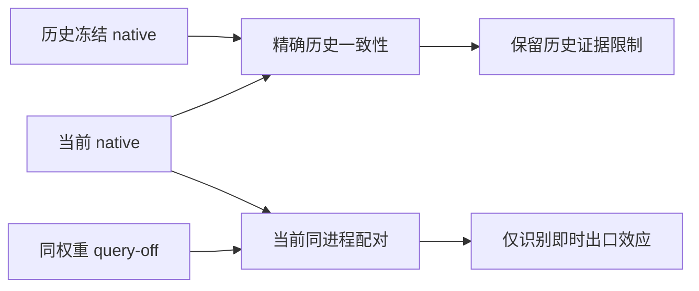

# Cranial-SCQR v1.2-QA 全面实验报告：QA-1 主实验与 R1-B 后续机制诊断

_截至 2026-10-19，Asia/Shanghai · 综合报告 v2 · 目的、方法、执行、结果、可靠性分析与下一阶段科研路线_

---

## 📋 1. 执行摘要、报告范围与完成状态

### 1.1 总体结论

Cranial-SCQR v1.2-QA 的 **QA-1 六运行主实验已经完成**，其后独立授权的 R0/R1-A 证据和事件触发审计、R1-B 人工 GPU preflight、Fold C/D 固定权重 query-off 干预及正式冻结审计、科研解读也已完成。当前可以对这批实验作阶段性收束，不需要为了“把计划填满”而自动执行下一批实验。

但“运行完成”不是“候选通过”。原 QA-1 的正式 gate 与科学分类仍受历史数值证据缺口限制，状态保持 NOT_ADJUDICATED_HISTORICAL_NUMERICAL_EVIDENCE_GAP、classification=null。QA-2、QA-3、容量对照、Mamba 及 confirmation20 尚未执行，也没有因此获得自动执行授权。

本报告的核心判断：

1. **边界覆盖有条件性改善信号。** 原 QA-1 的 LSQ−LS RimCover-P95 在 C/D 分别为 −0.572073、−0.402413 mm；pooled 为 −0.487243 mm，既有 source-skull 分层 bootstrap 95% CI 为 [−0.894924, −0.088829] mm。
2. **收益不是全指标一致改善。** Fold D 的 Implant CD、Final CD/HD95、contact 质量出现不利权衡；四个 LSQ 独有 disaster 不能被主指标均值或总事件净数抵消。
3. **当前残差出口不是充分解释。** R1-B 关闭 Query 残差加法后，两折几何变化幅度较小、方向混合；四个 LSQ 独有风险全部保留，没有 native/off disaster 转换。
4. **历史数值限制具有实质性。** 早期三个训练/BNCal 运行缺完整数值快照；R1-B 当前 native 也未精确重现历史指标，D 的一个 LS 病例 contact HD95 从历史 84.87 mm 变成当前 41.42 mm，不能统称微小浮点误差。
5. **研究决策应与正式裁决分开。** 建议当前 LSQ 不晋级、结束 R1-B 默认扩展；下一阶段优先选择 Local/SCF 的可证伪增量问题，而非自动拯救 Query 或实施 Query-Mamba。这是保守的科研预算建议，不是越权执行旧 gate，也不证明 Query/Mamba 普遍无效。

### 1.2 报告的来源与范围

本报告整合本机已冻结材料，包括：

- [2026-10-11 QA-1 阶段报告](E:/Codex/2026-06-06/mamba-ccf-c-1-high-resolution/docs/cranial_scqr_v12_qa_research_2026_10_11/cranial_scqr_v12_qa_stage_experiment_report_zh_v1.md)
- [六运行原始汇总快照](E:/Codex/2026-06-06/mamba-ccf-c-1-high-resolution/docs/cranial_scqr_v12_qa_research_2026_10_11/qa1_six_run_summary_source_snapshot_v1.json)
- [安全性与历史证据复盘](E:/Codex/2026-06-06/mamba-ccf-c-1-high-resolution/docs/cranial_scqr_v12_qa_research_2026_10_10/v12_qa1_safety_historical_evidence_review_report_zh_v1.md)
- [R0/R1-A 审计](E:/Codex/2026-06-06/mamba-ccf-c-1-high-resolution/docs/cranial_scqr_v12_qa_research_2026_10_11/v12_rsd_r0_r1a_audit_v1_20261011/r0_r1a_readonly_audit_report_zh_v1.md)
- [R1-B C/D 科研解读](E:/Codex/2026-06-06/mamba-ccf-c-1-high-resolution/docs/cranial_scqr_v12_qa_research_2026_10_11/v12_rsd_r1b_foldCD_scientific_interpretation_report_zh_v1_20261019.md)及其[全精度标量提取证据](E:/Codex/2026-06-06/mamba-ccf-c-1-high-resolution/docs/cranial_scqr_v12_qa_research_2026_10_11/v12_rsd_r1b_foldCD_scientific_interpretation_evidence_v1_20261019.json)
- 两折[正式冻结审计 C](E:/Codex/2026-06-06/mamba-ccf-c-1-high-resolution/docs/cranial_scqr_v12_qa_research_2026_10_11/v12_rsd_r1b_same_process_foldC_formal_post_intervention_freeze_audit_v1_20261019.json)、[正式冻结审计 D](E:/Codex/2026-06-06/mamba-ccf-c-1-high-resolution/docs/cranial_scqr_v12_qa_research_2026_10_11/v12_rsd_r1b_same_process_foldD_formal_post_intervention_freeze_audit_v1_20261019.json)

本次只读取本机材料和同哈希源码，重新序列化表格与索引；没有连接服务器、读取真实点云或模型权重、重算 bootstrap、运行 gate 或新实验。原桌面正式计划当前指定路径不存在，因此其合同与原 SHA256 仅按既有冻结报告追溯，不冒称本次直接重验了原件。此限制不阻止整合已保存的实验结果。

这是内部实验综合报告，不是新预注册协议、投稿论文、最新文献综述或临床安全评估。下一阶段设计均是待讨论建议，不是 execution request。

### 1.3 完成状态矩阵

| 阶段 | 已完成内容 | 当前边界 |
| --- | --- | --- |
| QA-1 协议、C/D 标定、六配置 preflight | 已冻结 | 不代表正式训练效果 |
| B0/LS/LSQ × C/D × seed0 | 六训练、BNCal、evaluation 完成 | 各阶段分离授权并冻结 |
| LSQ−LS 统计与安全性复盘 | 已完成 | 固定权重描述性结果 |
| R0/R1-A | 全量证据、210-case 迁移与触发审计完成 | 未重跑模型 |
| R1-B 人工 GPU preflight | 已通过并冻结 | 仅覆盖冻结人工样本 |
| R1-B Fold C/D 真实干预 | 各 105 case/315 forward，审计与解读完成 | 当前同进程配对诊断 |
| QA-1 正式 gate/分类 | 未裁决 | 历史证据锁仍在 |
| R2、QA-2/QA-3、Mamba、最终确认 | 未执行 | 条件式选项，不必自动补齐 |

## 🎯 2. 研究目的、模型设计与数据

### 2.1 研究问题与长期方向的关系

长期目标是基于 Mamba 的颅骨点云补全，并形成证据充分的小论文。v1.2-QA 本阶段不是直接验证 Mamba，而是先检验其拟依赖的 Query 路径是否具有值得保留的增量及可接受的几何风险。v1.1 的探索性信号只构成问题来源，不能与 C/D 拼接成严格四折新验证。

主问题为：在 Local geometry 与 SCF auxiliary supervision 已存在时，加入 Query conditioning 能否改善缺损边缘覆盖，同时保持 implant/final 几何质量和病例级工程风险？

后续 RSD 将问题细化为：风险由什么冻结规则触发？同一已训练 LSQ 权重下，旁路当前 Query 残差出口会改变什么？这些问题不预设 Query 必须保留。

### 2.2 嵌套模型及能识别的增量

| 模型 | Local | SCF auxiliary | Query | 角色 |
| --- | --- | --- | --- | --- |
| B0 | 关 | 关 | 关 | AdaPoinTr 嵌套基线 |
| LS | 开 | 开 | 关 | 原 A1 条件 |
| LSQ | 开 | 开 | 开 | 原 Q0 条件 |

三者均保持 direct contact log-bias 的 beta=0，不继续 QC/direct-bias 分支。LSQ−LS 是唯一主比较；B0 汇总用于完整记录，未新增 LSQ−B0 正式比较或跨候选 pooled 推断。

LSQ−LS 是 Local+SCF 条件下 Query block 的复合增量，不是对 attention 信息交换的纯因果识别：尚无参数/计算匹配的非交互容量对照。没有 L0/LQ 的同合同训练矩阵，也不能单独识别 Local、SCF 或 SCF×Query interaction。

### 2.3 模块含义与计算路径

本次核对的三份本机源码 SHA256 与 R1-B 绑定一致；这里只读文本，不导入模型：

- Local：在 raw partial 上以 proxy 为中心获取 KNN16/KNN32 邻域，编码相对坐标与距离，进行 max/mean pooling 和两尺度融合，再以可学习系数及 warmup 残差加入 proxy features，特征维度 384。
- SCF：根据训练 GT implant 与 partial 的 2 mm 邻近关系构造 raw contact-support 标签；KNN32 内任一正点即定义 proxy 正标签。Head 读取 feature 与 position embedding，采用逐病例类别平衡 BCE。GT 标签用于训练监督，不进入推理 Query 的观测输入。
- Query：384 维 query/proxy 经过 128 维投影计算 query-to-proxy attention，融合 attended feature 与 query，经 MLP/LayerNorm 得到 update；出口为 Q_out = Q + alpha_q × warmup × update。beta=0 时不施加 contact-probability log-bias。

SCF 的可见训练梯度路径不等于 representation shaping 已被实验确证；Query 有残差也不等于其直接贡献或安全性已经成立。R1-B 只把最后实际加入的 residual 置零，保留潜在分支计算，不改变 checkpoint。

### 2.4 数据表示与分区角色

数据为 SkullBreakPC_out8192 的 development84：84 source skull、420 case，每 skull 5 种缺损：bilateral、frontoorbital、parietotemporal、random_1、random_2。现阶段 partial 输入 8192 点、implant 输出 8192 点；final prediction 为 partial 与 predicted implant 的拼接，不等于已经验证独立 16384 点 implant 分支。

| 范围 | 规模 | 用途 |
| --- | ---: | --- |
| 每折 train | 63 skull / 315 case | 训练与 partial-only BNCal |
| 每折 dev | 21 skull / 105 case | 独立授权的内部 OOF 评估 |
| C/D dev 合计 | 42 skull / 210 独特 case | 主比较与后续诊断 |
| development84 | 84 skull / 420 case | 已暴露的适应性开发池 |
| confirmation20 | 20 skull / 100 case | 继续封存，未作当前确认 |

拆分按 skull 成组，不按 case 随机拆分。C/D dev 互斥，但折间训练集重叠，部分 dev skull 曾进入其他折训练；不能称外部独立验证。RSD 使用已看过结果的同一 C/D，更应称内部机制诊断，不是新的未暴露确认。

R1-A 核对发现 legacy gate_split 标签与当前冻结 development allowlist 并不等价；相关病例属于 official_split=train、精确 dev allowlist，未因此排除病例。病例名 train__ 前缀本身也不表示越界读 train。当前结果不涉及 confirmation20、官方 test、old monitor、MUG 或新增 SkullFix payload。

数据 manifest SHA256 为 f1f8cae47ed7d5529dc2ca244179cedddbc039981cdc0ff24b25a5c81ad30538；C/D dev allowlist SHA256 分别为 0bc9286bea354c60870818e47207a9da7f156704557f366ef27847d589f5c0b0、7afc9edc6654891cc8593ab2ce172657e1227e4583ed3281b159ab3ae2be68ac。上述是继承绑定，本次未读取服务器原始数据。

## ⚙️ 3. 实验内容、执行合同与工程过程

### 3.1 C/D 梯度标定与 QA-1 人工 preflight

SCF 权重在训练侧标定：每折选 4 skull/20 case、5 batch，候选 LS、模型 seed 31002，以冻结 SHA256 排序选择样本，目标梯度比例 0.1；不按 dev 结果调权重。

| 项目 | C | D |
| --- | ---: | ---: |
| median g_rec/g_scf | 8.912909312609397 | 8.346387037781536 |
| lambda_scf | 0.8912909312609397 | 0.8346387037781536 |
| 标定 forward | 5 | 5 |
| Autograd 调用 | 10 | 10 |

两折样本有重叠，40 次 payload open 对应 30 独特 case；没有 optimizer step、checkpoint load/write 或模型状态改变。标定只控制监督量级，不是 SCF 效果检验。

QA-1 六配置 zero-update preflight 于 2026-09-22 完成：人工输入、6 个 scratch 初始化、12 次完整 forward、6 次 backward；optimizer construction/step、参数/buffer 更新、checkpoint load/write、NPZ open、dataset construction 均为 0。公共主干初始化 hash 为 617d9def43387cc0afed528decf5acba30b1ea2a459c910f63091529e198c924。Coarse/fine 形状为 [1,256,3]/[1,8192,3]；LSQ attention 为 [1,256,256]。这些是执行合同证据，不是正式效果或容量公平性证据。

### 3.2 六运行训练合同

- AdamW，lr=1e−4，weight decay=5e−4；FP32，AMP=false。
- batch=8，drop_last=true，315 train case 对应每 traversal 39 batch。
- epoch labels 0–100，101 traversals，每运行精确 3939 optimizer steps。
- LambdaLR 合同：decay_step=21、lr_decay=0.9、lowest_decay=0.02；grad clip norm=10。
- Scratch、final-only，不选 best、不 early stop、不自动 resume/retry；训练不访问 dev。
- 六成功训练合计 23,634 optimizer steps。该总数不包含预实验，也不冒称全部历史尝试的 GPU 计算账单。

BNCal 在对应训练冻结后独立执行：315 fold-train case、partial-only、batch8、drop_last=false、40 forwards；参数不变、optimizer step=0，仅指定 BN buffers 更新。六成功 BNCal 合计 240 forwards。Evaluation 使用最终 ckpt-last-bncal.pth，而不是未校准 ckpt-last.pth。

每次 evaluation 为 batch1、workers0、FP32、eval/no_grad，105 case、105 NPZ open、105 forward、1 checkpoint load；仅 partial 进入模型，implant/gt 在 forward 后用于指标。参数和 buffers 保持不变，不保存预测坐标。六成功 evaluation 共 630 candidate-case forward，但只有 210 个独特病例。

### 3.3 六运行完成账本

下表均为 2026 年北京时间，来自既有冻结阶段报告，不是本次重新访问服务器日志：

| Run，seed0 | 训练完成 | BNCal 完成 | Evaluation 完成 |
| --- | --- | --- | --- |
| B0 C | 09-29 18:32:22 | 09-30 00:58:00 | 10-09 23:04:40 |
| B0 D | 10-08 15:33:12 | 10-08 16:03:52 | 10-09 23:23:33 |
| LS C | 10-08 20:24:36 | 10-08 21:12:01 | 10-09 11:29:37 |
| LS D | 10-09 12:45:17 | 10-09 14:22:08 | 10-09 14:42:28 |
| LSQ C | 10-09 16:55:54 | 10-09 17:25:10 | 10-09 17:48:34 |
| LSQ D | 10-09 20:18:19 | 10-09 20:51:20 | 10-09 21:16:24 |

### 3.4 数值证据不能一概而论

| 运行 | 训练/BNCal 完整数值快照 | 后期 evaluation 严格快照 |
| --- | --- | --- |
| B0 C、B0 D、LS C | 缺失 | 已有核验 |
| LS D、LSQ C、LSQ D | 存在 | 已有核验 |

历史 LS C 有 deterministic CLI、seed、CUBLAS/NVIDIA TF32 override 配置意图，但不等于完整 backend flags 的同期前后断言。缺失快照不能追溯补写，也不等于已证明违规；后期 evaluator 的严格设置不能认证早期训练/BNCal。

R1-B 则冻结当前容器与实际 provider：Python3.10.20、PyTorch2.4.1+cu118、CUDA11.8、cuDNN90100、NumPy2.2.6、SciPy1.15.3、driver570.190、RTX4090D，CPU/interop threads=1；deterministic algorithms=true、warn_only=false、cudnn deterministic=true、benchmark=false、TF32=false、float32 matmul precision=highest、CUBLAS_WORKSPACE_CONFIG=:4096:8。不能把这个环境表倒填为所有历史训练的环境证明。

### 3.5 工程问题与科研失败必须分开

执行依赖 WSL+hpc5000 WebShell、tmux、独立日志/PID/退出码、精确哈希及不覆盖路径。期间发生过参数/引号传递、重定向父目录、授权/runtime 循环哈希、容器身份变化、Windows/WSL fixture 兼容、库存过度扫描、链接/元数据合同、PointNet2 Python3.10 编译后端等阻断。这些属于执行链或环境准备问题，不是每次都完成了一次失败的科研实验。

后期已将通用库存/传输框架扩展收敛为固定来源、禁止服务器下载升级、串行构建、有限资源监测和失败即停的最小路径。用户明确接受监测与超限停止，不能在报告中写成已经具备 8 GiB 专属 cgroup 硬隔离。

PointNet2 使用隔离 provider/wheel；未以自动 fallback 替代编译后端，也未捆绑升级 PyTorch/重装 Chamfer。随后完成实际 CUDA 人工验证，才进入真实干预。工程 hotfix 的 CPU 通过不被当成 CUDA 通过。

本报告不枚举每一轮本机测试版本为算法实验，也不将工程投入写成算法创新。后续应复用已验证入口，只处理阻断所选科学问题的必要差异。

## 📚 4. 指标、风险规则与统计方法

### 4.1 几何指标的真实估计对象

归一化点先按 world = points × scale + centroid 恢复 mm。以下定义由同哈希本机 metric/evaluator 源码与 R1-A 审计交叉核对：

| 指标 | 定义要点 | 方向 |
| --- | --- | --- |
| Implant CD-L1 | predicted implant 与 GT implant 两方向欧氏最近邻均值各占一半 | 越低越好 |
| Implant/Final HD95 | 两方向最近邻距离数组拼接后 P95 | 越低越好 |
| Final CD/NSD | partial+predicted implant 与完整 GT 比较 | CD低、NSD高 |
| NSD@1mm | 双方向采样点中距离≤1 mm 的比例 | 越高越好 |
| RimCover-P95 | reference rim → 完整 predicted implant 的单向距离 P95 | 越低越好 |
| Contact CD/HD95 | predicted/reference 两个 partial footprint 的距离 | 越低越好 |

这里 CD-L1 沿用项目命名，底层距离是欧氏最近邻距离，不是任意重新定义的坐标 L1 范数。HD95 是拼接数组的 P95，不是两个方向 P95 的最大值。NSD 是点采样比例，不能直接当连续网格面积或临床 SurfaceDice。

定义 defective partial 为 P、GT implant 为 I、预测 implant 为 I_hat：

```text
reference_rim = {p ∈ P : d(p, I) ≤ 2 mm}
predicted_rim = {p ∈ P : d(p, I_hat) ≤ 2 mm}

RimCover-P95 = P95{d(r, I_hat) : r ∈ reference_rim}
Contact-HD95 = P95(concat(
    {d(p, reference_rim) : p ∈ predicted_rim},
    {d(r, predicted_rim) : r ∈ reference_rim}))
```

RimCover 改善与 contact 变差并不矛盾：它们比较的集合、方向和统计对象不同。Footprint 点数是 partial 上满足距离带的采样点数，不是 predicted implant 总点数或临床接触面积。

### 4.2 真实 disaster 与 zero-contact 定义

```text
core = [Implant CD-L1, Implant HD95, Final CD-L1,
        Final HD95, RimCover-P95]
disaster = int(any(nonfinite(core))
               OR (isfinite(contact_HD95) AND contact_HD95 > 50.0))
zero_contact_2mm = int(predicted_rim_points == 0)
```

阈值严格大于 50，不是大于等于；没有新增 Implant CD 的大小触发器。冻结结果均有限、footprint 非空，所有观测事件都由 contact HD95 项触发。空接触时原协议措辞与实现计数边界曾有歧义，但当前 zero-contact 全为0，不影响已存事件核验；未来出现空接触须先明确合同，不能静默重编码。

Disaster 是工程异常标记，不等于临床并发症；disaster=0 也不是临床安全证明。

### 4.3 聚合与既有 bootstrap

病例指标先在同 source 的五类缺损等权平均，再对 source 等权。主差值固定 LSQ−LS；C/D 各21 source，pooled 各折权重0.5。不能将所有点或 case 直接池化重算 P95，也不能做 case-level bootstrap 来扩大有效 N。

已执行统计采用 NumPy2.2.6、default_rng/PCG64、source ID 字符串升序、C后D分块、每块1000/共10000次、seed20260910、linear percentile 2.5/97.5；每指标重置 RNG，配对候选共享抽样索引。缺失、重复和非有限值不能静默删除。

CI 条件于固定 checkpoint 与采样表示，不覆盖训练 seed、架构选择、外部中心或完整跨折学习依赖的不确定性。RSD 已暴露数据进一步限制确认性解释。R1-B 只报告既有描述性差值及标量范围，未执行新的 bootstrap、等效检验或 p 值。

### 4.4 原门限仅记录，不在本报告重做 gate

继承规则包括：RimCover 的 C/D 各折方向不增、pooled差值≤−0.10 mm、CI上界<0；Implant/Final CD差值≤+0.10 mm、Final HD95≤+0.50 mm、Final NSD≥−0.01；无新增 LSQ 独有 disaster、每折灾难数不增加；zero-contact 增加需 review。

这些是原工程研究规则，不是临床容差。本报告不逐项生成新 gate 布尔值、不修改阈值、不执行正式五类分类。研究不晋级决策可以基于已有风险与信息价值，不需要先把未裁决状态强改成正式失败标签。

## 📊 5. 原 QA-1 六运行结果

### 5.1 Source 等权单运行汇总

以下直接取自冻结六运行 JSON 快照，展示六位小数；未新算候选对比或 B0 pooled。每行均为105 case/21 source，seed0。所有距离单位mm；NSD/precision/recall无量纲。

| Run | RimCover-P95 | Implant CD-L1 | Implant HD95 |
| --- | ---: | ---: | ---: |
| B0 C | 11.142993 | 4.220762 | 9.439216 |
| B0 D | 10.430084 | 3.501669 | 9.204368 |
| LS C | 7.031703 | 2.564158 | 6.654403 |
| LS D | 9.044280 | 2.917086 | 7.301843 |
| LSQ C | 6.459630 | 2.227645 | 5.655354 |
| LSQ D | 8.641867 | 3.167236 | 7.801530 |

| Run | Final CD-L1 | Final HD95 | Final NSD@1mm | Implant NSD@1mm |
| --- | ---: | ---: | ---: | ---: |
| B0 C | 2.392491 | 5.660926 | 0.149538 | 0.193081 |
| B0 D | 2.401351 | 5.608633 | 0.147293 | 0.194464 |
| LS C | 2.226540 | 4.743732 | 0.151912 | 0.229157 |
| LS D | 2.284062 | 5.025316 | 0.148880 | 0.219955 |
| LSQ C | 2.201194 | 4.634117 | 0.152539 | 0.243056 |
| LSQ D | 2.336912 | 5.308277 | 0.147994 | 0.211128 |

| Run | Contact CD-L1 | Contact HD95 | Contact precision | Contact recall |
| --- | ---: | ---: | ---: | ---: |
| B0 C | 7.269811 | 25.235362 | 0.449479 | 0.413867 |
| B0 D | 6.075102 | 23.236952 | 0.478554 | 0.470254 |
| LS C | 4.036591 | 16.659840 | 0.514674 | 0.525933 |
| LS D | 4.606191 | 18.554478 | 0.544292 | 0.501959 |
| LSQ C | 3.280838 | 14.007209 | 0.538780 | 0.555446 |
| LSQ D | 5.046010 | 19.440410 | 0.507126 | 0.490375 |

| Run | Implant pred→ref 均值 | Implant ref→pred 均值 | RimCover 均值 |
| --- | ---: | ---: | ---: |
| B0 C | 4.634130 | 3.807394 | 5.072794 |
| B0 D | 4.004294 | 2.999043 | 4.226030 |
| LS C | 3.103713 | 2.024603 | 2.894088 |
| LS D | 3.418762 | 2.415410 | 3.454263 |
| LSQ C | 2.619704 | 1.835585 | 2.628434 |
| LSQ D | 3.749881 | 2.584591 | 3.525767 |

| Run | Disaster /105 | Zero-contact /105 |
| --- | ---: | ---: |
| B0 C | 9 | 0 |
| B0 D | 11 | 0 |
| LS C | 3 | 0 |
| LS D | 4 | 0 |
| LSQ C | 1 | 0 |
| LSQ D | 5 | 0 |

B0/LS 的数值差距仅提示后续 Local/SCF 研究有信息价值：没有同合同 L0 因子分解、历史快照也不完整，不能从这张表宣称 Local 或 SCF 的单独因果作用、稳定胜出或跨 seed 增益已确立。

### 5.2 已冻结 LSQ−LS 统计

| 指标 | Fold C | Fold D | Pooled | Pooled 95% CI |
| --- | ---: | ---: | ---: | --- |
| RimCover-P95，mm | −0.572073 | −0.402413 | −0.487243 | [−0.894924, −0.088829] |
| Implant CD-L1，mm | −0.336513 | +0.250150 | −0.043182 | [−0.331009, +0.215501] |
| Final CD-L1，mm | −0.025346 | +0.052849 | +0.013752 | [−0.011417, +0.041837] |
| Final HD95，mm | −0.109615 | +0.282961 | +0.086673 | [−0.058518, +0.245725] |
| Final NSD@1mm | +0.000627 | −0.000886 | −0.000130 | [−0.000619, +0.000384] |

这些是已有、经单独授权并冻结的统计，不是本次重算。统计 request SHA256 为 a568b4219aaeef8ce9ea05df58df32ce2c8a3ebbba9a3daac39fc55dad3c3eda；summary SHA256 为 660adb3310532d5a4d8f08d9adde61f0a3961ce4676978e9ff9050da22774e89。

RimCover 两折均改善，给出了固定权重下的条件性主信号；其他指标显示折间方向差异，且 pooled CI不能支撑全面一致获益。不能以“CI跨0”证明等效，也不能用主CI为负取代病例风险评估。

### 5.3 Fold D 恶化不是单个极端病例的全部结果

既有全量复盘显示，D的21 source中17个 Implant CD差值为正、4个为负；恶化前三为087 +2.750441 mm、008 +0.942893 mm、079 +0.525093 mm。该观察既有多数source的不利方向，也有尾部贡献。

| 缺损类型 | Case数 | LSQ−LS Implant CD均值，mm |
| --- | ---: | ---: |
| bilateral | 21 | +0.192107 |
| frontoorbital | 21 | +1.071901 |
| parietotemporal | 21 | +0.308653 |
| random_1 | 21 | −0.360813 |
| random_2 | 21 | +0.038902 |

087/frontoorbital 为 +20.496147 mm，同source的087/random_1为 −11.875353 mm；两者都保留。不能通过删除source、事后换指标/seed或只展示均值来消去异质性。上述为旧 QA-1 的结果，不能直接当 R1-B 当前 native 数值。

## 🛡️ 6. R0/R1-A：病例风险与触发机制

### 6.1 已存证据审计的有效范围

R0/R1-A 核对158个绑定条目，按绝对路径去重为119个文件；不包含checkpoint payload。四份 LS/LSQ×C/D case CSV 共420行，形成210个完整配对病例、42个source，每source五缺损；身份、allowlist、单位恢复、指标有限性、source聚合及 flags 均在核验范围内一致，没有通过删行或换病例获得结果。

该结论排除了已核验范围内的缺行、重复、明显身份错配与已存 flag 重建矛盾，不等于所有模型/数据或真实物理几何都已经独立认证。历史快照限制仍保留。

### 6.2 完整风险迁移：净数会隐藏新风险

原 QA-1 的迁移如下，“均无事件”只指 disaster=0：

| 折 | 两者均无事件 | LS独有 | LSQ独有 | 两者共有 |
| --- | ---: | ---: | ---: | ---: |
| C | 101 | 3 | 1 | 0 |
| D | 98 | 2 | 3 | 2 |

C 的 LS事件为025/bilateral、051/frontoorbital、072/random_2；LSQ独有025/random_2。D 的 LS独有004/random_2、087/random_1，LSQ独有008/random_1、010/random_1、087/parietotemporal，共有022/frontoorbital、087/frontoorbital。

因此即便 C 的事件总数从3降到1，也出现了原LS没有的病例风险；不能只报净下降。原C/D合计11个独特事件病例、13条candidate-case事件记录，不是13个独立skull。

### 6.3 四个新事件不是 NaN 或空接触

| 原QA-1新增事件 | LS contact HD95 | LSQ contact HD95 | LSQ超50 mm |
| --- | ---: | ---: | ---: |
| C/025/random_2 | 46.997949 | 53.447213 | +3.447213 |
| D/008/random_1 | 18.959702 | 51.538335 | +1.538335 |
| D/010/random_1 | 40.622367 | 68.398622 | +18.398622 |
| D/087/parietotemporal | 36.915941 | 65.670762 | +15.670762 |

单位mm，原精度判定。这四例core均有限、zero-contact=0，不能以显示舍入、NaN或 flag 错配解释。它们的RimCover均改善，却产生更高contact风险，直接说明主指标不能替代全面几何与风险护栏。

Footprint点数在025、008、087下降，而010增加并伴precision下降。不能统一断言 underfill、contact collapse 或 attention capacity重分配。这里没有方向性距离数组、空间坐标或网格，无法识别具体边界段错误、穿透或制造适用性。

R1-A 同时按原LS RimCover与缺损类别预先固定了8个技术匹配对照；025、087匹配距离较大，不能当严格解剖学匹配。后续没有据新特征重挑有利病例。

## 🔬 7. R1-B：人工 CUDA 验证与两折固定权重干预

### 7.1 目标与历史失败后的协议分支

R1-B 只回答：在当前固定 LSQ 权重下，将 residual 加法出口旁路，对几何指标和风险有何即时影响？LS作为不同训练产物的参考，不是无Query训练的反事实。

最初历史精确重放要求未通过，旧request已消耗。经单独确认的补充协议将两种判断拆开：历史native差异完整报告；当前native/off在同进程、同状态和配对RNG下诊断。新分支成功不反向把旧零容差重放改成通过，也不将历史差异当成新的容差。



### 7.2 最小人工 GPU preflight 的已通过证据

成功的minimal v7冻结审计显示：2个scratch模型、8次独立出口调用、8次完整forward（LS2、LSQ6），11项指定张量精确比较最大绝对差为0；参数/buffers/schema与RNG证据通过，off实际残差RMS为0。不存在真实payload/checkpoint读取、训练/BNCal/development、optimizer/loss/backward调用。

Peak allocated为835,195,904 bytes（约796.505 MiB），peak reserved为859,832,320 bytes（820 MiB），冻结预算各≤20,000 MiB；记录墙钟约26.11秒、预算600秒。这不是正式速度基准。人工样本的精确比较不证明全部真实数据和所有CUDA算子全局等价；真实干预仍需自身计数与冻结证据。

人工preflight与真实forward分别记账。Off的dense输出允许变化，不能要求所有native/off输出坐标相同，否则干预失去研究意义。

### 7.3 真实干预执行与完整性

| 项目 | Fold C | Fold D |
| --- | ---: | ---: |
| Case / source / 缺损类型 | 105 / 21 / 5 | 105 / 21 / 5 |
| 三条件 forward | 315 | 315 |
| Checkpoint加载 / 哈希核验 | 2 / 4 | 2 / 4 |
| NPZ open | 105 | 105 |
| 条件 / 配对 / 历史表行数 | 315 / 105 / 210 | 315 / 105 / 210 |
| 参数/buffer更新、optimizer、BNCal | 均0 | 均0 |
| 退出码 | 0 | 0 |

每case只读一次NPZ，partial用于三条件forward，implant/gt在forward后用于指标；没有附加case筛选、参数扫描或真实warmup。两个checkpoint用于LS与LSQ，off不加载第三个模型。Coarse anchors相等、native/off前后RNG配对相等、状态与严格数值设置不漂移，均有冻结检查。

成功C于2026-10-19 14:38:50北京时间完成，D于19:40:56完成；各记录运行约119.67与117.16秒，不作为公平效率比较。每折15个控制/结果文件，manifest与哈希核验通过；peak reserved均820MiB。真实结果未独立保存peak allocated完整轨迹，不能把人工preflight的allocated值当成真实两折实测值。

成功运行共630次forward，旧C失败尝试另有3次，因此真实干预累计633次；不把失败曝光隐去，也不把它计为第211个独立病例。两折正式冻结审计均通过。D第一次审计曾因WebShell断线未完成，用户另授权后只补审计，未重跑实验，最终内容hash稳定。

### 7.4 当前三条件绝对结果

下表是2026-10-19同进程诊断，不是第5节原QA-1的历史汇总；不能混用baseline或沿用旧CI。

Fold C，距离mm：

| 指标 | LS native | LSQ native | LSQ off |
| --- | ---: | ---: | ---: |
| Implant CD-L1 | 2.558344 | 2.226912 | 2.226927 |
| Implant HD95 | 6.653524 | 5.650104 | 5.650123 |
| Final CD-L1 | 2.225522 | 2.201136 | 2.201134 |
| Final HD95 | 4.738094 | 4.633511 | 4.633503 |
| RimCover-P95 | 7.047021 | 6.486223 | 6.486180 |
| Contact CD-L1 | 4.048930 | 3.300956 | 3.301468 |
| Contact HD95 | 16.746166 | 14.082942 | 14.085394 |

Fold D，距离mm：

| 指标 | LS native | LSQ native | LSQ off |
| --- | ---: | ---: | ---: |
| Implant CD-L1 | 2.921849 | 3.178437 | 3.178427 |
| Implant HD95 | 7.306361 | 7.839167 | 7.839306 |
| Final CD-L1 | 2.285854 | 2.339563 | 2.339573 |
| Final HD95 | 5.031684 | 5.320835 | 5.320924 |
| RimCover-P95 | 9.048962 | 8.652883 | 8.652885 |
| Contact CD-L1 | 4.475590 | 5.044181 | 5.043949 |
| Contact HD95 | 18.028555 | 19.312503 | 19.310149 |

C中LSQ多数均值较LS好；D仍呈RimCover较好、implant/final/contact均值更差的权衡。Off没有把LSQ变为LS，也没有修复D的整体均值权衡。

### 7.5 核心干预：off − native

| 距离指标，mm | Fold C | Fold D |
| --- | ---: | ---: |
| Implant CD-L1 | +0.000014758 | -0.000009221 |
| Implant HD95 | +0.000019617 | +0.000138153 |
| Final CD-L1 | -0.000002522 | +0.000010490 |
| Final HD95 | -0.000008357 | +0.000088714 |
| RimCover-P95 | -0.000043794 | +0.000002122 |
| Contact CD-L1 | +0.000511945 | -0.000232668 |
| Contact HD95 | +0.002451941 | -0.002353919 |

数值较小且方向混合：C/D的Implant CD、Final CD/HD95和contact变化并不全部同号。没有事先等效界限或置信区间，故不用“统计等效”“无作用”或“临床可忽略”。

病例尾部仍应保留：C contact HD95差值范围−0.024906至+0.138765mm；D为−0.216860至+0.074304mm。D contact CD差值范围−0.111899至+0.075684mm，两种contact距离中位差均为0。均值近零不代表每例严格相同，指标相同也不证明全坐标相同。

### 7.6 风险与 Query 标量

| 当前条件 | C disaster /105 | D disaster /105 |
| --- | ---: | ---: |
| LS native | 3 | 3 |
| LSQ native | 1 | 5 |
| LSQ query-off | 1 | 5 |

所有zero-contact为0。Native/off的事件集合完全一致：C的025/random_2和D的008/random_1、010/random_1、087/parietotemporal等风险均保留；没有解除或新增事件。

D三个LSQ独有病例的当前native/off contact HD95分别同为51.538335、68.398622、71.619648mm；预测footprint点数分别同为6、179、76。原历史087病例的65.670762不能替代当前71.619648，尽管事件标志均为1。

| Query描述 | C | D |
| --- | ---: | ---: |
| alpha_q | +0.000111001 | −0.000162930 |
| Warmup | 1 | 1 |
| Native residual RMS均值 | 0.000111158 | 0.000163261 |
| Off applied RMS | 0 | 0 |
| 相对潜在RMS均值 | 约0.1431% | 约0.1984% |
| Attention entropy均值 | 5.543918 | 5.523858 |
| Effective proxy count均值 | 255.677810 | 250.610488 |

这排除了warmup未开、残差精确为零两种简单解释。较小特征注入与较小几何响应相容，不证明定量机制；alpha负值不自动代表训练错误。Attention描述不能证明空间针对性、collapse或因果重要性，不能据此事后放大alpha/扫temperature。

### 7.7 历史数值差异的准确记录

C/D各210个native历史对照行均有连续数值差异。C有68行计数字段差异、二值事件差异0；D有70行点数字段差异，其中1行还有disaster变化。重叠计数不可相加为71，也不能误写成70个灾难。

D唯一二值变化为LS_native / 004/random_2：

| 字段 | 历史 | 当前 |
| --- | ---: | ---: |
| Contact HD95，mm | 84.869571 | 41.416903 |
| Predicted rim点数 | 24 | 26 |
| Reference rim点数 | 389 | 389 |
| Disaster | 1 | 0 |

约−43.45mm的变化不是50mm附近的舍入翻转；它解释了历史LS D事件数4、当前3。不能混用历史LS=4与当前LSQ off构成新比较，也不能把所有历史偏移都称微小浮点噪声。

尚无唯一根因证据，不能归因于PointNet2、TF32、某个seed或多两个接触点。Footprint成员选择/分位数敏感性只是可讨论假设，不是已识别机制。历史复现缺口不自动否定当前同进程配对，但限制历史跨运行归因与QA-1正式裁决。

## 🔍 8. 综合专业分析与可靠性边界

### 8.1 三层结论不能互相替代

| 层级 | 当前可靠结论 | 不成立的跳跃 |
| --- | --- | --- |
| 执行有效性 | 计数、授权链、退出与冻结产物通过 | 所以算法胜出 |
| 科学观察 | 覆盖信号伴全局/病例权衡；即时旁路未解除风险 | 所以Query训练完全无用 |
| 历史可比性 | 有完整性证据，也有快照缺口和实际漂移 | 所有坏病例都由数值问题造成 |

当前可以保守作“不晋级”的研究决定，同时保持正式gate未裁决。既不以证据缺口忽略风险，也不以风险存在擅自补做未经授权的正式分类。

### 8.2 对 Query 机制的最窄结论

在两个固定checkpoint与当前条件下，当前残差加法旁路只引起较小、混合的几何响应，未改变disaster集合。因此“当前出口加法直接主导全部收益/风险”的解释缺乏支持。

但query-off没有撤销训练期间可能发生的权重适应，也没有提供无Query训练的反事实。小残差、下游敏感性、冗余路径、训练期适应和指标分辨率等均可能与观察相容。不能在没有训练因子干预时将其中任何一个认定为根因，也不能把LSQ off等同LS。

本轮没有测试Mamba，不提供Mamba正向有效性证据；但同样不能据此判所有Mamba方向无效。

### 8.3 为什么边界覆盖值得保留为问题，而非直接晋级理由

四个风险例均能出现RimCover改善与contact恶化，说明一个有价值的任务问题是“如何在覆盖、接触footprint与全局植入物质量之间建立可检验的一致性”，而不是只追求单一平均覆盖距离更小。

这为未来任务约束、诊断指标和失败可视化提供依据，但当前证据没有验证某个新loss/gate一定有效。尤其接触footprint点数与面积/质量不等价，不宜直接增加“点数越多越好”的目标，否则可能优化另一代理指标。

### 8.4 主要限制与不应声称的内容

1. 单训练seed、两个内部OOF折；bootstrap不覆盖训练随机性，训练集重叠与适应性开发限制泛化解释。
2. 早期三个训练/BNCal快照缺失，当前历史重放有实质漂移；不能追溯认证完整同合同。
3. 无L0/LQ完整因子分解、无参数匹配容量对照；Local、SCF、Query信息交换贡献未被独立识别。
4. 无已存预测坐标/网格和临床专家评估；无法从标量证明植入物可制造、无穿透或临床安全。
5. 点采样密度、footprint离散化与距离分位数可能影响指标；没有额外采样重复来量化该不确定性。
6. 本阶段无外部强基线同协议复现、Mamba质量/效率比较或最终未暴露确认。
7. 原QA-1与R1-B不能混合成同一统计样本；不能将旧CI套到新的native/off差值。
8. 未证明LSQ稳定胜出、SCF representation shaping成立、Mamba优于Transformer，或已有材料必能录用CCF C。

### 8.5 可以保存为论文论证资产的内容

已经形成明确的任务相关问题、完整负结果、边界与全局/风险分离的病例证据、source级评估合同、匹配干预设计与可追溯执行资产。它们有助于下一篇论文避免只报平均CD和只展示好例。

工程链本身不是算法novelty；负结果也不自动构成可发表主贡献。最终仍需一个清楚且被受控对照支持的方法或系统性发现、合理竞争基线与未暴露确认。是否有足够创新必须另做当前原始文献核验，本报告没有声称完成最新相关工作检索。

## 🧭 9. 下一阶段科研路线：先选问题，再分配训练预算

### 9.1 当前推荐决策

建议阶段性关闭当前LSQ的默认扩展，保留它作为有覆盖信号但有风险的历史候选；不自动进入R2、原QA-2或Mamba，不重跑已经完整的R1-B。无需为了停止路线先追齐所有历史证据。

下一阶段应只选择一个可证伪问题，并在开跑前写清候选、最近对照、唯一主要差异、训练预算和何时停止。优先级是科研信息价值，而不是继续完善通用库存/传输框架。已有冻结入口能复用就复用，必要适配限于阻断当前实验的最小范围。

### 9.2 三条路线的取舍

| 路线 | 主要问题 | 首轮最小平衡训练 | 当前建议 |
| --- | --- | ---: | --- |
| A：L0 vs LS | SCF在同Local表示上有无额外作用 | C/D×两候选=4 | 优先讨论 |
| B：B0 vs L0 | Local表示本身是否有条件增量 | C/D×两候选=4 | 若主张Local，优先于A |
| C：LS vs LSQ新合同复核 | Query候选在新严格合同下是否再现权衡 | C/D×两候选=4 | 可选，非默认 |

A/B是不同问题，不应不加区分地统称“证明Local+SCF”。当前B0/LS差距不足以替代这两个实验。如果选择A，先只回答SCF的条件增量；只有继续有信息价值时，才增加匹配B0来回答整体方案增量。

若A已按统一合同完成，新增B0×C/D是再加2次训练，不是免费复用历史B0；三候选首seed合计6次。若A未做而直接选B，仍是4次，不要求同时跑A。这样允许早停，不把所有分支列成必做矩阵。

### 9.3 推荐首轮 A 的可检验设计

假设：在同Local结构、相同公共初始化与数据流下，训练侧SCF监督能带来预先指定的任务收益，而不增加冻结风险或破坏全局质量。对照L0与候选LS均不启用Query、beta=0；同Local/SCF结构，唯一区别为lambda_scf=0与冻结非零权重。

设计要点：

- 首轮预先选定一个新seed，例如父计划建议的seed1；不先看seed0复核再改seed，不把历史模型拼成新配对。
- 公共主干/Local初始化与数据增强/shuffle随机流对齐，辅助模块使用独立随机流；同整数seed不足以证明配对。
- 两组实例化相同head，明确optimizer成员、requires_grad、梯度和weight decay行为；零监督不得因0×NaN污染主干，或因额外随机消耗改变数据序列。
- 复用原表示、allowlist、最终checkpoint与BNCal/evaluator合同；不同时改点数、loss配方、head结构、训练长度或采样。
- 每run仍3939 steps、101 traversals；train不读dev，final-only，无early stop/best选择或自动resume。
- 原lambda在C/D分别为0.8912909312609397/0.8346387037781536，复用仅是控制变量，不声称新seed梯度比例仍精确0.1。若重新标定，必须另列研究变量。
- 在train/BNCal/eval开始和结束记录实际数值flags、源码及二进制身份；只保留必要执行证据，不重建通用审计系统。
- 主指标及实际幅度、几何护栏、事件定义、聚合、停止规则在看新outcome前冻结。新问题若需不同primary，必须预先解释，不能事后从多指标择优。
- 若仅同结构零/非零监督对照成立，可支持SCF的条件增量；“共享表示塑形”还需要后续有信息价值的训练期梯度/stop-gradient证据，不能仅凭推理head关闭无变化得出。

首轮4run合计15,756 optimizer steps、BNCal160 forwards、dev evaluation420 forwards；人工验证另记。R2未执行，因此当前没有可直接复用的严格匹配seed1 LS，不得谎称A只需训练两个L0。

### 9.4 停止、简化与第二seed的准入

| 新证据 | 建议的研究处理 |
| --- | --- |
| 新增独有disaster或明确全局权衡 | 不晋级该候选，不用平均primary抵消 |
| 主效应幅度小、方向反向或CI不确定 | 保留不确定性，先判断是否值得继续 |
| 无额外收益且成本更高 | 可基于简约原则选择L0，不声称统计等效 |
| 主/几何/风险证据均支持且合同齐全 | 再单独讨论同比较第二seed |
| 技术失败或越界 | 停止并保留产物，不自动修复重跑 |

第二seed同样需要完整匹配，不能只跑较好候选。两seed不把同一个skull当两份独立样本，也不择最好checkpoint/seed。若历史seed0证据不足，则它只能作背景，不能把一个新seed包装为已完成严格双seed验证。

首轮已经揭示无价值或风险时允许停止；“最多两次算法版本修改”的父计划建议是研发预算上限，不是必须做满两版的承诺。工程hotfix与新算法版本分开记账。

### 9.5 如何让长期 Mamba 方向重新获得可检验基础

当前Query出口证据薄弱，所以不建议直接把attention换Mamba期待自动消除风险。Mamba的进入应由一个明确问题驱动：

- 若有稳定且必要的query交互表示，再讨论Query-Space Mamba。
- 若最终只保留Local而不支持Query coupling，可另立Local-token Mamba问题；它不是自动恢复旧encoder-post路线，也不能沿用当前Query增量结论。
- 若没有合理token序列化或可检验结构收益，就暂不让Mamba成为论文必须保留的标签。

最小归因控制应含冻结稳定基础G0、Mamba候选GM、matched Transformer的GT及非交互容量对照GP。参数/FLOPs无法同时精确匹配时，事前固定优先级与容许偏差；报告真实差额，不能结果后才称matched。

必须事前选择主要证据路径：质量增量，或质量达到预定非劣要求下的端到端效率优势。CI跨0不等于非劣；不能看完结果再挑latency或显存作为成功理由。计入排序/逆排序、预处理、同步和传输；理论复杂度不保证约256token场景的实际优势，人工preflight墙钟也不能替代公平benchmark。

按父计划的GM/GT/GP×C/D单seed是6个新训练；G0无法合法复用再加2个。这是未来量级说明，不是当前必须执行的预算。先让基础比较成立，避免一次性启动这套矩阵。

### 9.6 竞争基线、分辨率与最终确认

后续先做有限的官方来源/许可证/配置/数据与归一化可比性核对，再选择至少一个合理强基线；不能直接搬用论文数字。本报告不重复先前未更新核验的文献身份、不作SOTA或CCF录用保证。方法同研究合同适配与原recipe复现应分开标注，不能以错误BNCal/权重选择强行统一外部方法。

8192→16384是表示与采样问题，不是免费改输出层。先明确提高input还是implant output；不以点复制/插值当新增独立GT，不将密度带来的最近邻优势当架构贡献。只有基本方法证据稳定且数据来源获授权时才进入，不让高分辨率阻塞近期全部工作。

confirmation20继续封存。打开前必须冻结最终方法、最近机制对照、合理竞争基线、完整训练/权重选择、seed、表示、primary/风险门、统计与失败处理。确认后不根据结果改结构、阈值、后处理或选择最好seed再重复使用同一确认集；历史已暴露官方test不能包装成全新测试。

### 9.7 把后续工作压缩成产物驱动的科研里程碑

1. M1：本报告完成R1-B阶段收束，确定只选A、B、C或停止；不再默认扩大工程链。
2. M2：只为选定问题冻结一份最小协议、四运行上限与停止条件；已有工具只做必要适配。
3. M3：逐run独立授权并获得新平衡比较，风险不足以晋级时立即结束该候选，不扫seed。
4. M4：只有M3有价值，才进入第二seed、竞争基线或独立Mamba问题；最终确认最后进行。

这四项是依赖顺序，不是本次批量授权。当前没有下一run自动排队。本报告本身不创建request、材料化runtime/launcher或执行任何测试/训练。

## 🔗 10. 复现索引、证据保存与最终结论

### 10.1 关键 checkpoint 身份

以下从已冻结报告和request继承；本次没有重新读取或反序列化权重。

| Run | ckpt-last.pth SHA256 | ckpt-last-bncal.pth SHA256 |
| --- | --- | --- |
| B0 C | 282f07942d680b6e652e5e1acf0270ee389d531674cf0ce7189d2300acfaa89c | 3cc9906440ff2ca47d48d668f016d0fdf482a9c2860972fd874b48c0bc1640ce |
| B0 D | e03279f179642619b66d5a397ac9fcc751c903b664a560b3310d04ef56064f5c | d63141ae697017203e9af336fb4103c291e47f27b2febe9ba2f145863baf6393 |
| LS C | f0c4d01e14fd6a488daa8d782f26a30cb60e8668bcdd53afadaba537ba3ec3e5 | 47d21ab4e5e577515eec314b21695166c5af0fa3c02ed29c9756fe85f80cbb7e |
| LS D | 2faf9e4a13d7a6c82b39843eb991a7fe88c3244f985467b42bb747cd8528acdd | bdc2bf228e9aa57bcad58f2aecf06481aab367f308a6cae9629ba91462ca9c57 |
| LSQ C | a67fa8421d4ebf7433e1cb2551df618881b40c9258212c81502f09777557e5f1 | 5c2f39f029b019843ae403103933d93b6061f127ac1a95d355940e8eb6a3befa |
| LSQ D | f469976f35b55e29b1346c90b4ca98ac8a90ff78fd0d1bcc578c837191d80bfb | 71da7f3b68c3dc5b97aba4530480cc9e7622b75e74b1802f2200dce99bf788ad |

### 10.2 核心协议与冻结审计

| 对象 | SHA256 |
| --- | --- |
| 原QA-1预注册协议 | 10878972310ced7ddad1188a29b233686c17b5dd5cee72f27593846cef16c8b8 |
| 已确认统计补充协议 | 85751899ec1c9d274c6f899049e45823e4acf9c41fe50504efae60561cbf0b8f |
| QA-1统计summary | 660adb3310532d5a4d8f08d9adde61f0a3961ce4676978e9ff9050da22774e89 |
| R1-B成功人工preflight审计 | 3163a04f3f1541c19e1e606bd33aa4d4cfac4285e7da9d7e4ec30fc2fbb81cac |
| R1-B同进程补充协议 | 2740564568231035e37e561f28ce88c3eae729d90c8bbdf5c5b1df6e87a1143c |
| R1-B成功C request | 4e36c6bfaecce3c9ae15c412f6079d8e9d9f0635f1de8df8c13c2493e121b0ca |
| R1-B成功D request | 4f4a3c89d86bcaf6f76ed62b02b61155b98b553c834101222ab00c56d1a6bb97 |
| R1-B C正式冻结审计 | ab57f970c6c70eb5a509ce742bd251d07c62238507443f40b2a017aca17fc813 |
| R1-B D正式冻结审计 | 3b364476f1cd47a48215ece45296ed8aa91e32d086666f64694b97ce176d0743 |
| C/D科研解读证据 | 5bbcccc0e7ab8c3707a310dafdf4405a240d56a7c3a7d2af00663832e539a090 |

QA-1原统计目录为服务器 logs/cranial_scqr_v12_qa1/qa1_descriptive_statistics_v1_20261010。R1-B成功结果分别为 logs/cranial_scqr_v12_rsd_r1b/paired_diagnostic_foldC_seed0_v1_20261019 与 paired_diagnostic_foldD_seed0_v1_20261019，均相对服务器 /home/jovyan/adapointr_work/PoinTr。精确文件清单、bytes和SHA见两折正式审计，不以本报告替代原始CSV。

本机进一步来源：[后续正式计划](E:/Codex/2026-06-06/mamba-ccf-c-1-high-resolution/docs/cranial_scqr_v12_qa_research_2026_10_11/cranial_scqr_v12_qa_followup_formal_experiment_plan_zh_v1.md)、[R1-B人工preflight正式审计](E:/Codex/2026-06-06/mamba-ccf-c-1-high-resolution/docs/cranial_scqr_v12_qa_research_2026_10_11/v12_rsd_r1b_minimal_v7_formal_post_preflight_freeze_audit_v1_20261019.json)。本报告随附[本机来源索引](E:/Codex/2026-06-06/mamba-ccf-c-1-high-resolution/docs/cranial_scqr_v12_qa_research_2026_10_11/cranial_scqr_v12_qa_comprehensive_report_source_index_v2_20261019.json)与[交付哈希清单](E:/Codex/2026-06-06/mamba-ccf-c-1-high-resolution/docs/cranial_scqr_v12_qa_research_2026_10_11/cranial_scqr_v12_qa_comprehensive_report_v2_20261019.files.sha256)，区分本机本轮重验的来源hash与从旧报告继承的服务器/原计划身份，不冒称本轮验证服务器所有原始文件。

### 10.3 操作与保存边界

本次只新增本机综合报告、来源索引及交付清单，未覆盖原阶段报告或历史计划。本机项目根为 E:/Codex/2026-06-06/mamba-ccf-c-1-high-resolution；它与服务器不是同一个文件系统。长期备份目录 E:/ResearchBackups/AdaPoinTr 的下载/恢复核验状态未认证，本报告不是完整实验归档，不授权删除服务器文件。

本次服务器连接/写入、NPZ/STL/checkpoint读取、模型导入、GPU计算、训练、BNCal、evaluation、统计重跑、bootstrap、gate、request/runtime/launcher创建、依赖安装、Git commit/tag/push、删除操作全部为0。仅检查本机源文件、解析既有JSON、生成报告表格与本机文档核对。

采用markdown-mermaid-writing技能组织摘要、方法、结果、推断边界与条件路线；没有以文档结构替代研究证据，也没有引入未经验证的新结果或最新文献主张。

### 10.4 最终结论

Cranial-SCQR v1.2-QA已经产出完整的QA-1执行矩阵、条件性边界覆盖信号、不可忽视的全局/病例风险权衡，以及两折固定权重残差干预的负面机制证据。当前结果足以支持阶段收束和不晋级当前LSQ的保守研究建议，但不足以宣布QA-1正式通过、Query普遍无用、Local/SCF机制成立或Mamba创新已经验证。

下一阶段最有价值的行动，是选择并验证一个最小、可证伪的独立增量问题，配套足够但有限的对照与停止规则。若以Local/SCF为主线，应先区分Local作用与SCF条件增量；若长期保留Mamba，应在稳定基础上独立检验质量或实际效率，而不是让既定模块名称决定结论。


